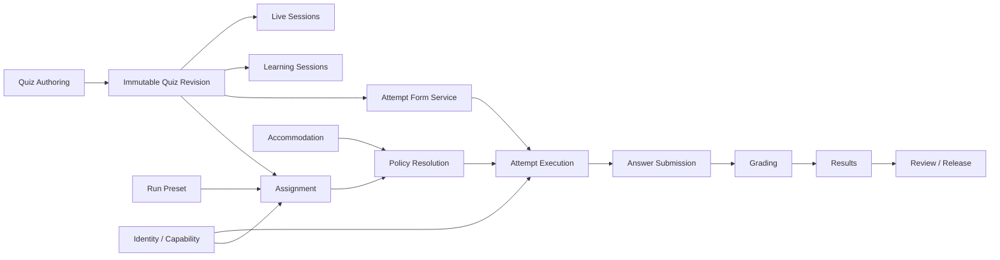
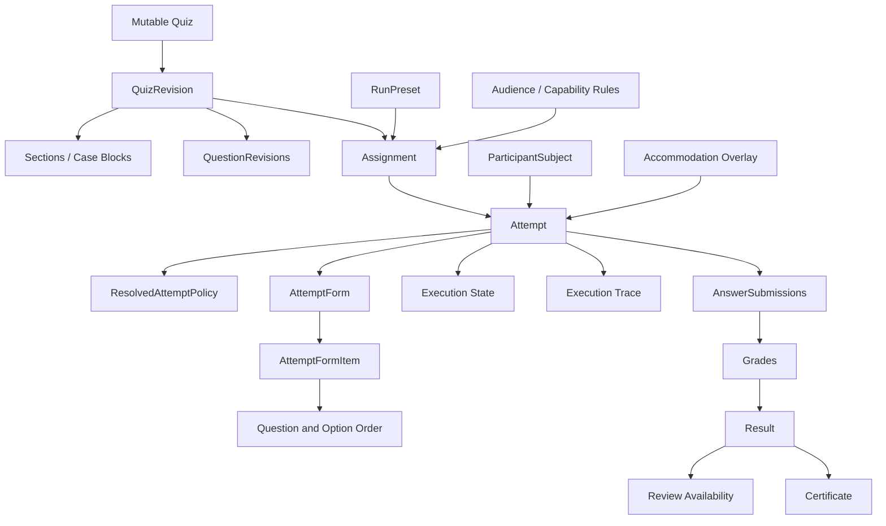

# Policy-Driven Quiz Execution Architecture

## Learning clean-start refinement

The owner confirms that no current quizzes/questions use repetitions. Plan new Learning without SM-2 import or mandatory legacy repetition adapters; ordinary quiz/API/training compatibility remains separate. The [approved clean-start contract](decision-register.md#learning-clean-start) supersedes earlier preservation/migration assumptions for the unused repetition subsystem. Verify the target-scope assumption before any later destructive cleanup; do not invent migration work or reset unexpected records.

## Status, Purpose, and Authority

This document is the architectural reference for evolving QuizMaker from its current practice and assessment implementation into a general-purpose learning and assessment platform.

It defines:

- the target product capabilities;
- the core domain concepts;
- architectural and security invariants;
- policy composition and resolution;
- ownership boundaries between features;
- compatibility and migration principles;
- extension points for future execution modes;
- the intended delivery sequence behind the [Quiz Execution tracker](https://github.com/Gegcuk/QuizMaker/issues/472).

This document is broader than any individual implementation issue. It explains how the individual issues fit together and what architectural assumptions future work must preserve.

It is not a commitment to implement every capability immediately. Each capability remains subject to product prioritisation, security review, data-retention decisions, operational constraints, and the acceptance criteria of its owning issue.

Apply the most recent explicit owner decision within its stated scope. The dated refinements in the [decision register](./decision-register.md) take precedence over older linked issue wording on that same point; otherwise a more specific approved issue clause governs. When a decision conflicts with an invariant or another still-applicable decision, resolve the conflict explicitly rather than silently interpreting it.

The [decision register](./decision-register.md) records the approved target decisions and their owning issues, synchronized with owner refinements through 22 October 2026. The [open questions](./open-questions.md) separate remaining choices and conflicting decisions from those already approved. Approval describes intended product behaviour; it is not evidence that a feature is implemented or publicly activated. Candidate strategies and future scenarios below are an extension catalogue, not permission to enable them.

Read [P1–P5 preparation evidence](./open-questions.md#preparation-evidence) for the verified current code, source issues, rate-limit distinctions, lifecycle gaps and bounded calculations. Proposed technical candidates and illustrative workloads there are not runtime defaults.

The [approved Q13–Q15 tag scope](./decision-register.md#quiz-certificate-batch-approved) keeps one author-provided display name initially and separate group-catalog management authority. Retirement hides a tag from new selection while preserving existing question bindings, including authorized drafts, immutable revisions and historical topic/report evidence. Existing published quizzes still work; no questions or attempts are deleted. A rename/merge is a different operation and does not authorize rewriting published revisions.

---

## Isolated Deployments and Operator Authority

The [22 October Q08 refinement](./decision-register.md#isolated-deployment-operator-boundary) requires an architectural foundation for on-premises and organization-dedicated virtual deployments with isolated organizational data and a local platform operator. Operator authority is deployment/trust-boundary scoped and still permission/resource checked; it is not inherently a central vendor account or an automatic privilege of every organization administrator.

Isolation must cover persistence, images/documents, queues/jobs, caches/projections, notification data, audit/logs/metrics, exports and backups. Configuration and project-owned external-system ports must support deployment-local identities, storage and services without mandatory transfer into a shared control plane or inherited central credentials. One tenant column or one separate database is not evidence that all these paths are isolated. Provisioning, keys/storage topology, bootstrap, backups and isolation tests remain engineering design; no infrastructure vendor or change to the existing shared-service topology is selected.

For example, a school-local operator may place an authorized hold on its examination evidence within its own deployment; that role grants no access to another installation or the shared SaaS environment.

---

## Product Vision

QuizMaker should support two equally important product families without maintaining two separate execution engines.

### Learning and self-improvement

A learner should be able to:

- practise an entire quiz;
- receive immediate feedback after each submitted answer;
- repeat only incorrectly answered questions;
- practise questions not seen before;
- keep a stable question order between sessions;
- receive a different random selection on every session;
- use hints and explanations;
- retry until correct where the policy allows it;
- rate confidence in an answer;
- review due material through spaced repetition;
- work towards topic mastery;
- resume an unfinished session;
- use flashcard or self-assessment workflows;
- complete ungraded reflective activities.

### Teaching and assessment

An author, teacher, or assignment manager should be able to:

- maintain a large reusable question bank;
- publish an immutable version of a quiz;
- create an assignment for a particular audience;
- distribute an authenticated or anonymous participant link;
- choose a fixed or random number of questions from a larger bank;
- require balanced selection across topics and difficulty levels;
- give every participant the same form or equivalent individual forms;
- set opening time, deadline, and attempt duration;
- configure total, section, or question-level timers;
- prevent backtracking or allow free navigation;
- limit the number of attempts;
- delay scores, correct answers, or explanations until a specified release point;
- manually grade free-text or file-based answers;
- view participant and cohort results;
- issue certificates where appropriate;
- provide participant-specific accommodations;
- investigate disputed attempts using reproducible evidence.

These workflows must reuse the same immutable content, policy-resolution, form, answer, grading, and review foundations.

---

## Representative Product Scenarios

The architecture must be capable of expressing the following scenarios without controller-specific mode branches.

### Scenario A: approved free-practice target

A learner opens their own quiz and chooses practice.

The system:

1. uses the current published revision;
2. selects all questions;
3. uses authored question and option order by default, with permitted option shuffling resolved and persisted before start;
4. allows free navigation;
5. accepts each submitted answer atomically and locks it immediately;
6. reveals correctness, question score, correct answer, and explanation only after that acceptance;
7. offers an authored hint before submission where the saved practice policy permits it;
8. restores the same form, order, accepted answers, and unanswered state after reconnect;
9. requires explicit final submission, allowing confirmed unanswered items without inventing accepted incorrect answers;
10. permits later practice through a separate attempt/session rather than editing the accepted answers.

This is the approved untimed, no-pause baseline in [#612 D01–D03/R01](https://github.com/Gegcuk/QuizMaker/issues/612) and [#687 D11–D13](https://github.com/Gegcuk/QuizMaker/issues/687). The [ONE_BY_ONE default and skip/return configuration](./decision-register.md#one-by-one-navigation) and [additional view/edit/pending-confirmation capabilities](./decision-register.md#answer-finalization-and-review) are also approved. Remaining finalization interactions and `TIMED` mapping details retain their activation gates; no unsupported capability becomes active implicitly.

### Scenario B: consistent learner practice

A learner wants to compare progress across repeated attempts.

The system:

- selects the same question set for that learner;
- uses a stable order derived from a versioned deterministic key;
- preserves the option order where configured;
- records each attempt separately;
- calculates progress without changing historical results.

### Scenario C: future timed randomized student assignment

A teacher has a bank of 120 questions and creates an assignment that:

- opens at 09:00 on 10 October;
- closes at 18:00 on 17 October;
- gives every student 45 minutes after first start;
- selects 30 questions;
- includes 10 questions from each of three topics;
- includes a defined balance of easy, medium, and difficult questions;
- gives every participant an individually randomized but equivalent form;
- allows one attempt;
- prevents returning to submitted questions;
- reveals no correctness or score during the attempt;
- automatically submits when time expires;
- releases the total score after the deadline;
- releases correct answers and explanations only after the teacher manually approves review.

The student accesses the assignment through an authenticated invitation or a capability-backed link. The participant cannot change any of these rules.

This broader capability example is not the approved initial formal fixture. The exact authenticated 40-item-bank/20-item-form, 30-minute, binary-scored fixture is owned by [#668 D38](https://github.com/Gegcuk/QuizMaker/issues/668); guest, stratified, manual-release, and other extensions require their own gates.

### Scenario D: future mixed automatic and manual grading

An assignment contains:

- multiple-choice questions;
- fill-gap questions;
- short free-text questions;
- one essay graded using a rubric.

The participant can submit before manual grading is complete.

The system represents:

```text
Execution: SUBMITTED
Answer submission: COMPLETE
Automatic grading: COMPLETE
Manual grading: PENDING
Result release: WAITING_FOR_GRADING
Review availability: HIDDEN
```

Submission, grading, result release, and review are therefore separate concepts.

Manual/rubric grading is deferred from v1 by [#675 R05](https://github.com/Gegcuk/QuizMaker/issues/675). This scenario describes the extension boundary, not the initial grading contract.

### Scenario E: branching scenario

A participant receives the next scenario node based on their previous decision. Future nodes are not preselected or visible.

Each selected edge and newly delivered node is persisted before delivery so that the participant path remains reproducible.

### Scenario F: live competition

A host opens a synchronized session. Participants receive rounds at the same server-controlled time.

Live coordination manages:

- lobby membership;
- teams;
- current round;
- answer windows;
- synchronized delivery;
- provisional scores;
- leaderboard publication.

The live feature reuses immutable content and scoring contracts but is not implemented as another `AttemptMode`.

---

## Architectural Objective

Support practice, assessments, assignments, review, manual grading, adaptive learning, branching scenarios, spaced repetition, surveys, and live sessions without creating a separate copy of the execution engine for each mode.

An execution mode is a reusable server-owned preset.

At attempt creation, the preset, published content, assignment configuration, participant context, accommodations, and only explicitly permitted overrides are resolved into one immutable versioned policy snapshot.

```text
Platform defaults
    + run preset
    + published quiz revision constraints
    + assignment or legacy share-link configuration
    + participant eligibility
    + authorized accommodation overlay
    + explicitly permitted start-time override
    = immutable ResolvedAttemptPolicy
```

The attempt executes its saved policy and saved form.

It must not reinterpret mutable quiz, link, template, accommodation, question-bank, or algorithm data after it starts.

---

## Fundamental Architectural Principles

### 1. Modes are presets, not runtime branches

`PRACTICE`, `ASSESSMENT`, `FLASHCARDS`, and similar names may be exposed as convenient product presets, but they must not become the primary runtime architecture.

Avoid:

```java
if (mode == PRACTICE) {
    ...
} else if (mode == ASSESSMENT) {
    ...
} else if (mode == LIVE) {
    ...
}
```

Prefer:

```text
Practice preset
    -> SelectionPolicy
    -> OrderingPolicy
    -> DeliveryPolicy
    -> NavigationPolicy
    -> SubmissionPolicy
    -> DisclosurePolicy
    -> TimingPolicy
    -> GradingPolicy
    -> ReviewPolicy
```

A new conventional mode should usually be expressible as another combination of existing policies.

### 2. Attempts execute immutable snapshots

After creation, an attempt never continuously reads mutable execution settings.

It executes:

- a specific immutable quiz revision;
- a versioned resolved policy;
- a persisted fixed or progressive form;
- stored answer and lifecycle state;
- versioned grading contracts.

### 3. The server owns every consequential decision

The server decides:

- who the participant is;
- whether they may start;
- which questions are selected;
- which question is currently available;
- which actions are allowed;
- whether time remains;
- whether an answer may change;
- how the answer is graded;
- which protected information may be released;
- whether review is available.

The client renders server state and requests actions. It does not authorize them.

### 4. Participant experience is persisted as evidence

A seed is useful but insufficient.

The system persists what the participant actually received:

- selected questions;
- section and case membership;
- question order;
- option order;
- progressive selections;
- branch transitions;
- applied accommodations;
- algorithm versions.

### 5. Submission, grading, release, and review are independent

Completing the participant interaction does not necessarily mean:

- every answer has been graded;
- the total score is final;
- results have been released;
- correct answers may be reviewed.

### 6. Fundamentally different runtimes use separate bounded contexts

Learning schedules, live orchestration, and potentially advanced analytics have different lifecycles from assessment attempts.

They may reuse shared immutable content and strategy interfaces, but they must not overload the ordinary attempt lifecycle.

---

## Starting Constraints

The repository contains an existing practice/assessment implementation and API contracts that remain authoritative until an explicit activation gate. The [22 October owner clarification](./decision-register.md#legacy-compatibility-and-retained-fallback) confirms that existing quizzes and a frontend that may lag behind backend changes must be supported. Exact production/attempt inventory still needs evidence; an empty or disposable environment must not be assumed.

Current constraints include:

- `Attempt` has a direct relationship to a mutable `Quiz`;
- `Answer` has a direct relationship to a mutable `Question`;
- execution uses a compact `AttemptMode` enum;
- current routes contain mode-specific or route-specific behaviour;
- existing request and response shapes are used by the frontend;
- existing historical attempts do not contain complete policy or form evidence;
- legacy anonymous access uses a sentinel user;
- share links currently act as capabilities but not immutable assignments;
- some request shapes contain disclosure-related flags;
- existing practice and assessment behaviour must continue during migration.

The target architecture is additive.

It introduces new policy-aware application services and persistence alongside the current implementation, then adapts existing routes through explicit compatibility adapters.

The [owner's preservation decision](./decision-register.md#legacy-compatibility-and-retained-fallback) retains the existing API, quizzes/user data and required legacy execution path, including its writers. It refines [#688 D10/D29](https://github.com/Gegcuk/QuizMaker/issues/688): a preproduction cleanup cannot remove that required path or treat existing retained data as disposable. Any eligible disposable-data cleanup still needs an environment check, backup evidence and exact owner-confirmed scope. Target attempts retain their evidence and execution binding. [Operator-controlled fallback](./decision-register.md#operator-controlled-legacy-fallback) is decided; the exact [coordination and readiness evidence](./open-questions.md#oq-cutover) still precede activation.

The migration must not:

- rewrite all controllers in one change;
- destructively reinterpret historical attempts;
- alter active attempts in place;
- silently infer historical policies that were never stored;
- remove legacy routes before their migration lifecycle is complete.

---

## Core Terms

| Term | Meaning | Primary owner |
| --- | --- | --- |
| Mutable Quiz | Authoring aggregate that authors may edit. | Quiz |
| Quiz Draft | Mutable unpublished authoring state. | Quiz |
| Quiz Revision | Immutable published content and response contracts. | Quiz Revision |
| Question Revision | Immutable version of one question and its grading contract. | Quiz Revision |
| Section | Ordered grouping with optional policy overrides and completion rules. | Quiz Revision |
| Case Block | Atomic collection of related questions sharing context. | Quiz Revision |
| Question Bank | Eligible immutable questions used by selection strategies. | Quiz Revision |
| Run Preset | Immutable versioned policy defaults; initially code-defined, later managed within an approved ownership scope. | Quiz/Assignment |
| Assignment | Published delivery configuration bound to one quiz revision and policy configuration. | Assignment |
| Legacy Share Link | Existing capability-backed access path preserved through an adapter. | Sharing |
| Resolved Attempt Policy | Versioned rules applied to one attempt. | Attempt |
| Participant Subject | Server-resolved participant identity abstraction. | Attempt/Identity |
| Attempt | One participant execution governed by one policy and form. | Attempt |
| Attempt Form | Exact fixed or progressively constructed participant-visible content. | Attempt |
| Form Item | Immutable question occurrence within an attempt form. | Attempt |
| Answer Draft | Mutable, unsubmitted participant work where policy permits it. | Answer Submission |
| Provisional Response | Saved participant response that remains editable until the policy's finalization boundary; distinct from final accepted evidence. | Answer Submission |
| Pending Confirmation | Explicit intent to defer confirmation, optionally retaining a proposed response; still unanswered if the attempt completes without confirmation. | Answer Submission |
| Answer Submission | Accepted answer aligned to a form item and response contract. | Answer Submission |
| Grade | Automatic or manual evaluation of a submitted answer. | Grading |
| Result | Aggregated assessment outcome derived from eligible grades. | Results |
| Review | Participant-visible post-submission content controlled by release policy. | Review |
| Execution Trace | Append-only protected evidence of decisions and accepted commands. | Attempt |
| Learning Session | Non-assessment practice and scheduling lifecycle. | Learning |
| Live Session | Multi-participant synchronized orchestration. | Live |

---

## Bounded Contexts and Ownership



### Quiz and Quiz Revision

Own:

- mutable authoring;
- publication;
- immutable question content;
- immutable response and grading contracts;
- sections;
- case blocks;
- authored order;
- question metadata;
- shuffle constraints;
- rubric definitions.

Do not own:

- participant progress;
- attempt policy snapshots;
- answers;
- assignment eligibility;
- result release.

### Assignment

Own:

- revision binding;
- policy or preset binding;
- audience and eligibility;
- availability window;
- participant limits;
- assignment publication and revocation;
- assignment-level reporting configuration.

Do not own:

- active attempt state;
- answer submissions;
- grades;
- participant review representation.

### Attempt Execution

Own:

- resolved policy snapshot;
- participant subject;
- attempt form;
- current execution state;
- allowed-action calculation;
- navigation;
- timing checkpoints;
- command idempotency;
- execution trace references.

### Answer Submission

Own:

- drafts;
- submitted response values;
- answer state;
- answer locking;
- response-contract validation;
- answer command concurrency.

### Grading

Own:

- automatic grade decisions;
- manual grading queue;
- rubric decisions;
- grading state;
- grading algorithm version;
- score correction or supersession records where supported.

### Results and Review

Own:

- result aggregation;
- pass/fail evaluation;
- result selection across attempts;
- release decisions;
- review windows;
- participant-visible review content;
- certificates;
- leaderboard projections where applicable.

### Learning

Own:

- due state;
- mistake-review selection;
- mastery state;
- scheduling strategy;
- learning-session outcomes.

Learning progress must not be stored as assessment result data.

### Live

Own:

- lobby;
- participants;
- teams;
- rounds;
- synchronized question windows;
- connection and reconnection state;
- provisional scoring;
- leaderboard timing.

---

## Domain Model



---

## Policy Resolution and Precedence

### Authorized launch context

The [access-aware launch decision](./decision-register.md#access-aware-start) distinguishes ordinary launches from assignment participation. An ordinary launch offers a choice among policies authorized for the participant and quiz. Full rights over the particular quiz give an untimed training default with immediate feedback after immutable answer acceptance; take-only access is limited to the policies provided by the quiz creator, including their timing and disclosure restrictions.

The [22 October full-rights criterion](./decision-register.md#full-rights-practice-authority) includes the quiz owner and users authorized to fully edit that quiz's questions and correct answers. Qualifying editors need no separate free-practice grant. Determine effective ownership/content-editing authority on the server for the authenticated subject and specific quiz, with applicable resource, organization and membership checks. Taking/viewing a quiz, editing only metadata or a subset of questions, rights over another quiz, and a teacher/moderator/administrator role name alone do not establish this entitlement. Administrative or delegated authority qualifies when its actual permissions satisfy the criterion. A take-only participant may still use a practice policy explicitly authorized by the creator.

An assignment launch strictly uses that assignment's policy, including for a participant with full rights over the quiz. An ordinary-launch policy cannot replace it, and a separate practice attempt does not complete the assignment. Approved policy composition, such as an authorized accommodation, still occurs within that assignment context.

The server resolves resource-specific authority and the authorized launch context before composing the effective policy. A client mode cannot grant the training path, substitute the assignment policy or remove creator-policy restrictions. The owner/full-content-editor eligibility criterion is decided; mapping it to existing permission/resource checks remains engineering preparation and grants no new role permissions. Compatibility-request context/policy references, remaining mode compatibility and selection/unavailable-policy error contracts remain [open details](./open-questions.md#oq-r01).

The [22 October ambiguous-start decision](./decision-register.md#ambiguous-ordinary-policy-selection) requires an explicit policy choice before creating an ordinary attempt when several policies are authorized and the choice is ambiguous. Offer only participant-safe information about authorized alternatives. Pending selection creates no attempt, placeholder, form or attempt-bound policy snapshot, starts no timer, consumes no attempt allowance and emits no `AttemptStarted` evidence. Do not silently select the first or least restrictive policy. Revalidate the chosen policy and authority at the subsequent start boundary. The existing owner/full-editor practice default, strict assignment binding and unambiguous legacy mappings remain intact; ambiguous legacy starts require client choice support before activation. This decision does not choose an HTTP status or a new single-policy confirmation rule.

The separate [22 October legacy TIMED decision](./decision-register.md#legacy-timed-with-disabled-timer) preserves an untimed new start through the old API when the quiz timer is explicitly disabled and an authorized untimed policy is unambiguously resolved. The legacy enum does not create a duration or practice authority; preserve other legacy behavior and response contracts while capturing the effective policy. A stored duration for the disabled timer does not activate it. Ambiguity still requires a choice, and required assignment/policy timing cannot be removed by the legacy quiz flag. Enabled but invalid timing stays subject to validation before attempt creation; no invented duration or untimed fallback is authorized. Existing attempts retain their captured timers and historical evidence.

Once created, an attempt keeps its captured policy and timer. Quiz edits do not turn that attempt into untimed practice; pause follows the saved policy, and a permitted untimed run is a different attempt. A full-rights user explicitly entering a policy-bound self-test follows that selected policy for the whole attempt.

### Composition within the authorized context

Policy composition must use deterministic precedence.

A recommended order is:

1. platform safety defaults;
2. preset defaults;
3. quiz-revision structural constraints;
4. assignment configuration;
5. audience or cohort restrictions;
6. participant accommodation overlay;
7. explicitly permitted start-time overrides;
8. server-computed derived fields.

Later inputs may override earlier inputs only where the schema explicitly allows them.

For example:

- an assignment may disable pause even if the preset allows it;
- an accommodation may add time where its approval allows it;
- a participant may choose a permitted question count for personal practice;
- a participant may not disable an assignment deadline;
- an option ordering policy may not override a question-level `shuffleAllowed = false`.

Policy resolution must return both:

- the final immutable `ResolvedAttemptPolicy`;
- provenance explaining which source contributed each material override.

Example:

```text
timing.totalDuration = PT45M
    source: Assignment version 3

timing.extraDuration = PT15M
    source: Accommodation code EXTRA_TIME_33

timing.effectiveDuration = PT60M
    source: Derived policy value
```

Detailed accommodation rationale remains outside the attempt snapshot. Only the minimum approved code, version, and effective changes belong in the snapshot.

---

## Resolved Attempt Policy

The complete target model is composed from typed, versioned sub-policies.

```text
ResolvedAttemptPolicy
├── content
├── questionSelection
├── questionOrdering
├── answerOrdering
├── delivery
├── navigation
├── submission
├── answerChange
├── disclosure
├── hints
├── timing
├── pause
├── attempts
├── access
├── grading
├── review
├── results
├── accessibility
└── integrity
```

The approved v1 schema includes all of these typed dimensions. Unimplemented capabilities have explicit disabled/not-configured values and cannot be activated by arbitrary data. Only the code-defined `FREE_PRACTICE/v1` preset is initially supported; other capabilities require their own conformance gates. This is the broad-schema choice in [#612 A01/A02/D06](https://github.com/Gegcuk/QuizMaker/issues/612), not permission to omit dimensions or build a generic extension bag.

### Implemented policy vocabulary foundation (#515)

`features/attempt/domain/model/policy/ResolvedAttemptPolicy` is an immutable, transport-neutral
Java value with all 19 dimensions. Its constructor accepts the initial authenticated, flat,
untimed practice contract and rejects unsupported versions, missing values and unsupported
combinations. It has no Spring, JPA, Jackson, preset-name or `AttemptMode` dependency.
No existing endpoint or attempt writer consumes it yet.

The value follows #612 A01/A02, D01–D03, D07 and R01, A22 binary grading, and the subsequent
practice-retention, server-authorization and [policy-controlled completeness](./decision-register.md#voluntary-completion-requirement)
refinements. Every sub-policy is mandatory:
omitting a dimension is not equivalent to disabling it. Nullable configuration/default
inference and arbitrary extension maps are not supported.

| Dimension | Initial value contract |
|---|---|
| `content` | Exact quiz revision UUID and revision schema `1`; `PRECOMPUTED`, `IMPLICIT_FLAT`, cases `NOT_CONFIGURED`. The UUID is a reference, not proof of existence or access. |
| `questionSelection` | `ALL`, algorithm version `1`. |
| `questionOrdering` | `AUTHORED`, algorithm version `1`. |
| `answerOrdering` | `AUTHORED` or the approved `SHUFFLED_PER_ATTEMPT` choice, algorithm version `1`. This is vocabulary, not an ordering implementation. |
| `delivery` | `ALL_AT_ONCE`. |
| `navigation` | `FREE`; membership and answer immutability still apply. |
| `submission` | Drafts/autosave disabled; policy-controlled require-all accepts both `false` and `true`, with `false` the future preset default in #516. Completion confirmation remains required, with single and atomic batch acceptance, identical replay/changed conflict, payload-free terminal submit, and no credit for unanswered items without fabricating accepted incorrect answers. |
| `answerChange` | `LOCK_ON_ACCEPTANCE`. The known `EDIT_UNTIL_FINALIZATION` value is rejected by the aggregate; it does not activate the separately owned editable-answer capability. |
| `disclosure` | Correctness, question score, correct answer and explanation `AFTER_ACCEPTANCE`; total score `AFTER_COMPLETION`; rubric, grader comments and cohort statistics explicitly `NEVER`. |
| `hints` | Authored hints `ON_REQUEST`, or `DISABLED` for the permitted participant choice; no generated hint or retry mechanism. |
| `timing` | `NONE`; no invented duration, deadline or grace default. |
| `pause` | `DISABLED`. |
| `attempts` | `UNLIMITED`; this is not exemption from authorization or existing request-rate limits. |
| `access` | `AUTHENTICATED` with `SERVER_REVALIDATED_AT_START_AND_READ`; the value grants no identity, permission, ownership or visibility. |
| `grading` | `BINARY`, exact points with integer basis points. Score calculation and rounding remain owned by #603 and exact question contracts. |
| `review` | `AFTER_COMPLETION`, all four categories: submitted answers, correctness, correct answers and explanations; while the account/result is retained and current access permits it. |
| `results` | Running progress enabled; explicit pass threshold in integer basis points, inclusive range `0–10000`. D02's default `7000` is a named constant for the future preset owner, not a missing-value fallback. Result selection is `NOT_CONFIGURED`; leaderboard and certificates are `DISABLED`. |
| `accessibility` | Accommodations `NOT_CONFIGURED`; this does not disable ordinary accessible presentation. |
| `integrity` | Exact persisted identities/order, immutable engine binding, rejection of unknown versions. This describes required evidence; construction does not persist or verify it. |

`submission.requireAllAnswers` retains the supplied value without substituting a default.
Both values are supported with the same flat, untimed, immediate-lock configuration;
they do not depend on editable answers, timers or sections. The approved default `false`
belongs to the preset owner #516, not to value validation. #529 owns the actual completeness
check: with eight accepted answers out of ten, OFF permits confirmed completion, while ON
denies incomplete voluntary submission and preserves the answers and nonterminal state.
This foundation represents that choice only; terminal-command writes and their atomicity
must be proved by #529.

Disclosure rules must contain each closed category exactly once. Review categories must be
unique and complete for the supported aggregate. Both collections are defensively copied
and normalized into vocabulary order, making equivalent permutations equal. Their maximum
cardinality is the number of declared categories, not a new numerical product quota.
This normalization defines value equality only; it is not canonical JSON or a hashing format.

`parseValue` accepts exact declared symbolic names without aliases, ordinal conversion,
case folding or whitespace trimming. Unknown names fail with `UNKNOWN_VALUE`. Version
checks distinguish policy schema, content schema and strategy versions. Other bounded
`PolicyValidationException` reasons distinguish missing/invalid values, contradictory
combinations, unsupported combinations and deferred capabilities. Messages contain only
the fixed reason and never echo input. These are internal failures; no new HTTP status,
`ProblemDetail` mapping or public schema is introduced.

For example, locking an accepted answer and then disclosing its correctness is a valid
practice value. Asking to keep that answer editable while revealing its key fails with
`INVALID_COMBINATION`. Withholding feedback does not enable editing: that capability still
fails with `UNSUPPORTED_CAPABILITY`. A failed construction has no persistence side effects.

Pure JUnit vectors exercise the approved tuple, permitted hint/option choices, basis-point
boundaries, all required references, category completeness/duplicates, deterministic
permutations, immutable copies and safe failures. A compiled-class dependency check guards
the pure boundary. These tests prove the value contract, not authorization, answer writes,
algorithm execution, scoring, release, retries or a complete attempt.

Integration ownership remains separate: #516 supplies presets and legacy mappings; #517
resolves precedence/provenance and canonical bytes/hashes; #518 persists snapshots; #520,
#521 and #544 supply actual ordering/selection. Exact question response/scoring bindings
remain revision-owned under #597/#598 and are resolved through their existing boundary,
not copied into a competing policy authority. Consumers must check content, permissions,
question-level constraints and actual algorithm availability before writing. The dark
start is #600 and public activation is #609. Approved formal, timed, section, editable,
guest, Learning and other capabilities require their own typed extensions and conformance;
they cannot be enabled by supplying arbitrary policy data.

### Content policy

Defines:

- quiz revision;
- eligible sections;
- eligible question bank;
- case-block treatment;
- whether the form is fixed or progressive;
- response-contract versions.

### Question selection policy

Candidate strategies:

```text
ALL
MANUAL_SET
RANDOM_COUNT
RANDOM_PERCENTAGE
STRATIFIED
WEIGHTED_RANDOM
UNSEEN_ONLY
INCORRECT_ONLY
LOW_CONFIDENCE_ONLY
DUE_FOR_REVIEW
ADAPTIVE
```

### Question ordering policy

Candidate strategies:

```text
AUTHORED
SHUFFLED_PER_ATTEMPT
STABLE_PER_USER
STABLE_PER_ASSIGNMENT
STABLE_PER_SHARE_LINK
STABLE_PER_COHORT
SEEDED
DIFFICULTY_ASC
DIFFICULTY_DESC
TOPIC_GROUPED
TOPIC_INTERLEAVED
ADAPTIVE
```

### Answer ordering policy

Candidate strategies:

```text
AUTHORED
SHUFFLED_PER_ATTEMPT
STABLE_PER_USER
STABLE_PER_ASSIGNMENT
STABLE_PER_COHORT
SEEDED
```

Question-level constraints override general shuffling where necessary.

### Delivery policy

Candidate modes:

```text
ALL_AT_ONCE
SECTION_AT_ONCE
ONE_AT_A_TIME
PREFETCH_NEXT
PROGRESSIVE
```

### Navigation policy

The [approved ONE_BY_ONE decision](./decision-register.md#one-by-one-navigation) preserves the legacy answer-before-next, no-skip default and also requires an authorized configuration that allows skipping and returning to unanswered questions. One-at-a-time delivery does not itself select either navigation behavior. Resolve the configuration before start and preserve it in the attempt policy; ordinary choice and assignment binding follow the authorized launch context.

Candidate modes:

```text
FREE
SEQUENTIAL
SEQUENTIAL_WITH_BACKTRACK
SECTION_LOCKED
BRANCHING
```

### Submission policy

Defines:

- draft availability;
- autosave support;
- answer requirement;
- skip behaviour;
- single or batch submission;
- answer locking;
- idempotency;
- completion confirmation;
- automatic submission.

### Disclosure policy

Defines independent rules for:

- correctness;
- per-question score;
- total score;
- correct answer;
- explanation;
- hints;
- rubric;
- grader comments;
- participant answers;
- cohort statistics.

### Timing policy

Defines:

```text
NONE
TOTAL_ATTEMPT
PER_SECTION
PER_QUESTION
COMBINED
```

It also defines availability, deadline, grace periods, and expiry behaviour.

### Pause policy

Candidate values:

```text
DISABLED
IMMEDIATE
AFTER_CURRENT_SUBMISSION
BETWEEN_SECTIONS
LIMITED_COUNT
LIMITED_DURATION
MODERATOR_ONLY
```

### Attempt policy

Defines:

```text
UNLIMITED
FIXED_COUNT
ONE_PER_PERIOD
ONE_PER_REVISION
MANUAL_RESET
```

It also defines cooldown, retake selection, and result-selection rules.

### Grading policy

Candidate strategies:

```text
BINARY
PARTIAL_CREDIT
NEGATIVE_MARKING
WEIGHTED
MANUAL
RUBRIC
CONFIDENCE_WEIGHTED
MASTERY
UNGRADED
```

### Review policy

Defines:

- review eligibility;
- release timing;
- review duration;
- content visible in review;
- revocation behaviour;
- whether only incorrect answers are shown.

### Result policy

Defines:

- participant visibility;
- author visibility;
- assignment reporting;
- pass thresholds;
- section thresholds;
- best/latest result selection;
- leaderboard behaviour;
- certificate eligibility.

---

## Typed Policies, Not a Generic Rules Engine

Policies are typed Java records or value objects.

For example:

```java
public record TimingPolicy(
        TimingMode mode,
        Duration totalDuration,
        Map<SectionId, Duration> sectionDurations,
        Duration defaultQuestionDuration,
        Instant opensAt,
        Instant deadline,
        Duration gracePeriod,
        ExpiryAction expiryAction
) {}
```

Canonical JSON acts as:

- a persistence boundary;
- a hashing boundary;
- a compatibility boundary;
- an operational inspection format.

It must not become an arbitrary expression language or generic runtime workflow engine.

Algorithmic behaviour belongs behind narrow interfaces:

```java
interface QuestionSelectionStrategy {
    SelectionResult select(SelectionContext context);
}

interface QuestionOrderingStrategy {
    OrderedQuestions order(OrderingContext context);
}

interface AnswerOrderingStrategy {
    OrderedOptions order(AnswerOrderingContext context);
}

interface GradingStrategy {
    GradeDecision grade(GradingContext context);
}

interface ReviewReleaseStrategy {
    ReviewDecision evaluate(ReviewContext context);
}
```

Each implementation must have a stable version identifier.

---

## Policy Validation

A central validator must reject unsupported or dangerous combinations before an attempt exists.

Examples:

```text
ALL_AT_ONCE
+ future questions hidden
= invalid
```

```text
ADAPTIVE selection
+ fully precomputed fixed form
= invalid unless the adaptive policy explicitly precomputes
```

```text
MANUAL grading
+ immediate final score release
= invalid
```

```text
correct answer released after submission
+ scored answer editable after submission
= invalid answer oracle
```

```text
timed protected assessment
+ unlimited participant-controlled pause
= invalid or explicit high-risk override
```

```text
branching navigation
+ client-selected next question
= invalid
```

The validator should distinguish:

- structurally invalid policy;
- unsupported combination;
- unauthorized override;
- insufficient content;
- incompatible revision structure;
- unavailable algorithm version.

Failures return stable RFC 7807 responses and create no partial attempt.

---

### Built-in practice preset and legacy mapping (#516)

`AttemptPresetService` exposes one code-defined `FREE_PRACTICE/v1` through
`AttemptPresetServiceImpl`. `BuiltInPracticePreset` supplies the complete typed #515 tuple
for explicit immutable `ContentPolicy` revision metadata. It reads no mutable quiz configuration.
This is an internal foundation: no controller or existing attempt writer consumes it.

The frozen defaults follow #612 A01/A02, D01–D03, D06 and R01: `ALL` selection, authored
question/option order, `ALL_AT_ONCE` delivery, `FREE` navigation, untimed/no pause, authored
hints on request, immutable accepted responses and immediate per-item feedback after acceptance.
Final total and complete review follow completion. `requireAllAnswers=false`, completion
confirmation is required and the pass threshold is `7000` integer basis points. Other typed
disabled/not-configured dimensions retain the #515 values. Later participant choices and
authorized overrides are resolver work; they do not mutate this preset version.

`LegacyPracticeRequest` mapping version `1` accepts exact legacy mode names and trusted
server-prepared launch facts. It only describes a **new** launch. The caller must establish
identity, resource/organization/membership/visibility access, full question-and-answer editing
authority and authorized policy versions; role labels and client-supplied identifiers cannot
supply those facts. `AuthorizedPresetPolicy` references an unmodified preset policy version,
not a managed or overridden policy disguised as a built-in default.

| Input | Internal outcome |
|---|---|
| Unauthenticated or missing/ambiguous resource authority | `Unavailable`; no owner/default elevation. |
| Ordinary owner/full-content-editor without an explicit selection | The established built-in default; no additional practice grant or ambiguity from other alternatives. |
| Take-only with zero / one / multiple authorized alternatives | `Unavailable` / mapped supported preset / `ChoiceRequired`. No first-item selection or filtering away unsupported alternatives. |
| Explicit policy version selection | It must occur in the captured authorized alternatives, even for an owner. Unknown preset/version is unsupported; no built-in fallback. |
| Assignment, including an owner/full editor | `LegacyOnly(ASSIGNMENT_REQUIRES_BOUND_POLICY)`; this mapper supplies no replacement assignment policy. |
| `ALL_AT_ONCE` with unambiguous compatible authorization | Mapped preset reference plus selected authorized policy-version identity; that identity is absent for the full-rights default. The quiz timer flag does not make this mode timed. |
| `TIMED` with an explicitly disabled quiz timer and an unambiguous authorized untimed preset/default | Mapped untimed preset. An inactive stored duration does not participate. |
| `TIMED` with enabled / unknown quiz timing | Explicit `LegacyOnly` / `Unavailable`; no dropped timer or invented duration. |
| `ONE_BY_ONE` | Explicit `LegacyOnly`; never silently changed to all-at-once delivery. |
| Unknown mapping version, mode or selected preset/version | Explicit `Unsupported`; exact symbols/versions only. |

Assignment classification takes precedence over ordinary preset mapping. Within an ordinary
launch, the authorized preset reference/version is checked before delivery/timing limitations:
an unsupported version returns `Unsupported(UNSUPPORTED_PRESET)` even for `ONE_BY_ONE` or
`TIMED` with enabled/unknown quiz timing. A supported v1 keeps the mode outcomes listed above.

All outcomes are classifications, not authority to route to a retained engine. In particular,
`LegacyOnly` requires separate current eligibility checks before any future routing. No mapping
outcome starts an attempt, creates a form/snapshot, consumes an allowance, starts a clock or
releases feedback. Input and choice collections are defensively copied, duplicate policy-version
identities are rejected, and failure messages contain fixed reasons rather than input content.
Existing attempts and historical engine/policy evidence are never reinterpreted.

For example, an old client requesting `TIMED` with the quiz timer off and one authorized
`FREE_PRACTICE/v1` policy receives a compatible resolver input. Two ambiguous alternatives
produce a choice requirement. Required assignment timing remains outside this mapper and cannot
be removed by the disabled quiz flag. These are unit-level mapping outcomes, not HTTP-start proof.

The complete golden tuple and a fixed SHA-256 of a small, explicitly sorted **test-only** JSON
fixture guard version stability and serialization reconstruction. They define no production
canonical format/hash and never read document content. Additional tests cover mapping/version
boundaries, immutable captures, denied/ambiguous inputs and the absence of runtime wiring or
repository/provider/clock dependencies. No JPA read/write path is added, so N+1 does not apply.

Integration ownership remains #517 precedence/canonical bytes/hashes, #518 snapshot persistence,
#600 actual dark start, #833 public choice and current-access revalidation, #609 activation and
#668 formal/timed conformance. HTTP/API summary/OpenAPI contracts, current security rules,
legacy success/error responses, database schema, retry policy and frontend behavior are unchanged.

### Canonical practice-policy resolution (#517)

`AttemptPolicyResolver` is a dark internal application interface. It consumes trusted server facts
for an already selected ordinary `FREE_PRACTICE/v1` policy and returns an immutable
`PolicyResolution`. The implementation does not load identity, grants, revisions, assignments,
documents or accommodations, create attempts, persist snapshots, or activate an execution route.
The caller must establish current resource authority and revision existence and revalidate at
actual start. Prepared grant facts in unit tests are not integration proof of authorization.

The supported precedence is:

1. Fixed platform-safety invariants and the exact code-defined preset defaults.
2. Explicit immutable content metadata: quiz revision ID, revision schema and flat structure.
3. Authorized author choices within the supported typed allow-list.
4. Authorized participant choices within the exact values permitted by the preset/author.
5. Aggregate validation through the existing `ResolvedAttemptPolicy` constructor.

Only answer-option order (`AUTHORED`/`SHUFFLED_PER_ATTEMPT`) and authored hints
(`ON_REQUEST`/`DISABLED`) are override inputs in this increment, following A03/A04/R01. Each source
carries explicit allowed-value sets resolved by the server; an empty set grants no change.
For example, an author may disable hints and permit the participant only `DISABLED`; an attempted
`ON_REQUEST` choice then fails instead of silently restoring the preset default. Where both values
are explicitly permitted, a participant choice wins over the author choice. An explicitly selected
value receives that source even when it equals the preset default. Missing choices retain the
previous source/value. Input list/set iteration order never establishes precedence.

Identity, access, scoring, pass thresholds, submission/retry semantics, release, versions and
integrity have no generic override channel. The content metadata retains #597's typed structural
constraints. Per-question shuffle restrictions and exact option order remain #521's responsibility:
a global shuffled strategy does not authorize shuffling a protected question. Question-count,
question-order, managed-preset, assignment and accommodation extensions retain their own owners;
their unsupported values are not enabled by this resolver. No derived timing/arithmetic rule is
introduced for the untimed baseline.

Resolver, canonical format and source versions are exactly `1`; the hash algorithm is exactly
`SHA-256`. Unknown versions/algorithms, duplicate sources, duplicate settings and disallowed values
fail explicitly without a partial result or permissive fallback. Existing preset/version errors
retain their typed non-sensitive failures. Collections are defensively copied. The service has no
clock/random/provider/persistence dependency, so independent instances and concurrent invocations
produce the same result from the same facts.

Canonical format v1 is project-owned compact UTF-8 JSON, **not RFC 8785**. Its envelope contains
`resolverVersion`, `canonicalVersion`, `hashAlgorithm`, `preset`, `policy` and `provenance`.
Properties and map keys are sorted alphabetically, enum names are symbolic, UUIDs are lowercase,
and integers/booleans retain their JSON scalar types. Policy constructors normalize category
arrays; semantically ordered arrays are never generically sorted. The codec owns an isolated
mapper, independent of application JSON configuration. A material representation change requires
a new supported format/version and explicit golden evidence.

Provenance has one entry per effective-policy scalar leaf, using dotted paths and `[index]` array
positions. Each entry contains a closed source name and version. Content leaves originate from
`REVISION`; `schemaVersion` and integrity leaves from `PLATFORM_SAFETY`; remaining unchanged leaves
from `PRESET`; supplied choices from `AUTHOR` or `PARTICIPANT`. The lowercase hexadecimal hash
covers the complete envelope, including provenance. Equal values selected from different actual
sources can therefore have different hashes. The hash identifies resolution evidence; it is not
an authorization token, command identity or replacement for the captured policy. Only the bounded
policy structure is encoded/hashed; no document bytes or source text are read.

Independent frozen fixtures in `attempt-policy-resolution/` cover the baseline and a composition.
Tests cover every leaf's source, explicit equal-value choices, source/property/collection
permutations, semantic changes, forbidden choices with successful controls, unknown versions,
duplicate inputs, defensive copies, concurrent calls and reconstruction with a separate codec.
These are pure component/contract proofs, not database restart or actual-start integration.
No JPA read/write path changes, so N+1 is inapplicable.

Metrics `attempt.policy.resolutions` and `attempt.policy.resolution.sources` use only bounded
outcome/reason/source/version labels; they carry no policy values, IDs or sensitive rationale.
Telemetry failure cannot change a result or replace its original rejection. No new alert threshold
is selected for this dark component. #518 owns persisted snapshot verification, #600 actual start,
#666 any authorized preview and #609 activation. Existing HTTP/OpenAPI/security contracts and
legacy routes remain unchanged.

### Immutable resolved-policy snapshot storage (#518)

`PolicySnapshotService` is an internal application interface for already authorized server callers.
It stores #517's exact canonical UTF-8 representation, including effective values, preset reference
and per-leaf provenance, with a stable server-supplied snapshot UUID. `attempt_policy_snapshot`
also stores the snapshot/resolver/canonical versions, algorithm/hash and immutable quiz-revision
reference. The UUID is the replay identity; a hash alone is neither identity nor authorization.
Equal policies under different snapshot UUIDs are separate evidence, not globally deduplicated.

`createOrReplay` verifies the incoming evidence before writing. Its unique root key serializes
concurrent identical and conflicting requests, and no existing payload is overwritten. A current
locking read uses `FOR UPDATE OF s` to lock only the snapshot while retaining the revision-owner
scope check. Independent snapshot IDs referencing one revision do not upgrade their shared FK
locks on that revision. The read verifies the winner: exact replay returns the same evidence;
different evidence under that ID is a typed conflict. Both JDBC and JPA callers can include the
write in their transaction; a later outer rollback cancels a new snapshot. Ordinary reads retain
the caller's isolation semantics. In an older `REPEATABLE_READ` snapshot, use the returned replay
value rather than expecting an ordinary read to see another transaction's commit.

The trusted `revisionOwnerId` scope is resolved by the server and checked against the immutable
revision. It is not the current participant ID and grants no quiz/assignment/participant authority.
The actual caller must enforce those checks at its own boundary. Missing and foreign target IDs
share `SNAPSHOT_UNAVAILABLE`. `PolicySnapshotReference.Legacy.NO_SNAPSHOT` explicitly returns
legacy/no-snapshot without resolving settings or writing anything. A missing required target
snapshot is never automatically classified as legacy. Existing attempts receive no backfill or
new engine binding; #600 owns atomic start and #609 owns public activation.

Every stored read checks the exact supported versions/algorithm, revision binding, complete
structurally valid provenance, strict named JSON fields/types, exact canonical bytes and SHA-256.
Unknown versions, corrupt hashes, duplicate/unknown/missing JSON fields, coercion, trailing data,
changed canonical representation and impossible provenance fail closed. Verification never calls
the current preset service, re-resolves current grants/settings, or reads/hashes document bytes.
Hash verification detects corruption; it is not protection against an administrator replacing
both a payload and its digest. Application immutability comes from the write-only-once port and
the insert/no-op/compare transaction. There is no update/delete operation in that port.

V87 is additive, preserves the exact JSON string using text storage, validates version/hash/JSON
shape, indexes the immutable revision and restricts deletion of a referenced revision. There is
no FK to the legacy attempts table. Before any target writes, application rollback can leave this
empty table in place. After target writes, preserve retained evidence and use a forward fix rather
than dropping/rebuilding snapshots. Future erasure/lifecycle work retains its own decision gates.

`attempt.policy.snapshots` uses closed operation/outcome/version labels without payloads, hashes,
IDs or provenance values. `verified` means the service verified and returned evidence; it does not
claim that an enclosing transaction has committed. Telemetry failure cannot change the operation.
Database/JSON failures cross the service boundary as content-free typed errors without raw causes.

Focused tests use real MySQL transactions for migration, identical/different concurrent writes,
rollback after actual INSERT, commit acknowledgement loss/reconciliation, recreated-service reads,
JPA transaction participation, corruption and scoped isolation. Frozen #517 fixtures verify byte
compatibility independently of the resolver. Each single-snapshot read uses one joined metadata
query across a multi-revision fixture; no JPA relationship-loading path is introduced. These tests
prove the store, not an activated participant start, assignment, accommodation or offline package.

## Example Policy: Approved Free-Practice Baseline

This is a conceptual excerpt of the approved target in [#612](https://github.com/Gegcuk/QuizMaker/issues/612) and [#687](https://github.com/Gegcuk/QuizMaker/issues/687), not a complete serialized DTO or a claim of runtime availability. The complete typed schema also represents disabled/not-configured dimensions explicitly.

This is the default training context for a full-rights user. A take-only participant receives these settings only when the creator's applicable authorized policy supplies them; this example is not a universal participant fallback.

```yaml
schemaVersion: 1
preset: FREE_PRACTICE/v1

content:
  revisionId: quiz-revision-42
  formMode: PRECOMPUTED

questionSelection:
  strategy: ALL

questionOrdering:
  strategy: AUTHORED

answerOrdering:
  strategy: AUTHORED

navigation:
  mode: FREE

delivery:
  mode: ALL_AT_ONCE

submission:
  completionConfirmationRequired: true

answerChange:
  allowedUntil: NEVER_AFTER_SUBMISSION

disclosure:
  hint: ON_REQUEST
  correctness: AFTER_EACH_SUBMISSION
  questionScore: AFTER_EACH_SUBMISSION
  correctAnswer: AFTER_EACH_SUBMISSION
  explanation: AFTER_EACH_SUBMISSION
  totalScore: AFTER_ATTEMPT

timing:
  mode: NONE

pause:
  mode: DISABLED

grading:
  strategy: BINARY

review:
  availability: AFTER_ATTEMPT
  content:
    - SUBMITTED_ANSWERS
    - CORRECTNESS
    - CORRECT_ANSWERS
    - EXPLANATIONS
```

An accepted answer is locked before protected feedback becomes available. There are no within-attempt answer retries. Before start, permitted option shuffling is computed by the server and its exact stable-ID order is persisted; clients never reshuffle an active form. Final submit carries no answer payload. Confirmed unanswered items receive no credit without becoming accepted incorrect answers. The [initial personal-practice retention decision](./decision-register.md#initial-practice-history-retention) keeps detail and result evidence without age-based cleanup until retention is explicitly revisited. The separate [account-deletion decision](./decision-register.md#account-deletion-history-scope) deletes the user's personal training history while preserving non-training history from that operation; other record classes remain separately scoped.

---

## Example Policy: Approved Formal Conformance Fixture

[#668 D38](https://github.com/Gegcuk/QuizMaker/issues/668) defines this exact target fixture. It is a conformance requirement before formal activation, not a second initially active preset. The excerpt omits other typed dimensions and authentication fields rather than defining a complete wire schema.

```yaml
schemaVersion: 1

content:
  revisionId: formal-fixture-revision
  formMode: PRECOMPUTED
  fixtureBankSize: 40

questionSelection:
  strategy: RANDOM_COUNT
  totalCount: 20
  fixtureComposition:
    MCQ_SINGLE: 8
    MCQ_MULTI: 4
    TRUE_FALSE: 4
    FILL_GAP: 2
    ORDERING: 2

delivery:
  mode: ONE_AT_A_TIME

navigation:
  mode: SEQUENTIAL
  allowSkip: false
  allowBacktrack: false
  requireAnswerBeforeNext: true

answerChange:
  allowedUntil: NEVER_AFTER_SUBMISSION

disclosure:
  totalScore: AFTER_DEADLINE
  passFail: AFTER_DEADLINE
  correctness: NEVER
  questionScore: NEVER
  correctAnswer: NEVER
  explanation: NEVER

timing:
  mode: TOTAL_ATTEMPT
  duration: PT30M
  gracePeriod: PT0S
  effectiveExpiry: EARLIEST_APPLICABLE_DEADLINE

pause:
  mode: DISABLED

attempts:
  limit: FIXED_COUNT
  count: 1
  activeLimit: 1

grading:
  strategy: BINARY
  pointsPerItem: 1
  passThresholdBasisPoints: 7000

review:
  availability: NEVER

access:
  audience: AUTHENTICATED_ROSTER
```

The versioned deterministic fixture selects and persists the expected twenty-item form from forty immutable items. The family counts above describe that fixture's expected output, not additional runtime stratification. Passing requires 14/20; expiry is the earlier of assignment close and start plus 30 minutes. Final submit contains no answer payload. Guests, sections, accommodations, manual grading, Offline, Adaptive, Branching, and Live are excluded from this baseline.

---

## Attempt Creation

Starting an attempt is a single server-owned operation.

Before applying start limits or composing the snapshot, resolve the authorized launch context described above: full-rights default training or a creator-policy-bound run. When several ordinary-launch policies are authorized and selection is ambiguous, return the [choice-required outcome](./decision-register.md#ambiguous-ordinary-policy-selection) before creating an attempt or consuming its allowance. After a valid choice, revalidate start eligibility and persist that context's policy/version and effective settings atomically with the attempt. Missing or ambiguous access cannot be replaced with a more permissive practice policy.

A recommended transaction flow is:

1. resolve the entry resource;
2. resolve participant identity or exact capability;
3. check assignment visibility and eligibility;
4. verify opening time, deadline, revocation, capacity, and attempt limits;
5. load the immutable quiz revision;
6. capture the exact preset and assignment versions;
7. apply permitted accommodation overlays;
8. apply only authorized overrides;
9. validate the complete configuration;
10. persist the resolved policy snapshot;
11. create the participant subject binding;
12. create the attempt;
13. construct and persist the fixed form, or initialise a progressive form;
14. persist initial execution and lifecycle state;
15. append `AttemptStarted` evidence;
16. commit;
17. return the participant-safe representation.

If any required stage fails:

- no participant-visible attempt exists;
- no partial form is published;
- no attempt limit is consumed;
- no orphan snapshot remains;
- the failure is observable without exposing sensitive data.

Attempt creation must support canonical idempotency.

Concurrent start requests with the same semantic operation must not create duplicate attempts or consume multiple allowed attempts.

---

## Immutable Quiz Revisions

A mutable quiz is an authoring workspace.

A quiz revision is immutable delivery content.

A revision contains or references immutable versions of:

- question text;
- stimulus material;
- options;
- stable option IDs;
- response schema;
- correct-answer interpretation;
- explanation;
- hints;
- scoring contract;
- topic and difficulty metadata;
- authored order;
- section membership;
- case-block membership;
- shuffle restrictions;
- rubric;
- branching graph where applicable.

Editing a quiz after publication creates another revision.

It must not modify:

- existing assignments;
- active attempts;
- completed attempts;
- historical scoring;
- review content;
- learning sessions already started from the previous revision.

A physical deep clone and a strictly immutable versioned representation may be implementation alternatives, but their external semantics must be identical.

[#612 D04/D05](https://github.com/Gegcuk/QuizMaker/issues/612) selects explicit authorized publication and forms that retain revision references plus exact item/option order. An ordinary draft save does not publish. External media whose immutability and retention cannot be guaranteed needs retained snapshot/reference evidence; storing a URL alone does not prove that guarantee.

The [22 October initial image-publication decision](./decision-register.md#initial-stored-image-publication) requires an image already saved in platform-controlled storage, uploaded by the author or produced through an existing managed pipeline. Automatic external-URL import is deferred. An external-only image reference requires the stored image to be supplied before new publication; an already managed, authorized image can be reused without another upload. Publication binds the exact retained image version, not a mutable object key or transient delivery URL. Validate existence/readiness and applicable use authority server-side, and coordinate publication with removal/replacement so it cannot claim a complete binding to unusable evidence.

The first-stage decision preserves existing quiz APIs, active/historical attempts and the approved legacy path until compatible activation. It neither reconstructs past images from today's remote content nor expands #597/#818 or introduces a new fetching policy.

The [22 October ordinary-removal decision](./decision-register.md#referenced-image-author-removal) removes an image from the author's available materials while retaining the exact image version and bindings required by existing revisions and attempts. Do not refuse list removal merely because those references exist. Removal does not unpublish the quiz, change its original image/regions, revoke ordinary access or block permitted new attempts on the unchanged published revision. Existing reads remain subject to normal authority and release checks; the removed image is no longer offered for new selection. This action must not be presented as physical erasure of referenced bytes.

For a completed attempt with intact immutable form, image bindings, answers and result, the [22 October review decision](./decision-register.md#completed-review-unavailable-image) shows permitted available content with an explicit marker when an image is temporarily unavailable. Do not fail the whole review solely for that image or present it as fully available. Original references and grades remain unchanged; no substitute image, partial authoritative form or new snapshot is created. Missing/corrupt form evidence and uncertain authorization still follow their existing failure/denial contracts.

[Q36](./decision-register.md#preparation-batch-approved) separately covers completed review after an authorized exceptional display restriction: hide the prohibited part with an explicit marker, retaining only the independently permitted remainder. [Q57](./decision-register.md#exceptional-material-display-authority) requires a platform operator with a dedicated scoped permission and a recorded reason to impose that restriction, including an operator of an isolated installation. Teacher or organization-administrator status alone is insufficient. Enforce the prohibition on affected representations/delivery paths without rewriting immutable revisions; do not automatically alter grades/certificates. [Q63/Q66](./decision-register.md#exceptional-material-and-backup-lifecycle) limit initial grounds to confirmed disclosure of others' personal data, secrets/closed information or absence of permission to use material, and allow verified, recorded lifting by an authorized operator, including the original operator. Ordinary instructional errors/obsolescence use new revisions and applicable correction rules. Physical erasure requires Q64's separate authority/safeguards and an admissible request; Q65 governs authorized backup erasure. Active-attempt integrity/cancellation and ordinary author removal retain their own contracts.

[Q69–Q71](./decision-register.md#historical-original-erasure-approved) permit exceptional physical erasure of historical originals for confirmed grounds, require explicit resolution of preservation conflicts and set the working-storage deletion target. Storage lifetime, pre-existing draft/copy/republication references, restriction/lifting/erasure execution, case verification, unavailable-content handling and delivery ownership remain [implementation/coverage gates](./open-questions.md#oq-media). The completed-review decision selects no active-attempt behavior, timer pause, compensation, retry schedule or permanent-loss recovery policy.

The [approved Q01/Q02/Q11 batch](./decision-register.md#quiz-certificate-batch-approved) extends ordinary-removal survival to existing authorized draft bindings, while new selection/copy still needs an available authorized asset. Initially no automatic physical cleanup of ordinarily removed unreferenced images is enabled. During an active attempt, temporary image unavailability is explicit and does not automatically alter clocks; an organizer with the relevant scoped authority may compensate a verified fault through an eligible extension or a separate new-attempt allowance. Absolute assignment close and immutable finalized evidence remain protected. Permanent loss/corruption, exceptional erasure and storage-lifecycle evidence retain their separate gates.

### Immutable identity storage boundary (#597)

`QuizRevisionRepository` stores complete immutable content aggregates in `quiz_revisions`,
`question_revisions`, `quiz_revision_items`, and `question_option_revisions`. Its supported
operations are insert and owner-scoped reads; it exposes no update or delete operation.
Revision IDs identify immutable versions. Item and option IDs remain stable independently
of authored/display positions and are scoped by their containing revision. A new revision
can therefore reorder the same logical items/options without rewriting the old revision.

The repository accepts already authorized, server-owned publication input. Its owner argument
is an additional persistence scope, not a substitute for principal/permission/visibility checks.
Publication authorization, idempotency and the current pointer belong to #700. Response/scoring
contract versions and family-specific option-key interpretation belong to #598/#701. Question
content is validated as a JSON object and stored as the accepted canonical string in UTF-8
`LONGTEXT`. Object keys are sorted, array order is preserved, integers retain arbitrary precision,
and decimal numbers use Jackson `BigDecimal` nodes without stripping trailing zeros. MySQL binary
JSON is not used: it can round large integers and decimals. JSON validation stays at the immutable
Java boundary because MySQL JSON validation functions also reject valid numbers outside the
`DOUBLE` range. Malformed/non-object stored text fails closed on read. Option source keys use the
case-sensitive, `NO PAD` binary collation `utf8mb4_0900_bin`, so `a`, `A`, and `a ` are distinct;
exact duplicates are rejected both in Java and by the unique index. This storage boundary does
not reinterpret grading rules or hash documents.

An insert is one transaction across the complete aggregate. Existing question-revision IDs may
be reused only with exactly matching immutable content and metadata. A conflicting identity,
constraint error or concurrent conflicting insert aborts the transaction; no partial graph or
silent overwrite is accepted. Publication retry/idempotency remains the responsibility of #700.
Reads perform three SQL queries per batch of at most 500 requested revision IDs, independently
of the number of questions/options. Missing or wrong-owner revisions return no result; invalid
stored versions/content fail with a bounded integrity error and never fall back to mutable rows.

The additive migration does not backfill or rebind current attempts. `RevisionReference` classifies
missing identity as `LEGACY`; a non-null reference still requires successful repository resolution.
Historical content is not reconstructed from the current draft. Revision tables have no foreign
keys or cascades to mutable authoring/user records, so deleting a draft cannot silently remove or
rewrite retained revision content. Retention/erasure remains owned by the governance programme;
this port adds no retention duration or public history endpoint.

Current controllers, training feedback, scoring and legacy attempt reads retain their existing
behavior. A saved revision is not publicly activated by this foundation alone. Application rollback
before new writes leaves empty additive tables; after revision writes, preserve them and use a
forward fix rather than dropping history or editing an applied migration.

V82 upgrades V81 in place without rewriting its migration checksum. Conversion from binary JSON
retains the representation actually stored in each existing row; it cannot recover digits already
rounded by MySQL or Jackson. Historical snapshots are never reconstructed from mutable drafts.
Existing stored snapshots remain readable/reusable. An original pre-write object that differs from
an already rounded snapshot still conflicts under strict immutable equality; the migration does not
invent lost content or weaken identity checks. New writes retain the exact accepted snapshot.
The column/index alterations can rebuild revision storage and take metadata locks; migration
duration depends on retained history size. Apply V82 before accepting new writes with this fix.

---

## Question and Response Contract Versioning

Every form item references an immutable question revision and response contract.

Existing Fill Gap content without distractor options remains valid; option-aware Fill Gap behaviour is additive. [#701](https://github.com/Gegcuk/QuizMaker/issues/701) owns old/new payload compatibility and golden family fixtures rather than reinterpreting historical answers.

The owner-approved [all-nine-family compatibility decision](./decision-register.md#all-nine-question-families) requires support for all nine current families before fully switching training to target execution. #701 remains the five-family baseline; separate follow-ups must cover OPEN, MATCHING, HOTSPOT and COMPLIANCE with existing response and grading behavior. The formal D38 fixture is unchanged. This is an activation requirement, not evidence that the additional adapters already exist. [Legacy-path retention and operator-controlled fallback](./decision-register.md#legacy-compatibility-and-retained-fallback) are decided separately; their compatibility, coordination and readiness evidence remain activation gates.

Response validation and grading must not depend on the current Java implementation alone.

Examples of response contracts include:

- single option ID;
- multiple option IDs;
- ordered option IDs;
- free text;
- normalized fill-gap values;
- matrix responses;
- matching pairs;
- hotspot coordinates;
- confidence value;
- uploaded artefact reference.

A contract must carry a stable type and version.

Example:

```text
questionType: MULTIPLE_CHOICE_SINGLE
responseContractVersion: 2
gradingAlgorithmVersion: binary-option-id/v1
```

Display order must never affect scoring.

Correct answers use stable domain IDs rather than:

- array indexes;
- letters such as A, B, or C;
- text equality against the displayed option.

---

### Versioned registry and immutable bindings (#598)

`QuestionRevisionContractService` binds the complete distinct question-revision set of an
immutable quiz revision to exact response/scoring `(id, version)` pairs. Its caller must
already have authorized the operation and resolved the owner from trusted server context;
the persistence owner filter is additional protection, not permission or visibility authority.
This internal boundary adds no public endpoint or permission and does not route existing attempts.

V84 adds `question_revision_contract_bindings`, keyed by question-revision ID with a foreign
key to the immutable question snapshot. One question revision has one binding even when reused
in several quiz revisions. Supported ports expose no replacement/deletion. An identical bind
is idempotent; a different pair conflicts. A new pair needs a new question revision.
This is an invariant of the supported write boundary, not an independent database prohibition
on privileged SQL UPDATE/DELETE. The metadata digest detects inconsistency, not an administrative
rewrite that also recomputes the digest; V84 adds no triggers or new database access policy.
Existing rows are not backfilled: absent bindings fail with `UNBOUND_REVISION`, rather than
inferring a contract from the current question type, `QuestionContracts.VERSION`, or Java handler.
Missing/wrong-owner quiz revisions have the same `REVISION_UNAVAILABLE` failure.

`QuestionContractRegistry` resolves both exact references before returning a pair of project-owned
response/scoring ports. Duplicate registrations fail at startup. Unknown or unavailable versions
fail with `UNSUPPORTED_CONTRACT`; there is no latest-version alias or fallback. The registry has
no built-in family implementations in this foundation. #701 and #826–#829 supply the separately
owned adapters; existing validation, grading, feedback and web/iOS API shapes remain unchanged.
`ContractScore` carries exact decimal earned/possible points only; it defines no normalization,
pass threshold, stored result, release rule or concrete family algorithm.

Binding format v1 is fixed-order JSON encoded in UTF-8: `bindingFormatVersion`,
`questionRevisionId`, `response` (`id`, `version`), then `scoring` (`id`, `version`).
Identifiers use bounded lowercase ASCII names, positive integer versions and no class-name lookup.
SHA-256 covers only this bounded metadata; the saved digest is checked on read. No document,
question payload, media or source text is loaded/hashed to resolve or compare versions.
An external transaction must call `declareScope(ownerId, quizRevisionIds)` before any bind or
resolve. The declaration covers the entire outer transaction. The service checks ownership of
**all** declared quiz revisions, reads their immutable membership in bulk and computes the union
of question-revision IDs itself. It reserves existing question identity rows, including unbound
questions, in canonical BINARY(16) primary-key order. Read-write transactions use FOR UPDATE;
read-only transactions use FOR SHARE. Disjoint question sets remain parallel and overlapping
read-only scopes can proceed together. Lock queries select IDs only, without payloads/options.
Standalone bind/resolve creates its own transaction and declares the single requested revision.
Declaring a scope without an active external transaction fails with `TRANSACTION_REQUIRED`;
using an external transaction without a declaration fails with `SCOPE_REQUIRED`.

The first declaration freezes the owner and quiz-revision set until that transaction completes.
Repeated declarations of the same set or a subset are idempotent and do not shrink the scope.
Every later bind/resolve must name a declared quiz revision, even when another undeclared revision
contains the same question union. An attempted expansion fails with `SCOPE_VIOLATION` and marks
the whole transaction rollback-only, including when the caller catches the exception. The scope
also retains a terminal violation flag outside JDBC savepoint state. Its `beforeCommit` callback
rejects the outer commit with `SCOPE_VIOLATION` even if a manual or NESTED savepoint rollback cleared
Spring's rollback-only marker. Ordinary savepoint rollback without a scope violation remains valid.
REQUIRES_NEW owns an independent flag and restores the suspended outer flag on return. A missing
scope argument fails with `INVALID_SCOPE`; null identity, unavailable or foreign-owner revisions
fail with `REVISION_UNAVAILABLE`. Scope state follows the actual Spring transaction: inner
REQUIRED calls and recreated service components share it, REQUIRES_NEW suspends/restores it, and
completion clears it. Each operation rechecks persisted owner/membership, so a savepoint rollback
cannot turn cached membership into authorization for a revision that no longer exists.

For example, two callers both declare quiz revisions containing A, B and A+B. One then resolves
A followed by B; the other resolves B followed by A and binds A+B. Their traversal order cannot
create the former lock cycle: the second writer waits for the full union before its first read.
Declaring only A and later requesting B is a transaction error, not an implicit scope extension.
This addresses contract-operation lock cycles, not every possible deadlock in an arbitrary outer
transaction. #700 must coordinate publication/current-pointer and revision-creation/FK locks with
this declaration order; callers must not first acquire overlapping identity locks in a conflicting
order. There is no global quiz mutex and no automatic transaction retry.

Scope setup uses two metadata queries for up to 500 quiz revisions and 500 distinct questions;
larger declarations use bounded batches in the same canonical order. Locking reads use
UNION ALL batches of exact primary-key lookups: an IN predicate can choose a full scan and lock
unrelated identities/bindings, even with FORCE INDEX. Each arm takes its point lock in canonical
order, keeping disjoint sets parallel. Within the scope, resolution uses one membership query
and a current FOR SHARE metadata query per batch of up to 500 distinct questions, regardless of
option/payload size. A standalone nonempty resolution with up to 500 questions uses four queries.
The binding read sees a concurrently committed identical binding even inside an older REPEATABLE
READ transaction. Empty revisions need no identity or binding lock query and
remain distinct from unavailable revisions. Joining an outer transaction preserves its effective
read-only flag, isolation and completion boundary.

The bind service joins the caller's transaction, including an existing JPA transaction. It
requires the complete question set for the requested quiz revision and orders writes canonically.
Membership checks read immutable metadata without additional source-graph locks. The unique-key
insert/no-op and current binding read preserve an existing winner under READ COMMITTED and
REPEATABLE READ; no metadata is overwritten. A later unknown version, conflicting binding,
scope violation or SQL failure rolls back earlier bindings and participating revision writes;
a joined transaction is rollback-only even if its caller catches the failure.
TransactionTemplate execution is inside the sanitizing boundary, covering begin, SQL, and owned
commit/rollback failures as bounded `PERSISTENCE_UNAVAILABLE` without exposing technical causes.
If an existing transaction is joined, its eventual outer commit happens after this service returns
and its failure handling belongs to the caller. A commit/rollback failure is not proof of rollback:
the database may have committed before its acknowledgement was lost. Callers must reread durable
state before retrying the same binding after an unknown outcome. There are no automatic retries.
Domain failures extend `RuntimeException` directly so Spring JPA's repository exception translation
preserves conflict/integrity categories rather than reclassifying them as database failures.
`question.contract.resolutions` records only fixed `supported`/`unsupported` outcome labels.

CONTRACTS-01 uses persisted v1/v2 bindings and explicit registry doubles to prove dispatch after
component recreation, not concrete family grading. CONTRACTS-02 proves reached SQL and fresh-read
rollback of bindings plus participating #597 revision writes. Actual publication/current-pointer
composition remains #700; actual family compatibility remains #701 and the other family owners.
CONTRACTS-03 proves real MySQL concurrent success/conflict, same-transaction identical replay and
resolution, including different quiz parents sharing several questions in opposite input orders
under READ COMMITTED and REPEATABLE READ. Connection-open, reached SQL, rollback and commit faults
exercise real Spring transaction boundaries; fresh reads distinguish rollback from lost commit acknowledgement.
Additional JDBC/JPA races cover same-set resolve-then-bind, opposite-order subset reads followed
by a superset bind, resolve-only A/B composition and opposite-order binds of initially unbound
questions. Both outer transactions must commit and preserve the binding. Separate races prove
parallel disjoint writers and overlapping read-only scopes while both transactions stay open.
Caught declaration/resolve/bind expansions must roll back a binding that already reached SQL.
Scope lifecycle checks cover component recreation, input mutation, subset redeclaration,
REQUIRES_NEW suspension/restoration, completion and savepoint rollback. JDBC regressions prove
that manual/NESTED rollback cannot erase a scope violation after a reached binding write; fresh
reads must find no binding after the rejected outer commit. The current Hibernate JPA dialect
rejects savepoints even with nested transactions enabled; JPA tests cover that boundary and
independent REQUIRES_NEW failure state. JPA invokes beforeCommit even for a global rollback-only
transaction, so its scope guard reports the typed violation before provider commit. The concurrency
and rollback matrix uses both isolation levels and runs against MySQL 8.0 and 8.4. CONTRACTS-04 checks
bounded metadata SQL for bulk scope setup and read-only/read-write resolution against multiple
quiz parents and large stored payloads.
These local proofs do not activate target execution or claim the unavailable downstream integrations.

Apply V84 before using this boundary. Preserve additive tables and retained bindings on application
rollback; use a forward fix after writes rather than dropping history or editing an applied migration.
There is no new retention period, offline mutation capability or destructive cleanup.

## Assignments and Legacy Share Links

### Assignment

An assignment is a published immutable delivery binding.

It should contain:

- immutable quiz revision reference;
- preset or explicit policy configuration;
- audience definition;
- availability window;
- participant limits;
- attempt limits;
- same-form or individualized-form policy;
- result visibility;
- review release configuration;
- reporting ownership;
- status and publication version.

Changing material assignment behaviour creates a new version or assignment. It does not rewrite active participant attempts.

[Q04–Q06](./decision-register.md#quiz-certificate-batch-approved) approve exact-assignment management/delegation through dedicated scope, separate from ownership of the source quiz. Assignment transfer offers an explicit retained-access choice for the former owner, default off, and gives the new owner an effective-access view including inherited/independent grant sources. Transfer is not a hidden permanent grant or a power to revoke authorities outside the actor's scope. An authorized emergency action may cancel one active attempt or the whole assignment with reason/confirmation/audit. The whole-assignment action prevents new starts and cancels affected active attempts; it does not automatically revoke finished results/certificates or refund committed start allowances. Prepare permission mapping and transactional/race-safe behavior while preserving legacy contracts.

Under [#672 A08](https://github.com/Gegcuk/QuizMaker/issues/672), revocation blocks new starts by default while active attempts retain their snapshots. Cancelling active attempts requires the separately explicit, authorized and audited `cancelActiveAttempts` decision; checking current assignment state must not silently turn ordinary revocation into cancellation.

### Legacy share links

Existing share links remain supported through an adapter.

They are not silently renamed or rewritten into assignments.

The adapter may resolve a legacy link into:

- the current legacy access behaviour;
- an equivalent default preset;
- a legacy participant subject;
- a compatibility form and result representation.

The adapter must preserve documented success behaviour without preserving security vulnerabilities.

### Capability separation

These concepts must remain distinct:

```text
Quiz share capability
Assignment access capability
Attempt execution capability
Attempt review capability
Public certificate verification capability
```

Possession of a quiz or assignment link must not automatically authorize access to another participant’s attempt review.

---

## Participant Subjects

An attempt must not assume that every participant is a registered `User`.

Candidate subject types include:

```text
AUTHENTICATED_USER
CAPABILITY_GUEST
EXTERNAL_PARTICIPANT
COHORT_MEMBER
TEAM
```

The first free-practice walking skeleton is authenticated. Capability-bound guests have separate decisions and conformance gates; listing them here does not activate them. The target model must not use a common anonymous sentinel as authorization identity.

Participant identity and access capability are related but separate concepts.

For example:

```text
Participant subject:
    CAPABILITY_GUEST / pseudonymous subject 9271

Current authorization:
    exact attempt capability X

Display identity:
    "Student 14"
```

The server resolves the subject. A client-supplied `userId`, `participantId`, team ID, or subject type cannot establish ownership.

### Authenticated subject resolution (#536)

`AuthenticatedSubjectResolver` is an internal application interface returning the existing
`AUTHENTICATED_USER/v1` value for a server-allocated attempt ID. Its Spring adapter reads only
the current `SecurityContext`: the authenticated `UsernamePasswordAuthenticationToken` with
`UserDetails` produced by the session/JWT boundary. Anonymous, unauthenticated, unsupported or
invalid principals fail closed. Principal account flags must be valid; a contradictory token
name and principal username is rejected. String/UUID principals and authentication details
cannot supply an alternative user, subject or guest identity. No raw credentials are inspected.

The user-owned `AuthenticatedUserLookup` performs one indexed scalar username query for current
active, non-deleted users, excluding the reserved `anonymous` sentinel. It does not load user
entities, roles, permissions, passwords or contact fields, and does not fall back to email or
interpret UUID-shaped usernames as user IDs. A missing or ineligible account receives the same
non-enumerating failure as an invalid principal. Database/transaction failures produce a typed
unavailable outcome; bounded outcome-only timing must never change success or failure semantics.

Resolution performs no writes and grants no resource permission. Its lookup checks current
eligibility, not a lifetime guarantee: #535 rechecks and locks eligibility when binding within
the eventual #600 start transaction. #537 owns attempt access, #625 owns guest resolution and
mixed-credential transport integration, and #609 owns public activation. Existing routes and
authentication responses do not invoke this resolver and remain unchanged. No endpoint, schema
migration or historical identity inference is introduced.

### Authenticated subject storage (#535)

`AttemptSubjectService` is an internal, dark persistence boundary for `AUTHENTICATED_USER/v1`.
The immutable subject key is its type/version and user ID; the binding's natural key is the
server-allocated attempt ID. `bindOrReplay(trustedUserId, subject)` rejects a mismatched user,
missing/inactive/soft-deleted users and the reserved legacy `anonymous` sentinel. The trusted
argument must originate in the server authentication boundary, never a request field. #536
owns that resolver and #537 owns resource access; storage alone grants neither authentication
nor authorization. No current attempt route invokes this service.

V86 adds `attempt_participant_subject` with one row per attempt, exact type/version checks and
a non-cascading user FK. A read-only `AttemptSubjectEntity` mapping makes Hibernate schema
validation and test schema lifecycle aware of that FK; no runtime read traverses its lazy user
association and JDBC remains the only application writer. It does not read, backfill or alter legacy attempts. The table deliberately
has no FK to the legacy `attempts` model: #600 must create the target attempt and binding atomically
in its own transaction, using the same allocated ID. This storage increment does not prove that
start integration. It adds no guest subtype, account-erasure job or retention period; those remain
with #624/#851/#699 and the approved record-class rules.

First writes and identical retries serialize on the binding key. A conflicting user cannot replace
the winner. `bindOrReplay` returns the verified current stored binding and joins an existing
transaction, so a successful return is not an independent commit. Its later rollback removes the
new binding. Confirmed rollback and lost commit acknowledgement can both be reconciled by retrying
the same natural key after recreating the service. A shared user-row lock keeps eligibility stable
until commit; it does not prevent later account deactivation.

`read` returns either `Bound` evidence or `LegacyOrUnbound`. Absence proves no target binding, not
that an attempt exists or belongs to a particular user. It never derives identity from a legacy
user, sentinel or null reference. Retained evidence remains readable after soft deletion without
granting login/access. Unknown stored types/versions fail closed. Ordinary reads honor transaction
isolation: an older `REPEATABLE_READ` snapshot may still omit another transaction's binding after
an identical retry; use the verified return value or a fresh transaction.

Unit and real-MySQL fixtures cover identity disagreement, eligibility, unique/FK/type/version
constraints, concurrent identical/conflicting writers under both isolation levels, reached-write
rollback, commit uncertainty, recreated-service replay and participation in real JPA transactions.
The nullable historical-source fixture verifies preservation only; the current legacy `attempts`
schema does not permit null users. Reads use one indexed scalar query per binding and never traverse
JPA user/role/answer graphs. The bounded `quizmaker.attempt.subject.operations` timer uses only
operation/outcome tags and emits no identities. A database failure is a typed unavailable outcome,
not a successful empty read. Timer startup, registration and recording failures never change the
command result or replace its original error. Database tests prove successful standalone/outer
commits and preserved domain/rollback semantics with a real registry meter-type collision.

Schema conformance has two independent fixtures, each in its own temporary MySQL catalog: the
complete Flyway chain through V86 followed by Hibernate `validate` with the real mappings, and a
controlled Hibernate `create-drop` over the explicitly prepared retained-subject FK. An unmapped-FK
negative control fails on DDL errors. These fixtures do not recreate the shared legacy schema or
claim that mapping the new FK reconciles old Flyway/Hibernate constraint names. Timestamp precision
is preserved during validation; the controlled lifecycle alone asserts Hibernate's generated schema.

Before target writes, recovery can disable the dark consumer; after
target writes, preserve the binding evidence and use a forward fix rather than destructive downgrade.

After account deletion, [minimal participant identification is retained in non-training results](./decision-register.md#retained-non-training-identity) and may be read only with current access rights to that result and identity. The retained fields are the participant's name/designation from the assignment and stable participant identifier, without contact data. Do not use email or phone as a fallback name/identifier or copy the rest of the profile. The identifier distinguishes equal names within the applicable scope; the display name does not establish verified real-world identity. The retained subject/identity does not preserve login capability or grant access. Source/capture timing, identity corrections and handling of missing or contact-based historical labels remain [contract work](./open-questions.md#oq-r03); do not invent historical identity.

---

## Question Bank Selection

[Q38](./decision-register.md#preparation-batch-approved) requires an independently editable question copy for authorized reuse of another author's content, with retained provenance and only authorized material bindings. A source correction does not silently alter that copy; no existing published revision changes. Reading the source is not permission to copy it. Prepare explicit question ownership/source authority and compatible handling of existing shared/orphaned records; the current attachment method is not proof of the approved reuse contract.

Question selection is separate from ordering.

Selection answers:

> Which questions belong in this attempt?

Ordering answers:

> In what order are those selected questions shown?

### Candidate selection strategies

```text
ALL
MANUAL_SET
RANDOM_COUNT
RANDOM_PERCENTAGE
STRATIFIED
WEIGHTED_RANDOM
UNSEEN_ONLY
INCORRECT_ONLY
LOW_CONFIDENCE_ONLY
DUE_FOR_REVIEW
ADAPTIVE
```

### Stratified selection

Example:

```text
Total: 20 questions

Topic quotas:
- Java: 5
- Spring: 5
- SQL: 5
- Security: 5

Within each topic:
- Easy: 2
- Medium: 2
- Hard: 1
```

This permits different participants to receive different questions while preserving comparable form composition.

### Candidate constraints

Selection should eventually support:

- minimum questions by tag;
- maximum questions by tag;
- required questions;
- recently seen exclusions;
- mutually exclusive questions;
- one question from a group of equivalent alternatives;
- prerequisite constraints;
- complete case-block inclusion;
- question-type quotas;
- difficulty quotas;
- content-exposure constraints;
- exclusion of retired or invalid items.

### Impossible selections

Under [#673 A14](https://github.com/Gegcuk/QuizMaker/issues/673), an unsatisfiable formal selection fails at publication/start. Practice also fails unless an explicit saved typed policy authorizes a partial/fallback form and records its unmet constraints and actual composition. This exception never permits silent degradation or invents a fallback for a policy that has none.

The system must not silently:

- reduce the requested count;
- ignore a topic quota;
- split an atomic case block;
- replace stratified selection with random selection;
- downgrade an unknown strategy to `ALL`.

### Equivalent forms

The architecture must distinguish:

```text
sameContent
sameOrder
equivalentComposition
equivalentDifficulty
individualRandomization
```

Two students may receive different questions while still receiving forms designed to be equivalent.

This equivalence should be auditable through composition metadata without exposing hidden questions or answers.

Advanced statistical equating is a future product capability, not implied by simple topic and difficulty quotas.

---

## Question Ordering

Candidate strategies include:

```text
AUTHORED
SHUFFLED_PER_ATTEMPT
STABLE_PER_USER
STABLE_PER_ASSIGNMENT
STABLE_PER_SHARE_LINK
STABLE_PER_COHORT
SEEDED
DIFFICULTY_ASC
DIFFICULTY_DESC
TOPIC_GROUPED
TOPIC_INTERLEAVED
ADAPTIVE
```

A fixed authored order is necessary when:

- later questions depend on earlier ones;
- the quiz follows a teaching sequence;
- all students discuss question numbers together;
- the content represents one story or case;
- stable comparison is more important than randomization;
- accessibility requires predictable navigation.

### Authored-order contract boundary (#520)

`AuthoredQuestionOrder` is a pure, internal `AUTHORED/v1` contract implementing the
authored-order part of #612 R01. Its immutable input contains the ordering format version,
quiz-revision ID/schema version, existing `QuestionOrderingPolicy`, complete trusted item
metadata (source occurrence ID and authored position), and explicit already-selected item IDs.
Selection remains a separate operation; ordering a supplied subset does not implement `ALL`
or `MANUAL_SET`. `Input.fromRevision` projects the real #597 immutable revision and checks
that #515's resolved content binding names that same revision. The metadata-only constructor
accepts already-resolved server facts; neither constructor proves existence or authorization.

Ordering uses authored position, independently of input/query order and UUID ordering. Positions
are nonnegative integers and may have gaps, matching #597/#519; missing positions, repeated
positions, duplicate source/selected IDs and selected IDs outside the revision fail explicitly.
Ambiguous unselected source metadata is rejected too. There is no UUID tie-break, silent
deduplication, renumbering, randomization or fallback to mutable authoring data. Empty selections
are representable without deciding whether a later start operation may accept them.

The immutable result contains the exact ordered source item IDs and typed evidence of the
ordering format, revision/schema and strategy/algorithm version. Two occurrences of the same
question revision retain their separate item IDs. Unknown ordering/revision versions fail closed;
unknown strategy versions are also rejected by the existing policy contract. Errors use bounded
`QuestionOrderingException` reasons without content or resource identifiers. Input/evidence/result
contain no question text, answer keys, hints, explanations or caller identity.

This boundary performs no I/O, relationship loading or writes and introduces no endpoint,
migration, telemetry, selection quota or application-service dependency. #521 owns option order;
#522 owns actual form materialization/persistence, including #612 D05's exact persisted order;
#600 owns start composition and #609 owns public activation. A deterministic calculation is not
proof of persisted resume/review behavior or activation of those future integrations.

### Shuffle scope

Randomization may operate on different units:

```text
QUESTIONS
SECTIONS
QUESTIONS_WITHIN_SECTION
CASE_BLOCKS
QUESTIONS_WITHIN_CASE
```

For example, section order may remain fixed while questions within each section are randomized.

---

## Answer Option Ordering

Option ordering is independent from question ordering.

Candidate strategies:

```text
AUTHORED
SHUFFLED_PER_ATTEMPT
STABLE_PER_USER
STABLE_PER_ASSIGNMENT
STABLE_PER_COHORT
SEEDED
```

Question- and option-level constraints include:

```text
shuffleAllowed
shuffleGroup
pinnedPosition: FIRST | LAST | NONE
preserveRelativeOrder
semanticOrder
```

These constraints support:

- “All of the above”;
- “None of the above”;
- Likert scales;
- Strongly disagree to strongly agree;
- chronological choices;
- grouped dependent options;
- matching questions;
- matrix questions.

The exact option order is persisted in the form and never regenerated during resume or review.

---

## Attempt Forms

An attempt form represents exactly what may be delivered to a participant.

### Fixed-form identity storage boundary (#519)

`FixedFormService` is a dark internal application boundary for already authorized server callers.
It stores identity and supplied positions only; it does not start an attempt, select questions,
resolve participant authority, deliver content or activate a new execution route. The trusted
owner scope is checked against the immutable quiz revision. It is additional persistence scoping,
not permission to publish, view or take a quiz and not a client-supplied identity claim.

V85 adds `attempt_form` and `attempt_form_item`. A v1 form has an immutable ID, schema version,
quiz-revision reference and item count. Each item has a stable ID scoped by its form, one source
item in that exact quiz revision and a nonnegative position. Item identity, source occurrence
and position are independently unique within a form. Composite foreign keys prevent attaching
an item from a different revision even when both sources exist. The source item identifies its
immutable question revision; question text, answer keys and response/scoring algorithms are not
copied or inferred. This foundation can retain unbound question identities: resolving supported
response/scoring implementations remains the later materialization/start boundary.

The service preserves supplied positions (including gaps) and returns items in position order;
it does not implement an ordering algorithm. Empty forms are structurally representable without
deciding whether a later use case may start one. Option order is #521, materialization is #522,
fingerprint/legacy-read interpretation is #613, and canonical start is #600.

Create/replay is atomic and keyed by the form ID. Identical immutable metadata replays successfully;
changed revision, cardinality, item identity, source or position conflicts. The root's immutable
item count prevents a larger retry from appending items. Unique-key no-op inserts serialize
competing writers without overwriting the winner; a final current read compares all item metadata
before commit. Any late mismatch rolls back provisional inserts. Different forms do not require
an exclusive quiz lock. These guarantees cover the supported service/repository boundary, not
privileged SQL updates/deletes. No trigger or database access-policy change is introduced.

`findByIds` omits missing and foreign-owner forms, deduplicates requested IDs and retains request
order. It reads two metadata queries per batch of up to 500 visible form IDs, independently of
item count; an entirely missing batch needs only the root query. Parameter batching is not a
quiz-size or selection limit. Both queries are ordinary non-locking reads governed by transaction
isolation. An older `REPEATABLE READ` snapshot may still omit a form committed by another transaction
after that snapshot, even after an identical replay succeeds; `READ COMMITTED` sees the committed
form, and a new transaction sees it after commit. A transaction sees its own new insert immediately.
Callers needing the verified form after creation/replay use the result of `createOrReplay` directly,
rather than requiring a subsequent `findByIds` to refresh a snapshot. Successful return inside an
enclosing transaction does not commit it; a later rollback still cancels the new form and its items.
Write serialization and exact comparison remain inside `createOrReplay`. Ordinary reads take no
shared row/gap locks that would need upgrading when concurrent callers subsequently create/replay.
No JPA relationships, question payloads, media objects or document contents are loaded by these
operations.

Failures use bounded `FixedFormException` reasons without identifiers or SQL diagnostics.
Transaction/connection failure, including an unknown commit outcome, is reported as
`PERSISTENCE_UNAVAILABLE`: reconcile using the same form ID and exact metadata, never assume the
write disappeared or allocate a replacement identity. No automatic transaction retry is added.
The operations timer uses only `operation` (`create_or_replay` or `read`) and bounded `outcome`
tags. Success describes completion of this service boundary; an enclosing transaction may still
roll back. The combined create/replay operation does not claim to distinguish first insertion
from replay using driver-specific affected-row counts.

The migration neither alters nor backfills legacy attempts. Foreign keys retain the exact revision
references without deletion cascades. Retention/erasure remains purpose-scoped under #664 and its
implementation owners; this store adds no cleanup worker or retention period. Before target
writes, application rollback leaves empty additive tables. After writes, retain the tables and
use a forward fix. Existing quiz, training, authentication, scoring and public API contracts stay
on their current paths until their separately owned activation gates pass.

### Precomputed form

All selected questions and option orders are resolved at start.

Suitable for:

- ordinary practice;
- randomized tests;
- section-based assessments;
- offline-eligible full forms.

### Progressive form

The form grows during execution.

Suitable for:

- adaptive selection;
- branching scenarios;
- some mastery workflows.

```text
AttemptForm
├── mode: PRECOMPUTED | PROGRESSIVE
├── formVersion
├── formHash
├── itemSequence
├── sectionMembership
├── caseMembership
├── optionOrder
├── selectionEvidence
└── algorithmVersions
```

Every progressive extension is persisted before the item is delivered.

A progressive decision may record:

```text
selectedItem: question-revision-219
strategyVersion: adaptive-rules/v2
reasonCode: TOPIC_MASTERY_BELOW_THRESHOLD
candidateSetFingerprint: ...
precedingSubmission: answer-submission-18
```

The reason code should explain the category of decision without exposing protected internal data to participants.

---

## Sections and Case Blocks

Sections deserve explicit revision and form models.

```text
Section
├── title and instructions
├── ordered items or blocks
├── selection override
├── ordering override
├── timing override
├── navigation override
├── grading threshold
├── disclosure override
└── completion rule
```

Examples:

- untimed theory followed by timed practice;
- fixed first section and randomized second section;
- next section opens only after passing the previous section;
- first-section feedback is released before the next section;
- mandatory and optional sections;
- separate pause rules by section.

A case block contains shared stimulus material and multiple related questions.

Atomic case blocks must never be partially selected unless the authored block explicitly allows it.

Section policy precedence must be explicit:

```text
Global resolved policy
    overridden by permitted section policy
        constrained by immutable question/case rules
```

---

## Delivery

Candidate delivery modes:

```text
ALL_AT_ONCE
SECTION_AT_ONCE
ONE_AT_A_TIME
PREFETCH_NEXT
PROGRESSIVE
```

The delivery policy defines:

- whether future questions may be fetched;
- whether future question IDs are visible;
- how many questions may be prefetched;
- whether the full participant-safe form is downloadable;
- when an item becomes “delivered”;
- whether repeated retrieval changes delivery state;
- what happens after reconnect.

The server should distinguish:

```text
selectedFormItemIds
deliveredFormItemIds
currentFormItemId
submittedFormItemIds
lockedFormItemIds
```

Selection does not automatically mean delivery.

Delivery may have security, timing, or exposure consequences.

---

## Navigation

For the existing `ONE_BY_ONE` compatibility mapping, the default remains sequential answer acceptance without skipping. An explicitly authorized configuration permits skipping and returning to unanswered items. A skip creates no accepted answer and releases no pre-acceptance feedback; returning cannot edit an already finalized accepted answer. Preserve the form order, delivered items, response/confirmation states and durable navigation state across reconnects. The flexible configuration cannot infer the current item solely from accepted-answer count.

The [additional approved configurations](./decision-register.md#answer-finalization-and-review) support both read-only revisit and prohibition of revisit for finalized items, alongside provisional responses editable until final attempt submission. Navigation, revisit, finalization and disclosure are separate typed dimensions. Free navigation grants neither response editing nor protected feedback. A no-revisit rule limits subsequent server retrieval; it cannot erase question content or feedback already delivered to the client. A prohibition on revisiting finalized items does not by itself prohibit returning to an unanswered pending item. Post-completion review follows its own policy.

Candidate modes:

```text
FREE
SEQUENTIAL
SEQUENTIAL_WITH_BACKTRACK
SECTION_LOCKED
BRANCHING
```

Parameters may include:

- skip allowed;
- return to skipped item allowed;
- answer required before next;
- submitted answer editable;
- previous section locked;
- bookmark allowed;
- complete with unanswered items allowed;
- completion confirmation required;
- current item fixed until submission;
- direct item retrieval permitted.

The frontend must not determine navigation validity from its local array alone.

Every request is checked against authoritative server state.

---

## Server-Reported Allowed Actions

The participant representation should include actions computed from:

- resolved policy;
- attempt state;
- answer state;
- form state;
- timing state;
- participant subject;
- assignment and capability state.

Example:

```json
{
  "attemptState": "PAUSE_PENDING",
  "allowedActions": {
    "canViewCurrent": true,
    "canSaveDraft": true,
    "canSubmitCurrent": true,
    "canRequestNext": false,
    "canGoBack": false,
    "canSkip": false,
    "canPause": false,
    "canResume": false,
    "canComplete": false,
    "canReview": false
  }
}
```

This reduces client duplication of policy logic.

The server still validates every requested action. `allowedActions` is not an authorization token.

### Implemented initial command decisions (#523)

`AttemptCommands` is a pure, dark v1 contract consuming `ResolvedAttemptPolicy` (#515) and
`AttemptLifecycle` (#527). It has five initial participant commands: `START`, `VIEW_ATTEMPT`,
`NAVIGATE_TO_ITEM`, `SUBMIT_ANSWER` and `SUBMIT_ATTEMPT`. Its values have no Spring, HTTP,
database, clock, provider or legacy-mode dependency. No existing route calls this contract.

The following table assumes current verified access, supported versions, a fresh command at the
current optimistic state version, a delivered member item with no accepted answer, confirmed
completion and require-all OFF. View means a safe participant view, never an answer-key/review grant.

| Execution / answer collection | Start | View attempt | Navigate to item | Submit answer | Submit attempt |
|---|---|---|---|---|---|
| `CREATED / NOT_STARTED` | Allow | Not started | Not started | Not started | Not started |
| `IN_PROGRESS / NOT_STARTED` | Already started | Allow | Allow | Allow | Allow |
| `IN_PROGRESS / IN_PROGRESS` | Already started | Allow | Allow | Allow | Allow |
| `SUBMITTED / COMPLETE` | Terminal | Allow | Terminal | Terminal | Terminal |

`CREATED` remains a hypothetical pre-start value, not permission to persist an ambiguous-launch
placeholder. Start, response activity, terminal guards and replay-state checks delegate to #527;
the command layer does not introduce another transition table or perform its proposed writes.

- Each consumer supplies current identity/access checks, immutable policy and lifecycle facts,
  the authoritative optimistic counter, and exact target membership/delivery/response facts.
  `Access.VERIFIED` is a trusted server precondition, never a participant-provided flag. It covers
  all applicable permission, ownership, organization, visibility and subject boundaries. Missing
  or denied access is checked before protected facts and always returns public `DENIED` with no
  actions, even for stale, conflicting or previously committed commands.
- Navigation can revisit an accepted item; a fresh answer command cannot rewrite it. Non-members,
  undelivered/missing items and contradictory response facts do not grant item actions. Draft,
  editable and pending-confirmation item commands are outside this initial immediate-lock slice.
- Final submission requires every form item in saved order through trusted `CompletionFacts`.
  Captured require-all, immediate-lock finalization and completion scopes must match policy.
  `IMPLICIT_FLAT` requires `APPLICABLE` for every item, including already accepted responses and
  policies with require-all OFF. A `PERMANENTLY_CLOSED` scope returns `POLICY_FACTS_MISMATCH` and
  removes `SUBMIT_ATTEMPT` from allowed actions; #527's closed-section exception does not apply
  to a flat form. #527 applies confirmation
  and completeness: two unanswered items are permitted with require-all OFF and denied with ON.
  This contract accepts no answer payload and neither finalizes editable work nor releases results.
- Stateful commands require server-resolved metadata: expected optimistic version, an internal
  operation/receipt UUID and verified command identity. That UUID does not prescribe a transport
  idempotency-key format. #599 must prove operation, subject/context, target and canonical-input
  identity. `FRESH` with a different version returns `STALE`; conflicting reuse returns `CONFLICT`.
  `VERIFIED_IDENTICAL` can return no-effect `REPLAY` despite a later state version, without
  reevaluating new completion payload. The receipt still owns the original acknowledgement.
  Navigation replay requires a started state; lifecycle events use #527's exact replay table.
  `VIEW_ATTEMPT` is read-only and needs no mutation metadata or receipt.
- `allowedActions` is a deterministic, immutable list in command-vocabulary order, using the same
  fresh eligibility function as evaluation. It reflects the supplied item/completion context and
  currently satisfied guards; it is not a promise that a later command/version remains eligible.
  A caller must reevaluate every actual command. Client mode/status/allowed-action assertions are
  absent from the command input and cannot grant authority.
- Public `Acknowledgement` exposes only `ALLOWED`, `REPLAY`, `DENIED`, `STALE` or `CONFLICT`.
  `Decision` and its bounded reason/lifecycle reason are internal diagnostics and must not be
  serialized into participant responses. No existence, resource IDs, version, response or hidden
  content is included in the acknowledgement. HTTP status/ProblemDetail mapping belongs to the
  consuming endpoint; this foundation defines no new public HTTP contract.

Unknown names/schema versions fail closed with bounded, content-free errors. Typed policy and
lifecycle constructors retain their own strict version/tuple validation; no adapter may replace
invalid input with a current default. `Command` itself can represent an unsupported version/null
type so evaluation returns a denial. The broader command catalogue above/below does not enable
drafts (#541/#542), hints (#687), batch handling (#629), review/release (#555/#556), timing,
pause, sections, assignments or operator actions. Those capabilities need their own contracts
and real integrations; a vocabulary/parser fixture is not runtime evidence.

`AttemptCommandsTest` carries the explicit 20-row fresh table, 16-row verified replay table,
policy/completion/item guards and projection consistency across require-all, option order,
confirmation and response-state variations. Eight closed-scope regression cases explicitly assert
both command denial and absence of the completion action, with applicable-scope positive controls.
`CommandBoundaryTest` proves non-enumerating denial,
strict parsing, lack of client authority, immutable values and isolation from legacy wiring.
These are local contract tests, not receipt durability, authentication, HTTP or transaction proof.
#599 owns durable receipts; #528 owns state; #537/#600 own actual access/start composition;
#543/#529 own response/terminal writes; #526 owns participant mapping and #609 activation.
No persistence or relationship-loading path changes, so N+1 does not apply. No document content
is read/hashed, no new telemetry/retry/retention policy is added, and current API/training behavior
remains on its existing path.

---

## Answer Lifecycle

Candidate answer states:

```text
EMPTY
DRAFT
SUBMITTED
LOCKED
GRADED
REVIEWED
```

Not every question needs every state, but the architecture must preserve the distinction between mutable work and accepted submission. This candidate list is not an exhaustive enum: the approved editable-response and pending-confirmation capabilities require explicit response/confirmation intent as described below.

### Draft

A draft:

- may be overwritten where allowed;
- is not graded;
- does not trigger feedback;
- does not count as a submitted answer;
- may be returned only to the same authorized subject.

### Provisional responses and pending confirmation

The [21 October owner decision](./decision-register.md#answer-finalization-and-review) approves a configuration where an ordinary participant response remains editable until final attempt submission. A separate [approved configuration](./decision-register.md#section-answer-finalization) permits editing until section submission. Such work is provisional until the applicable finalization boundary; a saved payload is not proof of immutable acceptance. The existing immediate-lock default continues to finalize each individually confirmed answer.

An explicit pending-confirmation mark has stronger semantics than a bookmark. It may retain a proposed answer, but the item is still unanswered until explicitly confirmed. Before final completion, the confirmation flow presents pending items with their saved proposals. Opening that flow, navigating, autosaving or submitting the attempt does not itself confirm them. If completion proceeds while a mark remains, the item stays unanswered and no accepted incorrect answer is fabricated. An enabled [require-all completion policy](./decision-register.md#voluntary-completion-requirement) prevents voluntary submission while such items remain in applicable non-closed sections; the requirement is disabled by default and never blocks authoritative expiry.

Persist the proposal and confirmation state for durable resume and apply the same server-side rules to single, batch and finalization operations. Never turn a finalized accepted answer back into an unanswered item by applying a mark. Exact state representation and finalization command composition require engineering preparation; ordinary ready-to-finalize work must remain distinguishable from an autosaved draft or a pending-confirmation proposal.

### Section finalization boundary

With [editing until section submission](./decision-register.md#section-answer-finalization), provisional responses remain editable while their section is active and its saved timing/navigation rules permit it. Present the section's pending-confirmation proposals before voluntary submission. Successful `SubmitSection` finalizes eligible ordinary responses and atomically locks the section under R17; afterwards neither an existing answer nor a previously empty/pending item may be changed or confirmed. The [saved require-all setting](./decision-register.md#voluntary-completion-requirement), disabled by default, determines whether voluntary submission with unanswered items is allowed.

Permitted later views are read-only and release-filtered. Reload, a later section or final attempt submission cannot reopen the section, and the final attempt overview must not offer edits or confirmation of its abandoned pending proposals. Editing until final attempt submission is compatible with sections used only for grouping, without intermediate irreversible submission. The policy validator must reject a combination promising that editing window while requiring an earlier section lock. Finalization does not automatically release feedback. The [saved section-timeout policy](./decision-register.md#section-timeout-scope) determines whether expiry closes only the section or the entire attempt.

### Voluntary completion requirement

The [approved require-all setting](./decision-register.md#voluntary-completion-requirement) is resolved in the saved policy and disabled by default. When disabled, voluntary section/attempt submission may proceed after explicit warning/confirmation of unanswered items. When enabled, every question in the applicable completion scope needs an answer, with the [approved exception for already permanently closed sections](./decision-register.md#closed-section-completeness). In other applicable sections, an empty item or a pending-confirmation proposal is insufficient. An eligible ordinary provisional response can satisfy the check through finalization in the successful completion operation; prior individual irreversible acceptance is not required in an editable configuration.

Rejecting incomplete voluntary submission must leave answers, section state and attempt lifecycle unchanged, without partial acceptance or a terminal result. Existing time continues to run. Authoritative expiry bypasses this voluntary-completion requirement: ordinary saved responses finalize under the approved expiry rule, while marked proposals remain unanswered. It never extends the deadline or grants disclosure beyond the saved policy.

The [22 October owner refinement](./decision-register.md#closed-section-completeness) excludes permanently closed sections from blocking final attempt submission. Their omissions remain unanswered with the original form membership and grading rules; no answers are invented and no closed section is reopened. Closure must be authoritative server lifecycle state, not a client flag, temporary access restriction or a not-yet-started section. The requirement continues to apply in other applicable sections. For example, eight answers plus two omissions in a closed first section and ten answers in the second permit final submission with eighteen answered and two unanswered items; an unanswered item in a still-open second section continues to block voluntary submission when require-all is enabled.

### Submitted answer

A submitted answer:

- has passed response-contract validation;
- has an accepted server timestamp;
- is aligned to one immutable form item;
- may trigger grading;
- may trigger disclosure;
- is immutable once finalized; subsequent navigation cannot reopen it.

### Answer change policy

The default practice contract locks an accepted answer immediately and allows no within-attempt retry ([#687 D12](https://github.com/Gegcuk/QuizMaker/issues/687)). Additional approved configurations allow provisional responses to change until [section submission](./decision-register.md#section-answer-finalization) or [final attempt submission](./decision-register.md#answer-finalization-and-review). They change when the response becomes final, not the immutability of finalized evidence or published quiz/question revisions. They do not authorize answer retries after protected feedback.

The following names describe policy dimensions, not a declaration that every combination is implemented or approved. Editing until section submission and until final attempt submission are approved additional capabilities, alongside [ordinary-response finalization at expiry](./decision-register.md#editable-response-expiry), [require-all completion with closed-section handling](./decision-register.md#voluntary-completion-requirement), [section-timeout scope](./decision-register.md#section-timeout-scope), [automatic completion at last-unclosed-section expiry](./decision-register.md#last-unclosed-section-expiry) and [clock activation with separate delivery, including immediate start when breaks are prohibited](./decision-register.md#section-start-and-break). Remaining command composition and compatibility work stays in [open questions](./open-questions.md#oq-answer-finalization). Existing defaults and section locks retain their contracts.

```text
UNTIL_SUBMISSION
UNTIL_NEXT_QUESTION
UNTIL_SECTION_SUBMISSION
UNTIL_ATTEMPT_SUBMISSION
NEVER_AFTER_SUBMISSION
```

### Retry policy

Candidate rules:

```text
NONE
FIXED_COUNT
UNTIL_CORRECT
UNTIL_SECTION_END
```

Retry attempts must remain distinguishable from attempt-level retakes.

### Locking after feedback

Under the approved scored-answer contract, the answer must be finalized and locked before protected feedback is disclosed. A response that remains editable receives no correctness, correct answer or protected explanation; delayed finalization therefore delays those categories. A revisit permission does not override disclosure.

Otherwise a participant could:

1. submit an answer;
2. observe correctness or the correct answer;
3. change the answer;
4. receive a score based on disclosed information.

An explicitly unscored learning activity would require a separately approved feedback/retry contract for different behaviour; the new editable-response capability does not approve that exception.

---

## Answer Submission, Idempotency, and Concurrency

All mutating commands require defined idempotency behaviour.

Canonical rule:

- same idempotency key and same semantic payload returns the previous result;
- same key and different semantic payload returns conflict;
- a retry never grants more disclosure than the original successful operation.

Submission must support:

- single answer submission;
- batch submission where approved;
- atomic answer submission plus transition request;
- optimistic version checking;
- duplicate request handling;
- two-device conflict handling;
- deterministic partial-batch semantics.

A batch must not apply looser policy than individual commands.

[#629 D09](https://github.com/Gegcuk/QuizMaker/issues/629) approves `ATOMIC_ALL_OR_NOTHING`: at most 500 items, a 5 MiB request body, and 32 KiB per textual response unless its contract is stricter. An invalid item rejects the entire batch with no accepted answers, locks, grading trigger, or feedback. Errors retain stable form-item order; malformed JSON uses `400`, limits `413`, deterministic validation `422`, and lifecycle/version/idempotency conflicts `409`.

Possible future batch policies include:

```text
ATOMIC_ALL_OR_NOTHING
VALID_ITEMS_ONLY_WITH_ITEM_ERRORS
```

`VALID_ITEMS_ONLY_WITH_ITEM_ERRORS` is not the approved v1 behaviour. A later policy requires a separate contract; final attempt submission remains a distinct command without answer payload under #612 D07.

The approved editable-until-final-submission configuration requires explicit orchestration between acceptance of ready provisional responses and the terminal transition. A generic final-submit operation must not promote pending-confirmation proposals or arbitrary autosaved drafts. Define version/precondition and transaction boundaries that prevent an edit/confirmation race or ambiguous partial finalization while retaining D07/D09 responsibilities; the exact command composition is [engineering preparation](./open-questions.md#oq-answer-finalization), not an implicit API change.

---

## Execution, Grading, and Review Lifecycles

One attempt status is insufficient.

### Execution lifecycle

A possible target model:

```text
CREATED
READY
IN_PROGRESS
PAUSE_PENDING
PAUSED
SUBMITTED
EXPIRED
ABANDONED
CANCELLED
```

`SUBMITTED` is a terminal participant execution state, but not necessarily a terminal grading or review state.

### Answer-submission lifecycle

```text
NOT_STARTED
IN_PROGRESS
COMPLETE
```

Per-answer state remains separately represented.

### Implemented v1 lifecycle contract (#527)

`AttemptLifecycle` is a pure domain contract with `version = 1`. It is dark: no controller,
legacy service, persistence model or execution route calls it. The wider candidate vocabulary
above does not enable timing, pause, abandon/cancel, sections, grading, release or review.

Exactly four execution/answer-collection tuples are valid. `COMPLETE` means collection is
closed, not that every item has an accepted answer. `CREATED` is an internal pre-start value;
it does not authorize persisting a placeholder during an ambiguous policy choice.

| Current execution / collection | Fresh `START` | Fresh `RESPONSE_RECORDED` | Fresh `SUBMIT` |
|---|---|---|---|
| `CREATED / NOT_STARTED` | `IN_PROGRESS / NOT_STARTED` | Deny `NOT_STARTED` | Deny `NOT_STARTED` |
| `IN_PROGRESS / NOT_STARTED` | Deny `ALREADY_STARTED` | `IN_PROGRESS / IN_PROGRESS` | `SUBMITTED / COMPLETE`, subject to completion guards |
| `IN_PROGRESS / IN_PROGRESS` | Deny `ALREADY_STARTED` | Allowed, same tuple | `SUBMITTED / COMPLETE`, subject to completion guards |
| `SUBMITTED / COMPLETE` | Deny `TERMINAL_STATE` | Deny `TERMINAL_STATE` | Deny `TERMINAL_STATE` |

`RESPONSE_RECORDED` describes validated response activity, not an answer payload or a request
to accept one. Collection may remain `IN_PROGRESS` after provisional work is cleared.
Conversely, `NOT_STARTED` cannot be combined with non-empty response facts at submission.

State alone is not idempotency proof. The caller must first establish the same committed
operation/scope/key/canonical input using #599. With that `VERIFIED_IDENTICAL` context, the
following are no-effect `Replay` decisions; every other tuple/event denies
`REPLAY_STATE_MISMATCH`:

| State | Replayable events |
|---|---|
| `CREATED / NOT_STARTED` | None |
| `IN_PROGRESS / NOT_STARTED` | `START` |
| `IN_PROGRESS / IN_PROGRESS` | `START`, `RESPONSE_RECORDED` |
| `SUBMITTED / COMPLETE` | `START`, `RESPONSE_RECORDED`, `SUBMIT` |

`CONFLICTING` command identity always denies `CONFLICTING_REPLAY`. Replay returns no plan and
does not rerun completion against a new payload. The receipt owns the original acknowledgement;
current authorization and disclosure remain separately enforced by its consumer.

`CompletionFacts` contains trusted form-item IDs in persisted form order, response states,
captured finalization/require-all/confirmation facts and authoritative applicable/closed scope.
It contains no response payload. It distinguishes `EMPTY`, `DRAFT`, `EDITABLE`,
`PENDING_CONFIRMATION` and `ACCEPTED`. The immediate-lock contract rejects ordinary `EDITABLE`
facts. Editable-until-attempt-submission facts model the approved later capability without
enabling it in `ResolvedAttemptPolicy` or implementing #834.

- Already accepted answers remain untouched. Only ordinary eligible editable items enter the
  proposed finalization plan. A closed scope cannot contain an ordinary still-editable answer.
- Empty items, drafts and pending-confirmation proposals remain unanswered. With require-all
  enabled they deny voluntary submission in applicable scope; permanently closed scope does
  not block it. The model does not itself close any scope.
- Voluntary completion requires confirmation, including confirmation of omissions. Denial
  returns no partial plan and cannot change the immutable input.
- For eight editable responses, one pending proposal and one empty item, confirmed submission
  with require-all OFF proposes eight finalizations and two unanswered items. ON denies it.
  For eight already accepted responses, the same OFF submission proposes no new acceptances.

Every evaluation returns exactly one `Advance`, `Replay` or typed `Denied`. Structural invalid
input, contradictory tuples/facts and unknown versions/symbolic values are rejected with bounded
`LifecycleException` reasons; no input or protected content is echoed. Public error mapping is
owned by the consuming HTTP boundary. No default version, access or release is inferred.

`AttemptLifecycleTest` covers every valid tuple/event for fresh, verified identical and
conflicting identities, terminal replay and invalid tuples/versions. `LifecycleCompositionTest`
covers completion, immutable inputs/plans, eligible versus pending work and closed-scope facts.
`LifecyclePurityTest` checks strict symbolic parsing and framework/persistence/transport isolation.
No JPA relationship is read, so N+1 does not apply to this slice. These are pure contract proofs:
#528 owns storage; #529/#834 own real acceptance/terminal transactions; #600/#609 own start and
activation. Expiry workers, section runtime, durable command receipts and offline execution need
their separately owned integration evidence. No deployed behavior changes in #527.

### Authoritative lifecycle storage (#528)

`AttemptLifecycleService` persists the #527 execution/answer-collection tuple in the separate
`attempt_lifecycle_state` table (V88). It is an internal boundary for trusted, already authorized
server callers. It grants no access from an attempt ID and has no controller or public route.
No legacy `AttemptStatus` row is read, changed, backfilled or treated as target evidence. There
is deliberately no foreign key to legacy `attempts`; #600 owns atomic target start/binding.

The lifecycle contract version (`1`) is distinct from the nonnegative `row_version` concurrency
counter. Initialization creates only `CREATED / NOT_STARTED` at counter zero. `save` locks one
root using a current `SELECT ... FOR UPDATE`, checks the expected counter, and updates with
an explicit compare-and-set predicate. A successful write increments the counter once, including
new response activity whose tuple remains `IN_PROGRESS / IN_PROGRESS`. Stale writes and duplicate
initialization conflict. Storage prevents skipping start, regression and terminal rewriting;
callers still own the #527 guards, response/finalization writes, authorization and command identity.
Saving a tuple alone is not proof that an answer was accepted or an attempt command executed.

The injected application `Clock` supplies creation/update and first-start/submission timestamps.
They are stored as UTC `DATETIME(6)` values with microsecond precision. The original creation
and start instants survive later updates. Invalid time ordering, unsupported contract versions,
unknown exact symbolic names and contradictory tuples fail closed with bounded, content-free
errors; reads neither repair corruption nor select a current default. V88 also enforces the
supported tuple/version/time constraints, including rejection of case and trailing-space variants.
These timestamps do not introduce deadlines, pause, expiry or scheduling behavior.

`LifecycleReference.Legacy.NO_TARGET_STATE` returns an explicit legacy marker without database
access. A missing `Target` reference is an error, never an invitation to construct target state.
Ordinary reads respect the caller's transaction isolation. `lock` requires an existing caller
transaction and retains the root lock until that transaction ends. Current locking reads avoid
using an older `REPEATABLE_READ` snapshot when checking the expected write version.

Writes join real JDBC/JPA caller transactions: returning a value does not commit an outer
transaction, and a caught nested storage failure still makes that transaction rollback-only.
There is no automatic deadlock retry. Competing first inserts may also select a real MySQL
deadlock victim: one creator succeeds and the victim receives a typed storage failure. After
fresh reconciliation, trying to initialize the existing winner conflicts without overwriting it.
After an unavailable/unknown commit outcome, a caller
must reconcile through a fresh transaction; state equality does not establish command replay.
#599 owns durable receipts and original acknowledgements. The `attempt.lifecycle.storage` timer
uses bounded version/operation/outcome tags, and telemetry failure cannot change persistence.
Its `returned` outcome describes the service boundary rather than an outer transaction commit.

`LifecycleStateTest` checks metadata, tuple progression and compatibility with #527 advances.
`AttemptLifecycleMySqlIntegrationTest` applies the full V1–V87 history followed by V88 in a
generated test-owned catalog. It covers constraints/corruption, independent concurrency under
both isolation levels, an actual MySQL deadlock with one committed winner, explicit retry after
fresh reconciliation, reached-write rollback, lost commit acknowledgement, reconstructed services,
caller locks and real JPA composition. `LegacyLifecycleIsolationIntegrationTest` exercises the
real existing start/read/answer/complete services and wrong-owner denial in all legacy modes,
with committed commands and fresh reads, without creating target state. A synthetic legacy
marker in the focused storage suite proves only migration/transaction isolation; it is not a
substitute for that real legacy-service test.

State reads load one indexed root and no JPA relationships. The focused SQL-count test measures
one query for an ordinary or locking read with multiple roots present, and verifies the primary-key
lookup plan. No list, aggregate, mapper or relationship-serialization path is added.

The migration is additive and creates no historical state. Before target writes, deployment may
disable the unused boundary. After target writes, preserve its evidence and use forward fixes;
destructive downgrade or new retention/erasure behavior is outside this increment. Actual start,
answer acceptance, terminal orchestration, grading and activation remain #600, #543, #529/#834,
#603 and #609 respectively. No public API, client rollout or production activation is implied.

### Grading lifecycle

```text
NOT_REQUIRED
PENDING_AUTOMATIC
PENDING_MANUAL
PARTIALLY_GRADED
GRADED
FAILED_RETRYABLE
```

### Result lifecycle

```text
NOT_AVAILABLE
CALCULATING
FINAL
INVALIDATED
```

### Release lifecycle

```text
HIDDEN
WAITING_FOR_GRADING
WAITING_FOR_DEADLINE
WAITING_FOR_MANUAL_RELEASE
AVAILABLE
REVOKED
```

### Review lifecycle

```text
NOT_AVAILABLE
AVAILABLE
EXPIRED
REVOKED
```

The final state names may differ, but these concepts must remain separate.

---

## Disclosure and Feedback

Correctness, score, correct answers, and explanations are different information categories.

Each requires its own release rule.

### Protected categories

```text
correctnessRelease
questionScoreRelease
totalScoreRelease
correctAnswerRelease
explanationRelease
hintRelease
rubricRelease
graderCommentRelease
participantAnswerRelease
statisticsRelease
```

### Candidate release conditions

```text
NEVER
ON_REQUEST
AFTER_HINT_REQUEST
AFTER_EACH_SUBMISSION
AFTER_N_FAILED_ATTEMPTS
AFTER_QUESTION_LOCK
AFTER_SECTION
AFTER_ATTEMPT
AFTER_PASSING
AFTER_DEADLINE
AFTER_ALL_PARTICIPANTS_FINISH
MANUAL_RELEASE
```

Examples:

- show only correct/incorrect immediately;
- show a hint after the second failed attempt;
- show explanation after the third failed attempt;
- show total score immediately but delay correct answers;
- release full review after the deadline;
- never release the answer key;
- release grader comments but not the complete rubric.

Disclosure is evaluated by a central server-owned service.

Request flags such as:

```text
includeCorrectness
includeCorrectAnswer
includeExplanation
```

must not override the stored policy.

Legacy flags may temporarily be accepted and ignored for request compatibility.

---

## Timing and Deadlines

The server clock is authoritative.

The client clock is display-only.

### Timing modes

```text
NONE
TOTAL_ATTEMPT
PER_SECTION
PER_QUESTION
COMBINED
```

Timing policy may include:

- assignment opening time;
- assignment deadline;
- duration from first start;
- section duration;
- question duration;
- grace period;
- warning thresholds;
- automatic submission;
- draft handling on expiry;
- participant accommodation;
- behaviour during pause;
- behaviour after reconnect.

### Important time concepts

These must not be conflated:

```text
assignmentOpensAt
assignmentDeadline
attemptStartedAt
attemptExpiresAt
sectionStartedAt
sectionExpiresAt
questionDeliveredAt
questionExpiresAt
submittedAt
serverReceivedAt
```

An assignment may close at 18:00 while an attempt started at 17:45 has a 45-minute limit. [#674 A07/A17/A18](https://github.com/Gegcuk/QuizMaker/issues/674) selects earliest-applicable-deadline behaviour and no formal v1 grace. With only these two deadlines, the saved expiry is:

```text
min(assignmentDeadline, startedAt + duration)
```

Persist the overall terminal deadline separately from section/question timing events. Each event retains its exact UTC instant, scope, saved policy outcome and adjustment evidence. The earliest event tells the worker what to process next; it does not automatically end the attempt. Default section expiry closes only that section; a configured whole-attempt outcome or expiry of the last unclosed section terminates the attempt. An overall deadline always terminates, including when it coincides with a section event. A question deadline follows its own explicitly supported saved outcome; do not infer whole-attempt termination merely because it is the earliest event.

For example, Grammar expires at 10:10 and the overall exam closes at 10:40. Under section-only expiry Vocabulary may still proceed through its saved transition/break rules; under the whole-attempt override the attempt ends at 10:10. Persist all timing evidence; do not recompute from later mutable configuration. Extensions follow #674 A21 and cannot silently rewrite the original facts.

### Expiry action

Expiry follows the approved response category and the saved event scope/outcome below. This is not an open menu of interchangeable submit/discard/no-result behaviors: accepted evidence stays immutable, eligible ordinary saved editable responses finalize, and pending-confirmation proposals remain unanswered. Existing unsubmitted legacy drafts retain their separate contract.

For existing v1 policies, [#674 A19](https://github.com/Gegcuk/QuizMaker/issues/674) retains an unsubmitted draft temporarily as restricted, ungraded evidence. It is not accepted automatically, does not affect score/completion, and follows detailed-attempt retention. The additional approved configuration below distinguishes ordinary saved responses intended for submission from arbitrary drafts; it does not enable generic `SUBMIT_DRAFTS_WHERE_VALID` behavior.

For the additional editable-until-final-submission configuration, the [owner's expiry decision](./decision-register.md#editable-response-expiry) requires automatic finalization of ordinary saved responses intended for submission when time expires. Marked pending-confirmation proposals stay unanswered even when their proposed response validates. For example, nine ordinary saved responses and one marked proposal yield nine finalized answers and one unanswered item.

The saved policy and authoritative server deadline determine eligibility. Apply expiry through the shared idempotent operation; reconcile concurrent edits/manual completion and delayed workers without extending time, duplicating acceptance or changing pending proposals into answers. Finalized answers become immutable, while grading and feedback release continue to follow the captured policy. The exact acceptance/terminal transaction composition remains engineering preparation. Existing policies retain A19's draft handling.

### Scope of section timeout

The [approved section-timeout policy](./decision-register.md#section-timeout-scope) closes and permanently locks only the expired section by default, permitting continuation to a later authorized section where one remains. When expiry closes the last unclosed section, automatically complete the attempt as specified below. A configured alternative terminates the whole attempt on any section expiry and prevents further section participation. In both cases, finalize eligible ordinary saved editable responses and leave pending-confirmation/empty items unanswered; require-all completion cannot delay expiry. Overall attempt expiry or assignment close prevents continuation, including when deadlines coincide.

The [approved start/break policy](./decision-register.md#section-start-and-break) determines next-section clock activation separately from question delivery. A permitted break allows explicit early start or automatic clock start at its expiry; its maximum defaults to five minutes. When breaks are prohibited, the next permitted section's clock starts immediately at previous-section closure. Both automatic-start paths wait for an explicit question request. Worker latency, client rendering or reconnect cannot silently establish a new timing policy.

### Expiry of the last unclosed section

The [22 October owner decision](./decision-register.md#last-unclosed-section-expiry) requires automatic attempt completion when expiry permanently closes the last unclosed section in the attempt's applicable scope, including under section-only timeout handling. Determine that condition from authoritative lifecycle state across the scope. Being the highest ordinal section is insufficient if another section remains open or unstarted.

No explicit final-submit action or participant presence is required. Use the effective saved deadline, preserve earlier outer-deadline precedence, finalize eligible ordinary responses, and leave pending-confirmation/empty items unanswered without changing grading rules. Coordinate finalization, section closure, terminal completion and result-processing effects through the shared idempotent expiry flow; retries or manual-completion races must not duplicate accepted evidence/results or leave an additional manual-submit requirement. Exact D07/D09 transaction composition remains engineering preparation. Terminal completion starts result processing but does not itself authorize release of results, correctness or explanations.

This also applies when a break automatically started the last section's clock and no question was requested before it expired. Do not fabricate delivery, reopen the section or grant fresh time. Resume reconciles expiry and returns the terminal state with disclosure filtered by the saved policy. For example, Grammar is closed and Vocabulary expires at 10:20: returning at 10:30 shows an attempt completed at the effective 10:20 deadline, subject to any earlier outer expiry. This refinement does not choose a new automatic-completion rule for voluntary last-section submission or reaching a Branching terminal node.

### Next-section activation and inter-section breaks

The [start/break decision](./decision-register.md#section-start-and-break) distinguishes previous-section closure, permission to continue, waiting, clock activation and question delivery. With a permitted break, an authorized explicit participant action may start the next section before the break expires; otherwise its clock starts automatically at the saved break deadline. When breaks are prohibited, the clock starts immediately at previous-section closure. All starts remain subject to outer deadlines and continuation authority. Starting a clock never by itself means that any form item was delivered.

Break availability and maximum duration come from the saved policy. The default maximum permitted inter-section break is five minutes (`PT5M`). A break does not pause the overall attempt clock, extend assignment availability, stop an active section timer or reopen the previous section. Earlier outer expiry prevents activation even if the break allowance has time remaining.

After automatic start, wait for an explicit participant request before delivering the next question. Until then, status/resume shows the running timer and a next-question action with no question content, including no hidden prefetch in a response or client cache. Persist clock and delivery states separately. A later delivery request rechecks authorization and deadlines and never grants a fresh duration. Once an item was delivered, ordinary durable resume/navigation preserves its delivery evidence.

Persist break/start timing so reload, device switching, reconnect, repeated commands and worker latency cannot restart the allowance or grant extra time. For automatic activation after a permitted break, the section start is the saved break deadline, not when the worker runs or the participant returns. For example, after a break from 10:00 to 10:05, a 15-minute section has ten minutes remaining at a 10:10 return even though no question has been requested. If its time has already elapsed, process the saved expiry outcome instead of serving an expired question or extending time. Manual-start/expiry races converge on one start/deadline.

The [22 October prohibited-break refinement](./decision-register.md#no-break-section-transition) starts the next permitted section's clock at the previous section's authoritative effective closure time, after either successful voluntary submission or section-only expiry. For expiry, use its saved deadline even if processing occurs later. A rejected submission leaves the current section active and cannot start another clock; terminal/outer expiry prevents further activation. The five-minute permitted-break default supplies no waiting time when breaks are prohibited. Preserve one idempotent closure/start outcome and keep question delivery explicit, including in the closure response. For example, Grammar closes at 10:00 and Vocabulary has ten minutes: its first question requested at 10:03 comes with seven minutes left. This changes no saved duration and creates no timer for an untimed policy. If the undelivered section has already expired, apply expiry, including automatic attempt completion when it was the last unclosed section.

---

## Pause Semantics

Candidate policies:

```text
DISABLED
IMMEDIATE
AFTER_CURRENT_SUBMISSION
BETWEEN_SECTIONS
LIMITED_COUNT
LIMITED_DURATION
MODERATOR_ONLY
```

For `AFTER_CURRENT_SUBMISSION`:

```text
IN_PROGRESS
    -> PAUSE_PENDING
    -> current question remains active
    -> current timer continues
    -> current answer is submitted
    -> PAUSED
    -> no next question is available
```

The architecture must define behaviour for:

- browser closure;
- connectivity loss;
- application backgrounding;
- share-link expiry;
- assignment revocation;
- capability revocation;
- another device login;
- server restart;
- deadline reached during pause;
- per-question timer expiry while pause is pending.

A disconnect is not automatically a pause.

[#674 A20](https://github.com/Gegcuk/QuizMaker/issues/674) permits an enabled pause to affect only the covered attempt/section-duration clocks. Assignment close, capability expiry and scheduled release do not shift. Pause is disabled in the initial free-practice and formal baseline fixtures; enabled-pause combinations still require their owning conformance and unresolved timing decisions.

---

## Attempt Limits and Retakes

Candidate limits:

```text
UNLIMITED
FIXED_COUNT
ONE_PER_PERIOD
ONE_PER_REVISION
MANUAL_RESET
```

Retake policy may define:

- cooldown;
- same or new question set;
- same or new order;
- same or new option order;
- incorrect-only selection;
- whether previous feedback remains visible;
- whether previous revealed answers exclude questions from the next attempt;
- retry penalties;
- abandoned-attempt continuation;
- assignment-level reset;
- participant-specific reset.

### Result selection across attempts

Candidate rules:

```text
FIRST_VALID
LATEST_VALID
BEST_VALID
AVERAGE_VALID
```

For the new reporting/result-selection policy, [Q23 selects BEST_VALID by default](./decision-register.md#best-result-and-risk-retake). The other listed strategies remain candidates unless separately authorized. A policy may offer a risk retake after explicit informed consent before start: a new valid result becomes definitive even when lower. With 80% selected, an ordinary 40% attempt leaves the selected best at 80%; a consented risk retake selects 40%. Preserve both immutable results and the versioned selection/consent evidence; do not let a generic MAX query undo that commitment.

[Q23А](./decision-register.md#best-result-and-risk-retake) initially permits risk retakes only with a preconfigured finite deadline, shown before consent/start. Closing a page does not cancel the stored attempt, commitment or server clock. At that deadline, ordinary expiry finalizes eligible saved answers and grades them; pending-confirmation proposals remain unanswered. Ordinary earlier submission also honors the commitment. No hidden timeout/default duration or change to ordinary untimed free practice follows. [Q28](./decision-register.md#quiz-certificate-followup-approved) now restores the previously selected still-valid eligible result, in its current corrected state, after verified terminal technical/organizer cancellation without a trustworthy new result. It does not select an arbitrary old maximum, resolve unknown commits by guessing, invent zero or refund an allowance. [Q29](./decision-register.md#certificate-after-examination-finality) requires examination finality before certificate issuance; a released passing attempt with an eligible continuation is insufficient. Existing attempt limits and genuine correction/release rules remain authoritative.

[Q56](./decision-register.md#late-technical-risk-invalidation) also resolves later technical invalidation after a risk-retake result has already been released as definitive: restore the previously selected result only if still valid and eligible, using its current corrected state. For example, selected 80 becomes a released definitive 60 after a consented risk retake; a later confirmed technical invalidation of that retake restores the still-valid eligible 80. A valid 60 remains definitive. Persist selection/invalidation history and protect restoration against concurrent corrections; do not run a historical MAX query, invent missing results or automatically grant another attempt. Retain release/current-access checks, mandatory visible-score-change notifications and A26 certificate correction/revocation/replacement conditions, without silently reactivating an old certificate. Unknown outcomes, nontechnical invalidation and an absent/invalid/ineligible predecessor do not qualify for this restoration by analogy.

Tie behaviour must be explicit.

Failed attempt creation must not consume an attempt allowance.

Concurrent starts must not exceed the limit.

[#683 D21/D22](https://github.com/Gegcuk/QuizMaker/issues/683) makes committed participant starts consume an allowance and permits at most one active attempt per participant subject and immutable assignment/publication context. Technical failure before commit consumes nothing. Resets create audited allowance adjustments rather than deleting attempts.

---

## Grading

Grading is a separate domain from execution, even though execution policy determines when grading is triggered.

Approved v1 grading is binary all-or-nothing ([#675 A22](https://github.com/Gegcuk/QuizMaker/issues/675)); the baseline five-family binding belongs to #701. Exact earned/possible values and normalized integer basis points (`10000 = 100.00%`) follow [#612 D02](https://github.com/Gegcuk/QuizMaker/issues/612). The strategy catalogue below describes future extensions. Manual/rubric grading remains deferred by #675 R05.

### Candidate grading strategies

```text
BINARY
PARTIAL_CREDIT
NEGATIVE_MARKING
WEIGHTED
MANUAL
RUBRIC
CONFIDENCE_WEIGHTED
MASTERY
UNGRADED
```

### Grading configuration may include

- question weight;
- section weight;
- penalty for incorrect answer;
- penalty for hint use;
- penalty for retry;
- critical questions;
- total pass threshold;
- minimum section score;
- normalization rule;
- rounding policy;
- confidence weighting;
- manual grading requirement;
- mixed automatic and manual grading.

### Reproducibility

A grade decision must identify:

- question revision;
- response contract version;
- grading strategy version;
- participant response;
- configuration version;
- result;
- decision timestamp.

Historical answers must remain gradable after the current code or question draft changes.

---

## Manual Grading and Rubrics

A submitted attempt may contain both automatic and manual items.

Manual grading should support:

- immutable revision-bound rubric;
- grader queue;
- explicit grader permission;
- item-level score;
- participant-visible feedback;
- private grader notes;
- idempotent decision submission;
- audit history;
- total-score recalculation;
- release re-evaluation.

An accepted grading decision should not be silently edited.

Correction should use explicit supersession:

```text
GradeDecision v1
    superseded by GradeDecision v2
```

Each decision records actor, time, reason, and previous decision reference.

Multi-grader moderation may be deferred, but the initial design must not store grading directly in a way that makes supersession impossible.

---

## Results

A result is a derived and versioned interpretation of eligible grades.

It may include:

- raw score;
- maximum score;
- percentage;
- pass/fail;
- section results;
- critical-question failure;
- mastery outcome;
- completion-only outcome for ungraded activities;
- selected attempt under best/latest rules.

A result must not be treated as automatically participant-visible.

The [22 October formal-assignment release decision](./decision-register.md#explicit-formal-result-release) requires an explicit supported release rule in the assignment's policy/settings before assignment publication. A rule already supplied by the selected policy needs no duplicate choice. If no valid unambiguous rule is resolved, require configuration before publication; do not silently choose manual release, a scheduled time, immediate release or the assignment close as a fallback. This is an assignment-publication requirement, not a new prerequisite for publishing ordinary quiz-content revisions.

Manual release retains A24's dedicated scoped authority. Scheduled release retains D37's exact persisted instant, time-zone/DST evidence and idempotent manual/scheduler race behavior. Use the approved override authority, retain the effective rule and provenance, and version supported later changes rather than rewriting released results. Result readiness and disclosure gates still apply: formal defaults expose TOTAL_SCORE/PASS_FAIL only, with other categories requiring explicit saved allowance. Preserve practice feedback, D38's explicit fixture and existing clients/legacy behavior until compatible activation.

The [22 October visible-score notification decision](./decision-register.md#visible-total-score-change-notification) requires participant notification for every actual correction to an already available total score, including increases/decreases that leave pass/fail and certificate eligibility unchanged. A 17/20 pass becoming an 18/20 pass qualifies without a minimum-delta threshold. Compare authorized before/after score values under the existing score contract; formatting/internal-only changes, unchanged visible totals and repeated handling of the same committed correction are not new score-change events.

Notification follows the durable correction/result transition under existing audit/outbox and idempotency contracts. Rollback produces no successful-change notification, and external delivery failure cannot undo the committed result. Notification is not a grant to hidden outcomes or private correction details and does not create a new retained-contact or deleted-account delivery policy. Initial release and hidden-score corrections are outside this score-change rule; [issued certificate revocation has its own approved event rule](./decision-register.md#issued-certificate-revocation-notification), while other category-only changes retain their scoped classification questions.

The [22 October channel decision](./decision-register.md#score-correction-notification-channels) makes in-app notification mandatory for these corrections. Email is an additional channel requiring the recipient's separate explicit opt-in and is off by default, including an absent preference. Email off does not suppress the in-app notification; email on does not replace it. Thus a 17/20 to 18/20 correction produces an in-app notification by default and also email when separately enabled. This category-specific decision does not change other platform emails or grant access/contact-retention rights. Email failure cannot undo the correction or remove the required in-app notification.

The [22 October email-content decision](./decision-register.md#score-correction-email-content) requires both the new total score and a link to the corresponding result: for example, “New score: 18/20” with a result link. The old score is not required by this choice. Bind the score to the committed result version represented by the notice; preserve existing access/release checks when following the link. An already delivered score copy cannot be revoked with application access, while the result page may show a newer authorized correction. This accepted consequence does not authorize hidden result details.

The [22 October consolidation decision](./decision-register.md#pending-score-correction-email-consolidation) combines pending emails for the same recipient/result and sends the latest committed eligible score with the result link. In-app notifications remain per actual change; immutable corrections and mandatory audit/outbox evidence are preserved. If 17/20 → 18/20 → 16/20 occurs before provider handoff, retain two in-app notices and consolidate the pending email to 16/20. Do not merge different results/recipients or let an older delayed event overwrite a newer pending version. Already handed-off messages cannot be assumed retractable; unknown handoff outcomes require an explicit delivery contract. Consolidation selects no extra waiting interval.

The [22 October daily retry decision](./decision-register.md#daily-score-correction-email-retries) requires one retry per day for the following seven days after an initial temporary sending failure, stopping after confirmed successful sending, exhaustion of the effective period or email opt-out cancellation. Without a new correction there are up to seven daily retries after the initial failure; repeated failures or event replays do not reset the period. Success means confirmed provider acceptance, not inbox delivery or reading. Keep delivery state durable, coordinate workers, preserve the approved latest-score consolidation and avoid resending already successful logical messages; uncertain outcomes need reconciliation rather than an assumed rejection. Email failure never undoes a committed result or removes in-app notices.

The [22 October extension decision](./decision-register.md#score-correction-retry-deadline-extension) gives a new actual score correction seven days from its authoritative committed time for active pending email retry work. Preserve the already scheduled next retry and daily cadence; no immediate extra send is introduced. A correction on day six moves the deadline from day seven to day thirteen, so seven is not a lifetime retry-count cap across distinct corrections. Use immutable correction identity/version/time; duplicate or older events, unchanged visible scores, processing delay by itself and repeated sending errors do not extend the deadline. Coordinate this with latest-score selection and dispatch, without losing newer corrections or assuming in-flight messages can be retracted.

The [22 October email opt-out decision](./decision-register.md#score-correction-email-opt-out-cancellation) cancels the recipient's still-pending score-correction emails, including consolidated and retry work. Re-enabling does not restore cancelled messages or restart their retry period. Preserve cancellation across off/on transitions, restarts and delayed/repeated events; a stale preference read or claimed retry must not bypass it. Each in-app notice and immutable result/correction/audit record remains. Already handed-off email cannot be assumed retractable; unknown outcomes require reconciliation. A genuinely new eligible correction after re-enabling can create new work under the existing rules.

The [22 October manual-attempt decision](./decision-register.md#single-manual-score-correction-email-attempt) allows an authorized operator one manual sending attempt after automatic retries are exhausted. The allowance is per logical exhausted delivery, not per operator/request; success or failure starts no new automatic cycle. Check current operator authority/scope, recipient eligibility, email opt-in and result access/release; send the latest eligible score and result link. The action cannot restore opt-out-cancelled messages, resend successful work or bypass an active/unknown sending outcome. Persist allowance, audit and dispatch intent consistently; repeated requests, concurrent operators or restarts must not create extra submissions. Preserve all immutable result/correction evidence and in-app notifications.

The [22 October operator-authority decision](./decision-register.md#platform-operator-manual-email-authority) initially limits the manual action to authorized platform operators with a dedicated permission within their assigned scope. Platform staff or generic administrator status alone is insufficient; organization representatives, teachers and quiz owners do not gain the action through those roles. Enforce authoritative principal, permission and resource/organization scope checks server-side, including revocation and missing-context denial. The permission does not itself grant access to scores, answers, contacts, grading or release. Preserve all manual-attempt limits and recipient protections; actual permission identifiers and integration with existing grants require implementation evidence.

The [22 October read-state decision](./decision-register.md#score-correction-notification-read-state) uses ordinary in-app read/unread status for score-correction notices, without separate participant acknowledgement. Notification creation and provider acceptance are not proof of reading. Maintain recipient-scoped state per logical notification, preserve it across duplicate processing and keep later corrections distinct. Corrected results take effect independently of reading; no new confirmation gate, reminder, email suppression or staff access is implied. Approved email delivery and immutable result/audit contracts remain intact.

The [22 October certificate-revocation decision](./decision-register.md#issued-certificate-revocation-notification) independently requires participant notification when an already issued certificate is actually revoked, even with an unchanged score. Preserve A26, the certificate's committed transition and immutable evidence; rollback produces no successful-revocation notice and delivery failure cannot restore validity. Duplicate handling does not create another logical revocation event, and simultaneous score correction must not hide the revocation fact. Existing recipient/privacy and account-deletion boundaries remain intact. Initial issuance, expiry and supersession are separate event classes; do not silently transfer score-only email preferences or message-consolidation rules. [Certificate-revocation channels are separately approved](./decision-register.md#certificate-revocation-notification-channels). Delivery implementation evidence remains in [R05](./open-questions.md#oq-r05), with shared retention in R03; [unknown acceptance blocks resending until clarified](./decision-register.md#unknown-notification-email-outcome), and the [N1–N8 notification choices are approved](./decision-register.md#notification-first-stage-batch).

The [22 October certificate-channel decision](./decision-register.md#certificate-revocation-notification-channels) makes in-app revocation notices mandatory and email additional, with its own explicit user opt-in, off by default. Keep certificate-revocation and score-correction email settings independent; neither an absent preference nor existing score/general email consent enables revocation email. Ivan can enable revocation emails while leaving score-correction emails off, with in-app notices still required for both eligible event categories. Preserve recipient/access/privacy boundaries and revocation effectiveness independently of delivery. [Separate score/revocation notifications are decided](./decision-register.md#separate-score-and-certificate-revocation-notices). [Revocation-email retry/cancellation/manual-attempt rules are decided](./decision-register.md#certificate-revocation-email-delivery). [Required revocation content is decided](./decision-register.md#certificate-revocation-notification-content); [predefined reasons are decided](./decision-register.md#predefined-certificate-revocation-reasons), and [unavailable-reason fallback is decided](./decision-register.md#unavailable-certificate-revocation-reason), and [separate later clarification is decided](./decision-register.md#certificate-revocation-reason-clarification), and [pending original cancellation is decided](./decision-register.md#pending-revocation-email-replaced-by-clarification), and [no resending during unknown acceptance is decided](./decision-register.md#unknown-notification-email-outcome); ordinary read-state integration remains preparation and the N1–N8 product choices are approved.

The [22 October notification-separation decision](./decision-register.md#separate-score-and-certificate-revocation-notices) keeps score-correction and certificate-revocation notices distinct even when one correction causes both. A visible 18/20 to 12/20 correction with certificate revocation requires two in-app notices. Both email preferences enabled means separate logical emails; only one enabled means only that category's email; with neither email preference enabled, both in-app notices remain required. Preserve consolidation within pending score-correction email, without merging it with or overwriting revocation messages. Deduplication and successful delivery of one category cannot suppress the other; immutable domain/audit evidence and recipient boundaries remain intact. [Revocation-email retry/cancellation/manual-attempt rules are decided](./decision-register.md#certificate-revocation-email-delivery); [required revocation content is decided](./decision-register.md#certificate-revocation-notification-content), and [predefined reasons are decided](./decision-register.md#predefined-certificate-revocation-reasons), and [unavailable-reason fallback is decided](./decision-register.md#unavailable-certificate-revocation-reason), and [separate later clarification is decided](./decision-register.md#certificate-revocation-reason-clarification), and [pending original cancellation is decided](./decision-register.md#pending-revocation-email-replaced-by-clarification), and [no resending during unknown acceptance is decided](./decision-register.md#unknown-notification-email-outcome); the N1–N8 choices are approved and delivery preparation stays scoped to R05.

The [22 October revocation-email delivery decision](./decision-register.md#certificate-revocation-email-delivery) applies daily retries for seven days after an initial temporary sending failure, cancellation of pending work when revocation email is disabled without restoration on re-enabling, and one manual attempt after automatic exhaustion by a platform operator with the dedicated in-scope permission. A score correction does not extend the revocation email's deadline; duplicate events, failures and restarts do not reset it. Maintain separate category preferences and delivery state, stop on confirmed provider acceptance, reconcile uncertain outcomes and preserve the one-attempt allowance across competing operators. Manual sending cannot restore cancelled or successful work or start a new cycle. In-app notices and certificate validity remain independent of email delivery; [required content is decided](./decision-register.md#certificate-revocation-notification-content), and [predefined reasons are decided](./decision-register.md#predefined-certificate-revocation-reasons); [unavailable-reason fallback is decided](./decision-register.md#unavailable-certificate-revocation-reason), and [separate later clarification is decided](./decision-register.md#certificate-revocation-reason-clarification), and [pending original cancellation is decided](./decision-register.md#pending-revocation-email-replaced-by-clarification), and [no resending during unknown acceptance is decided](./decision-register.md#unknown-notification-email-outcome); the N1–N8 choices are approved, with implementation preparation in R05.

The [22 October revocation-content decision](./decision-register.md#certificate-revocation-notification-content) requires the affected certificate identifier, revocation fact, concise participant-facing reason and associated result link in both the in-app notice and enabled email. Exclude internal comments and hidden/private/cross-participant data; keep all content associated with the same committed revocation across delayed delivery and retries. The result link retains current authorization/release checks, while A26's public verification remains minimal without the reason. For example, “Certificate #123 was revoked: after recalculation, the result no longer meets the issuance requirements,” with a result link. Separate score-email content and delivery contracts remain intact. [Initial reasons use predefined wording without free text](./decision-register.md#predefined-certificate-revocation-reasons). [Unavailable reason wording has an approved fallback](./decision-register.md#unavailable-certificate-revocation-reason). [Separate later clarification is decided](./decision-register.md#certificate-revocation-reason-clarification). [Pending original cancellation is decided](./decision-register.md#pending-revocation-email-replaced-by-clarification). [No resending during unknown acceptance is decided](./decision-register.md#unknown-notification-email-outcome). Catalog/mapping and provider integration evidence remain preparation; the N1–N8 choices are approved, with implementation preparation in R05.

The [22 October predefined-reason decision](./decision-register.md#predefined-certificate-revocation-reasons) initially permits only prepared participant-facing wording tied to the supported, verified revocation ground. Automatic revocations map the actual cause, and authorized human actions use the applicable supported reason. No free-text explanation, supplement, arbitrary label/template parameter or generated per-event narrative may bypass this constraint. Internal audit/correction comments remain separate under their existing access rules. Reason mapping adds neither new revocation grounds nor authority, and manual-email permission does not grant reason-authoring powers. Prepare supported reason mappings and fixtures; a missing mapping is not permission to invent a cause or apply an unrelated phrase. For an eligible valid committed revocation with unavailable wording, use the [approved fallback without holding notification](./decision-register.md#unavailable-certificate-revocation-reason); [separate later clarification is decided](./decision-register.md#certificate-revocation-reason-clarification), and [pending original cancellation is decided](./decision-register.md#pending-revocation-email-replaced-by-clarification), and [no resending during unknown acceptance is decided](./decision-register.md#unknown-notification-email-outcome); the N1–N8 choices are approved, with implementation preparation in R05.

The [22 October unavailable-reason decision](./decision-register.md#unavailable-certificate-revocation-reason) requires notifying an eligible valid committed revocation without a hold for missing reason wording. Both the in-app notice and enabled email include the certificate identifier, revocation fact, exact prepared text “Причина отзыва сейчас недоступна” and associated result link. This is the explicit exception to the actual-reason requirement; use the applicable predefined reason when available. Preserve the stored cause and immutable evidence, recipient/access/privacy boundaries, asynchronous delivery and approved retry/cancellation/manual-attempt rules. The fallback neither authorizes an invalid revocation nor guesses a cause or restores validity. Public verification remains minimal. [Later verified reason availability requires a separate clarification](./decision-register.md#certificate-revocation-reason-clarification); [pending original cancellation is decided](./decision-register.md#pending-revocation-email-replaced-by-clarification), and [no resending during unknown acceptance is decided](./decision-register.md#unknown-notification-email-outcome); the N1–N8 choices are approved, with implementation preparation in R05.

The [22 October reason-clarification decision](./decision-register.md#certificate-revocation-reason-clarification) requires a distinct in-app notice when a previously unavailable reason becomes verified and available, plus a separate email when revocation email is currently enabled and the recipient remains eligible. The authorized result view can show the verified predefined reason. Preserve the original notification/content/read state and immutable revocation evidence; clarification changes neither certificate validity nor score. Use a distinct logical clarification delivery under the approved seven-day temporary-failure retries, category opt-out cancellation and one scoped manual attempt after exhaustion. Replays do not create new notices/allowances, and the clarification cannot restart or restore original delivery work. [Cancel an unaccepted pending original in favor of the complete clarification](./decision-register.md#pending-revocation-email-replaced-by-clarification), while preserving original content and history. Accepted original email remains sent; unknown acceptance requires reconciliation.

The [22 October pending-original decision](./decision-register.md#pending-revocation-email-replaced-by-clarification) cancels the original unavailable-reason email when provider non-acceptance is established and sends only the complete clarification email under its existing rules. Preserve both in-app notices, original content and delivery history; cancellation stops old initial/retry submissions and cannot be bypassed by a stale worker or replay. The clarification retains its own bounded delivery state and current preference/access checks. Coordinate cancellation with handoff: already accepted email cannot be recalled, and an unresolved outcome is not proof of non-acceptance. This changes no certificate validity or reason and does not merge score and certificate emails. [An outcome still unknown after checks blocks resending until clarified](./decision-register.md#unknown-notification-email-outcome); the N1–N8 choices are approved, with implementation preparation in R05.

The [22 October unknown-outcome decision](./decision-register.md#unknown-notification-email-outcome) prohibits additional automatic or manual submission of the same result-notification email while provider acceptance remains unknown after available checks. Keep the in-app notice, original delivery evidence and actual uncertain status; do not infer success or failure from elapsed time. Later authoritative evidence applies the existing success/failure, opt-in/access, cancellation and retry/manual-limit contracts without resetting periods or restoring cancelled work. Independent genuine new events retain their own eligibility. This applies to score corrections, certificate revocations and reason clarifications, not unrelated authentication/security email. The [N1–N8 product decisions](./decision-register.md#notification-first-stage-batch) are approved; provider integration, ordinary read-state mapping, race handling and tests are engineering preparation, while the approved Q12 notification-retention class mapping stays in R03.

The [22 October first-stage notification batch](./decision-register.md#notification-first-stage-batch) approves in-app notices for first result availability, certificate issuance/replacement and visible validity/pass-fail changes, without new email categories. Ordinary expiry only changes displayed validity. Existing scoped correction/revocation actors may correct a published reason through a new audited version and the existing clarification-notice scheme. Permanent email failure ends that delivery; access loss cancels unsent work without restoration on access return; enabling email sends no historical backfill. Existing operator diagnostics suffice, without a new incident workflow/digest/SLA. Preserve all earlier score/revocation channel, cancellation, unknown-outcome, immutable-history and access contracts. Q12 now supplies the shared retention periods; class/cleanup mapping remains in R03 and delivery evidence in R05.

### Result visibility

Candidate scopes:

```text
PARTICIPANT_ONLY
AUTHOR_ONLY
PARTICIPANT_AND_AUTHOR
ASSIGNMENT_MANAGER
TEAM
COHORT
PUBLIC_LEADERBOARD
```

### Review content

Candidate content:

```text
SUBMITTED_ANSWERS
CORRECTNESS
QUESTION_SCORES
CORRECT_ANSWERS
EXPLANATIONS
HINTS
RUBRICS
GRADER_COMMENTS
COHORT_STATISTICS
```

### Review rules

Review may be:

- delayed;
- time limited;
- manually released;
- revoked;
- limited to incorrect questions;
- available without correct answers;
- available only after passing;
- disabled permanently.

Review uses the original attempt form and original display order.

For a completed attempt whose original form and result remain intact, [temporary image unavailability](./decision-register.md#completed-review-unavailable-image) is represented explicitly at the affected review item while otherwise permitted available content remains readable. Do not substitute an image, hide the affected question, change an answer/score or bypass release/access checks. A later authorized read can render the same bound image when it is available; exact availability transport/rendering remains implementation work. This tolerance does not apply to corrupt/missing authoritative form evidence or uncertain authorization.

[#675 A25](https://github.com/Gegcuk/QuizMaker/issues/675) approves practice review while account/result evidence is retained, and a formal window of 30 days by default within 1–365 days. The [22 October initial-retention refinement](./decision-register.md#initial-practice-history-retention) resolves the personal-practice conflict with [#664 A27/A28/R03](https://github.com/Gegcuk/QuizMaker/issues/664): initially retain personal-practice attempts/forms/answers/results and the immutable references needed for full review without scheduled age-based deletion or irreversible anonymization. Its previous twelve-month detail/answer and twenty-four-month result limits do not cause a result-only transition or removal in this phase. Every review still checks saved release, authority and revocation and uses original evidence.

Revisit this initial policy explicitly if measured storage/cost or performance raises concerns. Investigate query plans, indexes, table/media growth and backup/restore costs; access-preserving archival may address storage pressure. None of those signals automatically authorizes deletion or selects a threshold. At month thirteen or twenty-five, a personal-practice result and its authorized full review therefore remain available unless a separate applicable lifecycle rule intervenes.

This scoped decision does not change formal-assignment review/retention, technical/security metadata or temporary-record policies. Keeping evidence initially is not a decision to ignore deletion requests or to retain every record class indefinitely.

The [22 October account-deletion decision](./decision-register.md#account-deletion-history-scope) deletes the account holder's personal training history, including personal forms, answers and results, rather than retaining an anonymized training archive. Non-training attempts/results and their required evidence are preserved from that deletion. This does not reset their separate retention periods or extend review/release rights. Classify history using authoritative saved purpose and launch context; neither a missing timer nor a legacy mode proves personal practice. Historical records with insufficient classification evidence require a verified migration/deletion contract before destructive cleanup.

[Q37](./decision-register.md#preparation-batch-approved) permits unambiguously authorized parts of account/history erasure to proceed while disputed historical records remain protected pending classification, with honest incomplete progress. Do not block all proven personal-history erasure because some records lack purpose evidence, and do not guess or falsely declare full completion. Ownerless-document classification and backup replay retain their separate contracts; [Q69–Q71](./decision-register.md#historical-original-erasure-approved) now define exceptional historical-original erasure, preservation-conflict resolution and the working-storage deletion target.

[Q57](./decision-register.md#exceptional-material-display-authority) establishes dedicated scoped platform-operator authority for exceptional display restrictions. [Q63–Q66](./decision-register.md#exceptional-material-and-backup-lifecycle) now select the initial confirmed grounds, verified lifting, and separate physical-erasure controls: one authorized operator, an admissibility check, a preview of affected material/dependencies, explicit confirmation and recorded reason/outcome. Display permission alone is insufficient; no second operator is mandatory. [Q69/Q70](./decision-register.md#historical-original-erasure-approved) permit exceptional erasure despite historical references for confirmed disclosure of others' personal data or secrets; use-right grounds must cover retaining the original, not merely its display. A preservation conflict keeps erasure pending until explicit recorded resolution: retain, release or narrow the hold. The same operator may act with both required grants; destruction permission does not automatically override preservation. Conflicting external mandatory requirements are not resolved by an invented application priority.

[Q71](./decision-register.md#working-storage-erasure-target) targets erasure from working storage within 24 hours after final exceptional-erasure authorization with scope/obstacles resolved, or after a confirmed personal-training-history request and its existing prerequisites, including ending a selected active training attempt. There is no additional cancellation grace period or new fixed operator-review SLA. Q37's independently authorized parts proceed while disputed records remain pending. Persist scope/timing across retries; incomplete or overdue erasure must not be reported as completed. Validate this target against the actual installation before activation.

An uploaded source document and a delivered examination stimulus may have different dependencies. Prove whether deleting a source PDF preserves independently retained delivered content; do not infer a blanket deletion permission. Exceptional erasure of a delivered image may permanently prevent full reconstruction. Cover affected managed copies/representations within the verified scope and current authority; retain independently permitted identities, relationships and result facts plus bounded deletion evidence. Never replace historical content with a current image, copy erased sensitive content into audit, or cascade erasure into unrelated answers/results. Q36's partial review marker, Q27's confirmed irrecoverable ungradable active-attempt cancellation and existing correction/certificate rules retain their distinct triggers. Erasure alone does not change grades, revoke certificates, extend clocks or grant retakes.

For data authorized and erased from working storage at time T, Q65 permits isolated old backups to expire without immediate rewriting but requires the erased data to disappear from them by T plus 30 days. Replay applicable deletions before opening restored user access, exclude erased data from subsequent usable backups and report backup erasure as pending until complete. A restore/rebackup does not restart the deadline. Verify actual DB/object/backup coverage; do not treat the 30-day bound as permission to retain live deleted history or erase unrelated formal/shared evidence. For example, hiding a telephone-list image under Q36 is not proof that its originals/backups have been erased.

Account deletion must not cascade into another participant's history or shared immutable content/media needed by retained evidence. For example, deleting personal practice on a quiz must preserve an exam result and the same revision needed to interpret it. The [minimal retained-identity decision](./decision-register.md#retained-non-training-identity) keeps that non-training result attributable, with identity visible only to users with current access rights. Recheck result/identity authority and applicable resource, organization and disclosure boundaries on each read, including newly served reports/exports/cached responses. A teacher who loses those rights can no longer retrieve the retained identity; having taught the participant previously is insufficient.

The retained identity consists of the assignment's participant name/designation and participant identifier, with no contact data. Account deletion alone [does not revoke already issued non-training certificates](./decision-register.md#certificate-validity-after-account-deletion) or [disable their existing public verification links](./decision-register.md#certificate-verification-after-account-deletion). [Q03/Q07–Q12](./decision-register.md#quiz-certificate-batch-approved) fix the identity snapshot at attempt start with authorized versioned correction, permit separate selected/all personal-training history deletion, scope holds to the deployment's platform operator, initially disallow organization retention overrides, and archive organizations on closure under existing rights/retention. Notification history follows the related result/certificate lifetime; detailed technical delivery traces last 90 days after completion, while minimal safe cancellation/deduplication/unknown-outcome facts and mandatory audit keep their distinct purposes. Contacts of deleted accounts are not retained. Retaining identity does not authorize copying a profile, rewriting submitted answers, restoring account access or making identity public. Historical classification, exceptional shared-content erasure, backup/concurrent-write handling and class/cleanup evidence remain [R03 preparation/questions](./open-questions.md#oq-r03).

---

## Teacher Reporting

The assignment and reporting model should eventually support:

- participant status;
- not started / in progress / submitted;
- remaining time where appropriate;
- grading pending;
- result released;
- selected result;
- section performance;
- question-level aggregate performance;
- completion rate;
- score distribution;
- manually graded work queue;
- form composition metadata;
- audit access for disputes.

Reporting must distinguish:

- assignment-level facts;
- attempt-level facts;
- result-selection projections;
- learning analytics;
- legacy analytics.

Participant answers and identities must not be exposed through aggregate endpoints unless authorization and privacy rules permit it.

[#679 A32/D35](https://github.com/Gegcuk/QuizMaker/issues/679) requires at least five eligible distinct participants for public/cohort aggregate cells, with explicit suppression and protection against complementary-cell inference. A participant's own authorized result does not depend on that cohort threshold. Reporting requires the dedicated permission in the exact assignment/organization scope; quiz ownership alone is insufficient.

[Q24/Q25](./decision-register.md#quiz-certificate-batch-approved) approve separately authorized individual teacher summaries of released identity/status/result without raw answers, and bounded aggregate CSV export with its own permission and the same k=5/complementary-cell and current-access checks. Individual summaries do not authorize individual-row or raw-answer export. [Q23](./decision-register.md#best-result-and-risk-retake) supplies BEST_VALID and informed risk-retake selection; [Q33](./decision-register.md#quiz-certificate-followup-approved) separates success among completed, completion among assigned and success among assigned. For 100 assigned, 60 completed and 45 passed these are 75%, 60%, 45%.

[Q45–Q48](./decision-register.md#preparation-batch-approved) refine those reports: technical cancellation without an eligible result remains in the assigned base, separately labelled and not counted as failed; a cancelled retake does not erase a valid prior selected result. Historical periods retain their actual assignment/roster history despite later membership changes. Interim statistics may show the eligible released subset with explicit coverage: 30 successful among 40 released out of 60 completed is 75% among released, not an unlabeled final success rate for all 60. Privacy applies to coverage as well as grades. Initially reject oversized foreground aggregate CSV and request narrower filters; no silent truncation or background large-export feature. [Q56](./decision-register.md#late-technical-risk-invalidation) supplies the selected result after later technical invalidation of a released risk retake; reports must use that versioned selection and its ordinary release/eligibility rules. [Q68](./decision-register.md#aggregate-csv-first-stage-limits) sets the first aggregate CSV target to at most 10,000 rows and at most 10 MiB (10,485,760 bytes), both applying. A 12,000-row, 8-MiB report requires narrower filters under Q48. Define counting/encoding and cancellation precisely and validate query, memory and concurrent-load behavior before claiming support; do not silently lower the selected target or truncate output. Query/form equivalence, eligibility, correction/selection races and empty denominators remain preparation.

---

## Certificates

Certificate-bearing examinations have configured finite submission/attempt bounds and a finite attempt allowance, **one attempt by default**. The [Q29 owner refinement](./decision-register.md#certificate-after-examination-finality) selects **immediate issuance after an eligible successful final outcome by default**, with explicit deferred result/certificate conditions. Certificates still require examination finality and an eligible released result; ordinary continuation must not cause provisional issuance followed by revocation.

Model completion opportunity, result release and certificate release separately. A one-attempt result may await the configured deadline or responsible-person approval. Multiple attempts may share a finite submission window measured from the first start; later starts do not restart it. A certificate may be issued after success, approval or the configured certificate-release date/deadline. A delayed certificate does not extend the answer window, and approval does not introduce manual grading. No numerical duration is selected; saved configuration carries the applicable defaults and explicit release rules. Existing untimed training and legacy APIs keep their approved compatibility boundaries.

[Q42–Q44](./decision-register.md#preparation-batch-approved) make completion and issuance behavior creator-configurable when the certificate-bearing quiz is created, captured in its immutable execution/assignment configuration. Support automatic finalization on eligible success and an explicit learner-choice mode to finalize or keep improving within saved limits. Continuing never issues a provisional certificate. Configured mandatory release conditions compose with AND: an approval on Thursday plus release not before Friday permits issuance no earlier than Friday; approval only on Monday delays it until Monday. When issuance awaits the submission deadline, a passing result alone does not close otherwise eligible improvement attempts under the chosen completion mode. Keep the existing one-attempt/immediate-success default; do not infer a universal multi-attempt mode.

For example, a successful single attempt with immediately available result produces its certificate immediately. In a three-attempt automatic-success configuration, passing the second closes the exam; in a learner-choice configuration, the participant can finalize or use the last opportunity before issuance. A seven-day first-start window is only an illustration, not a default. Date/approval gates do not grant continuation beyond the saved window. Finalization, active/new starts, approval tied to a result version, extensions and issuance need [concurrency/conformance preparation](./open-questions.md#prepared-p1). Actual correction/invalidation still follows A26.

Certificate issuance must be:

- idempotent;
- based on an immutable result reference;
- attributable to a policy version;
- auditable;
- revocable or invalidatable through an explicit lifecycle if corrections are supported.

A certificate must not be issued for:

- pending manual grading;
- unreleased results;
- invalidated results;
- ungraded activities;
- attempts that fail certificate policy.

Public verification, if introduced, follows [A26](./decision-register.md#a26): only the current minimal validity state is disclosed, without private correction details. Its capability is separate from assignment access, attempt execution and private result review.

The [22 October owner decision](./decision-register.md#certificate-validity-after-account-deletion) preserves already issued non-training certificates from revocation merely because the participant deletes their account. The existing certificate/result/policy binding and required verification evidence survive that account cleanup. Existing expiry and A26 correction/invalidation/idempotent replacement rules still apply; deletion does not reissue a certificate, reset expiry or reactivate an expired/revoked/superseded certificate. For example, deleting an account in October does not change an issued certificate's 31 December expiry or protect it from a later result invalidation.

The existing R03 minimal verification-record retention baseline remains while valid and twelve months after expiry/revocation/supersession; this does not extend all detailed attempt/answer retention. The separate [22 October verification-link decision](./decision-register.md#certificate-verification-after-account-deletion) preserves previously issued public certificate-verification links from disablement merely on account deletion. Their own scope, expiry and revocation rules remain unchanged; expired/revoked verification access is not restored and need not depend on the holder retaining a login account. Preserve its scoped binding and minimal evidence through account cleanup without retaining unrelated account credentials or capabilities.

A usable verification link returns the current minimal certificate state, including an expired/revoked/superseded state where applicable; it does not guarantee that the certificate is still valid. Neither the link nor preserved certificate validity grants public access to the retained participant identity, full result, answers or private correction history. For example, an employer using the original QR after the holder deletes the account can still check the certificate under the link's existing rules, but receives its current status rather than a stale pre-deletion assertion.

---

## Ungraded and Self-Assessment Activities

Not every activity has a correct answer or numeric score.

The platform should support:

- reflective free text;
- confidence rating;
- self-rating;
- surveys without correct answers;
- participation-based completion;
- mixed graded and ungraded sections.

An ungraded activity must not create:

- fabricated score;
- fabricated correctness;
- pass/fail;
- certificate eligibility;
- assessment leaderboard entry.

Ungraded responses may require additional privacy and consent rules beyond ordinary assessment answers.

---

## Accessibility and Accommodations

Accommodations are authorized overlays applied before attempt creation.

Candidate overlays include:

- additional time;
- disabled per-question timer;
- stable question order;
- stable option order;
- adjusted navigation;
- additional pause allowance;
- alternative delivery setting.

The attempt snapshot stores only the applied code, version, and effective policy changes.

It should not contain medical evidence or detailed sensitive rationale.

An accommodation:

- does not modify the assignment for other participants;
- cannot be self-declared through the attempt request;
- cannot silently alter an active attempt;
- must remain auditable under restricted access.

Accessibility also requires:

- screen-reader-friendly navigation;
- no dependence on visual A/B/C positions;
- semantic labels;
- stable order after reconnect;
- preserved scale ordering;
- predictable focus and error handling.

[Q16/Q17](./decision-register.md#quiz-certificate-batch-approved) choose the maximum valid EXTRA_TIME_25/50/100 increase without addition and round computed duration up to seconds. Resolve before start and retain the grant snapshot. The earliest absolute assignment close still wins: a participant nominally entitled to 45 minutes with only 25 left may start after an explicit shorter-time warning. There is no automatic assignment extension or mutation of an active captured allowance. Bounds/overflow/compatibility evidence remains preparation.

---

## Adaptive Execution

Adaptive selection is a progressive-form strategy.

Inputs may include:

- previous correctness;
- response time;
- answer confidence;
- topic mastery;
- question difficulty;
- prerequisites;
- current attempt evidence;
- prior learning state where privacy policy permits it.

Stopping rules may include:

- mastery threshold reached;
- diagnostic confidence reached;
- minimum questions completed;
- maximum questions reached;
- time exhausted;
- no eligible questions remain.

Every next-question decision is persisted before delivery.

Initial adaptive execution should use deterministic project-owned rules rather than an opaque external model.

[#685 D25](https://github.com/Gegcuk/QuizMaker/issues/685) approves current-attempt accepted correctness plus versioned difficulty/topic metadata, a minimum of five items, a maximum of twenty, and an 8000-basis-point mastery threshold after the minimum. The [approved Q18 contract](./decision-register.md#adaptive-bank-sufficiency-direction) permits incomplete drafts but requires sufficient distinct eligible questions for every supported selection path to its normal stopping bound before executable publication. Revalidate applicable participant-specific dynamic eligibility before start without partial attempt/allowance on rejection, and provide bounded author diagnostics by level/topic/reserve. Author-configured lower/higher reserve levels and their explicit preference order apply only after genuine requested-level depletion. No global fallback distance/direction/order default is selected. This narrowly refines the former blanket difficulty-fallback prohibition, not other topic/access/exclusion, grading or D25 evidence boundaries. Checking five questions or even twenty globally cannot prove all eligible paths; a non-mastering path may need twenty. The immutable policy/bank basis stays fixed; a later publication cannot repair an active attempt by substitution. The proof algorithm and conformance evidence are [engineering preparation](./open-questions.md#oq-adaptive-sufficiency-proposal). Unexpected integrity/storage/implementation failure remains exceptional. [Q27](./decision-register.md#quiz-certificate-followup-approved) selects technical cancellation without a grade after authorized confirmation of irrecoverability and inability to assess reliably. Saved evidence remains; a new attempt needs separate authorization and no allowance is automatically refunded. Temporary image outage remains Q02; unknown/recoverable states retain integrity/quarantine gates and exact repair preparation.

Adaptive selection must remain distinct from branching:

- adaptive selection chooses a suitable question from an eligible bank;
- branching follows authored scenario edges.

---

## Branching Scenarios

A branching revision contains an immutable directed graph.

```text
ScenarioGraph
├── nodes
├── entry node
├── edges
├── server-evaluated conditions
├── terminal outcomes
└── graph version
```

Publication validation must detect:

- missing entry node;
- missing targets;
- unreachable nodes;
- forbidden cycles;
- invalid conditions;
- ambiguous transitions;
- missing terminal behaviour.

The participant cannot request an arbitrary branch or hidden node.

Each selected edge is persisted as execution evidence.

Review normally displays only the participant’s path unless broader exploration is explicitly permitted.

For v1, [#686 D27/D28/R16](https://github.com/Gegcuk/QuizMaker/issues/686) requires an acyclic graph, hides alternative paths from participants, and makes a reached terminal node terminal-ready rather than automatically submitted. Final submission remains explicit; the remaining required-data/deadline/confirmation semantics are still open in that issue.

---

## Learning and Spaced Repetition

Spaced repetition and mistake review belong in a separate Learning bounded context.

They reuse:

- immutable question revisions;
- participant-safe content representations;
- selection and ordering infrastructure where appropriate.

They own:

- per-learner due state;
- review intervals;
- last-reviewed timestamp;
- confidence/self-rating;
- scheduling strategy version;
- mistake history;
- learning-session forms.

Learning sessions do not create assessment results unless explicitly designed as assessments.

Candidate learning selections include:

```text
DUE_FOR_REVIEW
INCORRECT_ONLY
UNSEEN_ONLY
LOW_CONFIDENCE_ONLY
TOPIC_MASTERY_GAP (future; requires separately approved mastery definition)
```

[#681 A33–A36](https://github.com/Gegcuk/QuizMaker/issues/681) selects pinned versioned FSRS-6 and quiz-local Learning state. Active sessions finish against their original question revision; a new revision starts separate state unless a separately approved lineage migration transfers it. [Q49–Q53](./decision-register.md#preparation-batch-approved) select the first configuration to validate: desired retention 90%, learning steps 1 and 10 minutes, relearning 10 minutes, profile-local calendar days, no additional fuzz and a shared fixed parameter vector with individual state/schedules. Profile calendar grouping does not alter authoritative due instants or silently reschedule deadlines. [Q67](./decision-register.md#learning-maximum-interval) selects a 3650-day maximum interval for this first configuration. [Q91](./decision-register.md#fsrs-transcription-implementation-selection) selects Java FSRS 1.0.0 and its full explicit 21-weight vector. Bind the complete versioned manifest, supply project-owned identity/clock values, and verify dependency compatibility, exact rating/rounding/overdue/timezone mapping, the selected maximum, replay and workload before activation. The selected model target is not measured recall quality.

The [clean-start clarification](./decision-register.md#learning-clean-start) confirms that no current quiz/question uses repetitions. New Learning starts clean by explicit user action, without SM-2 import, mandatory old-route adapters or dual-writer cutover. Do not infer FSRS state from old fields or ordinary quiz scores. Verify the target-scope assumption before any later obsolete-code/data cleanup; ordinary quiz and training API behavior remains protected. Personal model fitting and any actual future import are separately scoped.

### First enrollment, selection and public progress

[23 October scope](decision-register.md#learning-initial-selection-and-mastery) selects bounded page/session sizes without a daily Learning quota. With 100 due items and a batch of 20, finishing the batch permits continuing that day. Command-rate limits are independent. Public mastery is deferred to #847; desired retention, exam scores and finite-plan completion retain distinct names and meanings.

#578 owns the explicit authenticated `EnrollLearningItems` boundary and invokes #649. Start/resume/due reads do not silently enroll or advance schedules. #649 owns common active-cycle uniqueness across strategies; #839 reuses it for custom enrollment/restart/switch. The first #667 fixture starts with empty new Learning tables and calls real enrollment/start/review commands. No schedule repository seeding substitutes for a reachable user action.

A switch uses an expected current cycle/version; old committed review receipts stay attached to their historical cycle and cannot advance the replacement. Finish captured active sessions before switching as already approved. Timezone preview confirmation in #840 compares the preview's cycle/schedule version; a review committed since preview requires a fresh preview. Nested membership in #841 rejects self/ancestor cycles even under concurrent edits; bounded paging alone does not bound graph traversal.

<a id="custom-learning-intervals"></a>
### User-defined repetition intervals — Q94–Q114 APPROVED

**Approved on 22 October 2026:** a learner may use a personal interval sequence, review both questions and quizzes, and organize review through nested Learning sets. The [Q94–Q114 decisions](./decision-register.md#custom-interval-decisions) include unit-preserving duration/calendar scheduling and DST resolution, a two-interval rollback, coefficient-based indefinite continuation and nondecreasing entered sequences. All Q108–Q113 answers are A, including the explicitly accepted DST rules. [Q114 A](./decision-register.md#custom-interval-decisions) also approves nominal mixed-unit ordering with unchanged due calculation. No product question remains open within this selected scope; implementation evidence is still required.

For example, a learner preparing for an anatomy examination can use `1 day, 3 days, 7 days, 14 days`, a quiz default and a different plan for one difficult question. The first review is available immediately; later intervals follow actual review activity. Again on the review due after the 14-day step returns to the 3-day step. Successful advancement after the final entered step completes a finite plan; in indefinite mode the default coefficient 2 produces 28, then 56, then 112 days, subject to the 3650-day ceiling. Day scheduling uses the learner's selected local time, such as 09:00; that example time is not a default.

This is a scheduling capability within **Learning**, using its project-owned scheduling boundary. It is not a new strategy line in the legacy repetition feature and does not replace or reconfigure the approved first FSRS release. The approved scope does not select a delivery date, activate custom schedules or establish implementation readiness.

#### Existing architectural boundaries

- Learning state remains personal, quiz-local and bound to immutable question revisions. Reusing a sequence definition across quizzes does not share progress or merge similar questions. A new content revision follows the already approved separate-state rule; custom intervals do not authorize lineage transfer.
- A schedule does not grant access to content. Existing permission, visibility and release rules apply at start, review and resume; a custom plan cannot expose a hidden examination question, answer or explanation. Within content already available for Learning, Q95 lets the learner select FSRS or a personal plan without an additional author-controlled strategy restriction.
- A custom review is not an assessment result. Its progress, completion, pause or restart cannot alter an examination timer, accepted answer, final grade, attempt allowance or certificate.
- New Learning starts explicitly under its own approved context. Because no current quiz/question uses repetitions, the new design need not inherit `Quiz.isRepetitionEnabled` or adapt the unused legacy writer. Content access and strategy permissions remain server-enforced; ordinary training is unaffected.
- Each active schedule has one authoritative strategy/version. Durable review identity, state version and idempotency prevent one event from being applied twice. Any strategy switch must be explicit and preserve evidence; it must not fabricate FSRS state or reinterpret old reviews.
- Persist the exact sequence/configuration version and the facts needed to explain transitions. Q101 applies edited definitions to new bindings only. Existing schedules retain their captured versions and due dates; applying a changed plan is an explicit confirmed new cycle. An active Learning session retains its captured strategy/content until its safe completion boundary. Q102 preserves history without inferred progress transfer when restarting or switching FSRS/custom.
- Use injected time, preserved interval units and persisted due instants. Q109 defines duration/calendar calculations below. The selected FSRS arithmetic and profile-local activity grouping remain unchanged. A late worker or restart does not by itself prove that a learner reviewed anything.

#### Approved lifecycle and selection

A finite sequence has an explicit completed state with no next due review after its required progression; it does not mean “assessment passed” or prove mastery. Again at the final step must follow the chosen rollback rather than claim completion. The learner may restart a completed plan or switch strategies through a confirmed new cycle. Pausing hides items from active due selection without freezing their due dates; resuming shows an overdue item once. Explicit early review may advance a step, while ordinary extra practice does not.

Quiz and individual-question review are both included, along with nested sets. For example, a learner can choose “Biology”, its nested “Anatomy” set, a quiz within it or a particular question. Under Q108 these are entry points selecting the same authoritative quiz-local question schedules, recursively for nested sets. Reviewing a question through Anatomy does not make it due again when opening Biology. There is no independent quiz/set schedule or automatic advancement of all members on quiz completion. Whole-quiz practice remains available; non-due questions advance only through explicit early review. Selection does not grant access to unavailable content, merge separate quiz/revision identities, start a formal assignment or consume an examination attempt. Flashcard feature expansion is not introduced by the analogy.

Personal reusable plans are private initially. Q96 permits a quiz default for new enrollments and explicit question overrides. Reusing a definition across quizzes does not merge progress. Nested organization does not silently introduce inherited scheduling overrides or cross-quiz identity. Shared templates and teacher-controlled updates to personal schedules remain outside this increment.

#### Calendar and duration calculation

Q109 preserves the entered scheduling unit. Minutes/hours are elapsed durations from the actual advancing review. Day intervals add calendar days to that review's profile-local date, at the learner-selected local time. Thus ten minutes remains ten minutes, while one day can mean tomorrow at 09:00. Do not convert a day into 24 elapsed hours before calculating its due instant. Late and explicit early reviews anchor their next interval to their actual review, without manufacturing missed events.

For a local time skipped by a clock change, choose the first valid local time afterward. For a local time occurring twice, use its earlier occurrence once. A repeated clock hour must not create two due items or two review events. Existing due instants are preserved on a profile timezone change unless the learner explicitly confirms a preview of the resulting rescheduling. Persist enough zone/local-time and resolved-instant evidence to explain the calculation and reproduce the selected transition; do not rely on an unexamined library resolver default.

#### Entered stages, rollback and generated continuation

Q106/Q113 accept 1–100 positive entered intervals, from 1 minute through 3650 days, with whole-minute duration precision and supported hour/day input units. Entered intervals must be nondecreasing; equal intervals remain allowed. Reject zero/negative/empty/decreasing sequences with an explanation rather than silently sorting them. For example, `1, 14, 3, 7` days is invalid. Q114 compares nominal lengths for validation, with 1 day = 24 hours only for ordering; due calculation still preserves the entered scheduling unit.

Q110 counts rollback from the interval of the review being performed, before successful advancement: in `1, 3, 7, 14, 30` days, Again at 14 returns to 3. At either of the first two stages it returns to the first interval. Initial review starts at the beginning; rollback preserves review history and does not delete two events. Hard/Good/Easy advance one stage without rating-specific multipliers. Again at the final finite stage rolls back rather than completing the plan.

Under Q111/Q112, each plan version has a coefficient of at least 1, default 2. Indefinite continuation multiplies the previously produced actual interval by that coefficient, rounds upward to a whole calendar day or whole duration minute, and caps the generated interval at the selected 3650-day maximum. The rounded/capped result is the next multiplication's input: 7 days with coefficient 1.2 gives 9 days, then 11 days. Preserve the duration/calendar distinction in generated intervals too.

When a generated interval stops growing because of the ceiling or coefficient 1, retain one plateau stage instead of creating indistinguishable later growth stages. Each review remains a separate history event, and Again can return to earlier stages under Q110. Explicit equal input stages remain intentional user steps; this generated-plateau rule does not collapse them or erase history. Generate only the needed continuation state, not an infinite list of future reviews. Changes to the coefficient follow immutable plan versioning and the same explicit new-cycle boundary as other plan edits.

#### Approved mixed-unit ordering and rollback

Under Q114 A, compare entered lengths nominally to validate a nondecreasing sequence, using 1 day = 24 hours only for that comparison. Calculate actual due instants under Q109, preserving duration/calendar units. Rollback selects the earlier stage and applies its interval as entered; it does not clamp to the current stage's next date.

For example, `20 hours, 20 hours, 1 calendar day` is valid. With day appointments at 09:00, a learner reviewing the day stage at 22:00 and selecting Again returns to the first 20-hour step and sees tomorrow at 18:00 on an ordinary day. Tomorrow at 09:00 would apply to a calendar-day step, not to this rolled-back duration step. Show the resulting next date clearly; moving back two stages does not guarantee a strictly shorter elapsed wait across these unit families. This rule does not change FSRS arithmetic or existing training behavior.

Q107 initially provides due/upcoming views without new reminders, email or push. The former proposed reminder-inheritance hierarchy is not part of this scope; existing result/certificate notifications remain unaffected.

Implementation preparation requires a precise transition table with dated examples; nested quiz/question selection and identity; finite completion and generated-tail/plateau rollback; calendar/DST and overdue/early-review cases; version/switch boundaries; permission negatives; duplicate/concurrent reviews and restart; bounded due/history reads. These are verification needs, not additional product questions, restored class-by-class tasks or a new migration sequence. Mixed-unit acceptance cases must reproduce Q114 A. The [issue-alignment review](./issue-alignment-review.md#custom-interval-issue-alignment) identifies the remaining contract/implementation coverage rather than reopening approved product decisions.

---

## Live and Team Sessions

Live execution is a separate bounded context.

```text
LiveSession
├── host
├── lobby
├── participants
├── teams
├── current phase
├── current round
├── synchronized form item
├── answer window
├── provisional scores
└── leaderboard release
```

Live policy may define:

- admission rule;
- participant capacity;
- late joining;
- team membership;
- synchronized or individualized forms;
- speed-based scoring;
- answer-window duration;
- reconnection;
- participant elimination;
- leaderboard release.

The server clock controls all phase transitions.

Live orchestration may reuse ordinary form items, response contracts, and grading strategies, but it must not add live-specific branches throughout the ordinary attempt service.

[Q19–Q22](./decision-register.md#quiz-certificate-batch-approved) approve host-managed teams with a random-allocation action before lock, default two teams and a nonempty team count bounded by participants/overall capacity. [Q32](./decision-register.md#quiz-certificate-followup-approved) balances random allocation with team counts differing by at most one, without ability/profile-based placement. The host can inspect/edit before locking; persist the allocation rather than reshuffling after reconnect. Individual late joins begin at the next round, while locked team rosters remain fixed. Disconnect alone does not remove a participant from early-close waiting, but explicit authorized removal does. For equal scores, sum correct-answer server elapsed time plus full effective durations of other rounds; keep the existing score/time/earlier-completion ordering and no speed bonus to points. Visibility, capacity and release restrictions remain; event-window/recovery and random-allocation conformance evidence still need preparation.

---

## Offline Boundary

Offline behaviour is explicit opt-in functionality, not a general permission to execute without the server.

[#682 D18–D20](https://github.com/Gegcuk/QuizMaker/issues/682) limits Offline v1 to untimed personal free practice with a precomputed fixed form. Packages are subject/attempt-bound, not device-bound, use versioned authenticated encryption, and last at most seven days bounded by attempt/capability expiry. Formal, timed, progressive, Adaptive, Branching and Live execution are ineligible in v1.

An offline package may contain:

- participant-safe immutable form data;
- package version;
- package expiry;
- integrity information;
- display order;
- already authorized participant instructions.

It must not contain:

- correct answers;
- unreleased explanations;
- capability secrets;
- grader data;
- privileged policy internals.

While offline, the client may:

- display already delivered package content;
- collect local drafts or queued commands according to the client contract.

It may not:

- start an attempt;
- authorize a participant;
- choose adaptive questions;
- evaluate branches;
- extend the form;
- trust its clock for final timing;
- grade answers authoritatively;
- release results.

Every replayed command is revalidated after reconnect.

---

## API Representation Boundaries

A universal `QuestionDto` with nullable privileged fields is prohibited.

Separate purpose-specific schemas are required.

### Authoring representation

May contain:

- answer keys;
- explanations;
- rubric;
- internal metadata;
- unpublished content;
- validation warnings.

### Participant representation

Contains only:

- delivered question content;
- visible options in saved order;
- response schema;
- permitted instructions;
- current allowed actions;
- permitted timing summary.

### Answer acknowledgement

Contains:

- accepted submission reference;
- answer state;
- server timestamp;
- permitted feedback;
- updated actions;
- updated lifecycle state.

### Grader representation

Contains:

- submitted response;
- permitted participant context;
- immutable rubric;
- current grading state;
- previous decisions where authorized.

### Review representation

Contains only categories currently released by the review policy.

### Reporting representation

Contains authorized result and aggregate projections, not authoring DTOs.

---

## API Contract Principles

Every public operation must:

- belong to one logical grouped OpenAPI document;
- use named request and response schemas;
- define authentication or capability authorization;
- define expected RFC 7807 errors;
- define idempotency where mutating;
- define concurrency and stale-version behaviour;
- define ordering;
- define pagination and filtering where lists are exposed;
- preserve additive client compatibility;
- avoid exposing internal policy implementation details.

A participant-facing policy summary may expose:

- duration;
- attempt count;
- navigation restrictions;
- feedback timing;
- deadline;
- whether answers may be changed.

It should not expose:

- hidden strategy thresholds;
- answer-key metadata;
- candidate question bank identifiers;
- private accommodation rationale;
- internal security rules.

---

## Command Model

Attempt interactions should be represented as application commands rather than controller-specific mutations.

Candidate commands:

```text
StartAttempt
ViewAttempt
SaveDraft
DeleteDraft
DeliverCurrentItem
RequestNextItem
NavigateToItem
SubmitAnswer
SubmitSection
RequestPause
ResumeAttempt
SubmitAttempt
ExpireAttempt
ReleaseResult
ReleaseReview
```

Each command:

1. resolves actor and subject;
2. loads immutable policy and form;
3. checks lifecycle;
4. checks timing;
5. checks assignment and capability state;
6. validates the command;
7. applies one atomic transition;
8. records required evidence;
9. returns the updated participant-safe representation.

---

## Persistence Model

A possible conceptual schema:

```text
quiz
quiz_revision
question_revision
quiz_revision_section
quiz_revision_case_block
quiz_revision_item
question_option_revision
rubric_revision

run_preset
run_preset_version

assignment
assignment_version
assignment_audience
assignment_capability

attempt
attempt_participant_subject
attempt_policy_snapshot
attempt_form
attempt_form_item
attempt_form_option_order
attempt_progressive_decision

answer_draft
answer_submission
answer_submission_version

grading_record
manual_grading_queue
grade_decision
grade_decision_supersession

attempt_result
result_release
review_release
certificate

attempt_command_idempotency
attempt_execution_event

learning_session
learning_form_item
learning_schedule

live_session
live_membership
live_team
live_round
live_response
```

The exact table split may differ, but ownership and immutability boundaries must remain clear.

### Database rules

New persistence uses additive Flyway migrations with:

- foreign keys;
- uniqueness constraints;
- check constraints where appropriate;
- optimistic version fields;
- indexes for start eligibility;
- indexes for resume and grading queues;
- bounded idempotency retention;
- explicit retention ownership;
- no destructive reinterpretation of legacy rows.

JSON policy snapshots should be accompanied by searchable typed columns only where operational queries require them. The JSON snapshot remains authoritative for the attempt.

---

## Snapshot Versioning

Each persisted policy, form, response contract, grading algorithm, graph, and scheduling strategy requires a version.

Example:

```text
policySchemaVersion: 1
formSchemaVersion: 1
selectionAlgorithm: stratified-random/v2
questionOrderingAlgorithm: seeded-fisher-yates/v1
gradingAlgorithm: mcq-partial-credit/v3
responseContract: multi-option/v2
```

Unknown versions fail closed.

The system must not:

- assume the latest implementation;
- silently migrate at read time;
- replace an unknown strategy with a default;
- regenerate a historical form.

Operational tooling may later support controlled offline migration, but it must not happen implicitly during participant requests.

---

## Hashing and Integrity

Useful integrity values include:

- policy hash;
- form hash;
- revision content hash;
- response-contract hash;
- execution-event chain hash where approved.

Hashes support:

- corruption detection;
- audit evidence;
- duplicate detection;
- operational comparison.

A hash is not a replacement for storing the actual immutable evidence.

If a persisted hash does not match:

- do not regenerate from mutable content;
- stop the affected operation safely;
- record an operational incident;
- return a non-sensitive support-oriented failure.

---

## Execution Trace

Full event sourcing is not required.

However, the system needs append-only evidence sufficient to explain important outcomes.

Candidate events:

```text
AttemptStarted
FormCreated
QuestionSelected
QuestionDelivered
DraftSaved
AnswerSubmitted
AnswerLocked
PauseRequested
AttemptPaused
AttemptResumed
SectionCompleted
AttemptSubmitted
AttemptExpired
AutomaticGradeProduced
ManualGradeProduced
ResultFinalized
ResultReleased
ReviewReleased
ReviewRevoked
CertificateIssued
```

An event should contain only the minimum evidence necessary:

- event type;
- sequence;
- server time;
- actor/subject reference;
- policy hash;
- form hash;
- state transition;
- bounded reason code;
- command idempotency reference.

[Q34/Q35](./decision-register.md#preparation-batch-approved) define a distinct mandatory access-evidence contract: viewing another person's personal result, exporting a report and protected operator investigation require durable evidence. Own-result, privacy-safe aggregate and public-verification views do not require a mandatory event per view. Deny a sensitive consequential operation if required local evidence cannot be committed; do not block exempt views merely for that failure. All ordinary authorization/disclosure checks still apply. External audit-export outage does not undo the committed action. Preserve a non-exportable event and an explicit gap while letting later events export. [Q55](./decision-register.md#manual-audit-export-authority) restricts manual export retry to a platform operator with a dedicated scoped permission, including isolated-installation operators; organization administration, repair or email-retry permission alone does not grant it. Retry transfers existing evidence without replaying the original domain action. [Q58/Q59](./decision-register.md#audit-export-first-stage-configuration) select waits of 1, 5, 15 and 60 minutes after successive temporary failures, then hourly, for at most seven days from the first failure. Success ends retries; restarts do not reset the window. A delivery delay of 15 minutes alerts the operator at export-destination/incident scope, without an alert per event. After automatic exhaustion, authorized manual export remains possible while the source audit record is retained; failure does not extend retention or create an indefinite payload copy. Persist retry identity/state and validate bounded dispatch, deduplication and source-retention races; email and recovery-command budgets remain separate. These records prove access operations, not that a person read or understood the page.

Raw answers, correct answers, capability values, and sensitive personal information should not appear in the general execution trace.

Detailed protected data remains in its owning aggregate and is retrieved only under explicit authorization.

---

## Security and Privacy Invariants

1. The server determines authorization, ownership, participant identity, navigation, timing, grading, result visibility, and disclosure.
2. Missing or ambiguous identity and capability context defaults to deny.
3. Assignment access does not automatically grant attempt review.
4. Participant, author, grader, reviewer, and operator representations remain separate.
5. Correct answers never enter participant responses before release policy allows them.
6. Client include flags cannot override release decisions.
7. Future questions and question-bank membership remain hidden where policy requires it.
8. Direct item endpoints cannot bypass form delivery restrictions.
9. Capability tokens never appear in logs, metrics, trace payloads, public errors, or cache keys.
10. Raw participant answers do not appear in metric labels or ordinary application logs.
11. Sensitive accommodation data is minimised and access-audited.
12. Caches vary by representation and authorization context.
13. Error responses do not permit assignment, user, capability, or attempt enumeration.
14. Every sensitive endpoint has negative authorization tests.
15. Client time, state, score, subject ID, and allowed-action claims are untrusted.

---

## Caching Rules

Authoring, participant, grader, and review representations require distinct cache handling.

A participant-safe form cache key may include stable internal references such as:

- attempt ID;
- form version;
- authorized representation type;
- review state version.

It must not include:

- raw capability token;
- participant email;
- answer text;
- correct answer;
- private accommodation details.

A cached review representation must not remain usable after review revocation without appropriate invalidation or short bounded expiry.

Public caches must never store capability-authorized private responses.

---

## Failure Semantics

Expected failures use stable RFC 7807 responses.

Important categories include:

- invalid configuration;
- unauthorized override;
- assignment unavailable;
- attempt limit reached;
- attempt expired;
- invalid state transition;
- stale attempt version;
- idempotency conflict;
- form integrity failure;
- unsupported policy version;
- unsupported algorithm version;
- insufficient eligible questions;
- review not released;
- grading pending;
- capability revoked.

[Q41](./decision-register.md#preparation-batch-approved) permits deterministic automatic recovery of derived views from committed facts, due attempt expiry via the existing authoritative command, and result release under proved saved conditions. Require version/identity/authority preconditions, receipts, transaction boundaries and required audit. Reconcile uncertain commits before retry; missing or conflicting source evidence stays quarantined. Manual review retains Q30's scoped operator authority. [Q60–Q62](./decision-register.md#recovery-first-stage-configuration) allow at most three retries after a confirmed safe recovery execution fails, waiting 1, 5 and 15 minutes, then operator handoff. Persist retry progress; these do not consume learner attempts. Show the checking state and last-update time without a fixed review/resolution promise or unverified saved-answer claim. After manual resolution, an authorized operator explicitly resumes the stopped processing; clocks, allowances and result-release gates retain their existing rules. Unknown outcomes still require reconciliation before replay. Concrete command/receipt mapping, detection thresholds, durable budgets and race evidence remain preparation.

Failures must preserve invariants:

- no partial attempt;
- no partial form;
- no partial state transition;
- no additional disclosure;
- no consumed retry on failed creation;
- no silent fallback;
- no hidden server exception details in public responses.

---

## Observability

Use low-cardinality metrics for:

- policy resolution;
- policy validation rejection;
- attempt starts;
- attempt-start conflicts;
- form creation failures;
- selection strategy outcomes;
- invalid transitions;
- command idempotency hits and conflicts;
- timing expiry;
- grading queue age;
- result-release state;
- legacy-adapter usage;
- unknown version failures;
- integrity mismatches.

Metrics may use bounded values such as:

- policy schema version;
- strategy type;
- lifecycle state;
- result code;
- legacy/new execution path.

Metrics must not use:

- user IDs;
- participant names;
- emails;
- capability tokens;
- quiz titles;
- question text;
- answer text;
- correct answers.

Structured operational logs and protected audit records serve different purposes and should not be conflated.

---

## Legacy Compatibility and Migration

Compatibility rules below protect existing clients, quizzes, retained history and behavior throughout migration. The [22 October owner decision](./decision-register.md#legacy-compatibility-and-retained-fallback) retains the required legacy execution path and limits any older preproduction cleanup language accordingly.

### Compatible cutover with a retained legacy path

Retain the old public API and the legacy implementation needed by supported flows and fallback. Existing quizzes and retained user data must remain usable under their supported contracts; users need not recreate them for the new architecture. Backend readiness does not imply frontend readiness. Compatible adapters can translate old requests into target commands once behavior and response compatibility are proven, while flows without a safe translation retain the legacy path.

The owner refinement supersedes unconditional target-only routing and removal of required legacy writers after the conditional [#688 D10/D29](https://github.com/Gegcuk/QuizMaker/issues/688) reset. Any separate cleanup is limited to proven disposable development/test data with exact scope, backup evidence and owner confirmation. Account, billing, quiz authoring, retained attempts and other user data remain protected; current inventory cannot be inferred from the existence of a preproduction exception.

Fallback retention concerns eligible new starts, never conversion of an existing target attempt into legacy. Equivalent timing, disclosure, authorization and grading behavior must be supported, and authoritative operation/idempotency state must establish that the target start did not commit. A lost response or timeout is not sufficient proof; recover an already committed target attempt instead of creating a duplicate. Preserve established integrity/rate/burst stops and target-bound evidence.

The [22 October operator-control decision](./decision-register.md#operator-controlled-legacy-fallback) requires a scoped operator action to enable fallback for compatible new-start scenarios; an individual error, timeout or retry does not switch engines automatically. Compatibility and participant/resource authorization remain server-enforced for every start. Operator control cannot permit unsupported timing, disclosure, grading or navigation behavior, and normal integrity stops remain authoritative.

The no-target-attempt check must be coordinated with alternate creation and concurrent routing/target commits. An isolated read followed by an unguarded legacy write does not establish safety. Recover committed target outcomes, and do not start legacy while the target operation's outcome is unknown or it may still commit. Preserve one semantic operation, one attempt and one allowance effect across duplicates or operator switching. Persist the execution binding and durable operator/scope/routing audit evidence using existing operational authority and audit contracts. Exact coordination and control implementation remains [engineering preparation](./open-questions.md#oq-cutover).

Return to target already follows [#703 R09](https://github.com/Gegcuk/QuizMaker/issues/703): the owner or designated deployment/on-call operator authorizes resume after cause identification, deployed fix, focused/conformance testing, reconciliation and confirmation that no corruption remains, with a clean canary of at least thirty minutes and five hundred meaningful target requests; a repeat resets the window. Already created legacy attempts continue on their original engine. No automatic return or changed threshold is selected by the new fallback decision. Complete compatibility, concurrency, authority/audit and readiness evidence before #609/#703 activation.

Retirement of a retained legacy boundary continues to follow #688 D30: at least 14 days and two releases of observation, zero critical attributable integrity/security incidents, reconciliation and backup/restore evidence, no confirmed consumers, and owner go/no-go approval. Backend readiness or elapsed time alone cannot remove the compatibility path or fallback while it is still needed.

### Legacy attempts

Historical attempts remain readable through compatibility adapters.

The retained writer's timeout guard (#849) preserves its existing timing rule: only `TIMED` with an enabled quiz timer expires, strictly after `startedAt + timerDuration`. Equality remains on time; a stored duration does not enable a disabled timer. Answer and completion commands serialize on the attempt row and commit `ABANDONED` plus its completion timestamp before returning the existing `422 ProblemDetail`. A later completion cannot create a score or completion event. Pause/resume use the same row guard so a concurrent command cannot overwrite terminal state. Other command failures still roll back, including failures after real answer inserts or completion writes. These are legacy compatibility repairs, not activation of target expiry/finalization policy.

`LegacyAttemptTimeoutMySqlIntegrationTest` covers fresh-transaction reads, reopened persistence/service components, before/equal/after boundaries, controlled command races, authenticated/shared routes, immediate practice feedback, unrelated-write rollback, and bounded relationship queries with multiple attempts and answers. OpenAPI contracts retain the existing DTOs and document the `422` response in the `attempts` and `quizzes` groups.

They are not retroactively assigned invented policy snapshots unless a separate migration can derive the information unambiguously and is explicitly approved.

Legacy attempts may therefore have lower reproducibility guarantees than new attempts. The API may identify their provenance internally or in authorized operator views.

### Legacy modes

Existing `AttemptMode` values map to explicit legacy-compatible presets.

The mapping is tested and versioned.

For [legacy `TIMED` with a disabled quiz timer](./decision-register.md#legacy-timed-with-disabled-timer), preserve untimed execution only when the launch resolves unambiguously to an authorized untimed policy. This compatibility case does not override assignment binding, enable a disabled timer using its stored duration, remove required timing, relax other legacy behavior or rewrite existing attempts. Ambiguous ordinary selection must be resolved before creation. The complete mode/error matrix remains a conformance prerequisite.

New code should not add more business behaviour directly to the legacy enum.

### Legacy routes

Existing routes initially call adapter services that translate legacy requests into:

- new commands where possible;
- legacy behaviour where translation is not yet safe.

Business logic must not be duplicated indefinitely between the adapter and new execution services.

### Historical data

No migration should reinterpret a mutable current question as definitive historical content when the original delivered content is unknown.

Unknown history remains explicitly legacy rather than fabricated.

---

## Extension Rules

Use the smallest suitable extension point.

| Product need | Preferred extension |
| --- | --- |
| New conventional practice or assessment mode | New preset |
| Additional configurable behaviour | Typed policy value |
| New selection algorithm | Versioned selection strategy |
| New ordering algorithm | Versioned ordering strategy |
| New grading algorithm | Versioned grading strategy |
| New release timing | Versioned release strategy |
| New authored immutable structure | Quiz revision extension |
| New participant execution command | Attempt application command |
| Spaced repetition | Learning bounded context |
| Live competition | Live bounded context |
| Cross-feature side effect | Domain/application event where direct coupling is harmful |

Do not create:

- a generic untyped workflow engine;
- a central `switch` covering every mode;
- one endpoint family per preset;
- a universal DTO containing all privileged fields;
- algorithms that rely on mutable current entities for historical attempts.

---

## Expected Preset Catalogue

The architecture should eventually be able to express the following without separate execution engines.

### Learning

- open practice;
- sequential practice;
- stable-order practice;
- immediate-feedback learning;
- work-on-mistakes practice;
- unseen-question practice;
- mastery learning;
- hint-assisted practice;
- flashcards;
- spaced repetition;
- confidence-based practice;
- explain-after-answer;
- self-assessment;
- ungraded reflection.

### Assessment

- untimed test;
- timed test;
- no-backtracking test;
- section-based examination;
- open-book assessment;
- certification attempt;
- diagnostic test;
- placement test;
- homework assignment;
- manually graded assignment;
- delayed-review assignment;
- mixed automatic/manual assessment.

### Shared and group delivery

- public practice link;
- authenticated assignment;
- invited-user assignment;
- anonymous capability assignment;
- one-time attempt link;
- same-form cohort;
- individualized randomized cohort;
- team assignment;
- classroom session;
- live competition.

### Non-linear execution

- branching scenario;
- adaptive difficulty;
- case study;
- decision simulator.

### Operational

- author preview;
- moderator validation;
- grader review;
- support dispute review.

---

## Delivery Roadmap

The programme is sequenced by architectural invariants rather than by visible modes.

### Foundation

The current foundation owner is [#591](https://github.com/Gegcuk/QuizMaker/issues/591), with implementation in its exact children. Historical #447/#461 are context, not executable prerequisites.

1. [#597](https://github.com/Gegcuk/QuizMaker/issues/597): immutable quiz/question/item/option revision identity.
2. [#700](https://github.com/Gegcuk/QuizMaker/issues/700): idempotent publication and the current pointer after #597.
3. [#598](https://github.com/Gegcuk/QuizMaker/issues/598): versioned response/scoring registry after #597; [#701](https://github.com/Gegcuk/QuizMaker/issues/701): approved family bindings after #598/#700.
4. [#474](https://github.com/Gegcuk/QuizMaker/issues/474), [#477](https://github.com/Gegcuk/QuizMaker/issues/477), [#475](https://github.com/Gegcuk/QuizMaker/issues/475), and [#480](https://github.com/Gegcuk/QuizMaker/issues/480): policy, form, command, and separate lifecycle tracks through their implementation children.
5. [#599](https://github.com/Gegcuk/QuizMaker/issues/599): canonical command receipts after form-item identity #519; downstream start, submission, results and release use these foundations.

[#612](https://github.com/Gegcuk/QuizMaker/issues/612) owns the core product decisions; [#609](https://github.com/Gegcuk/QuizMaker/issues/609) is the separate technical conformance/activation gate. The exact native dependency graph and delivery order remain in [#472](https://github.com/Gegcuk/QuizMaker/issues/472); a tracker or closed planning issue is not proof of implemented behaviour.

### Assignment, Identity, and Evidence

1. [#476](https://github.com/Gegcuk/QuizMaker/issues/476): immutable assignments while preserving legacy share links.
2. [#489](https://github.com/Gegcuk/QuizMaker/issues/489): participant subjects without weakening capability security.
3. [#478](https://github.com/Gegcuk/QuizMaker/issues/478): protected execution trace.
4. [#479](https://github.com/Gegcuk/QuizMaker/issues/479): drafts and safe final submission.
5. [#481](https://github.com/Gegcuk/QuizMaker/issues/481): validated question-bank selection.
6. [#482](https://github.com/Gegcuk/QuizMaker/issues/482): attempt limits, retakes, and selected results.

### Content and Assessment Extensions

1. [#473](https://github.com/Gegcuk/QuizMaker/issues/473): sections and atomic case blocks.
2. [#483](https://github.com/Gegcuk/QuizMaker/issues/483): result release and certificates.
3. [#485](https://github.com/Gegcuk/QuizMaker/issues/485): manual grading and rubrics.
4. [#492](https://github.com/Gegcuk/QuizMaker/issues/492): accessibility accommodations.
5. [#491](https://github.com/Gegcuk/QuizMaker/issues/491): ungraded and self-assessment activities.

### Progressive and Offline Extensions

1. [#484](https://github.com/Gegcuk/QuizMaker/issues/484): adaptive selection over the shared neutral progressive-form contract #661.
2. [#487](https://github.com/Gegcuk/QuizMaker/issues/487): immutable branching graph and decision append over the same #661 contract; it does not depend on Adaptive algorithms.
3. [#486](https://github.com/Gegcuk/QuizMaker/issues/486): eligible offline full-form packages and replay through ordinary server command handlers.

These extend shared content/form/command foundations rather than introducing competing attempt engines.

### Separate Runtime Bounded Contexts

1. [#488](https://github.com/Gegcuk/QuizMaker/issues/488): learning sessions, schedules and mastery.
2. [#490](https://github.com/Gegcuk/QuizMaker/issues/490): live session and team orchestration.

### Related Existing Work

- [#445](https://github.com/Gegcuk/QuizMaker/issues/445): feedback and answer privacy.
- [#446](https://github.com/Gegcuk/QuizMaker/issues/446): canonical idempotency.
- [#448](https://github.com/Gegcuk/QuizMaker/issues/448): analytics policy.
- [#450](https://github.com/Gegcuk/QuizMaker/issues/450): anonymous capability security.
- [#462](https://github.com/Gegcuk/QuizMaker/issues/462): related execution work.
- [#465](https://github.com/Gegcuk/QuizMaker/issues/465): operational design.
- [#494](https://github.com/Gegcuk/QuizMaker/issues/494): publication and maintenance of this reference.

---

## Approved Decisions and Their Authority

The [decision register](./decision-register.md) is the local index of approved A/D decisions and R follow-ups, with source issue, status and remaining qualifications. It distinguishes approved target behaviour from implementation and activation evidence. The owning issue remains authoritative when more specific; unresolved conflicts must be settled explicitly rather than interpreted by an implementation.

The foundations established by those decisions include:

- broad typed `ResolvedAttemptPolicy` v1, with unsupported capabilities explicitly disabled;
- a code-defined `FREE_PRACTICE/v1` initial preset and versioned legacy mappings;
- explicit publication, immutable quiz/question/item/option identity, and persisted exact form order;
- accepted answers locked at acceptance, identical retry success and conflicting retry rejection;
- immediate practice feedback only after immutable acceptance, with authored hints permitted earlier;
- binary v1 scoring, exact earned/possible values and normalized basis points;
- independently versioned execution, grading, result, release and review responsibilities;
- additive foundations and compatible activation while preserving existing clients/data and the required legacy execution path;
- explicit scoped authorization, retention ownership, and separate Learning/Live lifecycles.

These are not assertions that all corresponding services or policies exist in the current runtime. In particular, the #597 storage foundation does not by itself publish content, bind attempts, version grading contracts, retain external media, or activate a new engine.

## Remaining Decisions and Coverage Gaps

The [Q34–Q54 approvals](./decision-register.md#preparation-batch-approved) close the discussed audit/access, failed-export, review restriction, partial erasure, copy reuse, explicit linking, quiz-only scope, recovery, configurable certificate, reporting and first Learning settings. [Q55–Q57](./decision-register.md#operational-and-result-followup-approved) additionally choose scoped operator-only manual audit-export retry, restoration of the prior still-valid eligible selection after later technical risk-result invalidation, and scoped operator-only exceptional display restrictions with a recorded reason. [Q58–Q68](./decision-register.md#operational-values-and-lifecycle-approved) additionally select export/recovery retries, no fixed review SLA, explicit manual resumption, restriction grounds/lifting, one-operator erasure safeguards, at-most-30-day backup erasure, the 3650-day Learning maximum and 10,000-row/10-MiB CSV target. [Q69–Q71](./decision-register.md#historical-original-erasure-approved) additionally select exceptional historical-original erasure, explicit preservation-conflict resolution and the 24-hour working-storage erasure target. [Remaining gates](./open-questions.md#remaining-after-q71) separate factual case verification and implementation evidence from downstream prerequisites and [broader unselected product requirements](./open-questions.md#broader-product-questions); [the remaining-decision inventory](./open-questions.md#remaining-owner-decisions) does not reopen these approved first-stage settings. [Q39 code/test evidence](./decision-register.md#q39-current-linking-evidence) confirms that current automatic email-match linking differs from the approved explicit existing-account-proof flow; completed login transport does not prove safe linking.

[The later source-input and invitation refinements](./decision-register.md#source-input-and-invitation-refinements) defer initial personal-data/secret content filters for every source sent to external AI, including documents, recordings and transcripts. This does not remove ordinary access/technical validation, prompt trust or logging protections, and the product must not claim automatic anonymization. Q77/Q78 select audio-only extraction from MP3/M4A/WAV or MP4/WebM with audio, at most 120 minutes and 250,000,000 bytes per recording, with a clear pre-processing explanation that images/text on screen are not analyzed. Q79/Q80 select separately priced transcription/generation stages, a paid owner-accessible transcript retained after later generation failure/cancellation, and at most one additional automatic paid call per recording after confirmed temporary failure, at platform expense within ten minutes from first transcription execution including waits/retry. Reuse successful parts, reconcile unknown outcomes and persist budgets across restarts; existing text-generation policy remains separate. [Q92/Q93](./decision-register.md#fsrs-transcription-implementation-selection) select OpenAI `gpt-transcribe` behind a project-owned port and two explicit confirmations: exact transcription price before transcription, then exact generation price after the transcript exists. Before transcription, generation is a clearly labelled estimate/rule. A teacher may stop with the paid source. Split provider requests within their limits without lowering the recording limits or multiplying retry allowances. The [owner’s pricing refinement](./decision-register.md#transcription-tokens-per-minute) sets N internal billing tokens per minute of source duration, with numerical N configured later; pack prices or USD conversion are not architecture/issue-synchronization prerequisites. Specify partial-minute and token-rounding semantics before implementing charges, preserve the confirmed quote and keep retries platform-funded. Codec/quality/cost/capacity and transaction evidence remain preparation. [Q90](./decision-register.md#personal-source-retention) retains durable personal sources without age cleanup and selects authorized owner/account erasure, preserving protected dependencies.

[Q81/Q83](./decision-register.md#invitation-recipient-and-current-authority) require the intended verified-email account and the inviter's current authority to grant the specified organization role at acceptance. Losing inviter authority blocks that pending admission, not existing memberships. Q82's lifetime is configurable at creation. [Q86–Q89](./decision-register.md#invitation-and-personal-source-lifecycle) set an editable seven-day default, inclusive one-hour/30-day bounds, explicit reissue replacing prior pending links within the actor's authority and membership-only acceptance preserving existing roles. Delivery retries do not restart expiry; expiry/reissue/concurrent acceptance require atomic enforcement.

[Q84/Q85](./decision-register.md#multilingual-attempt-presentation) require complete requested-language translations for formal starts, with no attempt/allowance effects on failure. Practice may use author-permitted mixed-language content disclosed before start. Language switching is creator-configurable, on by default for practice and off for formal examinations; languages and exact translation versions are bound at start. Switching cannot reopen closed/prohibited content or expose translations added later, and existing equivalence/scoring/release rules remain.

[Q74](./decision-register.md#single-server-confirmed-data-durability) requires preservation of confirmed examination data and balance operations after loss of the working server and its disk. Prove the defined failure scenario with independently durable facts/material and a recovery exercise; this is not a claim that current deployment meets the target or survives every catastrophe. Q75 has no numerical service-restoration target and remains operational planning rather than a universal prerequisite for quiz-domain development.

[Deployment sequencing](./decision-register.md#deployment-separation-readiness) keeps the current small-VPS assumption. The accepted preparation uses location-independent backend/frontend/database/storage boundaries, streamed storage ports and stable version metadata, shared durable job/attempt/billing/idempotency state, short transactions and recovery safe across restart or later concurrent backends. When a balancer is added, correctness must not depend on sticky routing. No additional S3 daemon on the same VPS is selected. Restore preserves exact required originals and replays authorized deletions before reopening access. This is architectural readiness, not proof of Q74 or a selected operational recovery-time target. [Q91–Q93 and the recovery boundaries](./open-questions.md#concrete-transcription-fsrs-recovery-options) are approved; [the remaining inventory](./open-questions.md#remaining-owner-decisions) separates remaining billing precision, deferred operations and technical verification from issue synchronization; numerical N does not block it.

Remaining owner questions are maintained separately in [open questions](./open-questions.md), rather than mixing approved defaults with unresolved choices. That register identifies the source, owner and affected implementation/activation boundary for each item.

Partial decisions retain their approved clauses. Their undecided parts cannot be filled by a candidate strategy or an illustrative example in this document. The [Q01–Q26 batch](./decision-register.md#quiz-certificate-batch-approved) records approved media, administration, retention, accommodations, Live, reporting and repetition refinements. Q13 tag retirement preserves existing bindings while hiding new selection. Q18 approves incomplete drafts, full publication/start sufficiency and author-configured reserve levels/order; proof implementation and exceptional recovery remain. Q23 chooses best-result default and informed risk retakes with a preconfigured finite deadline initially. The [Q27–Q33 follow-up](./decision-register.md#quiz-certificate-followup-approved) resolves confirmed irrecoverable cancellation, no-result risk selection, operator repair authority, no initial rate exemptions, balanced random teams and separate report metrics. Q29 requires finality before certificate issuance. The [P1–P5 evidence](./open-questions.md#preparation-evidence) records actual code boundaries, calculations and remaining implementation/policy inputs; it does not select unapproved values. Initial practice retention, legacy-path retention, operator-controlled fallback and guarded resume remain decided; exceptional erasure, compatibility, coordination and operational readiness keep their gates. Implementation issues must reference the applicable approved decision and any remaining gate; they must not reopen already approved policy without a new owner decision.

---

## Deliberate Non-Goals

[Q40](./decision-register.md#preparation-batch-approved) explicitly limits the initial product to quizzes, with no standalone or in-quiz AI chat and no conversational clarification/follow-up flow. Non-conversational ingestion/generation serving quizzes remains in scope. Existing utility endpoint exposure and client compatibility need an implementation inventory; this scope decision is not runtime evidence that those routes are already disabled.

This architecture does not require:

- one release containing every listed capability;
- a universal workflow scripting language;
- AI-based adaptive selection;
- AI grading;
- proctoring or surveillance;
- plagiarism detection;
- video or chat;
- public matchmaking;
- distributed global live infrastructure;
- full offline execution for every mode;
- immediate migration of historical attempts;
- a current iOS implementation.

These may require separate product and architectural decisions.

---

## Testing Strategy

### Unit tests

Use for:

- pure policy validation;
- policy composition;
- selection;
- ordering;
- timing calculations;
- lifecycle transitions;
- grading algorithms;
- review-release decisions;
- stable hashing and canonicalization.

### MVC and OpenAPI tests

Use for:

- participant-safe representations;
- privileged representation isolation;
- authorization negatives;
- RFC 7807 contracts;
- idempotency headers and conflicts;
- schema compatibility;
- legacy-route responses.

### MySQL integration tests

Use for:

- transactional attempt creation;
- immutable form persistence;
- start-limit concurrency;
- answer-save/submit races;
- grading races;
- release races;
- uniqueness and foreign-key constraints;
- adapter compatibility with historical rows.

### Compatibility fixtures

Maintain fixtures for:

- every existing `AttemptMode`;
- existing practice flow;
- existing assessment flow;
- legacy share links;
- authenticated attempts;
- sentinel anonymous attempts;
- historical rows without policy/form data;
- old request fields and response shapes.

### External systems

Automated tests never call real:

- AI providers;
- payment systems;
- email providers;
- storage providers;
- identity providers;
- certificate providers.

---

## Quality Gates

Every implementation issue must:

- follow the repository issue-writing guide;
- have explicit readiness decisions;
- remain narrowly scoped;
- identify its domain owner;
- define API and data changes;
- define authorization and privacy behaviour;
- define failure and offline behaviour;
- define compatibility impact;
- include automated tests at the correct level;
- record essential manual/operator verification in the handoff when automated evidence is insufficient; create a manual-testing file only when the owner directly requests one;
- use feature-owned interfaces across package boundaries;
- use additive Flyway migrations;
- preserve logs and metrics free of secrets and sensitive content;
- follow the repository's local-only delivery rule: commits require an explicit request; AI agents do not push, create/merge pull requests, publish releases, or deploy.

Prefer about 1,000 or fewer added handwritten implementation lines per issue; tests and fixtures do not count toward that recommendation. This is a reviewability preference, not a hard gate. Split only into independently useful, backward-compatible, verifiable outcomes, and retain necessary test coverage. Use the current repository guidance when estimating a new implementation issue.

Documentation-only changes validate links, Markdown, and consistency with the tracker and child issues.

---

## Cross-Issue Invariants

Every issue in this programme must preserve these invariants.

1. The server, never the client, decides authorization, participant identity, navigation, timing, grading, and disclosure.
2. Every new policy-driven attempt references immutable content.
3. Every new policy-driven attempt executes a versioned resolved policy snapshot.
4. Every delivered fixed form is persisted.
5. Every progressive form extension is persisted before delivery.
6. Resume never changes previously delivered content or order.
7. Correct answers use stable domain IDs, not visual positions.
8. Question selection and question ordering remain separate.
9. Submission, grading, result finalization, release, and review remain separate.
10. Participant, authoring, grader, review, and reporting representations remain separate.
11. Quiz, assignment, execution, and review capabilities have explicit scopes.
12. Unknown persisted versions fail closed.
13. Replays, caches, batch requests, and offline queues cannot gain authority.
14. Historical attempts are not regenerated from mutable authoring data.
15. New conventional modes extend presets and typed policies.
16. New algorithms extend narrow versioned strategies.
17. Fundamentally different runtimes use separate bounded contexts.
18. Security-sensitive content does not appear in logs, traces, metrics, public errors, or public cache keys.
19. Full and grouped OpenAPI documents describe the same security and policy contract.
20. Legacy compatibility is explicit and tested rather than assumed.

---

## Architecture Completion Criterion

The architecture is sufficiently extensible when all of the following are true:

- a new conventional practice or assessment mode can be added through a preset and typed policy composition;
- a new question-selection algorithm can be added without rewriting attempt controllers;
- a new ordering algorithm can be added without changing grading semantics;
- a new grading or release strategy can be added behind a narrow versioned interface;
- a teacher can create an immutable timed assignment from a large bank and distribute it safely;
- participants can receive fixed, randomized, or stratified forms that remain reproducible;
- students can use learning-oriented feedback without weakening protected assessments;
- manual grading does not distort attempt completion or result release;
- participant-specific accommodations do not change other participants’ assignments;
- adaptive and branching execution can extend forms progressively;
- live sessions can coordinate ordinary immutable content from a separate bounded context;
- legacy attempts and routes remain readable during migration;
- historical attempts remain reviewable without reading mutable current questions;
- adding a feature does not require expanding one central mode switch across controllers and services.

The intended outcome is not the literal absence of future refactoring. No architecture can guarantee that.

The intended outcome is that new capabilities usually arrive as:

- a preset;
- a typed policy value;
- a versioned strategy;
- an immutable revision extension;
- an application command;
- or a separate bounded context;

rather than requiring a rewrite of the core attempt model.


## Transaction and lifecycle evidence clarified after audit

Document structure processing uses the target short authorize/claim → external AI → short reauthorize/version-check/publication boundary described in [normalized ownership](normalized-document-ownership.md). #850 owns the correction; current implementation still holds the transaction through AI. Public build requires `NORMALIZED`; repeated build of `STRUCTURED` is rejected before AI and is not an existing public replacement operation. First publication stays atomic. Its rollback test must reach real writes and read after rollback in a new transaction; a repeat-build status guard, self-invoked transaction annotations or mocked save calls cannot prove this. No public reset/rebuild or partial-success mode is added.

For transcription Q79, #846 owns cancellation/delivery serialization and #308 owns settlement/release against its committed stage outcome. Cancel-first means an unfinished stage cannot become delivered/charged through a late callback; future dispatch stops, though an in-flight provider call may complete. Durable-delivery-first remains payable once even if settlement is delayed. Unknown provider or commit outcomes are reconciled, not guessed. #306's frozen quote does not itself authorize settlement or quiz generation.

For erasure, #832/#844 capture scope before losing owner/dependency evidence. Restore of a backup predating a tombstone must use deletion records surviving independently of the failed server; no test may recreate them from lost process memory. #845 compares and prepares proof for concrete durability designs. Selected-installation evidence gates activation, not unrelated registry work.

### Runtime ownership and capability gates

The prerequisite graph must supply actual operations used by conformance tests. Section state/closure is #659, participant section delivery is #615, authoritative section clocks are #660 and their real composition is #711. Flat #524 does not implement section delivery. With Grammar closed at 12:00, prohibited breaks and ten-minute Vocabulary, a real first request at 12:10 handles expiry before content. A separate 12:03 positive-control fixture delivers content with seven minutes remaining.

The section foundation also needs its consumed contracts in the native graph: #552 requires #551; #553 requires #517 and #552; #546 requires #553 and #544; #554 requires #546 and #522 in addition to #696. These minimal edges supply the other structure, policy and canonical-form prerequisites transitively. A dependency recorded only in prose does not make materialization ready.

Formal D38 #668 unconditionally requires #614 persisted ONE_AT_A_TIME delivery/resume, #525 SEQUENTIAL navigation and #634 scheduled release with #697/#675 configuration/decisions. The real #543 answer command must enable a successful next-item transition after an unanswered request was denied; resume retains that position. After the assignment deadline the actual #634 worker releases only TOTAL_SCORE/PASS_FAIL, with #526 participant reads applying #555 disclosure to persisted release facts. Neither flat delivery nor immediate release proves D38. These requirements do not become prerequisites of first practice or FSRS.

D38 selection is RANDOM_COUNT through actual #545/#547, with a fixed bank and server-controlled fixture seed yielding the approved five-family composition; it is not stratification by family/topic/difficulty quotas. #545 requires #544's strategy contract. #547 requires #600, which supplies #522/#544 transitively; a typed selector double can prove only this extension's real persistence transaction, while D38 uses the actual #545 algorithm. #604 separately requires #547 for real stratified start integration and retains its own structured/topic inputs. It is not a prerequisite of #668, #545 or the generic #547 extension. Readiness checks must inspect each producer's own ancestor closure, not rely on a common downstream conformance issue to provide implementation order.

Release configuration #697 owns immutable versions, validation and saved instants, not release execution or certificates. Its R05 choices are approved. #633/#634 prove their actual release transitions, authority, replay and restart; #633 consumes #698 mandatory audit. The dual manual/scheduled trigger mode requires both real commands as a conditional integration gate. #836 owns finality proof and #557 retains actual certificate issuance, including conditional approval/date modes. Assignment publication #621 likewise owns publication/supersession, while #835 owns transfer/access and #798 revocation/cancellation. Real start/submit races in #798 additionally require #534/#529 for the enabled integration; a prebuilt active-attempt fixture proves only the local cancellation writer.

Notification producer #837 has a mandatory first real writer: #556 immediate release. The release/evidence/receipt and bounded semantic event/outbox write commit together. Tests must reach a failure after actual release writes and before event completion/commit, observe neither side from a fresh transaction after rollback, and prove successful retry/restart with one source version and stable event identity. A best-effort after-commit callback or fake release cannot establish this. Consumer #800 is not a prerequisite of event production; it owns in-app state, preferences, daily retries, cancellation, unknown-outcome reconciliation and the single scoped manual send.

Before notifications from a source activate, #800 composes its actual consumer with #837 and that source writer, faking only external sending/status providers in the full path. #837's classifier/event-reader fixtures do not prove visible notices, and #800's synthetic persisted-event fixtures do not prove source atomicity. Optional source integrations use #633/#634 release modes, #550 selected-result/validity transitions, #557 issuance, #635 certificate lifecycle/reason clarification, or deferred #639 manual/mixed correction. These owners retain their state machines; #837 does not implement manual grading or reinterpret initial automatic grading as a correction. Each enabled producer needs its own atomic source/event proof, while first release remains independent of later producer types.

Certificate lifecycle #635 owns real status/history/causality and verified reason-clarification writes; #558 owns public status/privacy/cache reads. Before lifecycle verification activates, #558 composes real #557 issuance, #635 correction/revocation/supersession and its actual public endpoint. Warm the read, commit a real transition and verify its new minimal status. Separately reach a failure after actual lifecycle writes/flush before commit, verify the previous state in fresh transactions and HTTP reads, then retry successfully and restart. Prepared status fixtures remain useful for local projection tests but cannot replace this composition. Event atomicity remains #837 and delivery #800; #635/#558 need no mutual unconditional dependency.

Account deletion has a separate command owner #851: real account/profile/authentication writes and resumable orchestration using #844 personal-source cleanup and, transitively, #699 core-history cleanup. Neither a User deletion flag nor #699's core-family apply is full account deletion. Exact family scope and truthful partial/completed evidence must survive ownership removal; do not infer an unapproved post-deletion status-access policy. #558 owns conditional integration through the actual #851 command, real #699 and the public certificate endpoint, with #635 additionally for correction/deletion races. A holder can lose their account and personal history while the old usable verification link still reports the retained certificate's actual status, without contact/private result disclosure or reactivation after correction. The account task does not depend on certificate reads; these conditional gates do not block D38, first-release notifications or independent foundations.

Practice translation #95 uses real #600 start and #526 participant views over immutable #94/#700 versions. Formal translation additionally composes #534 assignment binding and #549 allowance in the #668 capability gate; section translation uses #615/#616 in #711. Both remain conditional extensions rather than blockers of authoring or first practice. An incomplete-language denial only establishes the intended invariant if the same formal path successfully starts a complete-language control and consumes exactly one allowance. Unsupported capability, exhausted allowance and legacy status-only resume are not substitutes for that proof.

Draft storage #541, commands #542 and immutable acceptance #543 prove their own real writes; #834 proves editable conversion and rollback, and #628 proves cleanup eligibility without destroying unresolved work. #702 owns real base expiry through the canonical #529 terminal persistence/receipt/trigger boundary. An expiry cause does not pretend to be voluntary submission or disable require-all in the saved policy. Scoped extension doubles cannot replace real base expiry, while #668/#711 provide full timed/section integration.

Navigation integration in #834 additionally requires real #525 and successful next/skip/answer/return controls. Base editable-finalization can complete independently. #614 one-at-a-time delivery and #616 section locks are needed only for variants that use them; a missing route or fake cursor does not establish either navigation denial or success.

Retention matrix #664 is a specification outcome. #699 owns deletion and actual DB restore/replay for its enumerated core aggregate family, including history with no uploaded files. Its test commits deletion, retains bounded deletion facts outside the database snapshot, restores old attempts/forms/answers in a fresh context and runs the real replay handler before serving history. A reached write/checkpoint failure, restart and fresh reads must prove that erased rows do not become visible; missing or incomplete independent evidence keeps the affected restored family unserved. #699 cannot claim object/backup erasure from a handoff event. #832/#844 inspect actual object generations and replay for their object/source families, while #845 proves independent evidence and durability on the selected installation. Local DB replay needs no backup-provider selection, and neither storage tests nor deployment design replace it. Personal practice retains details and results beyond the old 12/24-month thresholds; formal and technical baselines remain class-specific, and organizations cannot override periods initially.
