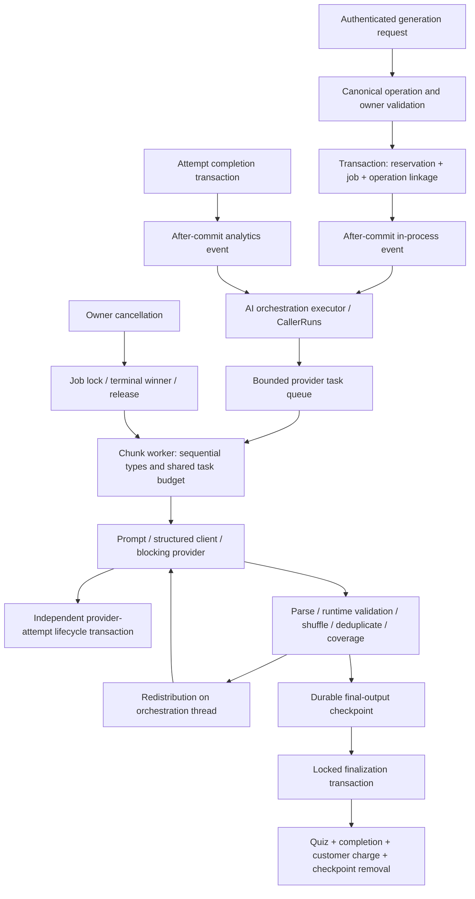

# Quizzence backend deep review — 17 September 2026

**Follow-up planning review:** [release-readiness coverage](QUIZZENCE_RELEASE_READINESS_COVERAGE.md) and [owner questionnaire](QUIZZENCE_RELEASE_READINESS_QUESTIONNAIRE.md) now reconcile the findings against the current issues and recorded owner decisions. Use revision-qualified finding IDs (`2026-09-17/SEC-001`, for example): older trackers reuse some short IDs for different defects. This follow-up does not change the production-readiness verdict or claim new runtime verification.

Two clarifications from the issue/source reconciliation: authored/stable form order and immediate per-item feedback after immutable acceptance were already approved in #612/#687 and need synchronization, not another policy vote. The share-start service does check scope in `AttemptServiceImpl:139–144` (accepting QUIZ_VIEW or QUIZ_ATTEMPT_START); the §14 controller-level observation must not be interpreted as a confirmed missing-scope-check defect. Shared guest identity and the legacy exchange/consumption contract still need their assigned work.

## 1. Executive summary

**Verdict: NOT APPROVED for public production or paid beta. Review coverage remains incomplete in the explicitly identified operational areas.** This is a new independent review of repository `Gegcuk/QuizMaker` (product Quizzence), branch `fix/actions-artifact-storage`, commit **`116c3e6cc5b5b67269698cdecf16e26242543bdb`**. The initial working tree was clean. This report replaces the older report at the requested path; its earlier version remains in Git history. No remediation was implemented.

**Core findings: 3 Critical, 14 High, 7 Medium, 0 Low (24 total).** A separately scoped frontend compatibility finding adds **1 Medium**; combined total **25: 3 Critical / 14 High / 8 Medium / 0 Low**. Critical denotes the requested impact model, not a claim that an active production incident or unauthenticated exploit has been observed. STRIPE-001 needs an authentic eligible canceled-refund event; SEC-001 needs a known foreign question UUID and normal author permissions; SEC-005 requires authentication and a configured paid provider. OAuth takeover feasibility is conditional, not live-proven.

Individual binary scoring has a simple consistent scale, but malformed responses can earn credit, answer keys can be read early, duplicate writes are unprotected, and historical pass rates change when quiz contents change. The backend average is correctly a mean of raw points; the nearby frontend misinterprets it on one screen. AI generation has materially improved validation, usage records, checkpoints and finalization, but legal large jobs can fail with a healthy provider, some outbound calls bypass the limit, and work before the final checkpoint is not restart-resumable. Customer generation settlement is substantially stronger than refund/invoice handling; overall financial integrity is not approved.

Top ten risks, in impact-oriented order:

1. Canceled refunds create tokens without a preceding debit (STRIPE-001).
2. Attaching a private question to another owner's quiz grants read access (SEC-001).
3. Authenticated direct chat bypasses quiz balance/admission controls and logs private text (SEC-005).
4. Refund replay and delayed invoices corrupt payment state or omit purchased entitlement (STRIPE-002/003).
5. Account-disable and OAuth email-trust gaps weaken authentication (SEC-003/004; provider caveat applies).
6. Participant answer-key routes and unprotected concurrent answer/completion writes undermine results (SEC-ANS-001/ATTEMPT-001).
7. Malformed false answers and mutable historical denominators produce wrong results (SCORE-001/002).
8. Approved quizzes can change material content without renewed moderation (QUIZ-001).
9. Valid chunking can exhaust a modest backend heap; large jobs drop work at queue saturation (DOC-AI-001/LOAD-AI-001).
10. Restart before the generated-output checkpoint loses accepted work (AI-PIPE-003).

Strongest areas: versioned deterministic customer tariff, canonical generation idempotency, provider-attempt lifecycle records, shared generated/manual content validation, monotonic bounded progress, isolated bounded parsing, normalized-document ownership, durable final-output checkpoints, atomic quiz/charge finalization, and explicit offline-provider CI intent. Weakest areas: legacy assessment integrity, source-question ownership, refund/invoice reconciliation, admission fairness and early-job durability.

**Capacity verdict:** no production-safe concurrency number is established. The actual pipeline with a fake provider produced 23/25 output events under a 25-job trial and failed one legal 100-chunk job even with healthy responses. Separate small trials at 2/10/30-second provider latency succeeded; they omit JDBC, HTTP acceptance, durable finalization and real provider quotas. Do not turn them into a claim that the product supports five or twenty-five production users.

**Recommended next decision:** review the concrete financial and source-ownership reproductions, then authorize narrowly scoped remediation tasks. Reconcile the existing backlog before selecting work; many fixes already exist despite open issue descriptions, and the future execution programme does not secure today's legacy endpoints.


## 2. Scope and limitations

| Item | Observed value |
|---|---|
| Repository / reviewed SHA | `https://github.com/Gegcuk/QuizMaker`, `116c3e6cc5b5b67269698cdecf16e26242543bdb` |
| Branch / initial state | `fix/actions-artifact-storage`; clean |
| Review date / locale | 2026-09-17; Europe/London |
| Host OS | macOS 26.6.2, Darwin 25.6.0, aarch64 |
| Default Java | Homebrew OpenJDK 25.0.4; rejected by project enforcer |
| Review Java | Installed Homebrew OpenJDK 17.0.17, selected per command |
| Maven | Wrapper Apache Maven 3.9.9 |
| Docker | Client/server 29.7.2; daemon available after read-only sandbox escalation |
| Database | No review database used. Existing local MySQL on 3306 was not repurposed. Runtime database version not verified; Compose declares `mysql:8.0`, CI `mysql:8.4`. |
| Production config | Source profiles/Compose/workflow only; no production secrets, host state, flags or overrides inspected |
| Frontend compatibility sample | Separate clean checkout at `de99ed402cb40c9185f0bcb975bf2c8048797b97` |
| Hardware precision | CPU/RAM sysctl blocked in sandbox; no host-capacity claim. Test JVM heaps explicitly 256/512 MiB where stated. |

The audit reconstructs all major feature families and deeply exercises selected production methods. It is not exhaustive execution of every requested matrix. No real AI/Stripe/email/storage call, charge, deployment, push, commit, issue mutation or production-data access was performed. Mocked repositories do not prove transaction behavior. Source-level absence of a lock/constraint is strong evidence of an unsafe protocol, but it is not an executed MySQL interleaving. No heap/CPU/connection telemetry from production is available.

Full migration rehearsal, MySQL concurrency/query plans/query counts, actual process-kill recovery, 10%/30% random provider-failure workloads, connection reset and DB-pool saturation, full large-plus-small fairness, deployed HTTP/OpenAPI, backup restoration, dependency CVE scan and real-model quality remain unverified. The retained `/private/tmp` harnesses/logs are session-local evidence, not permanent repository regression coverage; the report records reproductions so future tests can be written without relying on their retention.

### Executed checks

| Command / evidence | Outcome | Duration / report |
|---|---|---|
| `./mvnw --version` | PASS: Maven 3.9.9; default Java 25 | <1s; captured environment output |
| `./mvnw clean verify` | FAILED at Java-17 enforcer before compilation/tests | 1.969s; `/private/tmp/quizzence-clean-verify-default.log` |
| `JAVA_HOME=<installed-JDK17> ./mvnw -o test-compile dependency:build-classpath -Dmdep.outputFile=/private/tmp/quizzence-review-classpath.txt` | PASS, main and 557 test sources compiled | 26.101s; `/private/tmp/quizzence-test-compile.log` |
| Initial scoped test selection including `QuizAnalytics*Test` | 576 tests passed; 7 database tests errored on sandbox `SocketException: Operation not permitted`; no successful DB connection | 27.546s; `/private/tmp/quizzence-scoped-tests.log` |
| Corrected explicit scoped test selection in §20 | PASS, 425 tests, zero failures/errors/skips; db-serial lane selected zero | 12.529s; `/private/tmp/quizzence-scoped-pure-tests.log`, `target/surefire-reports` |
| `JAVA_HOME=<installed-JDK17> ./mvnw -o -DskipTests package` | PASS packaging only; not full verification | 5.055s; `/private/tmp/quizzence-package.log` |
| Production handler/analytics/refund/security harnesses | Reproduced defects and tariff formulas; no real DB/external service | Handler3.47s, analytics1.37s; harness evidence appendix |
| Actual AI pipeline + fake ChatModel | Load/partial/terminal/429 tests and chunker tests executed | §11; `/private/tmp/quizzence-ai-harness/*.log` |
| `docker compose --env-file /dev/null -f server/backend/docker-compose.yml config --quiet` | PASS syntax; expected unset-environment warnings; not a deployability check | <1s; `/private/tmp/quizzence-compose.log` |
| Network-disabled Docker build, host architecture | FAILED: no matching base-image platform | <1s; `/private/tmp/quizzence-image-build.log` |
| Same build with `--platform linux/amd64` | FAILED: uncached Alpine curl package requires network, intentionally disabled | ~11s; `/private/tmp/quizzence-image-build-amd64.log` |
| Cached `rhysd/actionlint:1.7.12`, read-only mount, network none | Exit1: ShellCheck findings in CI; no deployment executed | <1s; `/private/tmp/quizzence-actionlint.log` |

JaCoCo report generation ran in scoped tests; the full verify coverage gate did **not** pass or run to completion. Existing report files may contain the first blocked database selection; do not infer final-run counts by blindly summing every retained XML. Compilation emitted existing deprecated API and unchecked-operation warnings. Actionlint reported SC2034/SC2086/SC2329/SC2162; these are recorded check failures, not inflated into Critical product findings. No configured independent formatting/dependency-vulnerability gate was executed.


## 3. Product behaviour map

| Flow | Current implementation / state | Review conclusion |
|---|---|---|
| Local registration, verification, login | User + role/permission assignment, password hash, email token; session/JWT login | No login limiter; verification transport/login prerequisite is a product-contract question; email delivery was not run |
| OAuth and logout | Provider identity mapping, one-time exchange code, persisted session/refresh rotation and revocation | Exchange foundation exists; email trust and account-disable gaps remain |
| Profile, roles, permissions | Service ownership and permission/AOP/method checks; profiles separately reject inactive users | Mixed conventions; profile guards do not close JWT acceptance elsewhere |
| Quiz authoring/edit/publication | Ordinary PRIVATE/DRAFT; explicit publish/moderation paths, quiz version/hash | Question writes bypass material-change moderation; publication invariants differ |
| Questions/manual/import | Nine handlers; DTO mapping; import dispatches same validators | Shared validation good; response shapes and some answer keys unsafe |
| Upload/process/delete | Main Document path stages/streams and runs bounded child parser; NormalizedDocument path now owner-scoped and reuses parser | Main-process chunking remains a heap risk; normalized text chunking loses some source tails |
| Generation/estimate/status/cancel | Canonical request, quote/reserve, job, after-commit async work; checkpoint then atomic quiz/charge finalization | Correct per-chunk count semantics and >80% acceptance; initial job dispatch/durability/admission incomplete |
| Subscription/pack/refund | Server checkout snapshot, event/ledger deduplication, subscription ownership, refund policy | Refund/invoice defects invalidate financial approval |
| Attempt/answer/batch/complete | IN_PROGRESS/PAUSED/COMPLETED/ABANDONED; live quiz membership/order; binary handlers | Ownership checks exist; no cross-request write serialization or immutable roster |
| Scoring/review/results | Raw point sum, answered accuracy, current-count completion/pass; completed review | Raw average correct, historical denominator unstable; premature keys accessible |
| Analytics/leaderboard | Snapshot + after-commit recompute; best raw score per user; per-question counts | Full-history scans, mutable denominator, pooled anonymous identity, unstable ties |
| Sharing/anonymous | Quiz-bound link checks, expiry/revoke/scope, sentinel anonymous user | Link possession is not a distinct learner identity; future capabilities are not implemented protection |
| Notifications/repetition | User-registration and attempt listeners, repetition feature | General-purpose notifications/new Learning/Live remain future work; delivery not audited end to end |
| Data deletion | Document/quiz/question/attempt paths, soft deletion and reference effects | No end-to-end account erasure/retention system verified; avoid claiming one from document deletion |

Generation state is coupled to reservation and output checkpoint, not just a status enum. Attempt state is coupled to mutable Question rows today; the proposed policy/revision/form/result programme is future implementation. Missing future features are not automatically defects in current advertised features.


## 4. Business Rule Catalogue

| Rule ID | Area | Inferred rule and source | Confidence | Actual behaviour | Verdict |
|---|---|---|---|---|---|
| BR-Q01 | Quiz creation | Ordinary authors create PRIVATE/DRAFT; `QuizCommandServiceImpl:66–78` | High | Forced regardless of requested state; moderator may create PUBLIC/PUBLISHED directly | Ordinary author guard works; moderator bypass omits publish validation |
| BR-Q02 | Publication | A published quiz needs questions, valid answers and estimated time >=1; `QuizPublishValidator:33–82` | High | `setStatus` validates; moderation approval and moderator create do not | Invariant differs by entry point |
| BR-Q03 | Moderation | Material edits need review; `QuizCommandServiceImpl:136–157` | High | Question create/update/delete and relationship endpoints never invalidate approval; quiz hash omits questions | Failed |
| BR-Q04 | Concurrent editing | Quiz writes use optimistic locking; `Quiz:96–98` | High | Quiz has `@Version`; Question and Attempt do not; requests do not carry expected revision | Some overlapping quiz transactions protected; stale sequential client edits are not rejected |
| BR-A01 | Start | PUBLIC/PUBLISHED, owner, moderator or admin can start; `AttemptServiceImpl:89–100` | High | Server checks these conditions; zero-question own/draft attempt still possible | Access guard present |
| BR-A02 | State machine | Start IN_PROGRESS, pause PAUSED, resume IN_PROGRESS, complete COMPLETED; `AttemptServiceImpl:102–106,427–446,656–685` | High | Sequential invalid transitions rejected; concurrent transitions unguarded | Failed under races |
| BR-A03 | One answer/question | Duplicates rejected and sequential mode ordered; `AttemptServiceImpl:321–352` | High | Java read/check only; no database pair uniqueness, lock or version | Failed under concurrent submissions |
| BR-A04 | Question membership | Only questions currently in the attempt quiz may be answered; `AttemptServiceImpl:309–319` | High | Membership enforced against mutable quiz at submission time | Present, but not a stable attempt roster |
| BR-A05 | Timing | TIMED answers expire at startedAt + live timer minutes; `AttemptServiceImpl:298–306` | High | Timed submit attempts abandonment then throws/rolls back; completion has no deadline guard | Failed |
| BR-A06 | Anonymous identity | Share link belongs to quiz, unrevoked/unexpired, permitted scope; `AttemptServiceImpl:126–189` | High | Explicit checks; all anonymous attempts share one `anonymous` user | Per-participant analytics identity absent; access consequences owned by security review |
| BR-S01 | Answer score | Correct=1, incorrect=0 in all handlers | High | Uniform binary numeric scale; no negative values or partial credit | Consistent for structurally valid binary responses, with malformed-answer defects |
| BR-S02 | OPEN/COMPLIANCE | OPEN exact text; COMPLIANCE exact compliant-ID set | High | OPEN trims/lowercases and compares; COMPLIANCE automatic exact-set scoring | Neither is AI/manual reviewed; pedagogical suitability is PRODUCT DECISION REQUIRED |
| BR-S03 | Completion | Completion allowed with unanswered questions; `AttemptServiceImpl:422–448` | High | Missing answers add zero points, do not block completion | Explicit current behaviour; denominator interpretation must be clear |
| BR-S04 | Accuracy | `correct/answered*100`; `AttemptServiceImpl:561–572,882–892` | High | Unanswered questions excluded from accuracy, included through quiz count in completion/pass metrics | Distinct metric, not whole-quiz correctness |
| BR-S05 | Passing | >=50% correct questions; `QuizAnalyticsServiceImpl:90–110` | High | Correct count divided by current quiz count, all completed attempts included | Historical results unstable |
| BR-S06 | Average | Arithmetic mean raw totalScore, `AttemptRepository:51–57`, `QuizResultSummaryDto:16–21` | High | SQL AVG, not SUM, not percentage | Backend formula/name/documentation aligned |
| BR-S07 | Leaderboard | Best completed raw score per user, `AttemptRepository:86–95` | High | MAX grouped by user; no tie-breaker, all aggregate rows fetched before top limit | Only comparable within fixed quiz form; ties nondeterministic |
| BR-S08 | Historical review | Completed review must reflect answered content | High | Stored score persists, but answer key/context/type and denominator come from latest Question/quiz | Failed |
| BR-V01 | Shared validation | Same handler invariants for manual, import and generated content | High | Manual `QuestionServiceImpl:64–65`; import `QuizImportValidationServiceImpl:91`; generation `AiQuizGenerationServiceImpl:649–650,711` invoke handlers | Important protection present, but common handler gaps propagate |
| BR-V02 | Secret answers | Safe content omits answer fields; review requires completion | High | Safe attempt mapper and review guard exist; raw question reads and response flags bypass intended restriction | Failed |

Question order is ascending random UUID (`QuestionRepository:39`, `AttemptServiceImpl:260,324`), not explicit author order. The current-question endpoint selects `allQuestions[answerCount]`, not an actual set difference; in ALL_AT_ONCE/TIMED out-of-order submissions it can return an already answered question. It is not mode-restricted. Stable author ordering and per-attempt shuffled roster are PRODUCT DECISION REQUIRED; changing behaviour needs owner approval.

| Rule ID | Area | Inferred rule | Source | Confidence | Actual behaviour | Verdict |
|---|---|---|---|---|---|---|
| BR-G01 | Generation counts | q per type per selected chunk | GenerateQuizFromDocumentRequest / AiQuizGenerationServiceImpl | High | Requested total C×sum(q), not one global quiz count | Accurate explicit current contract |
| BR-G02 | Success | Accepted requested coverage strictly >80% | GenerationCoveragePolicy | High | 80/100 fails, 81/100 can succeed; duplicates/invalid rejected | Policy implemented; local load can trigger avoidable failure |
| BR-G03 | Provider attempts | Five calls per logical chunk/type invocation | ProviderAttemptBudget / AiRateLimitConfig | High | Shared within fallback, fresh for redistribution | Bounded local attempts; no whole-job budget |
| BR-G04 | Progress | Nonterminal <100, completed100 | Job progress SQL / service | High | Atomic increments and99cap; finalization may linger99 | Stronger current implementation |
| BR-B01 | Customer tariff | Base + ceil(rate×characters/1000)×active types | ContentLengthPerQuestionTypeTariff | High | Deterministic quote and capped settlement independent of provider usage | Correct nominal arithmetic |
| BR-B02 | Reversal | Restore only previously deducted entitlement | RefundPolicyService / StripeWebhookService | High | Canceled refund can restore nonexistent debit | Failed |
| BR-B03 | Reservation | Reserve/commit/release exactly once | BillingService / V17 / job finalization | High | Transactions, versions, unique ledger keys; full concurrency not retested | Strong foundation with unverified contention |
| BR-S09 | Private question | Source authority precedes copying/attachment | AccessPolicy / QuizRelationService | High | Only destination owner checked | Failed |
| BR-S10 | Suspension | Disabled account denied authentication | UserDetails enabled flag / JWT service | High | JWT creates authenticated disabled principal | Failed for paths without additional active guard |
| BR-S11 | Document privacy | Owner-scoped raw content and metadata | NormalizedDocumentAccessService / main document services | High | Owners now enforced; billing estimate still exposes bounded metadata by UUID | Improved, estimate residual |

**PRODUCT DECISION REQUIRED:** any new partial-credit model, normalized aggregate definition, hotspot coordinate semantics, OPEN fuzzy/manual scoring, account-link trust policy, unknown historical-owner repair, new rate/billing limits and rollout reset/fallback choice. This review neither invents those requirements nor applies them as unapproved code changes.


## 5. Architecture and concurrency map



The missing durable edge is between acceptance and complete generated-output checkpoint. The provider pool is not a global outbound boundary because redistribution and separate chat/structure paths bypass it. Cancellation persists a terminal decision but in-flight blocking calls need not stop immediately. There are no production `CompletableFuture.*Async` common-pool call sites found; the older common-pool allegation must not be repeated.


## 6. Scorecard

Scores are qualitative source-and-test judgments, not an average that can conceal blockers. A high subscore is not production certification.

| Area | Score /5 | Status | Key reason |
|---|---:|---|---|
| Quiz lifecycle | 2 | Meaningful fixes/evidence required | Material edits/publication entry points diverge |
| Question model | 3 | Meaningful fixes/evidence required | Nine types and shared validation; key/response gaps |
| Attempt lifecycle | 2 | Meaningful fixes/evidence required | No durable form or mutation serialization |
| Scoring correctness | 2 | Meaningful fixes/evidence required | Binary formula sound; malformed false credit/history failures |
| Analytics correctness | 2 | Meaningful fixes/evidence required | Raw AVG sound; historical pass denominator unsound |
| Correct-answer protection | 1 | Meaningful fixes/evidence required | Alternative read endpoints expose keys |
| Document processing | 3 | Meaningful fixes/evidence required | Bounded parser/owners; parent chunking risk |
| Chunking | 2 | Meaningful fixes/evidence required | Memory amplification and dropped tail |
| AI prompt design | 4 | Stronger, bounded evidence | Source delimiters, trusted metadata validation, safe main logs |
| Structured-output validation | 3 | Meaningful fixes/evidence required | Shared validators; logical key gaps remain |
| Generated-question quality controls | 2 | Meaningful fixes/evidence required | Structural controls; no independent grounding enforcement/evaluation |
| AI concurrency | 2 | Meaningful fixes/evidence required | Dedicated pool bypassed in redistribution |
| AI backpressure | 1 | Meaningful fixes/evidence required | Accepted work can be discarded at saturation |
| AI failure recovery | 2 | Meaningful fixes/evidence required | Final checkpoint recovers; earlier work does not |
| Job durability | 2 | Meaningful fixes/evidence required | Acceptance event and partial task results volatile |
| Progress accuracy | 4 | Stronger, bounded evidence | Atomic monotonic99/100boundary; timing unmeasured |
| Cancellation | 3 | Meaningful fixes/evidence required | Terminal locking/queue cancellation; cooperative provider stop |
| Token estimation | 3 | Meaningful fixes/evidence required | Customer quote deterministic; provider estimate heuristic |
| Internal token ledger | 2 | Meaningful fixes/evidence required | Core movement strong; refund minting violates integrity |
| Stripe integration | 2 | Meaningful fixes/evidence required | Checkout foundations; refund/invoice residuals |
| Authorization | 2 | Meaningful fixes/evidence required | Source ownership and disabled/OAuth trust gaps |
| Data isolation | 2 | Meaningful fixes/evidence required | Documents improved; private-question attach vulnerability |
| Database consistency | 2 | Meaningful fixes/evidence required | Key constraints present unevenly; attempts/payment races |
| Database performance | 2 | Meaningful fixes/evidence required | Full-history materialization; SQL counts unverified |
| Test quality | 3 | Meaningful fixes/evidence required | 425 scoped pass, defects reproduced, DB/correctness gaps |
| Observability | 3 | Meaningful fixes/evidence required | Usage/progress/recovery signals; unsafe chat logs and missing capacity proof |
| CI/CD | 3 | Meaningful fixes/evidence required | Offline gate/tested artifact/health checks; lint and image checks incomplete |
| Production operations | 2 | Meaningful fixes/evidence required | No live backup/restore/crash/migration proof |
| Overall functional correctness | 2 | Meaningful fixes/evidence required | Several concrete financial/security/result defects |
| Overall production readiness | 1 | Meaningful fixes/evidence required | Unresolved Critical/High findings; no capacity certification |

## 7. Findings summary

| ID | Severity | Area/title | Status |
|---|---|---|---|
| SEC-ANS-001 | High | Answer keys are available before the attempt | Source-confirmed; runtime scenario not executed |
| ATTEMPT-001 | High | Duplicate submissions and completion race can corrupt attempts | Source-confirmed; runtime scenario not executed |
| SCORE-001 | High | Invalid TRUE_FALSE responses earn full credit when the key is false | Reproduced locally |
| SCORE-002 | High | Historical results and active attempts reference mutable quiz content | Reproduced locally |
| QUIZ-001 | High | Material question edits bypass moderation; publishing entry points enforce different invariants | Source-confirmed; runtime scenario not executed |
| QUESTION-001 | Medium | Shared validators accept unanswerable ORDERING content and malformed answer handling is inconsistent | Reproduced locally |
| ATTEMPT-002 | Medium | Timeout abandonment rolls back and completion ignores deadline | Source-confirmed; runtime scenario not executed |
| ANALYTICS-001 | Medium | Every completion reloads full quiz history; summary request multiplies scans | Source-confirmed / runtime test pending |
| STRIPE-001 | Critical | Canceled refunds mint tokens which were never deducted | Service reproduction; ledger mocked |
| STRIPE-002 | High | Duplicate refund notifications corrupt cumulative refund amount and status | Reproduced locally |
| STRIPE-003 | High | Subscription invoice credit is attributed to the live subscription period and price | Source-confirmed; runtime scenario not executed |
| SEC-001 | Critical | An owner can attach another user's private question and acquire read access | Attachment service reproduced; persisted HTTP disclosure untested |
| SEC-002 | High | Unassociated questions have no owner and can be mutated by any creator | Reproduced locally |
| SEC-003 | High | Disabling a user does not invalidate existing access/refresh authentication | Reproduced locally |
| SEC-004 | High | OAuth automatically links accounts by an email without checking verification | Unverified-profile linking reproduced; live takeover conditional |
| SEC-005 | Critical | Direct AI chat exposes unmetered blocking paid calls and logs full user text | Source-confirmed / runtime test pending |
| SEC-006 | High | Login has no limiter; existing sensitive-operation limiter is local and non-atomic | Source-confirmed / runtime test pending |
| DOC-AI-001 | High | Valid small-chunk requests exhaust backend heap outside parser isolation | Reproduced locally |
| LOAD-AI-001 | High | Valid large jobs lose chunk work at bounded-queue saturation | Reproduced locally |
| LOAD-AI-002 | Medium | Redistribution bypasses the advertised global provider limit | Reproduced locally |
| AI-PIPE-001 | Medium | Selected later chunks cannot participate in redistribution | Reproduced locally |
| AI-PIPE-002 | Medium | Outer fallback retries erase terminal/Retry-After decisions | Reproduced locally |
| DOC-AI-002 | Medium | Normalized-document chunking deletes content after ordinary words | Reproduced locally |
| AI-PIPE-003 | High | Restart still loses accepted jobs before final output checkpoint | Source-confirmed / runtime test pending |
| CLIENT-001 | Medium | Frontend double-divides backend average | Source-confirmed compatibility addendum |

High/Critical findings block approval. Medium observations not promoted to findings are explicitly labelled in §14–16; they are not counted as reproduced incidents.

## 8. Detailed findings

Source references identify this pinned checkout. Abbreviated class references resolve through the source index in the appendix. Reproductions that use mocks exercise actual production methods but do not assert database/HTTP behavior absent from the harness.

### SEC-ANS-001 — High — Answer keys are available before the attempt

- **Status/confidence:** Confirmed from complete production call path; High. HTTP exploit not executed.
- **Affected flow/files:** `QuestionController:86–112,125–131`; `QuestionServiceImpl:117–146,181–195`; `QuestionMapper:28–42`; `AttemptServiceImpl:374–394`; `AttemptMapper:33–47`; `AnswerMapper`.
- **Evidence:** Public/published visibility permits any authenticated learner to read a question/list. Returned `QuestionDto.content` is parsed unchanged from storage and includes correct flags/answer/matching mappings; explanation is included. Even without that endpoint, answer submission passes client `includeCorrectAnswer` and `includeExplanation` directly through in TIMED/ALL_AT_ONCE as well as ONE_BY_ONE. `score` is always returned, so binary correctness is disclosed even with correctness=false. Attempt details similarly expose correctness while still in progress.
- **Reproduction:** As an ordinary signed-in learner, GET `/api/v1/questions?quizId=<public-published-quiz>`. Read `content.options[].correct`, `answer`, `left[].matchId`, etc.; begin and answer using these keys. Alternatively submit an answer with all inclusion flags true in TIMED mode and receive its key immediately.
- **Expected/actual:** Reader-safe question content before authorized review versus complete answer key with no attempt/completion entitlement.
- **Scenario/impact:** Two browser tabs or repeated attempts let a learner obtain a perfect leaderboard result without solving the quiz. This compromises assessment/result trust, not cross-user private-data confidentiality by itself.
- **Remedy:** Separate author/admin DTO entitlement from learner visibility; apply one server-side feedback rule across raw questions, submissions, detail, share-link and review APIs. Decide whether learning mode deliberately reveals feedback; never let request flags grant the entitlement.
- **Verification:** Authenticated non-owner public-quiz reads must strip keys and explanation; private ownership negatives; mode/status matrix for flags, score, details; owner authoring remains functional. Existing safe-builder/review tests do not cover this complete alternative-route path; request flags are documented as freely available in controller docs.

### ATTEMPT-001 — High — Duplicate submissions and completion race can corrupt attempts

- **Status/confidence:** Confirmed missing application/database concurrency guards, High; realistic race interleavings source-derived, not executed against MySQL.
- **Affected files:** `AttemptServiceImpl:290–356,401–417,422–446`; `Attempt:20–60` (no `@Version`); `Answer:16–47`; `AttemptRepository:72–84` (fetch graph, no lock); `V26__create_core_quiz_tables.sql:114–142` (PK answer ID only, no unique attempt/question pair). Later migrations were searched and no pair constraint found.
- **Evidence:** Two independent transactions can both read IN_PROGRESS and an unanswered question, both pass duplicate/sequential checks, and insert two UUID answers. Completion reads/sums a detached-in-time answer list without serializing with submit. Concurrent completions can both publish events.
- **Reproduction:** Barrier two requests after `findFullyLoadedById` before duplicate checking/insertion, submit same question. Then complete. Alternative: completion reads answers, another transaction inserts a new answer after its status check, completion commits a lower totalScore; answer commits after completion. Submit versus pause/resume/delete have related windows.
- **Expected/actual:** One logical answer and a single atomic terminal score versus duplicate rows/inflated score or stored totalScore different from sum of review answers. Sequential duplicate calls are rejected; this does not prove concurrent safety.
- **Scenario/impact:** Double-click/retry/two tabs yields 2 points for one question, can skip another in ONE_BY_ONE because next index uses answer count, can exceed 100% completion/correctness. A late answer can exist on a completed attempt and disagree with leaderboard’s persisted score.
- **Remedy:** Establish one locking/optimistic concurrency protocol for all attempt mutations; add pair uniqueness after addressing existing duplicates; make completion idempotent under that protocol, freeze attempt roster and final score. Define duplicate retry response semantics explicitly.
- **Verification:** MySQL barrier tests for same-question submits, batch/single overlap, different-question submit versus complete, complete twice, pause/submit; assert one answer per pair and stored score = sum = review score. Existing attempt tests are sequential; the five-completion analytics test uses distinct attempts and does not exercise these races.

### SCORE-001 — High — Invalid TRUE_FALSE responses earn full credit when the key is false

- **Status/confidence:** Executed against compiled production handler, High.
- **Affected files:** `TrueFalseHandler:34–41`; `AnswerSubmissionRequest` validates only non-null generic JSON, not per-type response shape.
- **Evidence:** `userAnswerNode != null && isBoolean ? asBoolean : false`. A missing/null/string/numeric answer becomes a legitimate false answer. Content validation validates the question, not submitted response.
- **Reproduction/results:** With question content `{"answer":false}`, submit each of `{}`, `{"answer":null}`, `{"answer":"maybe"}`, `{"answer":0}`. Actual `isCorrect=true,score=1.0` in all four. Harness `HandlerAudit` executes normal `handle`, including question validation.
- **Expected/actual:** Missing or malformed response should be rejected or receive no credit, never imply a chosen answer. Current code manufactures false.
- **Scenario/impact:** A client that serializes unanswered T/F questions as `{}` gets every false-key question correct, inflating score/pass/leaderboard without answering.
- **Remedy:** Validate the response is an object with an explicit Boolean `answer`; preserve malformed/absent distinction and choose the existing API-consistent 4xx/no-credit outcome.
- **Verification:** Test both true and false keys crossed with missing/null/string/number/array payloads and valid true/false. `TrueFalseHandlerTest` already tests missing/nonBoolean/null **only with correct key true**, masking this asymmetry.

### SCORE-002 — High — Historical results and active attempts reference mutable quiz content

- **Status/confidence:** Executed analytics formula regression with production service and fake repositories; other history effects source-confirmed; High.
- **Affected files:** `Attempt:31–35,55–59` stores quiz reference, no revision/roster/denominator; `Answer:29–31` references mutable Question; `AttemptServiceImpl:260,309–324,431–433,561–572,765,936–975`; `QuizAnalyticsServiceImpl:92–104`; `QuestionServiceImpl:244–249,272`; `Question:24–25` soft-delete filter.
- **Evidence:** Start returns a count without persisting it. Completion/review/stats query current count. Review extracts current key/context from Question while correctness/score are stored earlier. Question edits and quiz membership changes remain allowed during/after attempts; there is no immutable assessment form.
- **Reproduction/results:** Complete an attempt with 1 correct out of 2. Compute snapshot: passRate=100. Add a third quiz question, recompute without modifying any answer: passRate=0. The real analytics method produced `100.0 -> 0.0`, averageScore remained 1.0. Change a question’s key after answering: review shows the new key next to old correctness. Adding a question mid ONE_BY_ONE attempt may insert it before the current UUID index; removing a question shifts indexes or reduces denominator below answered count.
- **Expected/actual:** Stable historical assessment and answer-key explanation versus retrospective pass/fail/completion changes and key/correctness mismatch.
- **Scenario/impact:** A teacher grows an existing quiz and yesterday’s passing learners now fail. Historic raw leaderboard values remain from different maximum possible scores and cannot fairly rank attempts. Removing questions can give >100% completion.
- **Deletion caveat:** Soft-deleted questions are filtered by Hibernate. Review/fetch of an Answer referencing a deleted Question may produce a missing relationship/entity or failure depending on fetch path. This is an unexecuted ORM risk; do not claim a specific exception without a database test.
- **Remedy:** Persist an immutable attempt quiz/question revision with order, maximum points, timer, key/context or revision references. Historical aggregation uses the recorded denominator. Decide migration treatment for old attempts with no reliable historical denominator.
- **Verification:** Complete then add/remove/edit/type-change questions; verify unchanged score, normalized result, key and leaderboard cohort; active-attempt mutation; soft deletion; realistic multi-parent SQL/query count. Current tests do not establish these invariants.

### QUIZ-001 — High — Material question edits bypass moderation; publishing entry points enforce different invariants

- **Status/confidence:** Confirmed production paths, High; no HTTP/DB scenario executed.
- **Affected files:** `QuestionServiceImpl:59–90,199–251,255–272`; `QuizRelationServiceImpl:38–67`; `QuizCommandServiceImpl:136–157`; `QuizHashCalculator:16–43`; `ModerationServiceImpl:39–70,86–108`; `QuizCommandServiceImpl:64–80`; `QuizPublishingServiceImpl:55–57`; `QuizPublishValidator:33–82`.
- **Evidence:** Only metadata `updateQuiz` compares quiz hashes/invalidates publication. The content hash covers title, description, difficulty, tags, not questions/answers. Direct question writes and add/remove do not consult `PENDING_REVIEW`, `lockedForReview`, approved hash, or set PENDING_REVIEW. Approval never calls publish validator. A moderator can directly create PUBLIC/PUBLISHED before questions exist.
- **Reproduction:** Get a quiz approved; as its ordinary owner update a question’s text/answer, add/remove questions, or delete its last question. Quiz remains published with previous moderation metadata. Separately submit an empty draft then approve: approval sets PUBLISHED although setStatus would reject it.
- **Expected/actual:** Moderation approval applies to the reviewed content and all PUBLISHED transitions validate the same basic requirements; actual owner content mutations take effect under stale approval, and certain publication paths accept zero questions.
- **Scenario/impact:** Reviewed safe content can be replaced by unreviewed content visible to all users, and learners encounter published quizzes that cannot yield a current question.
- **Remedy:** Centralize material-change invalidation and publish validation across question changes, membership/import, moderator approval and direct create/status paths; tie review to a persisted content revision. Keep product’s precise review/locking policy explicit.
- **Verification:** Each write route against DRAFT/PENDING_REVIEW/PUBLISHED; pending moderation versus concurrent edit; zero/invalid-question publication via every path; old review decision cannot approve newer content. Existing separate service tests do not demonstrate cross-route equivalence.

### QUESTION-001 — Medium — Shared validators accept unanswerable ORDERING content and malformed answer handling is inconsistent

- **Status/confidence:** Executed handlers, High. Related response-shape defects grouped as validation boundary issue.
- **Affected files:** `OrderingHandler:25–55,62–87`; `FillGapHandler:48–56`; `MatchingHandler:87–104`; `HotspotHandler:73–81,95–107`; `McqSingleHandler:51–58`; shared validation entry points above.
- **Evidence/reproduction:** Valid two-item ORDERING content with `correctOrder:[]` or `[999]` passes validator. Empty `{}` or `[999]` answer respectively earns 1 point despite visible items 1 and 2. FILL_GAP duplicate `gapId=1` responses trigger `Collectors.toMap` duplicate-key `IllegalStateException`. MATCHING ignores unknown extra pairs and last duplicate left ID wins. Numeric IDs use `canConvertToInt`, permitting fractional values truncated to integers.
- **Expected/actual:** Explicit ORDERING key must be a permutation of all item IDs; structurally invalid answer sets should have one consistent client error/no-credit policy. Current validation and scorer disagree, or throw incidental collection errors.
- **Scenario/impact:** Author/imported question can be impossible to answer using the UI yet blank/made-up IDs are marked correct. A duplicate gap response breaks the request rather than yielding a deliberate validation result.
- **Remedy:** Validate explicit key cardinality/uniqueness/set equality, numeric integral types and response schema before evaluation. Decide unknown/duplicate pair treatment consistently. Do not silently repair incorrect author intent.
- **Verification:** Shared manual/import/generated validation matrix; empty/missing/duplicate/unknown IDs; every key value must be reachable by safe presentation. `OrderingHandlerTest` tests malformed response orders, but no content-key permutation checks were found.
- **Separate product limitation:** HOTSPOT evaluates `selectedRegionId`, not a click coordinate. It accepts zero-size regions and extreme coordinates without image dimensions. Coordinate normalization/image immutability remain PRODUCT DECISION REQUIRED if product intends actual geometric hotspot scoring; no unsupported claim of mobile coordinate bug.

### ATTEMPT-002 — Medium — Timeout abandonment rolls back and completion ignores deadline

- **Status/confidence:** High static transaction reasoning; no database rollback/timer scenario executed.
- **Affected files:** `AttemptServiceImpl:58–60,298–306,422–446,656–685`; `AttemptStatus`; `StartAttemptRequest`.
- **Evidence:** Timed submit saves ABANDONED then throws unchecked IllegalStateException from the same @Transactional method. Default rollback undoes abandonment. `completeAttempt` checks only IN_PROGRESS, not the elapsed deadline. No attempt-timeout recovery scheduler was found.
- **Reproduction:** Start TIMED quiz with one-minute limit; answer some questions; submit after deadline; receive timeout; inspect persisted status (predicted IN_PROGRESS due rollback); complete later and receive COMPLETED result. Start in another client-selectable mode and timer check never runs.
- **Expected/actual:** Deadline produces durable, consistent terminal behaviour; current rejection and later completion disagree. At exact equality `isAfter` allows submission. Pausing does not stop elapsed wall time, and timer duration remains mutable quiz state.
- **Scenario/impact:** Browser/session can remain in-progress indefinitely after expiry and later finalize, with no clear timed-out result semantics.
- **Remedy:** Define deadline/paused-time/mode eligibility policy with owner; enforce deadline for all relevant mutations under the same atomic transition protocol; persist timeout transition without rollback-by-throw; use injected Clock and attempt-time settings.
- **Verification:** Fixed clock tests just before/equal/after deadline; database assertion after thrown timeout; complete after timeout; pause/resume; timer edits; restart. Treat client-selectable modes as product policy, not automatically a security violation.

### ANALYTICS-001 — Medium — Every completion reloads full quiz history; summary request multiplies scans

- **Status/confidence:** Confirmed algorithm/query shape, High; no capacity/SQL timings measured.
- **Affected files:** `QuizAnalyticsServiceImpl:79–104,168–209`; `AttemptRepository:59–69`; `AttemptServiceImpl:459–487,509–519`; `AsyncConfig:191–198`.
- **Evidence:** Snapshot does SQL aggregate then fetches every completed Attempt with every Answer and Question to count passing attempts. Every completion schedules this through unqualified @Async, which maps to aiTaskExecutor, sharing AI orchestration capacity. Results API repeats full history fetch and for each current question scans all attempts/answers twice. Leaderboard fetches all user aggregates then applies Java `.limit(top)`; ties have no secondary sort.
- **Cost model (not a benchmark):** For fixed Q questions and A fully answered attempts, snapshot materializes O(AQ) joined rows per completion, cumulative ~Q*A*(A+1)/2 row visits over A completions. Q=20: 100 attempts =>2,000 rows/latest refresh; 10,000=>200,000; 50,000=>1,000,000. Q=20,A=10,000 cumulative ~1,000,100,000 answer-row visits if every completion recomputes separately. Results’ nested scans are O(AQ²), around 4 million question-answer comparisons at 10k*20² (early matches alter constants). Actual bytes/time require measurement.
- **Expected/actual:** Bounded aggregate/update cost and database top limit versus full history hydration and work proportional to all past answers.
- **Scenario/impact:** A popular quiz’s new completions occupy heap/DB connections and the AI orchestration executor; polling public results repeats large work, even when cached summary is fresh.
- **Remedy:** Persist trustworthy per-attempt final denominator/correct-count, aggregate in SQL or maintain idempotent event-driven summaries; compute per-question aggregate in grouped SQL; bound pagination/top in database; isolate analytics executor and record lag/failures.
- **Verification:** Actual MySQL EXPLAIN and query-count/heap/time fixtures at 100/10k attempts and 1m answers; concurrency 2/10 completions with exact snapshot assertions and injected listener failure; no fake throughput claims.
- **Protections/limitations:** Snapshot has @Version and unique quiz ID; optimistic/unique conflict retries 3 times. Missing/stale snapshots recompute after default 600s on reads, so event loss generally has a repair path. Completion event is in-process AFTER_COMMIT and can be lost on crash; retries exhausted can serve stale results until TTL. Setting max-age<=0 disables this repair for existing snapshots. These are bounded staleness/reliability concerns, not proof snapshots are always incorrect.

### STRIPE-001 — Canceled refunds mint tokens which were never deducted

Existing-test limitation: the complete repository suite was not executable here. No passing test is treated as disproving this reproduction; the specific regression cases below must be checked in the remediation.

- Severity: **Critical**. Category: financial ledger integrity. Confidence: High for the source path; prerequisites and validation limits follow.
- Source: `features/billing/application/impl/StripeWebhookServiceImpl.java:615` processes `refund.created` only when status is `succeeded`; `:656-695` handles `refund.updated` canceled by unconditional proportional credit. Full Java prefix for this and following abbreviated feature paths: `src/main/java/uk/gegc/quizmaker/`.
- Reproduce: start from a successful 1,000-token/1,000-cent payment. Deliver a requires-action refund for 500 cents (no debit), followed by an authentic `refund.updated` canceled for the same refund. No original debit exists.
- Expected: canceling a refund that never took effect leaves the balance unchanged. Actual: `creditPurchase(..., 500, "refund-canceled:<refundId>", ...)` is called, increasing the balance from 1,000 to 1,500. An event signature authenticates Stripe; it does not prove a token debit occurred. The same issue affects the unconditioned proportional restoration in `handleDisputeWon` (`:957-983`): restoration is not derived from an actual recorded debit, and under capped/blocked policies it can exceed the amount deducted.
- Impact: unearned spendable tokens, financial drift against external settlement, exploitable provider-cost exposure if refund cancellation is available through the operator/payment workflow.
- Bounded remediation: persist a unique refund/dispute operation and its exact applied debit, then restore only that recorded debit once. Define and preserve ordering semantics explicitly; do not choose a new refund policy during the fix.
- Regression: requires_action→canceled with no debit; succeeded→restoration if provider permits it; duplicate canceled events; canceled before delayed pending event; capped/zero deductions; dispute won before/after withdrawal.

### STRIPE-002 — Duplicate refund notifications corrupt cumulative refund amount and status

Existing-test limitation: the complete repository suite was not executable here. No passing test is treated as disproving this reproduction; the specific regression cases below must be checked in the remediation.

- Severity: **High / P1**. Category: financial record integrity. Confidence: High. Verification: executed `RefundPolicyServiceImpl.processRefund` twice with the same refund ID and two event IDs; code trace through real ledger idempotency.
- Source: `features/billing/application/impl/RefundPolicyServiceImpl.java:107-128`; `features/billing/application/impl/BillingServiceImpl.java:735-744` returns without changing balances for an existing REFUND key; `StripeWebhookServiceImpl.java:720-749` records the event separately after `processRefund` completes. `features/billing/domain/model/Payment.java` has no `@Version`; refund reads use nonlocking `findByStripePaymentIntentId`.
- Reproduce: a 1,000-cent purchase receives one succeeded 500-cent refund via `refund.created` and a distinct `refund.updated` event for the same refund. Both pass event-ID deduplication. The ledger correctly no-ops the second stable `refund:<id>` debit, but `processRefund` increments refundedAmountCents again.
- Expected: 500 refunded cents, PARTIALLY_REFUNDED, one debit. Actual: 1,000 refunded cents, REFUNDED, one debit. The local harness confirms the 1,000/REFUNDED mutation. It mocks the ledger boundary; the production ledger's explicit no-op is separately source-verified.
- Crash variant: crash after `processRefund` commits but before processed-event insertion; a retry of the same event increments again. Concurrent distinct refunds also load detached stale Payment totals without a row lock/version, so lost updates are possible; this concurrency variant was not executed against MySQL.
- Impact: support/payment history reports full refund when only half was returned; settlement sees an incorrect final state. Weekly token reconciliation cannot detect this because it compares balance to token entries, not external/payment amounts.
- Bounded remediation: one transaction/unique refund-operation claim for token debit, cumulative payment adjustment and processed marker; lock payment or use an atomic cumulative update. Distinguish already applied from newly applied ledger operations.
- Regression: same event replay after commit crash; different event IDs for same refund; two different refunds concurrently; refund after checkout settlement; ensure correct payment amount/status and exactly one token debit.

### STRIPE-003 — Subscription invoice credit is attributed to the live subscription period and price

Existing-test limitation: the complete repository suite was not executable here. No passing test is treated as disproving this reproduction; the specific regression cases below must be checked in the remediation.

- Severity: **High / P1**. Category: financial correctness/out-of-order events. Confidence: High source evidence; provider delivery scenario not executed.
- Source: `features/billing/application/impl/StripeWebhookServiceImpl.java:410-440` retrieves current subscription, uses `getCurrentPeriodStart()` at `:428` and current subscription first-item price at `:431`; `features/billing/application/impl/SubscriptionServiceImpl.java:65-72` keys credits by `sub:<subscriptionId>:<periodStart>`.
- Reproduce: August invoice delivery is delayed until September after the provider advances currentPeriodStart; deliver September and August paid events in either order. Both resolve September and collide on September's key. If plan price changed, the old invoice is also priced against the current plan.
- Expected: each paid, eligible billing period has one credit using the corresponding immutable invoice/line facts. Actual: two paid periods can yield only one period's tokens; stale events can credit the wrong entitlement.
- Related source defects: customer retrieval exceptions are swallowed in `StripeWebhookServiceImpl.java:458-470`, then handlers return normally when no user can be extracted (`:418-420`), acknowledging a temporary provider lookup failure without credit. Payment failure/deletion updates are not ordered against payment success, so stale failures can block a newly paid subscription. No full live-provider webhook exercise was performed.
- Bounded remediation: use immutable invoice ID/period/price/quantity facts plus authoritative local ownership and persisted event/entity state; retry transient lookups. Current-vs-historical entitlement for plan changes is a **PRODUCT DECISION REQUIRED**, not inferred here.
- Regression: previous-period event after renewal; two invoice events same period; price change; quantity; failure followed by success with reverse delivery; transient customer retrieval outage.

### SEC-001 — An owner can attach another user's private question and acquire read access

Existing-test limitation: the complete repository suite was not executable here. No passing test is treated as disproving this reproduction; the specific regression cases below must be checked in the remediation.

- Severity: **Critical**. Category: private-content confidentiality. Confidence: High for the source path; prerequisites and validation limits follow.
- Source: `features/quiz/application/command/impl/QuizRelationServiceImpl.java:38-51` loads arbitrary question ID then authorizes only destination quiz. HTTP route `features/quiz/api/QuizController.java:458-473` requires ordinary QUIZ_UPDATE. `features/quiz/domain/model/Quiz.java:135-143` owns the join table; `features/question/domain/model/Question.java:90-101` also maps it. Subsequent `features/question/application/impl/QuestionServiceImpl.java:171-176` allows anyone owning any associated quiz; `features/question/infra/mapping/QuestionMapper.java:29-42` returns complete content and explanation.
- Reproduce: Alice owns private quiz A with question Q. Bob owns quiz B and knows Q's UUID (e.g. previous authorized access/history). Bob POSTs `/api/v1/quizzes/B/questions/Q`, then reads his quiz questions/Q.
- Expected: source-question authorization before association. Actual: real method adds Q to B and saves without checking Alice's source resource. Owning B then makes Q readable, including answer-bearing content. If B is public this can publish Alice's content. Question UUID entropy is not authorization.
- Additional impact: Alice can subsequently be prevented from editing Q because update requires ownership of *all* linked quizzes, including Bob's.
- Bounded remediation: define permitted question reuse/copy ownership and enforce it before association; persist author ownership independently of join membership. Cross-owner sharing semantics need owner approval; deny private unauthorized source reads immediately while preserving existing approved cases.
- Regression: private foreign Q, public foreign Q with explicitly approved reuse rule, own Q, moderator, unlinked Q, duplicate association, request knowing UUID but without visibility; verify later reads and updates.

### SEC-002 — Unassociated questions have no owner and can be mutated by any creator

Existing-test limitation: the complete repository suite was not executable here. No passing test is treated as disproving this reproduction; the specific regression cases below must be checked in the remediation.

- Severity: **High / P1**. Category: authorization/content integrity. Confidence: High. Verification: real deletion method executed with another ordinary user and an orphan question; update path source-verified.
- Source: `features/question/application/impl/QuestionServiceImpl.java:210-217` and `:263-273` authorize solely by loops over linked quizzes; `:279-282` permits null/empty quiz IDs at creation. `features/question/domain/model/Question.java` persists no creator/owner ID. HTTP PATCH/DELETE require only QUESTION_UPDATE/QUESTION_DELETE (`features/question/api/QuestionController.java:156-186`), permissions assigned to normal creator roles in `src/main/resources/db/migration/V24__seed_roles_and_permissions_from_manifest.sql:143-144`.
- Reproduce: Alice creates a question without quizIds, or removes its last quiz association. Bob knowing its UUID DELETEs it or PATCHes content/quizIds to claim it.
- Expected: creator retains ownership regardless of association count, or orphan creation is rejected. Actual: empty loop grants mutation; real delete calls repository.delete.
- Impact: unauthorized deletion/modification of independently authored content; owner cannot normally find/read the orphan through own-quiz filtering.
- Bounded remediation: persist provenance/ownership with an explicit migration plan and authorize resource independently. For ambiguous historical orphans fail closed pending reconciliation. Do not silently assign an owner.
- Regression: orphan owner vs other creator, question after last unlink, historical unknown owner, default-role permissions, quiz deletion soft-delete behavior.

### SEC-003 — Disabling a user does not invalidate existing access/refresh authentication

Existing-test limitation: the complete repository suite was not executable here. No passing test is treated as disproving this reproduction; the specific regression cases below must be checked in the remediation.

- Severity: **High / P1**. Category: authentication/account suspension. Confidence: High. Verification: actual JWT issued with an ephemeral local random key, then user disabled; actual AuthSessionService and JwtTokenService executed with a fake active session repository. No secrets printed.
- Source: `features/auth/infra/security/JwtTokenService.java:191-205` checks existence/password version but not active; `:233-235` constructs authenticated UsernamePasswordAuthenticationToken from disabled UserDetails. `features/auth/application/impl/AuthSessionServiceImpl.java:124-142` checks active session, then uses that authentication. `features/auth/application/impl/AuthSessionRefreshServiceImpl.java:64-83` uses same validation/authentication and rotates. `UserDetailsServiceImpl.java:75-82` correctly sets enabled=false but no AuthenticationProvider re-checks it on this path.
- Reproduce: sign in active account, administratively persist active=false without password change/revoking sessions, present existing token. Harness result: Authentication.isAuthenticated=true while principal.isEnabled=false.
- Expected: inactive account fails authentication. Actual: old token remains usable; source shows refresh can continue renewing it.
- Impact: suspension fails on protected business paths without their own active-user checks, and refresh can renew the session. User-profile services separately reject inactive accounts; this is not a claim that every endpoint remains accessible.
- Bounded remediation: enforce active/enabled in centralized validated account resolution and refresh issuance, preserving fail-closed behavior; optionally revoke sessions on disable without relying solely on revocation.
- Regression: active→disabled between issue and access; refresh; OAuth login disabled account; re-enable semantics; logout/replay unchanged.

### SEC-004 — OAuth automatically links accounts by an email without checking verification

Existing-test limitation: the complete repository suite was not executable here. No passing test is treated as disproving this reproduction; the specific regression cases below must be checked in the remediation.

- Severity: **High / P1**, conditional account-takeover exposure. Category: authentication/account linking. Confidence: High for trust-check absence and local behavior; Medium for exploitability with currently configured provider tenant policies. Verification: executed real CustomOAuth2UserService using fake provider response `email_verified=false` and a different provider subject.
- Source: `features/auth/infra/security/CustomOAuth2UserService.java:121-136` links by raw email and sets emailVerified=true; extraction `:269-270` reads only email. Existing linked accounts also auto-verify whenever any email is present (`:109-114`), without checking equality to local email.
- Expected: unverified/missing provider email trust does not prove control of an existing local account. Actual: harness links the distinct provider identity and verifies the existing local account despite explicit false verification.
- Impact: an enabled provider capable of supplying unverified/reassigned email claims can bind an attacker login to a victim local account. No live provider impersonation attempted. The code flaw is confirmed; exploit availability must be validated per provider.
- Bounded remediation: explicit provider-specific verified-email policy, or require authenticated local-account confirmation for linking. Policy choice requires owner approval; never infer verified ownership merely from an email string.
- Regression: false/missing verification, different email from an already linked subject, duplicate provider subject, verified intended linking, disabled local account, provider-specific claim formats.

### SEC-005 — Direct AI chat exposes unmetered blocking paid calls and logs full user text

Existing-test limitation: the complete repository suite was not executable here. No passing test is treated as disproving this reproduction; the specific regression cases below must be checked in the remediation.

- Severity: **Critical**. Category: unmetered paid-provider exposure. Confidence: High for the source path; prerequisites and validation limits follow.
- Source: `features/ai/api/AiChatController.java:27,53-63`; `features/ai/application/impl/AiChatServiceImpl.java:25-43,63-65`; `shared/config/SecurityConfig.java:135` anyRequest().authenticated. ChatRequestDto caps each message to 2,000 characters, not the number of requests. There is no feature-specific permission, balance reservation, request rate limiter or shared dispatch permit in the controller/service path. AiRateLimitConfig is used for retry backoff, not admission. Logging records raw message at INFO on entry and provider dispatch, and in errors.
- Reproduce: authenticate ordinary user with zero tokens and repeatedly POST `/api/ai/chat`. Code allows each request into synchronous ChatClient; retries and sleeping occupy request threads. With a private source fragment as prompt, configured INFO logs contain it in full.
- Expected: every paid public AI route belongs to an approved admission/cost policy and avoids full-content operational logs. Actual: this route bypasses quiz safeguards and logs payloads.
- Impact: uncontrolled provider spending and request-thread exhaustion; retained logs can expose personal/private study text.
- Bounded remediation: owner decides disable/restrict route versus a supported chat entitlement; apply project-owned admission/billing/dispatch policy accordingly. Remove raw prompt logging preserving bounded correlation/outcome. Do not silently impose new prices or quotas.
- Regression: zero-balance/unauthorized/disabled route according to selected policy; concurrent request ceiling; provider failure retries; prove logs omit distinctive private input. Issue #269 should enumerate this route explicitly.

### SEC-006 — Login has no limiter; existing sensitive-operation limiter is local and non-atomic

Existing-test limitation: the complete repository suite was not executable here. No passing test is treated as disproving this reproduction; the specific regression cases below must be checked in the remediation.

- Severity: **High / P1**. Category: abuse protection. Confidence: High source evidence; edge/gateway protection outside repository unverified.
- Source: `features/auth/api/AuthController.java:84-94` calls login without RateLimitService; register `:55-65` similarly unrestricted. `shared/rate_limit/RateLimitService.java:13-45` uses two process maps, whole-map cleanup and non-atomic get/check/put. No global application limiter filter found.
- Reproduce: many failed login requests are all forwarded to password verification; concurrent calls to existing limiter can read the same count and both pass. Two replicas each have a full allowance; restart clears it.
- Expected: approved #457 shared atomic auth policy. Actual: repository does not implement it.
- Impact: password guessing/credential stuffing, costly password hashes and potentially registration bonus/email abuse; no claim that unknown edge protections are absent.
- Bounded remediation: implement existing approved #457 MySQL policy; do not reopen distributed-store choice. Atomic keyed state and bounded cleanup; exact burst/outage decisions must follow approved issue/current task constraints.
- Regression: concurrent limit tests, replicas/shared database, restart, known/unknown users, NAT, dependency failure, hashed identifiers and secret-safe logs.

### DOC-AI-001 — High — Valid small-chunk requests exhaust backend heap outside parser isolation

**Status/confidence:** confirmed by actual production chunker, High confidence. Flow: upload/reprocess → chunking. Files: `features/document/infra/converter/SizeBasedChunker.java:72–140,148–176`; `features/document/application/impl/DocumentProcessingServiceImpl.java:84–85,123–130`; `features/document/application/impl/DocumentValidationServiceImpl.java:17–18,47–48`; `application.properties:49,57–60`. All Java paths below are under `src/main/java/uk/gegc/quizmaker/`; properties under `src/main/resources/`.

**Evidence/actual:** each recursive invocation retains its whole remaining text and creates another substring; recursion only switches to iteration after1000levels. At1millioncharacters,1000characterchunks retain roughly500million ASCII characters, before objects and lists. `chunkWithinMetrics` runs in the main backend after the isolated parser returns; parser heap/concurrency caps do not bound it. A source at the configured character ceiling and legal chunk size1000 OOMs a256MiB JVM in202ms; size100 also fails. Backend catches no `Error` to convert this to safe rejection.

**Expected/example:** uploading a1MBtextbook with1000charactersections should either process within bounded memory or reject before allocation; it should not exhaust heap shared with login/attempt/payment requests.

**Impact/prerequisite:** realistic whole-backend availability risk on modest heaps; simultaneous requests raise risk on larger heaps. No claim every heap size fails.

**Remedy:** index-based iterative splitting over one source string, bounded chunk/output count, admission covering chunking as well as parsing. Keep text-copy cost linear. **Verification:** isolated child JVM tests near1M characters at100,1000,100000; assert bounded peak heap, termination and text coverage; concurrent ingestion resource tests. Existing SizeBasedChunker functional tests do not assert this memory envelope. **Backlog:** residual of#456; isolated parser work alone does not close resource bounds.

### LOAD-AI-001 — High — Valid large jobs lose chunk work at bounded-queue saturation

**Status/confidence:** confirmed actual orchestration/fake provider; High. Flow: accepted generation → eager fanout → partial/failure. Files: `AiQuizGenerationServiceImpl.java:168–180,191–230,883–921`; `ai/infra/execution/ExecutorAiProviderTaskScheduler.java:31–39`; `shared/config/AsyncConfig.java:117–126`; `GenerationCoveragePolicy.java:136–137` (under AI application); generation DTO documents1–10questions/type/chunk and permits documents with100+chunks.

**Evidence/actual:** all chunk tasks are offered immediately, 16 running+50 queued maximum. Excess receive exceptional futures and are treated as failed content generation. No backpressure/admission retains them for later processing. Redistribution tries at most five good chunks and at most two additional questions per missing type on each. A100-chunk/10questionjob requested1000 questions but healthy provider pipeline made only71 calls and failed >80%coverage.25concurrent20-chunkjobs lost two jobs under50ms provider latency.

**Expected/example:** a valid100chapterstudyguide should queue/reject predictably before expensive work, or schedule all admitted chapters fairly; user should not wait/pay provider cost and receive failure solely because the application discarded its own work.

**Impact:** deterministic failure for realistic large jobs, wasted provider spend and partial question counts caused by local load rather than source quality. **Remedy:** bounded fair admission/dispatch retaining durable pending tasks, global whole-job budget and clear overload API. Policy choices require owner approval. **Verification:**100-chunks/10 questions all admitted tasks complete under healthy fake provider;1/5/25-jobs and one-large-plus-small mix, no dropped work/fairness assertions. Existing scheduler rejection unit test checks the exceptional future but not end-to-end valid-job completion. **Backlog:**#442 is directly relevant;#777 queue position depends on genuine queue admission semantics.

### LOAD-AI-002 — Medium — Redistribution bypasses the advertised global provider limit

**Status/confidence:** confirmed measured High confidence. Files: `AiQuizGenerationServiceImpl.java:250–259,873–957` versus primary scheduling `:409`; `AsyncConfig.java:117–126`.

**Actual:** redistribution invokes `generateQuestionsByTypeWithFallbacks` synchronously on the orchestration thread, without `AiProviderTaskScheduler`. Measured peaks18,18,19 while provider maximum16; thread names include `ai-1..4` and `ai-provider-*`. Request-thread direct chat/normalized-structure flows are additional bypasses (separate security/cost review).

**Expected/example:** setting provider max16 must bound all quiz-generation outbound calls; retry-heavy jobs should not add hidden connections outside that limit. **Impact:** operator sizing/RPM/TPM contracts false; reduced isolation and increased429risk. **Remedy:** every provider-bound stage uses one global dispatcher/semaphore, ensuring orchestration cannot deadlock waiting for the same pool. **Verification:** saturate initial tasks and trigger redistribution concurrently; total observed outbound calls never exceed configured global bound. Scheduler unit tests do not include this route. **Backlog:**#442.

### AI-PIPE-001 — Medium — Selected later chunks cannot participate in redistribution

**Status/confidence:** confirmed measured High. Files:`AiQuizGenerationServiceImpl.java:191–200,886–890,936–939,1261–1269`.

**Actual:** initial successful outputs use the filtered-list position as map key; redistribution looks up original `DocumentChunk.chunkIndex`. Selecting original chunk20 stores output under0, so no good chunks are found. Controlled partial output2/3 succeeds at index0 after one extra call, fails at index20 without attempting redistribution.

**Expected/example:** asking for chapter21 should receive the same permitted recovery as chapter1 when both have enough content. **Impact:** avoidable failures, inconsistent behavior by scope; incorrect section labeling can also follow from relative indices. **Remedy:** retain original chunk identity with futures/results end to end. **Verification:** noncontiguous selected indices[4,20], partial content then successful top-up; assert original attribution and recovered coverage. Existing whole-document/index0fixtures do not detect it. **Backlog:** refine#442 or dedicated independently verifiable bug; do not conflate with new coverage policy.

### AI-PIPE-002 — Medium — Outer fallback retries erase terminal/Retry-After decisions

**Status/confidence:** confirmed measured High. Files:`SpringAiStructuredClient.java:119–152,685–706`; `AiQuizGenerationServiceImpl.java:752–851`.

**Actual:** structured client stops for terminal failures or Retry-After above60 seconds but wraps them in generic AiServiceException. Outer3normal+2reduced attempts retry it immediately. Shared budget correctly caps total at5, but it does not retain retry eligibility or minimum time. Typed429/Retry-After120 seconds produced5 calls within527ms; terminal401like NonTransient failure also5.

**Expected/example:** provider asks120 seconds or rejects credentials; the same logical task must not immediately send four more calls. **Impact:** avoidable rate-limit storms and wasted requests during outage/configuration failures. Bounded5prevents the old multiplicative explosion; severity is Medium. **Remedy:** preserve terminal/retry-delay metadata through orchestration, apply shared retry policy at dispatch boundary. **Verification:** whole-pipeline fake typed429Retry-After120s/terminal401 permitsone call/no immediate retry; transient recoverable errors remain bounded and honor delay. Existing structured-client retry tests stop at the inner client, missing outer fallback interaction. **Backlog:**#442 retry policy;#451 is not this defect.

### DOC-AI-002 — Medium — Normalized-document chunking deletes content after ordinary words

**Status/confidence:** confirmed actual chunker/fake source High. Files:`documentProcess/application/DocumentChunker.java:93–113,267–300`; `ChunkedStructureService.java:40–59,79–91`.

**Actual:** case-insensitive unanchored word patterns such as INDEX/REFERENCES truncate the entire remaining source at first occurrence, even prose. Test986,028 characters containing “An index improves searches” at720003 yields only source up to720002; later conclusions disappear. Two-chunk result follows normal chunked processing, so original full source is not substituted (the single-chunk branch would use original text).

**Expected/example:** textbook explaining database indexes must preserve subsequent chapters. **Impact:** silently incomplete structure/content coverage and incorrect source-selection assumptions. **Remedy:** do not delete source based on unanchored keywords; if excluding backmatter is a desired product policy, identify real sections and expose excluded spans. **Verification:** prose index/references/appendix and actual headings across multichunk documents; assert complete source-span coverage except explicit exclusions. Existing tests encode filtering heuristics but do not prove preservation for this prose case. **Backlog:**#456 residual chunking/content-integrity work.

### AI-PIPE-003 — High — Restart still loses accepted jobs before final output checkpoint

**Status/confidence:** confirmed static control-flow gap; High confidence, crash process test NOT RUN. Files:`quiz/domain/events/QuizGenerationRequestedEventListener.java:22–26`; `QuizGenerationFacadeImpl.java:366–374`; `QuizGenerationJobServiceImpl.java:260–307`; `QuizGenerationCheckpointEventListener.java:21–28`; `QuizGenerationCheckpointServiceImpl.java:156–193`; `QuizGenerationOutputCheckpointRepository.java:82–109`.

**Actual:** start uses process-local AFTER_COMMIT async event; queued tasks and per-chunk outputs are memory-only. Restart before event consumption loses work: PENDING is failed/released after2minuteactivation timeout plus scheduler delay. PROCESSING before durable final-output checkpoint has no resume mechanism; with RESERVED billing it is failed/reconciled when reservation expires (120 minutes default, extended before later generation tasks). Users can cancel, but automatic resume does not occur. Historical unbilled processing jobs without expiry are outside this expiry recovery query. This is materially narrower than claiming all generations/finalizations are nondurable: complete output checkpoints and atomic settlement recovery now exist.

**Expected/example:** deploy while chapter8of20is generating; accepted job should resume its pending durable tasks or promptly produce a reconciled recoverable state, not silently lose all earlier outputs/hold an active slot for up to2hours. **Impact:** lost user work and provider spend, lengthy active-job blocking after restarts. **Remedy:** durable admitted job/task dispatch, leases/heartbeats and per-task checkpoints with explicit provider ambiguity policy. **Verification:** process-kill tests before/aftercommit, task dispatch and result checkpoints, asserting eventual result or prompt recoverable terminal state, no duplicate quiz/charge. Existing finalization MySQL tests do not establish pre-checkpoint restart continuation. **Backlog:**#443 remains open and relevant despite improved finalization recovery.

### CLIENT-001 — Medium — QuizStats divides the backend average by attempt count a second time

Frontend revision `de99ed402cb40c9185f0bcb975bf2c8048797b97`, clean working tree at read. Path `/Users/alekseylazunin/Documents/Programming/Java/QuizMaker-Frontend/quizmaker-frontend/src/features/quiz/components/QuizStats.tsx:33–49`.

Status/confidence: Confirmed arithmetic source defect, High; frontend UI/test execution not run. Backend `AttemptRepository:51–57` sends AVG(totalScore). Component comment calls it a total sum, divides by attemptsCount, then question count. Ten attempts averaging8 of10 therefore show `(8/10)/10*100=8%` rather than80%; displayed average falls merely because more users attempt the same quiz. Fix contract consumption to divide raw average only by a meaningful denominator; for variable quiz revisions the backend must supply normalized aggregate semantics, not current question count. Add a component/contract fixture with multiple attempts and expected80%, plus independent historical-version tests. This is a frontend compatibility addendum, not evidence the backend AVG itself is wrong. Frontend `QuizResultsSummaryPage` uses raw-average normalization without this second division, causing inconsistent screens.

Cross-review caveats: timed late answers are rejected; the timeout defect concerns rollback of abandonment and later completion. Historical mutation changes denominators/keys, not stored raw scores automatically. Private-question disclosure requires knowledge of the UUID; no guessing claim is made. Disabling requires an administrative active=false transition without revocation; profile endpoints have separate inactive checks. OAuth trust-check absence is confirmed, live takeover is not. For canceled refunds, the documented API case is requires_action→canceled; eligibility/operator action is required. [Stripe refund cancellation](https://docs.stripe.com/api/refunds/cancel).

## 9. Scoring and analytics audit

All handlers return score exactly 0.0 or 1.0 and non-null Boolean correctness on the normal path. Maximum=1, minimum=0, no negative score, no weighting, no partial credit. `isCorrect=true` iff numeric score=1. Under ordinary sizes, binary integer sums represented as double introduce no rounding issue; passing threshold is 0.5 exactly. Nullable scores are treated as zero by summation.

| Type | Persisted content/schema actually checked | Response and correctness | Edge cases / presentation |
|---|---|---|---|
| MCQ_SINGLE | >=2 options; unique nonblank string IDs; text or media; exactly one truthy `correct`; no maximum, duplicate label check or strict Boolean field requirement | `selectedOptionId` text equals correct ID; 1/0 | Stable IDs survive shuffling. Manual options stay in stored order at attempt time. Blank missing answer incorrect for valid content |
| MCQ_MULTI | >=2; same ID/text rules; at least one correct; all may be correct; no maximum | set of `selectedOptionIds` exactly equals correct set | Order independent, duplicate selections collapsed; missing correct or extra wrong =>0. No partial credit/penalties |
| OPEN | `answer` present/nonblank by `asText` (not strict textual type) | Trim+default-locale lowercase exact string comparison | No AI/manual evaluation, variants, punctuation folding, inner whitespace or Unicode normalization. “Paris.” differs from “Paris”. Pedagogical meaning must be explicit |
| FILL_GAP | Text placeholders `{N}`; positive sequential unique gap IDs; every gap used and placeholder defined; repeated same placeholder allowed. Optional options pool includes all unique answers +>=6 distractors, <=10 total; strict AI requires pool | Map gapId->trimmed/default-locale-lowercase answer; all expected values exact | Order independent. Extra gap entries ignored; duplicate ID throws; no alternative answers/spelling, no partial credit. Correct answer pool shuffled |
| COMPLIANCE | 2–6 statements; unique integer-convertible IDs; strict Boolean compliant; >=1 compliant | Exact set of selected compliant IDs | Automated 1/0; duplicate numeric response IDs =>0; nonnumeric entries silently discarded; not manual review |
| TRUE_FALSE | Strict Boolean answer content | Explicit Boolean compared; **malformed defaults false** | SCORE-001; canonical content is sound, response boundary is not |
| ORDERING | 2–10 items; unique int-convertible IDs; text/media. Explicit correctOrder not validated | Exact sequence against correctOrder if array, else legacy stored item order | Missing/extra item normally wrong, except invalid key accepted; shuffled safe items preserve IDs. AI shuffler captures stored order as correctOrder |
| HOTSPOT | Nonblank imageUrl; 2–6 regions; unique integer-convertible IDs; strict Boolean correct; >=1 correct; nonnegative int-convertible x/y/width/height | One `selectedRegionId` in correct set | Any correct region succeeds; no click geometry/image size/coordinate normalization; zero-size/outside regions permitted; imageUrl mutable |
| MATCHING | >=2 left and >=2 right items; unique side IDs; each left matchId points at known right | All expected left mappings match submitted map | Many-to-one permitted; right labels/options shuffled; duplicate labels permitted; missing =>0, extras ignored, duplicate left entries overwrite; no partial credit |

Manual question creation/update, question import and final structured-AI conversion call the shared handlers. This prevents generated content bypassing manual invariants. FILL_GAP AI has stricter option pool requirements. Generated runtime validation runs before content shuffling; ORDERING shuffler replaces any existing `correctOrder` with current item order (`QuestionContentShuffler:159–181`), so an upstream explicit canonical order would not survive; current AI contract relies on item order, hence treat this as a compatibility risk if expanding that contract, not a confirmed AI-generation defect.

### Worked mathematical examples

1. Five-question quiz, answers scores `[1,1,0]`, two unanswered: `totalScore=2`, `correctCount=2`, API accuracy `2/3=66.67%`, completion `3/5=60%`, whole-quiz points percentage `2/5=40%`, not passing (<50%). These are distinct metrics; accuracy must not be labeled whole-quiz correctness.
2. Attempt A=1/1, B=50/100: mean attempt percentages=75%, global ratio=51/101=50.495%, average raw score=25.5. Backend returns the last metric and does not persist the attempt denominators needed for robust historical normalized means. Neither “75%” nor “50.5%” can be inferred just from averageScore. Product must choose/define a separate normalized metric.
3. Three binary questions, MCQ_MULTI selects 1 of 2 correct, FILL_GAP fills 1 of 2 correctly, MCQ_SINGLE correct: score=0+0+1=1, correctCount=1, whole-quiz score=33.33%, pass=false. Partial work does not create fractional credit.
4. Mixed scores `[1,0,0.5,null]` are **not achievable through current handlers**. A synthetic/null DB fixture sums to1.5, but `countCorrect` auto-unboxes nullable Boolean at `ScoringService:24` and throws NPE. This is a real executed null-safety weakness but only a latent production risk unless legacy/import/admin DB data can create nullable correctness. All current handlers set it; there is no pending-review workflow to claim is broken today.
5. Pass threshold: 1/2=.5 passes; 49/100=.49 fails; 50/100=.5 passes; 51/100=.51 passes. Current questions=0 forces false. Stored binary sums do not suffer decimal partial-credit precision at current scale.
6. Leaderboard: two-question version 2/2=100% loses to later ten-question version 3/10=30%, because raw 3>2. Across unchanged versions raw ranking works; edited versions invalidate comparison. Anonymous participants all group under one user. Ties may reorder because only MAX score is sorted.

### Accuracy/analytics and historical behaviour

- `attemptsCount` counts completed attempts, not starts, unique users or all statuses; repeated attempts all affect average/pass. Zero completed attempts produce zeros.
- `averageScore`, best/worst use persisted `totalScore`; post-completion review recomputes from Answer rows, allowing discrepancies after races.
- Question `timesAsked` counts completed attempts with an actual answer, not every presented/included question. Unanswered questions are excluded. Correct numerator counts answer rows; duplicate answers can make successRate exceed100%.
- Deleting an attempt removes its answers but emits no analytics invalidation event (`AttemptServiceImpl:690–699`); cache remains until TTL/read recompute. User/quiz/question deletion historical behaviour needs DB tests; soft filters are material.
- Snapshot duplicate event recomputes instead of increments, which is naturally idempotent with stable source data. First-row insert conflict and optimistic update conflict have bounded retry. MySQL isolation/commit interleaving still needs actual concurrency validation.
- `QuizAnalyticsSnapshotIntegrationTest:284–382` starts five distinct completions but ultimately accepts `attemptsCount>=4` of5, explicitly allowing inaccurate final snapshots. It also seeds score5 per answer although runtime handlers only yield0/1. This tests generic arithmetic/concurrency but cannot prove actual scoring contract or exact convergence.

**Verdict:** raw point sums/AVG are meaningful for unchanged valid binary forms. Whole-quiz historical correctness, pass rate, cross-version leaderboard and malformed-response handling are not trustworthy enough for assessment.

## 10. AI generation audit

Generation requests define counts **per selected chunk**. For C chunks and requested counts q by type, expected questions are C × sum(q). Accepted requested coverage must be **strictly greater than 80%**; exactly 80% fails. This is explicit current behavior, not an invented exact-count requirement.

The pipeline builds type-specific prompts, calls the structured client, parses responses, applies the shared runtime handlers, shuffles stable identities, deduplicates and evaluates coverage before checkpointing output. It validates finite confidence in [0,1] and requires at least0.70. Requested type/difficulty and accepted per-type caps are protected. Confidence is supplied by the model; it does not establish factual truth.

Prompt source is enclosed in unique delimiters and treated as untrusted data. GenerationLanguagePolicy rejects invalid trusted language metadata. The main structured path avoids source/output body logging. These controls do not prove the generated language, grounding or resistance to semantic prompt injection. The separate chat path still logs raw user messages.

Progress represents completed chunk/type batches, with atomic persisted increments, a99% cap before completion and100% only after durable completion. Redistribution/finalization can stay at99%; rejected tasks may leave incomplete batch counts. Progress is not elapsed time, outbound-call count or promised final question count.

Provider token estimation remains heuristic: normalized-document TokenCounter approximates ceil(characters/3.8), while primary chunk bounds use characters. Multilingual context fit has not been measured. Customer billing is the independent fixed content/type tariff, not this provider-token estimate. The generation ETA formula `int((30*C + 10*T)*1.2)` omits question count, queueing, retries and actual latency and must be treated as a heuristic.

### Quality-evaluation coverage

No real model was tested; fake JSON cannot establish factual grounding, language adherence or resistance to hostile source instructions. The actual client-to-runtime-validation pipeline was exercised with deterministic source facts, successful/partial responses and provider failures. Existing focused tests cover malformed/schema handling. This is not a human-reviewed model-quality benchmark.

| Source fixture / question sample | Grounded | Correct answer | Clear | Duplicate | Correct type | Difficulty | Verdict |
|---|---|---|---|---|---|---|---|
| Fake factual TRUE_FALSE outputs | By construction, not independent model evidence | Fake key fixed true | Simple synthetic text | Unique numbered outputs | Validated | Requested enum | Pipeline-only evidence |
| Long ASCII source / small chunks | Not a model test | N/A | N/A | N/A | N/A | N/A | Heap failure reproduced |
| Long prose containing ordinary “index” | Not a model test | N/A | N/A | N/A | N/A | N/A | Source-tail loss reproduced |
| Tables/conflicting/insufficient/multilingual/Unicode/hostile/repeated/very short source evaluation set | NOT TESTED as a model-quality corpus | NOT TESTED | NOT TESTED | NOT TESTED | NOT TESTED | NOT TESTED | Mandatory future quality evaluation remains incomplete |

Structural JSON/schema acceptance cannot verify that a correct-answer flag is factually true. Confidence≥0.70 is model self-report, not calibrated independent assurance. Partial success may satisfy the explicit >80% policy while discarding local queue work; this differs from a provider-quality shortfall and should be observable separately.


## 11. Concurrency and capacity report

Measured with JDK 17 against the actual compiled classes, using real `AiQuizGenerationServiceImpl`, `SpringAiStructuredClient`, `ChatClient`, prompt templates, schema registry, question runtime validation, shuffle, coverage/deduplication and `ExecutorAiProviderTaskScheduler`. A deterministic `ChatModel` supplies valid JSON, latency, token metadata or failures. Repositories, provider-usage persistence and transactions are test doubles; completion is observed at the real generated-output event. Executors use repository base-profile settings (4/8/50 orchestration; provider 8/16/50), manually submitting orchestrators to the same configured topology (Spring `@Async` interception itself is not under test). No JDBC/HTTP/server/persistence throughput or actual checkpoint/finalization durability is measured. Thus “completed” below means generated-output event, not a committed quiz/charge. No claim of full scenario PASS should be inferred.

Healthy fake provider, one requested type, twenty chunks/job, one question/chunk, fixed 50ms latency, bounded 8/16/50 provider and base-profile 4/8/50 orchestration executors. Production application-prod overrides orchestration to 8/16/100 (lines67–69); provider remains 8/16/50. These measurements must not be labeled a production-profile load test:

| Jobs | Output events | Errors | Calls | Peak active provider calls | Elapsed ms |
|---:|---:|---:|---:|---:|---:|
|1|1|0|20|8|319|
|5|5|0|94|18|503|
|10|10|0|185|18|886|
|25|23|2|468|19|1878|

Counts below requested work reflect queue rejection and partial-success threshold, not faster equivalent work. Runs are deterministic in provider responses but scheduling is OS-dependent. Provider calls were observed on both `ai-provider-*` and `ai-*`; the configured provider maximum is 16.

* One large job, 100 chunks, 10 questions/chunk, 200ms healthy provider: **no output event; FAILED; 71 calls; peak16; 2262ms** (`large.log`). 66 initial accepted chunk tasks plus five redistribution calls; healthy provider output cannot repair the deliberately dropped work.
* Partial-response regression: original chunk index0 → four calls/output event; original index20 → three calls/FAILED (`subset.log`). Both request three questions; provider returns two until one is requested. Subset harness passes the single selected chunk directly; API equivalent is `SPECIFIC_CHUNKS:[20]` on an actual multichunk document.
* Terminal `NonTransientAiException`: five outbound attempts (`terminal.log`).
* Typed429 with Retry-After120seconds: **five calls in527ms**, including harness setup (`retryafter.log`). Fake retry timing uses 1ms base/2ms max, while Retry-After120seconds also exceeds the production60second maximum and therefore takes the same stop path. No retry sleep occurs; lower backoff does not account for this result.
* 1,000,000 ASCII characters: chunk size100,000 →10chunks/84ms; size1000→OOM/202ms; size100→OOM/126ms at256MiB (`chunk.log`).
* Normalized document986,028characters, ordinary word `index` at720003: two chunks, final end720002, all subsequent critical conclusion omitted (`normalized.log`).

A repository-wide search found **zero `CompletableFuture.*Async` call sites**, zero parallel streams/common-pool submissions in production. Futures are a custom queued Runnable/CompletableFuture in ExecutorAiProviderTaskScheduler; `whenComplete` is synchronous. Do not report legacy common-pool leakage as current.

| Entry | Actual execution | Bounds/fallback |
|---|---|---|
|QuizGenerationRequestedEventListener @Async("aiTaskExecutor")|orchestration ai-*; blocking future.get|base core4,max8,queue50; production core8,max16,queue100; CallerRuns on submitting after-commit/request thread when saturated|
|Per-document-chunk work|aiProviderTaskExecutor via custom scheduler|core8,max16,queue50; AbortPolicy yields failed future, no caller-run|
|Per-type work within chunk|same provider worker; sequential types; blocking HTTP/backoff|at mostoneoutboundcall/worker at a time|
|Redistribution|same ai-* orchestration thread|bypasses provider bound; in production up to16 additional orchestration calls and unbounded request-thread additions after CallerRuns|
|QuizServiceImpl:197 @Async generalTaskExecutor finalization|general-*|core2,max4,queue25 CallerRuns|
|UserRegisteredEventListener:35 @Async generalTaskExecutor|general-*|samepool|
|RepetitionAttemptListener:16 @Async generalTaskExecutor|general-*|samepool|
|QuizAnalyticsServiceImpl:169 unnamed @Async|aiTaskExecutor because AsyncConfigurer.getAsyncExecutor returns it|competes with generation orchestrators; CallerRuns possible|
|AI chat controller/service|HTTP request thread|no provider scheduler in route|
|Normalized StructureService → OpenAiLlmClient|HTTP request thread; broad @Transactional buildStructure|no provider scheduler; DB connection retained across blocking provider call|
|Document parsing|bounded native child JVM per parse|global2,per-user1,60secondtimeout,384MiBchildheap; parent synchronously waits|

Document worker supervision also creates daemon reaper/parent-monitor threads, not common-pool jobs. Scheduled cleanup/recovery uses Spring scheduling; no application scheduler-pool override was identified. Blocking scheduler work could delay other scheduled work, but that was not measured.

### Call and capacity model

Let C be selected chunks, T positive requested types and q_t questions per type per chunk. `Q = C × sum(q_t)`. Nominal calls are `N = C × T`, because each call returns a batch. Each logical chunk/type invocation shares an attempt budget A=5 across structured-client retries and outer fallbacks. Spring AI transport retry is1. Redistribution creates fresh logical invocations for at most min(C,5) successful chunks per missing type, requesting at most2 additional questions each. A conservative dispatch bound is:

```text
minimum healthy calls = C × T
worst-case bounded logical dispatches <= 5 × T × (C + min(C,5))
expected calls = unknown without observed failure/partial-output distribution
```

Rejected tasks may reduce actual calls and outputs. There is no durable whole-job attempt budget. Early insufficient partial outputs can be discarded before the final selected result; their provider usage is still recorded.

| Variable | Meaning | Actual/configured value | Evidence |
|---|---|---|---|
|J|Simultaneous jobs|One active job per user; no equivalent global admission policy|Job constraints; orchestration executor|
|C|Selected chunks/job|No generation-level maximum; legal chunk sizes can imply thousands|Document character/chunk limits and generation DTO|
|T|Requested positive types|1–9|QuestionType enum/request|
|Q|Requested questions|C × sum(q_t), q_t≤10|Per-chunk request contract|
|R|Retry multiplier|A=5 per logical invocation; fresh redistribution budgets|ProviderAttemptBudget|
|L|Provider latency|50/200ms and2/10/30s fake trials; live unknown; connect10s/read180s configured|Harnesses; application.properties94–95|
|W|Provider workers|8 core /16 max; outbound concurrency can exceed16|Provider executor and measured redistribution|
|K|Queue capacity|Provider50; orchestration base50/prod100|AsyncConfig and production properties|
|H|HTTP connections|No independent global cap proven; direct routes bypass scheduling|Client/pipeline inspection|
|D|Database connections|No explicit production cap found; availability unmeasured|Properties; no JDBC in load harness|
|M|Memory/job|Source + futures + outputs; recursive chunker adds superlinear retained substrings|Bounded-heap reproduction|

Below saturation, approximate outbound throughput is W/L calls/s; job throughput is W/(N×L) jobs/s. RPM≈60W/L; TPM≈RPM×mean(input+output tokens/call). At W=8,L=15s,N=20, this is32RPM and roughly75 worker-seconds divided across capacity for one job, excluding queues/finalization; W=16 permits64RPM under the same idealization. Provider account RPM/TPM must independently constrain either figure.

A small job behind K chunk tasks may wait roughly ceil(K/W)×T×R×L plus backoff. There is no round-robin fairness. Five silent-peer read timeouts can occupy one type task for about900s plus backoff/connect overhead; nine sequential types can occupy a chunk worker for over2h. This is an illustrative degraded bound for those assumptions, not an absolute HTTP wall-clock guarantee. No whole-job deadline closes the combined queue/retry path. PENDING activation timeout is120s, so slow earlier jobs can cause queued jobs to expire.

**Current safe envelope:** only the documented fake-provider trial shapes are supported by measurements. One20-chunk/50ms job succeeded; five/ten larger concurrent trials completed output events while some originally requested work was dropped. There is no production concurrency certification.

**Degraded envelope:** slow provider calls/backoff retain workers, initial queues fill and reject chunk tasks, redistribution adds unscheduled calls, and queued jobs may expire before activation. At25 jobs×20 chunks×1type,500 nominal calls at15s require about469s of ideal16-worker service before queues/retries/finalization; this is an estimate.

**Breaking point:** a single legal100-chunk job failed with a healthy fake provider. Legal small-chunk processing exhausted a256MiB JVM before AI work. Queue admission/task loss and main-process heap amplification are demonstrated failure modes; increasing thread count alone does not solve them.

Additional actual-latency pipeline trials (same base-profile pools, real client/validation pipeline and fake persistence; separate JVMs, no production throughput inference):

| Jobs | Chunks/job | Latency/call | Output events | Errors | Calls | Peak calls | Elapsed |
|---:|---:|---:|---:|---:|---:|---:|---:|
|1|2|2s|1|0|2|2|2.146s|
|5|2|10s|5|0|10|8|20.235s|
|1|1|30s|1|0|1|1|30.162s|

Source `/private/tmp/quizzence-ai-harness/AuditSlowHarness.java`, log `slow.log`. These measure output events only. Job-acceptance latency, time-to-first-call distributions, queue wait per user, cancellation latency, CPU, heap peaks other than the bounded OOM test, actual HTTP connections, database occupancy and committed billing tokens were not measured.

Corrections/precision for the model: K=50 applies to base orchestration and provider queues; production orchestration queue=100. Production general executor is4/8/50 rather than base2/4/25. No explicit Hikari maximum was found in reviewed production properties; an inherited default is not a measured available-connection budget. Provider account RPM/TPM and actual model context limits were not supplied or tested. Worst-case end-to-end completion cannot be bounded by the 180s read timeout because many logical tasks and queues can precede finalization.

For C=2,T=2: nominal4 calls, conservative maximum5×2×(2+2)=40. For C=100,T=9: nominal900, conservative4725. At theoretical C≈10000,T=9: nominal90000, conservative450225; this input family may fail chunking/queue limits far earlier. These are dispatch-budget formulas, not counts of successfully billed questions or measured realistic throughput. One provider request is a batch of up to10 questions; Q is not the nominal call count.


## 12. Failure and recovery matrix

(source inspection, no kill tests)

| Crash boundary | Persisted state and money | Recovery/evidence |
|---|---|---|
| After reserve before job insert | Both participate in transactionTemplate in QuizGenerationFacadeImpl:293-378, so uncommitted reservation/ledger roll back | No permanent orphan reservation expected from this window; outer idempotency claim may remain retryable |
| Job created before event/commit | Job, reservation attachment and operation linkage same transaction | Uncommitted state rolls back |
| Commit before async listener starts | Job/reservation/operation durable; application event not durable | Recovery eventually terminal-fails expired uncheckpointed work/releases; does not by itself replay original generation. Generation agent owns queue dispatch detail |
| Provider dispatch before usage persistence | See dedicated provider-lifecycle audit/current V75; do not infer old missing telemetry defect from issue #451 | Customer quote unchanged by provider usage |
| Generated output before durable checkpoint | Job/reservation durable, question objects may be only memory | Lost output; eventual failure/release; provider cost possibly incurred |
| Durable checkpoint before quiz assembly | Checkpoint durable | QuizGenerationFinalizationRecoveryScheduler and facade :1026-1087 retry without provider work |
| Quiz inserted before billing commit | Finalization is @Transactional and includes quiz creation, markCompleted, commit, finalization success (:611-702) | Crash rolls all back; checkpoint retained for recovery. No separate durable free-quiz window assumed |
| During commit | Balance, reservation and token entries join finalization transaction | Atomic database rollback/commit; actual crash test not executed |
| Commit before completion persist | Same transaction as job completion/finalization | Atomic; after commit retries see terminal job/idempotency |
| Failure release errors | Failed finalization billing RESERVED query (:980-986) revisits plus TTL sweeper | Bounded recovery exists; database contention behavior unproven |

| Window | Persisted state / outcome | Recovery and limits |
|---|---|---|
|Accepted job commits before event delivery|PENDING/reserved; no durable outbox|After restart, failure/release after2-minute activation timeout plus scan; no resume|
|Provider dispatch begins|STARTED recorded before dispatch in independent transaction|Crash leaves ambiguity over whether remote request was sent; do not infer zero cost|
|Remote response before final usage record|STARTED remains|Unknown-cost reconciliation; successful output requires durable usage handling|
|Partial chunk results before final output checkpoint|Results held in memory, PROCESSING/reserved|No continuation; expiry reconciliation around120min default, extended before later tasks|
|Final output checkpoint before assembly|Durable JSON, bounded8MiB|Scanner retries after300s grace without repeating provider work|
|Quiz creation / charge / completion|Same locked finalization transaction|Database rollback/commit should preserve atomicity; actual crash test not run|
|Cancel versus finalization|Job row lock serializes terminal winner|Terminal state prevents later assembly; in-flight HTTP need not stop immediately|
|Cancel while provider hangs|CANCELLED/release may persist while call continues|Queued workers observe cancellation later; endpoint does not forcibly stop remote service|
|Deploy while processing|Pre-checkpoint memory lost; grace30s versus read180s|Final-output checkpoint can recover; partial work cannot resume|

| Additional failure point | Persisted state | User-visible result | Billing result | Recovery | Finding |
|---|---|---|---|---|---|
| During answer submission before commit | Uncommitted answer rolls back | Retry needed | N/A | Sequential retry checks; no receipt | ATTEMPT-001 concurrency unverified |
| Completion commit before analytics listener | Completed attempt durable, snapshot stale | Stale statistics | N/A | Default600s read-age recompute | ANALYTICS-001 |
| Concurrent completion/answer | Interleaving may store answers inconsistent with total | Wrong review/result | N/A | No proven automatic correction | ATTEMPT-001 |
| During Flyway migration | Version/schema state depends on failing DDL and MySQL | Candidate should fail readiness; old app compatibility depends on migration | Existing operations affected by schema availability | Strict fail-closed Flyway source exists; restored-copy rehearsal NOT RUN | Operational evidence gap #430 |
| During deployment | Candidate readiness and image rollback source exists | Pre-checkpoint jobs lose work if old JVM stops | Expiry/finalization recovery as above | No process-kill/deployment exercise | AI-PIPE-003 |

No destructive migration, restart or database crash was executed. Existing atomic-finalization protections mean a hypothetical quiz-created/charge-not-committed state must not be claimed as a confirmed normal durable state; both changes share the finalization transaction.


## 13. Billing integrity audit

| Rule | Inferred rule/source | Confidence | Actual behavior/verdict |
|---|---|---|---|
| B1 | Reserve moves available A to reserved R without changing A+R; BillingServiceImpl:164-179 | High | Correct nominal arithmetic; optimistic locking/DB reserved nonnegative guard; concurrency runtime not proven |
| B2 | Commit C<=E reduces total by C and returns E-C; :283-337 | High | Correct nominal arithmetic, transaction boundary present |
| B3 | Full release restores E and closes active reservation; :418-465 | High | Correct nominal arithmetic, TTL sweeper uses same movement |
| B4 | Purchase/refund stable operation IDs apply once | High | Ledger key unique (V17); refund payment metadata violates same invariant STRIPE-002 |
| B5 | Reversal restores at most previously deducted tokens | High | Fails STRIPE-001 |
| B6 | Every paid subscription period gets one corresponding entitlement | High | Live-period key fails delayed event STRIPE-003 |
| B7 | Quote is content length × active types plus base, independent of provider token costs | High | Current tariff implements and snapshots this; arithmetic verified below |
| S1 | Private source question requires source authorization | High | Fails SEC-001 |
| S2 | Unlinking question does not transfer mutation rights to every creator | High | Fails SEC-002 |
| S3 | Disabled account cannot authenticate | High | Fails SEC-003 |
| S4 | Local identity link requires trustworthy provider proof | High | Explicit unverified profile accepted SEC-004 |
| S5 | Shared-link operations bound to owning link and quiz | High | Both IDs checked; participant identity still pooled |
| S6 | Paid routes have bounded approved admission and safe logs | High | Direct chat bypass SEC-005 |

Ledger derivation: let E=reservation and C=committed actual. Reserve `(A,R) -> (A-E,R+E)`; commit `(A-E,R+E) -> (A-C,R)` after returning E-C; cancellation `(A-E,R+E) -> (A,R)`; purchase P increases total by P; refund D decreases total by D. Stored COMMIT amount is positive (subtract when reconciling), stored REFUND amount negative (subtract magnitude); RESERVE/RELEASE have zero net total effect. `ReconciliationServiceImpl` respects those signs. Example initial A=100,R=0; reserve 40 =>60/40; commit25 =>75/0; total lifetime debit25. V23 explicitly relaxes available-balance nonnegative constraint while retaining reserved>=0, so negative refund debt is permitted at database level when configured.

### Estimation math (independent examples executed against real tariff)

Current `ContentLengthPerQuestionTypeTariff` computes `Q = B + ceil(r * characters / 1000) * requestedPositiveTypeCount` with BigDecimal and checked arithmetic. Default illustrated B=3,r=.35. Settlement for K accepted distinct types: zero for K=0; otherwise `min(B+ceil(r*characters/1000)*K, storedMaximumQuote)`. Question count *within one type* does not change the quote; that is the implemented explicit tariff, not automatically a bug.

- 10,000 characters, 3 types: ceil(3.5)*3+3 = **15** billing tokens.
- Same source, only one accepted type: **7**, release **8**.
- Zero accepted types: **0**, full release.
- 1 character/1 type: ceil(.00035)+3 = **4**; zero characters still yields base 3 on quote. Character count is Java UTF-16 length, matching JS length if frontend uses `.length`; it is not Unicode grapheme count.
- `estimatedLlmTokens` is a heuristic operational estimate; it is distinct from deterministic customer billing. Do not confuse provider telemetry gaps with a per-provider-token customer overcharge.

| Job | Reservation | Quiz | Assessment |
|---|---|---:|---|
|PENDING|RESERVED|No|Expected accepted state; delivery may still be lost|
|PROCESSING|RESERVED|No|Expected during work; no heartbeat/fenced task resume proved|
|COMPLETED|COMMITTED|Yes|Expected atomic finalization|
|COMPLETED|RESERVED|Yes|Not expected from current atomic transaction; investigate legacy/manual drift|
|FAILED/CANCELLED|RELEASED|No|Expected terminal recovery; remote provider cost may exist|
|FAILED/CANCELLED|RESERVED|No|Transient settlement failure requires sweeper/reconciler; not acceptable indefinitely|
|FAILED|COMMITTED|No|Not demonstrated under current generation finalization; must remain an invariant test|

Expected/actual generation estimate error is not a financial error metric because customer billing intentionally uses a fixed content/type tariff, not measured provider tokens. No real/provider usage distribution was sampled to calculate mean estimation error. A fake provider’s fixed150 tokens/call is useful accounting stimulus, not realistic tokenization/pricing evidence. Failures/cancellations may cost the platform while releasing customer reservations; changing this is a product decision.

Stripe delivery can be duplicated and unordered; idempotency must use both event identity and the semantic payment/refund/invoice operation. Signature verification and checkout entitlement snapshots are useful safeguards but do not repair the demonstrated refund handlers. [Stripe webhook delivery guidance](https://docs.stripe.com/webhooks).


## 14. Security audit

Authorization was traced from route rules through permissions, ownership services and mappings. “Authenticated” is not equivalent to authorized source ownership; a UUID is not a capability unless the protocol deliberately makes it one. The critical private-question attachment path and orphan mutation path exploit that distinction. Public answer exposure compromises assessment integrity without itself proving a private-quiz leak.

Persisted sessions, token-kind checks, logout/replay handling and the one-time OAuth exchange are meaningful safeguards. Account active-state validation and provider email authority are independent missing checks. Provider-dependent account takeover must be verified in a safe provider-specific fixture; no live identity attack was performed. Google documents limits of email authority for third-party addresses. [Google backend identity verification guidance](https://developers.google.com/identity/sign-in/web/backend-auth).

The two document APIs now apply owner checks and shared parser infrastructure; the prior allegation that normalized documents have no owner is false at this commit. Prompt source delimiters and main structured-output redaction reduce injection/privacy risk but cannot certify model obedience. Raw chat logging and unscheduled structure/chat calls remain separate paths.

### Additional risks and product questions (not additional confirmed finding counts)

1. **Billing retries reuse a failed transaction (P2, high source confidence, no live contention test):** BillingServiceImpl wraps complete reserve/commit/release/credit in @Transactional but catches optimistic-lock exceptions after entityManager.flush and loops inside the same persistence context (`:149-238`, `:348-355`, `:479-486`). A failed JPA transaction cannot be made fresh by sleeping; database exceptions may be nontranslated at EntityManager.flush. Catching unique-key failures then reading in same marked-rollback transaction has the same problem. Constraints/version fields protect against silent double spend, but advertised retry/idempotent success can surface as 500 under contention. Remedy: retry outside transaction with a fresh context; test actual MySQL concurrent debit/credit.
2. **Estimator omits document authorization (P2, high source confidence):** BillingCheckoutController `:267-272` resolves caller only for rate limits, calls EstimationService with arbitrary document ID; EstimationServiceImpl `:66-71` reads findByIdWithChunks without owner. Other user knowing document UUID can infer existence, character counts and scoped structural matches via estimate, despite generation start checking document ownership in QuizGenerationFacadeImpl `:300-301`. Fix owner-scoped estimate boundary, negative user/document tests. No document raw text is returned by EstimationDto; do not exaggerate to full content disclosure.
3. **Verification routes authenticated (product/API gap):** PublicApiRoutes omits `/api/v1/auth/verify-email` and `/resend-verification`, so SecurityConfig anyRequest authenticated requires login although controller accepts only token/email. Fresh browser email links cannot verify directly. Whether intentional login-first is a product decision; document and test chosen onboarding behavior rather than label it a proven authorization defect.
4. **Refund allocation policy ambiguity:** calculateTokensSpentSincePayment counts all later user commits, regardless of which purchase supplied tokens (`RefundPolicyServiceImpl:139-148`). Example: old balance 1,000, new purchase 100, spend 50: this treats 50 of new purchase as spent even if accounting uses oldest credit first. CAP/BLOCK policies are applied after Stripe has already returned money and can skip token debit while acknowledging event; they cannot undo externally settled cash. This needs an explicit allocation/reconciliation policy and policy-specific financial tests. Current default ALLOW_NEGATIVE must not be changed automatically.
5. **Reconciliation is partial and unbounded:** ReconciliationServiceImpl `:41-46,87-98,152-186` only compares A+R to token-entry total, loads all balances then all each user's ledger. It does not verify reserved sum equals active reservation totals, payment/refund metadata vs provider, missing users with ledger/no balance, or invoice completeness. Aggregate sums and cursor pagination can bound resource use; no benchmark or query-plan executed.
6. **Sharing/anonymous identity:** share controller checks both quiz and share-link ID (`ShareLinkController:349-361`), a useful existing isolation safeguard. Participants sharing the same reusable link still use one sentinel anonymous user and same capability; per-participant isolation must be assessed by the attempts audit. One-time start path validates but does not consume (`:303-306`), while separate consume revokes token; scope checks are not visible in start path. These are product/security design gaps pending attempts-agent validation, not additional fully executed findings here.
7. **Data deletion:** no account-erasure/notification feature implementation was found in enumerated auth/user feature classes. Do not claim a complete GDPR/account deletion function from document deletion alone. Retention and cross-feature deletion semantics require product decisions and explicit lifecycle coverage.

The estimator authorization concern exposes existence/size/scope metadata, not raw source text. It should receive its own negative authorization fixture. No broad claim that documents leak freely is supported. Account-wide erasure, retention, guest identity, verification-link login requirement and refund allocation rules require explicit product definitions; missing future decisions are not authorization to invent them.


## 15. Data and database audit

No generated SQL/query count was measured. Explicit eager queries are code protections, not evidence sufficient to certify absence of N+1.

| Path | Source observations | Static risk/next evidence |
|---|---|---|
| Attempt page | `findAllByQuizAndUserEager` fetches quiz/user; mapper only reads IDs | Likely bounded page reads; SQL fixture required |
| Attempt summary | Page fetch joins quiz/category/user; explicit batch answers and grouped quiz counts | Good approach avoiding paginated collection join; measure multiple attempts/quizzes |
| Submit/current | Fully-loaded answers/question/quiz/user graph, then all quiz questions, repeated in ONE_BY_ONE | O(answered + total quiz size) materialization per answer; distinct relationship/media accesses need SQL count |
| Question list | Plain page repository then QuestionMapper reads lazy quiz memberships and tags for every question; media resolver per item | Likely N+1 (up to two collection loads/item without batching). No default batch configuration found in reviewed sources. Not measured |
| Result summary | All attempts/answers/questions fetched; nested application scans | Bounded query count does not imply bounded memory/work; ANALYTICS-001 |
| Leaderboard | Group/max SQL has no limit; Java limit | Full result materialization; add DB top and deterministic tiebreak |
| Owner attempts | Unbounded `findByQuiz_Id` and mapper | Unbounded response, relationship access needs query measurement |

Crash during answer save before transaction commit should roll back; after commit answer durable and retry sequentially sees duplicate, but endpoint has no idempotent replay. Crash after completion commit but before AFTER_COMMIT async listener leaves durable completed attempt/stale analytics; default read TTL can repair. Crash during analytics recompute rolls back snapshot only. No crash test executed.

Additional verified observations (not core finding counts):

- Quiz owner stats route checks quiz ownership, then delegates `getAttemptStats` that permits only attempt owner/admin (`AttemptServiceImpl:632–653` versus `540–554`). An ordinary quiz author cannot view their learner’s detailed stats despite passing owner route checks. Source-confirmed functional bug; existing permission-policy owner choice should be retained when fixing.
- “questionTime” is elapsed since attempt start (`AttemptServiceImpl:578–592`), not duration spent on that question. Answers at10s and20s yield timings10s,20s even if each took10s. No viewed/start event exists to derive true per-question time. Treat intended metric naming as product decision; do not infer exact time-on-question.
- Own active-attempt polling does not alter sequence and concurrent get-current requests alone do not mutate state. However mutations shift the live UUID/count cursor.
- Question ownerless/foreign attachment authorization is delegated to security subreview; not duplicated here.

### Scaling derivation

Let A be completed attempts and q mean answered questions. Snapshot pass recompute hydrates roughly A attempts and A×q answers per completion; sequential recomputation after every completion visits approximately q×A×(A+1)/2 answer rows over the lifetime, before repository/driver overhead. At q=10: 100 attempts→about1000answerrows per recompute; 10000→about100000; a corpus of1000000 answers→roughly1000000answerentities visited per recompute. These are algorithmic row/object counts, not measured SQL latency. Result summaries also repeatedly scan answers per question. A fetch join can remove N+1 while leaving these costs unacceptable.

Database constraints are uneven: generation operations/checkpoints/ledger and session ownership have stronger natural keys/locks; legacy Answer lacks `(attempt_id,question_id)` uniqueness, Attempt lacks version/lock, and Payment lacks a version/locked cumulative refund update. Subscription ID uniqueness remains #471. Migration strictness is configured, but ordinary integration profiles use Hibernate create-drop/update with Flyway disabled, so passing those tests cannot prove the full production migration chain. SQL query plans, migration-on-restored-schema and multi-row fetch-plan counts are NOT VERIFIED.


## 16. Test-quality audit

Compilation and 425 carefully selected tests pass, yet the adversarial harnesses expose defects because the exercised cases differ. The initial broader selection had576 passes and7 unavailable-DBerrors; those are not 583 successful tests, nor are the later425 additional unique successes.

- TRUE_FALSE tests cover malformed input against a true key; they miss the false-key coercion.
- Analytics concurrency coverage accepts at least4 of5 completed attempts and seeds scores impossible for current 0/1 handlers. It does not prove exact convergence or the actual scoring contract.
- Provider scheduler tests prove bounded queue rejection behavior; the whole pipeline still loses admitted chunk work and redistributes outside the pool.
- Inner provider retry tests cannot prove outer fallbacks respect terminal status/Retry-After.
- Sequential answer tests and same-batch duplicate checks do not prove cross-transaction uniqueness.
- Successful mocked finalization/ledger assertions do not prove real transaction recovery or N+1 absence.

Surefire explicitly excludes nine legacy live-AI integration classes plus `QuizImportTemplateGeneratorTest` and `UserRepositoryPerformanceTest`; real-provider-tagged tests are also excluded by default. The `live-provider-tests` profile was not activated. Excluding paid live tests is appropriate; excluding import/performance tests requires separate coverage justification. `NormalizedDocumentStatusMigrationIT` uses an `*IT` name and no Failsafe plugin is configured: default Surefire discovery does not establish execution of that class.

JaCoCo thresholds in POM are70% line/50% branch; report generation is not threshold enforcement. No full-suite pass, architecture-wide compliance, zero-vulnerability claim or production read-performance certification is made. The temporary defect harnesses assert faulty outcomes intentionally; an exit0 means the defect was reproduced, not that the product passed.


## 17. Documentation versus reality

| Claim/source | Classification at reviewed commit | Evidence |
|---|---|---|
| `averageScore` is raw average points, DTO/schema | Accurate | SQL AVG(totalScore) |
| Questions per type are per selected chunk | Accurate | Request contract and actual fan-out |
| Current main generation progress is monotonic bounded | Substantially accurate | Atomic progress/99cap/terminal100 |
| Shared question validation is absent | False at current revision | Manual/import/generated paths invoke handlers |
| No normalized-document ownership/bounded parsing (#456/#466 old text) | Stale/false | Current owner/access/parser services; #775/#776 closed |
| Provider attempt only recorded after response (#451) | Stale/false | STARTED before call, V75 |
| Language input interpolated without validation (#455) | Stale/false | GenerationLanguagePolicy enforced |
| Sessions use fixed7-day expiry (#793 problem) | Stale/false | Four-day rolling refresh implementation |
| Provider max16 bounds all generation calls | Misleading if read globally | Measured redistribution peak19 |
| Jobs are durable because stored in MySQL | Incomplete | Acceptance event/task outputs volatile; final-output checkpoint durable |
| Snapshot @Version proves accurate concurrent analytics | Incomplete | Bounded retries, mixed reads/TTL, permissive existing concurrency assertion |
| Policy/revision programme fixes legacy assessment findings | False until implementation/activation | Open #472 children; reachable legacy code remains |
| Production healthy/secure/backups ready based on workflow code | Not verifiable | No production configuration, restore or deployment exercise |

The issue-writing guide requires manual-testing files, while current repository instructions forbid unsolicited ones; old issue budgets require mandatory splitting beyond750lines while current guidance is non-strict1000addedhandwrittenlines. The current task agreement controls this review. No manual-testing document was created.


## 18. Production scenario results

A PASS here would require the full stated scenario, not just a mock returning success. Therefore pipeline-only successes remain PARTIAL.

| Scenario | Result | Evidence / limit |
|---|---|---|
|A Five simultaneous users|PARTIAL|5pipeline outputs, but94 calls vs100 nominal and peak18; no DB/billing/isolation load proof|
|B Twenty-five simultaneous users|FAIL (controlled pipeline)|23/25outputevents,2 errors,peak19; no live HTTP capacity claim|
|C One large plus small jobs|PARTIAL|Single100-chunkjob failed on healthy fake; mixed fairness workload NOT TESTED; eager queue predicts head-of-line delay|
|D 429storm|FAIL (pipeline)|Retry-After120s yielded5 calls in527ms through outer fallback|
|E Application restart|PARTIAL, static failure identified|Precheckpoint work not resumable; final checkpoint recovery exists; actual kill/restart NOT TESTED|
|F Duplicate generation request|PARTIAL|Canonical payload/idempotency and unique operation code inspected; MySQL concurrent replay NOT TESTED here|
|G Cancel/final-call race|PARTIAL|Job lock/terminal finalization and scheduler cancellation inspected/scoped tested; full DB/process race NOT TESTED|
|H Analytics concurrency|NOT TESTED at runtime|MySQL context blocked; source and weak existing exactness test reviewed|
|I Quiz edited after attempts|FAIL|Real analytics formula harness: passRate100→0 solely on question count2→3|
|J Concurrent duplicate answer|PARTIAL, static failure identified|No lock/version/pairkey; required barrier scenario not executed|
|K Partial-credit/mixed-review quiz|PARTIAL|Runtime is binary; no partial/manual state implemented; all9 handlerbasics and nullable-risk harness executed|
|L Prompt-injection document|PARTIAL|Prompt boundary examined and existing contract tests; real-model obedience/grounding NOT TESTED|
|M Logically invalid structured output|PARTIAL / defect reproduced|Shared handler accepts invalid ORDERING key; malformed provider persistence matrix not fully executed|
|N Billing failure after generation|PARTIAL|Atomic checkpoint/finalization design source-backed; actual MySQL commit failure/crash NOT TESTED|
|O Generation failure after reservation|PARTIAL|Failure release/expiry paths present; provider-only failures measured; durable billing rollback not exercised|


## 19. Remediation roadmap and review of existing development issues

### Backlog evidence and readiness

Read-only GitHub retrieval on 2026-09-17 returned **331 open issues** and **263 closed issues** (issues, not pull requests). Full open bodies, labels, dates and URLs were inspected through `/private/tmp/quizzence-gh-open-issues.json`; closed metadata is in `/private/tmp/quizzence-gh-closed-issues.json`. No issue, label, comment, branch, pull request or repository setting was changed. The issue index below is complete structural triage; targeted source comparisons below are the deeper readiness review. Open issue state is not proof of absent code, and closed state is not proof of a safe deployed outcome.

- **217** issues carry `policy-driven-execution`; the execution programme dominates the queue.
- **238** have every exact required second-level heading; **93** miss at least one. This is a format check, not a semantic readiness score. Older third-level headings can contain useful material while still failing the required current template.
- **84** retain legacy `priority:high/medium/low`; **236** use `priority:pN`; **11** have no priority. Ten have `priority:p1`; the 54 legacy `priority:high` labels do not identify the next ten urgent tasks.
- **154** bodies still impose a hard 750-line split rule, while current repository instructions prefer approximately 1,000 added handwritten lines and allow larger coherent slices. At least 205 bodies contain affirmative `docs/manual-testing` requirements; the current task agreement prohibits creating those unless directly requested. These stale process requirements need reconciliation, not blind execution.
- `docs/open-issue-roadmap.md` still declares a 2026-07-17/183-issue snapshot and includes later edits. It is a historical map, not an accurate implementation queue for this 331-issue snapshot.

### Revalidate or narrow before starting work

| Existing issue | Current evidence | Recommendation |
|---|---|---|
| [#804](https://github.com/Gegcuk/QuizMaker/issues/804) artifact cleanup | Current HEAD adds source-run-scoped cleanup with success condition, `continue-on-error`, exact artifact-name/count guard, and one-day fallback. | Implemented locally. Verify actual successful/failed deployment runs before closure; do not reimplement. |
| [#793](https://github.com/Gegcuk/QuizMaker/issues/793) rolling sessions | `AuthSessionRefreshServiceImpl:65-85` renews expiry; both application profiles set 345600000 ms. Commit `6d6ed104` is present. | Closure candidate after rollout evidence and focused refresh tests; separate the newly identified disabled-account bypass. |
| [#451](https://github.com/Gegcuk/QuizMaker/issues/451) provider attempt accounting | `SpringAiStructuredClient:290-307` records STARTED before dispatch and FAILED on exceptions; V75 adds lifecycle states. | The central description is stale. Revalidate lifecycle/reconciliation acceptance criteria and narrow remaining operational work. |
| [#455](https://github.com/Gegcuk/QuizMaker/issues/455) metadata/deadline | `GenerationLanguagePolicy:28-34` rejects unsupported/incorrectly formatted language; prompt service invokes it. | Keep the whole-job deadline and semantic-language-output residual; remove the already-fixed input-language claim. Share one budget/deadline with #442. |
| [#456](https://github.com/Gegcuk/QuizMaker/issues/456) documents | #775/#776 are closed and current code has normalized-document owner resolution and shared bounded parsing. | Remove obsolete claims that normalized documents lack owners or always bypass parsing. Add the independently reproduced main-JVM chunking memory/tail-loss defects. Keep #733 OS isolation separate. |
| [#466](https://github.com/Gegcuk/QuizMaker/issues/466) review tracker | Its August roll-up predates V75, normalized document fixes, cancellation follow-up, language validation, refresh/OAuth fixes and this audit. | Recompute every finding state at one revision. Preserve newly reproduced defects as separate findings; do not reuse an old count or infer production deployment. |
| [#338](https://github.com/Gegcuk/QuizMaker/issues/338) import schema registry | `QuizImportValidationServiceImpl:74-91` already dispatches to the question handler's validation; HOTSPOT import is explicitly rejected. | Narrow to demonstrated invariant gaps or close an artifact-specific request. A second registry is not required merely because the old title names one. |
| [#269](https://github.com/Gegcuk/QuizMaker/issues/269) AI rate policy | It says distributed design is awaiting #457, while #457 now records MySQL and fail-closed mutation behavior. Direct chat and structure extraction need explicit provider-boundary coverage. | Correct the stale dependency explanation; approve the AI-specific operation/limits policy independently. Coordinate budget/admission, avoid controller-only limits. |
| [#457](https://github.com/Gegcuk/QuizMaker/issues/457) auth throttling | Login still lacks a rate gate; shared atomic enforcement is absent. | Remains valid. Its opening ambiguity about choice/outage should be reconciled with its own decided scope. |
| [#471](https://github.com/Gegcuk/QuizMaker/issues/471) subscription uniqueness | Runtime ownership guard is separate from database uniqueness. | Retain audit-first migration scope. Add full issue sections and priority; do not bury new refund/invoice-period defects inside this constraint task. |
| [#503](https://github.com/Gegcuk/QuizMaker/issues/503) billing environment | It explicitly leaves override-versus-fixed-default policy undecided. | Keep decision-blocked. Review alone does not choose new reservation, currency or pricing behavior. |
| [#172](https://github.com/Gegcuk/QuizMaker/issues/172) non-OpenAI schemas | Current deployed client is explicitly OpenAI-based; issue describes a hypothetical alternative provider as well as a fallback. | Reproduce against a supported provider configuration, then narrow. Do not introduce speculative provider abstractions or weaken strict validation. |
| [#777](https://github.com/Gegcuk/QuizMaker/issues/777) queue position | No durable FIFO admission authority exists yet. | Correctly depends on #443/#442. Keep position separate from completion-time promises. |

Read-first source conventions for remediation are the current `QuizGenerationIdempotencyServiceImpl`, `QuizGenerationFinalizationServiceImpl`, normalized-document access service, `AuthSessionRefreshServiceImpl`, and their focused concurrency/ownership tests. These already demonstrate some transaction, idempotency and ownership practices missing from legacy attempts and refund handling.

### Policy-driven execution issues: strengths and blockers

The programme explicitly separates immutable content, execution, grading, release, Learning and Live, names data owners, uses fakes, and keeps activation separate. These are strengths. **Moving legacy defects into #472 has not fixed the currently reachable legacy routes.**

1. **Ship disclosure containment independently.** [#690](https://github.com/Gegcuk/QuizMaker/issues/690) covers client-controlled response flags, but its tests must also cover `GET /questions`, `GET /questions/{id}`, and any authoring/export representation reachable by a participant. Otherwise the answer-key oracle remains. Its dependency on #608 needs an explicitly small legacy fixture subset so a current security repair does not wait for the entire replacement engine.
2. **The 32-step milestone is an architecture programme, not a ready implementation queue.** #597/#598/#519/#535 and several others are storage/contract slices whose public value is deferred until #609. Some are legitimate additive foundations, but the line-count rule must not force nonfunctional fragments. Re-estimate and combine adjacent foundations into independently testable vertical outcomes where that reduces integration risk. Retain one canonical writer and one final activation gate.
3. **Synchronize decisions, rather than reopening approved choices.** #612 records approved FREE_PRACTICE decisions but explicitly leaves two ONE_BY_ONE/TIMED mapping questions unresolved. Those extension decisions need not block the untimed FREE fixture. #675 records binary v1 scoring; partial credit/manual review must not be silently added during bug fixes.
4. **Resolve the explicit rollout contradiction in [#688](https://github.com/Gegcuk/QuizMaker/issues/688).** It contains both target-only activation after a one-time pre-production reset and safe legacy fallback after a paused start. Its own final section identifies mutually exclusive choices. #609/#608/#610 must reference the selected current policy. This review does not authorize a reset, deletion or activation.
5. **Clarify FREE navigation ownership.** #472's canonical 32-step list omits [#525](https://github.com/Gegcuk/QuizMaker/issues/525), although that issue owns the FREE/SEQUENTIAL navigation command. Explicitly show which first-milestone slice supplies any required FREE command, or add #525. Do not duplicate navigation state across #523/#524/#525.
6. **Keep semantic terminal ownership unambiguous.** #529 owns terminal submission, #543 owns accepted responses, #599 owns command receipts; #630 is closed as absorbed. #538 owns trace append and supersedes #539. These are useful resolved overlap decisions and should remain so.
7. **Separate trackers, decisions, contracts, implementation and activation in planning views.** A checked decision checkbox, closed planning issue or dark start service is not conformance evidence. Native `Requires` links should exclude parents and `Blocks` links; blindly turning every `#number` mention into a dependency graph creates false cycles.

### Further backlog consolidation

- #32/#272 audit capture and #56/#311/#312 observability overlap; keep platform conventions plus explicitly scoped feature consumers.
- #274/#318 need one PII policy; redacted logging, source-as-data prompts and PII masking are distinct outcomes.
- #269/#302/#319 should share an approved rate policy and behavior tests; do not embed three incompatible request-count rules.
- #276-#319 remain predominantly class/DTO/test fragments. Reframe into secure link ingestion, bounded audio ingestion, and billed generation vertical slices. SSRF, redirect/DNS checks and byte/time caps must precede network fetch exposure. These are future capabilities, not defects solely because absent today.
- #416 mixes preferences, activity and statistics; separate only when each slice can actually ship. #75/#414 must share a real membership authority.
- #89/#90 bulk question mutation must wait for per-item ownership, transaction and immutable-history rules. Expanding unsafe single-item mutation into bulk would amplify existing problems.
- #497/#498 flashcard authoring and reviewed AI drafts are better outcome-oriented slices than old flashcard class tasks. Schedule after current access, billing and generation blockers, not before them.
- #39/#46 should be remeasured, not implemented as stale generic documentation/coverage checklists. #495/#802 are independent operational/SEO work; they do not resolve the product correctness blockers in this report.

### Recommended order and relative effort

| Stage | Outcome | Existing ownership / gap | Effort |
|---|---|---|---|
| Immediate blockers | Stop incorrect refund credits and duplicate refund effects; bind grants to paid invoice facts | New focused refund/invoice issues; keep #471 separate | M |
| Immediate blockers | Deny private-question attachment/orphan mutation, disabled-account bearer use and unsafe OAuth email linking | New narrowly scoped security issues, plus existing auth tests | M |
| Immediate blockers | Close every participant answer-key route; serialize answer/completion writes | #690 and #543/#529; legacy containment cannot wait indefinitely | M–L |
| Immediate blockers | Bound all provider dispatch, preserve terminal retry decisions and reject/admit large work predictably | #442/#269; add measured scenarios | M–L |
| Immediate blockers | Durable initial generation dispatch and owner-fenced recovery | #443, using existing MySQL/checkpoint foundation | L |
| Immediate blockers | Remove main-process recursive chunk amplification and content truncation | Narrow #456 residuals | M |
| Before wider beta | Validate response shapes and content invariants across manual/import/AI; freeze historical result facts | #598/#701/#597/#700/#603, with legacy compatibility | L |
| Before wider beta | Repair analytics denominator, projection races and frontend average units | #594/#606/#607; frontend counterpart needed | M–L |
| Before wider beta | Correct selected-chunk redistribution; semantic-quality gates and deterministic quality fixtures | #442/#444/#455 | M |
| Before meaningful scale | Durable scheduling, full MySQL query-count/load/crash tests, RPM/TPM budget, bounded analytics aggregation | #442/#443/#465/#56 and #606 | L |
| Before meaningful scale | Operator backup/restore and migration-drift proof; align runtime matrix | #430/#460/#427 | M |
| Later improvements | Scoped organization, ingestion, flashcard and community extensions after safety prerequisites | Relevant vertical slices above | L–XL |

These are complexity indicators, not delivery dates. Recommendations do not select new product policies or authorize implementation. The next concrete task should present the refund and cross-user access reproductions to the owner, choose narrowly scoped fixes with regression cases, and obtain the required separate implementation approval.


## 20. Retest plan

Use a disposable, explicitly isolated MySQL8.0/8.4 fixture and fake external services. The existing local3306instance is not an approved destructive fixture. Do not activate the live-provider profile or import real credentials. Reuse the repository's CI offline-network approach where available.

Commands actually used for the passing scoped selection (JDK17 already installed):

```sh
JAVA_HOME=/opt/homebrew/opt/openjdk@17/libexec/openjdk.jdk/Contents/Home ./mvnw -o test -Dtest='*HandlerTest,AttemptServiceImplTest,AttemptServiceCurrentQuestionTest,BillingServiceTest,ProviderAttemptBudgetTest,ExecutorAiProviderTaskSchedulerTest,ExecutorAiProviderTaskSchedulerCancellationTest,SpringAiStructuredClientProviderRetryTest,SpringAiStructuredClientRequestContractTest,SpringAiStructuredClientProviderUsageTest,SpringAiStructuredClientAttemptBudgetTest,AiQuizGenerationServiceTest,AiQuizGenerationServiceFallbackTest,AiQuizGenerationServiceProviderUsageTest,RealProviderTestExecutionContractTest,MavenVerificationContractTest,Deployment*ContractTest'
```

After separate remediation, add behavior tests described under each finding, then run the narrow owning classes first. Existing related class selection:

```sh
./mvnw test -Dtest=TrueFalseHandlerTest,OrderingHandlerTest,FillGapHandlerTest,MatchingHandlerTest
./mvnw test -Dtest=AttemptServiceImplTest,AttemptServiceCurrentQuestionTest,QuestionServiceImplTest,ModerationServiceImplTest
./mvnw test -Dtest=BillingServiceTest,ProviderAttemptBudgetTest,ExecutorAiProviderTaskSchedulerTest,ExecutorAiProviderTaskSchedulerCancellationTest
```

The following are release gates to run only in the isolated test environment, not assertions that they passed here:

```sh
./mvnw test -Dtest=QuizAnalyticsSnapshotIntegrationTest,QuizGenerationIdempotencyMySqlIntegrationTest,ProviderUsageServiceMySqlIntegrationTest,FlywayStrictPolicyMySqlIntegrationTest
./mvnw clean verify
```

Required new evidence: actual MySQL answer/completion/refund barriers with natural uniqueness and exact totals; zero-before-debit cancellation reversal; historical invoice periods; source-question access through HTTP and persisted associations; disabled-token/refresh and provider-email trust matrix; immutable historical roster/denominator; all nine response-shape matrices; healthy100-chunkjob with no dropped tasks; 1/5/10/25 users with2/10/30slatency,10%/30%failure,429/5xx/reset/timeout/malformed/duplicate/cancellation; one-large-plus-small fairness; real accepted-to-completed billing/status checks; kill/restart at every §12window; MySQL query-count/EXPLAIN and heap measurements at100/10000 attempts and1000000 answers. Retest source-content preservation including multilingual and ordinary index/reference words.

Only after those controls pass should an explicitly authorized small real-provider quality evaluation assess grounding, language, source coverage, difficulty and injection resilience. Real-model evaluation is separate from code correctness and must not be replaced by the generator judging itself.


## 21. Final verdict

**NOT APPROVED.** The evidence is sufficient to reject a production-readiness claim even though the full operational review remains incomplete.

| Required question | Answer |
|---|---|
|1. Individual attempt results trustworthy?|Only under narrow valid unchanged sequential binary cases; malformed input/races/key exposure prevent general trust.|
|2. Average score / correctness trustworthy?|Backend raw AVG is correct for stored scores; no robust version-normalized average correctness; one frontend screen double-divides.|
|3. Pass rate trustworthy?|No: current question denominator changes historical passing results.|
|4. Leaderboard trustworthy?|No for fair assessment across edits, anonymous users or compromised answers; ties lack deterministic order.|
|5. Generated questions structurally valid?|Many structural checks exist; shared logical-key gaps prevent a universal guarantee.|
|6. Likely grounded?|Not established; prompt intent and self-reported confidence are not independent evidence.|
|7. Several users generating large quizzes concurrently?|Not reliably demonstrated; healthy large job and25-jobtrial failed.|
|8. Safe concurrency?|No certified production number. Small fake-provider cases succeeded; base-profile20-chunkjob1/1,25-jobtrial23/25.|
|9. Can one large job starve others?|Eager FIFO chunk submissions can delay small jobs; exact mixed-load starvation duration unmeasured.|
|10. Can restart lose a job?|Yes before final-output checkpoint; later checkpointed finalization is recoverable.|
|11. Can users be charged/credited incorrectly?|Yes: refund credit/replay and invoice-period entitlement defects; current quiz settlement is better protected.|
|12. Can reservations remain stuck?|Normal expiry/finalization recovery exists, but accepted precheckpoint work can hold a slot/reservation until expiry; permanent current billed-state stranding not demonstrated.|
|13. Can duplicates create work/charges?|Generation canonical idempotency exists; refund semantic replay is defective; MySQL cross-request proof incomplete.|
|14. Can source documents leak?|Main/normalized owner checks improved; estimate metadata side-channel remains; private source question content can be reattached/disclosed. No blanket document-text leak proved.|
|15. Correct answers exposed too early?|Yes through public-question authoring DTO reads and caller-controlled feedback.|
|16. Safe limited beta?|Not approved with real payments or confidential content while Critical/High blockers remain; only controlled internal evaluation with fake services.|
|17. Safe public production?|No.|
|18. Exact blockers?|STRIPE-001/002/003,SEC-001/002/003/004/005/006,SEC-ANS-001,ATTEMPT-001,SCORE-001/002,QUIZ-001,DOC-AI-001,LOAD-AI-001,AI-PIPE-003; plus missing release-level operational evidence.|

A realistic user impact: a learner's completed1-of2result passes, then becomes failing after the teacher adds a question; an eligible canceled refund can create500 tokens without any preceding debit; a100-chunkstudyguide can fail even when every provider response is healthy. Fixing those outcomes and proving their invariants is the next work, before expanding the feature programme.


## Appendix A. Reproduction harness evidence

Files:

- `/private/tmp/quizzence-handler-audit/HandlerAudit.java`
- `/private/tmp/quizzence-handler-audit/results.txt`
- `/private/tmp/quizzence-handler-audit/AnalyticsAudit.java`
- `/private/tmp/quizzence-handler-audit/analytics-results.txt`
- `/private/tmp/quizzence-review-classpath.txt` prepared by root build.

Run from backend root after successful test-compile:

```sh
/opt/homebrew/opt/openjdk@17/libexec/openjdk.jdk/Contents/Home/bin/javac -cp "target/classes:$(cat /private/tmp/quizzence-review-classpath.txt)" /private/tmp/quizzence-handler-audit/HandlerAudit.java
/opt/homebrew/opt/openjdk@17/libexec/openjdk.jdk/Contents/Home/bin/java -cp "/private/tmp/quizzence-handler-audit:target/classes:$(cat /private/tmp/quizzence-review-classpath.txt)" HandlerAudit
/opt/homebrew/opt/openjdk@17/libexec/openjdk.jdk/Contents/Home/bin/javac -cp "target/classes:$(cat /private/tmp/quizzence-review-classpath.txt)" /private/tmp/quizzence-handler-audit/AnalyticsAudit.java
/opt/homebrew/opt/openjdk@17/libexec/openjdk.jdk/Contents/Home/bin/java -cp "/private/tmp/quizzence-handler-audit:target/classes:$(cat /private/tmp/quizzence-review-classpath.txt)" AnalyticsAudit
```

Both final harnesses exited0: handlers combined compile/run3.47s; analytics1.37s. They assert existence of reviewed defects, not passing product correctness. Initial analytics harness using Mockito failed due unavailable JVM self-attachment; it was replaced with JDK dynamic-interface fakes, preserving production analytics method execution. No DB/transaction proxy/HTTP coverage is claimed.

```text
MCQ_SINGLE correct => correct=true,score=1.0
MCQ_MULTI partial => correct=false,score=0.0
OPEN trim/case => correct=true,score=1.0
FILL_GAP all => correct=true,score=1.0
COMPLIANCE exact => correct=true,score=1.0
TRUE_FALSE invalid {} => correct=true,score=1.0
TRUE_FALSE invalid {"answer":null} => correct=true,score=1.0
TRUE_FALSE invalid {"answer":"maybe"} => correct=true,score=1.0
TRUE_FALSE invalid {"answer":0} => correct=true,score=1.0
ORDERING legacy exact => correct=true,score=1.0
ORDERING invalid empty key + empty response => correct=true,score=1.0
ORDERING invalid key absent item 999 => correct=true,score=1.0
HOTSPOT ID at out-of-image coordinate => correct=true,score=1.0
MATCHING extra pair ignored => correct=true,score=1.0
FILL_GAP duplicate => IllegalStateException: Duplicate key 1
null score sum => 1.0
nullable correctness => NullPointerException
Unchanged completed attempt score=1,correct=1. Current questions 2 -> 3: passRate 100.0 -> 0.0, averageScore 1.0 -> 1.0
```

Root agent owns Maven build/test evidence. This sub-audit used compiled HEAD classes and a root-created dependency classpath. Harnesses are outside repository:

- `/private/tmp/quizzence-security-harness/BillingSecurityHarness.java`
- `/private/tmp/quizzence-security-harness/AuthSecurityHarness.java`
- `/private/tmp/quizzence-security-harness/billing-results.txt`
- `/private/tmp/quizzence-security-harness/auth-results.txt`

Commands executed (from repository cwd):

```sh
/opt/homebrew/opt/openjdk@17/bin/javac -cp "target/classes:$(cat /private/tmp/quizzence-review-classpath.txt)" -d /private/tmp/quizzence-security-harness /private/tmp/quizzence-security-harness/BillingSecurityHarness.java
/opt/homebrew/opt/openjdk@17/bin/java -cp "/private/tmp/quizzence-security-harness:target/classes:$(cat /private/tmp/quizzence-review-classpath.txt)" BillingSecurityHarness
/opt/homebrew/opt/openjdk@17/bin/javac -cp "target/classes:$(cat /private/tmp/quizzence-review-classpath.txt)" -d /private/tmp/quizzence-security-harness /private/tmp/quizzence-security-harness/AuthSecurityHarness.java
/opt/homebrew/opt/openjdk@17/bin/java -cp "/private/tmp/quizzence-security-harness:target/classes:$(cat /private/tmp/quizzence-review-classpath.txt)" AuthSecurityHarness
```

All local harness assertions passed, meaning they confirmed the actual defective behavior or the stated correct tariff math. Exact distinctive output:

```text
CONFIRMED: canceled refund credits 500 tokens without any prior refund/debit lookup
CONFIRMED: same 500-cent refund applied twice produces 1000 refunded cents and REFUNDED status
CONFIRMED: destination owner can attach another owner's question without source authorization
CONFIRMED: ordinary other user deletes orphan question because association ownership loop is empty
CONFIRMED: tariff 10000 characters, 3 types = ceil(3.5)*3+3 = 15
CONFIRMED: one accepted type charges 7, releasing 8 from quote of 15
CONFIRMED: zero accepted types charges zero
CONFIRMED: active session + disabled account still produces authenticated principal with isEnabled=false
CONFIRMED: provider email_verified=false still links different provider identity to existing local account and verifies local email
```

These are service/handler reproductions, not a passing full-stack security certification. Repositories/external collaborators mocked; no real JPA transaction/interceptor, concurrent MySQL verification, HTTP SecurityFilterChain test, actual provider payload signature, restart, end-to-end OAuth callback, or query-count test in these harnesses. Mockito subclass mock maker is configured in a temporary resource to avoid agent attachment. Billing source compilation/execution initially took tens of seconds; no benchmark claim is made.

```sh
audit_cp="target/classes:$(cat /private/tmp/quizzence-review-classpath.txt)"
/opt/homebrew/opt/openjdk@17/libexec/openjdk.jdk/Contents/Home/bin/javac -cp "$audit_cp" -d /private/tmp/quizzence-ai-harness /private/tmp/quizzence-ai-harness/AuditAiHarness.java /private/tmp/quizzence-ai-harness/AuditNormalizedChunkHarness.java
/opt/homebrew/opt/openjdk@17/libexec/openjdk.jdk/Contents/Home/bin/java -javaagent:target/byte-buddy-agent.jar -Xmx512m -cp "/private/tmp/quizzence-ai-harness:$audit_cp" AuditAiHarness load
/opt/homebrew/opt/openjdk@17/libexec/openjdk.jdk/Contents/Home/bin/java -javaagent:target/byte-buddy-agent.jar -Xmx512m -cp "/private/tmp/quizzence-ai-harness:$audit_cp" AuditAiHarness subset
/opt/homebrew/opt/openjdk@17/libexec/openjdk.jdk/Contents/Home/bin/java -javaagent:target/byte-buddy-agent.jar -Xmx512m -cp "/private/tmp/quizzence-ai-harness:$audit_cp" AuditAiHarness terminal
/opt/homebrew/opt/openjdk@17/libexec/openjdk.jdk/Contents/Home/bin/java -javaagent:target/byte-buddy-agent.jar -Xmx512m -cp "/private/tmp/quizzence-ai-harness:$audit_cp" AuditAiHarness retryafter
/opt/homebrew/opt/openjdk@17/libexec/openjdk.jdk/Contents/Home/bin/java -javaagent:target/byte-buddy-agent.jar -Xmx512m -cp "/private/tmp/quizzence-ai-harness:$audit_cp" AuditAiHarness large
/opt/homebrew/opt/openjdk@17/libexec/openjdk.jdk/Contents/Home/bin/java -Xmx256m -cp "/private/tmp/quizzence-ai-harness:$audit_cp" AuditAiHarness chunk 1000000 100000
/opt/homebrew/opt/openjdk@17/libexec/openjdk.jdk/Contents/Home/bin/java -Xmx256m -cp "/private/tmp/quizzence-ai-harness:$audit_cp" AuditAiHarness chunk 1000000 1000
/opt/homebrew/opt/openjdk@17/libexec/openjdk.jdk/Contents/Home/bin/java -Xmx256m -cp "/private/tmp/quizzence-ai-harness:$audit_cp" AuditAiHarness chunk 1000000 100
/opt/homebrew/opt/openjdk@17/libexec/openjdk.jdk/Contents/Home/bin/java -Xmx256m -cp "/private/tmp/quizzence-ai-harness:$audit_cp" AuditNormalizedChunkHarness
```

Harness catches OOM only in its disposable subprocess to print evidence; backend catches only RuntimeException/Exception at this boundary. Heap size was deliberately bounded to avoid stressing the workstation. Does not prove every production heap OOMs.

## Appendix B. Complete open-issue triage index

### All-open-issue disposition index

Every one of the 331 issue bodies was retrieved and checked for structure/labels and dependency references. The deep semantic/code comparison is concentrated in the targeted review above. `Policy dependency review` and `Refine before selection` are triage dispositions, not proof of implementation or approval.

| Issue | Title | Disposition |
|---|---|---|
| [#31](https://github.com/Gegcuk/QuizMaker/issues/31) | Enhancement: Standardize Entity-DTO Mapping Across Codebase | Refine before selection; required issue sections incomplete |
| [#32](https://github.com/Gegcuk/QuizMaker/issues/32) | Feature: Comprehensive Audit Logging for Security and Compliance | Refine before selection; required issue sections incomplete |
| [#33](https://github.com/Gegcuk/QuizMaker/issues/33) | Feature: User Notification System for Scheduled Events and Alerts | Refine before selection; required issue sections incomplete |
| [#34](https://github.com/Gegcuk/QuizMaker/issues/34) | Feature: Quiz Bookmarking for Easy Access to Favorite Content | Refine before selection; required issue sections incomplete |
| [#35](https://github.com/Gegcuk/QuizMaker/issues/35) | Feature: Quiz Ratings and Community Discussion | Refine before selection; required issue sections incomplete |
| [#36](https://github.com/Gegcuk/QuizMaker/issues/36) | Feature: Social Following System for Content Discovery and Updates | Refine before selection; required issue sections incomplete |
| [#37](https://github.com/Gegcuk/QuizMaker/issues/37) | Feature: Quiz View Analytics for Engagement Insights | Refine before selection; required issue sections incomplete |
| [#39](https://github.com/Gegcuk/QuizMaker/issues/39) | Update README | Refine before selection; required issue sections incomplete |
| [#46](https://github.com/Gegcuk/QuizMaker/issues/46) | Add missing unit tests for service and mapper layers | Refine before selection; required issue sections incomplete |
| [#56](https://github.com/Gegcuk/QuizMaker/issues/56) | Feature: Application Metrics and Observability | Refine before selection; required issue sections incomplete |
| [#57](https://github.com/Gegcuk/QuizMaker/issues/57) | Feature: Audit Log Query and Search Interface for Administrators | Refine before selection; required issue sections incomplete |
| [#62](https://github.com/Gegcuk/QuizMaker/issues/62) | Feature: Application Configuration Management Interface | Refine before selection; required issue sections incomplete |
| [#63](https://github.com/Gegcuk/QuizMaker/issues/63) | Feature: Dynamic Application Configuration Updates | Refine before selection; required issue sections incomplete |
| [#71](https://github.com/Gegcuk/QuizMaker/issues/71) | Feature: Quiz Attempt Results Export for Analysis and Reporting | Policy dependency review; keep dark until named conformance/activation gate |
| [#75](https://github.com/Gegcuk/QuizMaker/issues/75) | Feature: Multi-Tenant Organization Management | Refine before selection; required issue sections incomplete |
| [#76](https://github.com/Gegcuk/QuizMaker/issues/76) | Feature: Organization Directory and Browse Interface | Refine before selection; required issue sections incomplete |
| [#77](https://github.com/Gegcuk/QuizMaker/issues/77) | Feature: Organization Profile and Information View | Refine before selection; required issue sections incomplete |
| [#78](https://github.com/Gegcuk/QuizMaker/issues/78) | Feature: Organization Settings and Profile Management | Refine before selection; required issue sections incomplete |
| [#79](https://github.com/Gegcuk/QuizMaker/issues/79) | Feature: Organization Removal and Cleanup | Refine before selection; required issue sections incomplete |
| [#80](https://github.com/Gegcuk/QuizMaker/issues/80) | Feature: Organization Member Invitation System | Refine before selection; required issue sections incomplete |
| [#81](https://github.com/Gegcuk/QuizMaker/issues/81) | Feature: Organization Member Directory and Management | Refine before selection; required issue sections incomplete |
| [#82](https://github.com/Gegcuk/QuizMaker/issues/82) | Feature: Organization Usage Analytics and Reporting | Refine before selection; required issue sections incomplete |
| [#89](https://github.com/Gegcuk/QuizMaker/issues/89) | Feature: Bulk Question Deletion for Efficient Content Management | Refine before selection; required issue sections incomplete |
| [#90](https://github.com/Gegcuk/QuizMaker/issues/90) | Feature: Bulk Question Updates for Efficient Content Maintenance | Refine before selection; required issue sections incomplete |
| [#91](https://github.com/Gegcuk/QuizMaker/issues/91) | Feature: Question Duplication for Efficient Content Reuse | Refine before selection; required issue sections incomplete |
| [#92](https://github.com/Gegcuk/QuizMaker/issues/92) | Feature: Bulk Question Import for Content Migration and Population | Refine before selection; required issue sections incomplete |
| [#93](https://github.com/Gegcuk/QuizMaker/issues/93) | Feature: Question Export for Backup and Content Portability | Refine before selection; required issue sections incomplete |
| [#94](https://github.com/Gegcuk/QuizMaker/issues/94) | Feature: Multi-Language Question Support and Translation Management | Refine before selection; required issue sections incomplete |
| [#95](https://github.com/Gegcuk/QuizMaker/issues/95) | Feature: Question Translation Retrieval for Multi-Language Display | Refine before selection; required issue sections incomplete |
| [#170](https://github.com/Gegcuk/QuizMaker/issues/170) | Feature: Passwordless Login with Email One-Time Code | Refine before selection; required issue sections incomplete |
| [#172](https://github.com/Gegcuk/QuizMaker/issues/172) | Bug: Schema Instructions Missing for Non-OpenAI Models | Reproduce under supported provider contract; avoid speculative multi-provider work |
| [#269](https://github.com/Gegcuk/QuizMaker/issues/269) | Add rate limiting for AI generation endpoints | Rewrite stale decision dependency; include chat/structure provider routes |
| [#271](https://github.com/Gegcuk/QuizMaker/issues/271) | Implement document access validation for AI generation | Refine before selection; required issue sections incomplete |
| [#272](https://github.com/Gegcuk/QuizMaker/issues/272) | Add audit logging for all operations | Refine before selection; required issue sections incomplete |
| [#273](https://github.com/Gegcuk/QuizMaker/issues/273) | Implement user quota management for AI features | Refine before selection; required issue sections incomplete |
| [#274](https://github.com/Gegcuk/QuizMaker/issues/274) | Add PII protection in AI prompts | Refine before selection; required issue sections incomplete |
| [#276](https://github.com/Gegcuk/QuizMaker/issues/276) | Add HTML readability extraction and JSoup cleaning utility | Refine before selection; required issue sections incomplete |
| [#277](https://github.com/Gegcuk/QuizMaker/issues/277) | Create MediaTranscriptionService interface (pluggable provider) | Refine before selection; required issue sections incomplete |
| [#278](https://github.com/Gegcuk/QuizMaker/issues/278) | Implement DefaultMediaTranscriptionService with timeout/retry policy | Refine before selection; required issue sections incomplete |
| [#279](https://github.com/Gegcuk/QuizMaker/issues/279) | Implement AudioVideoTranscribingConverter (DocumentConverter) | Refine before selection; required issue sections incomplete |
| [#280](https://github.com/Gegcuk/QuizMaker/issues/280) | Wire transcribing converter into DocumentConversionService pipeline | Refine before selection; required issue sections incomplete |
| [#281](https://github.com/Gegcuk/QuizMaker/issues/281) | Add ingestion configuration (timeouts, size caps, redirect cap) | Refine before selection; required issue sections incomplete |
| [#282](https://github.com/Gegcuk/QuizMaker/issues/282) | Add MIME allowlist configuration for audio/video types | Refine before selection; required issue sections incomplete |
| [#283](https://github.com/Gegcuk/QuizMaker/issues/283) | Extend NormalizedDocument.DocumentSource with LINK, AUDIO, VIDEO | Refine before selection; required issue sections incomplete |
| [#284](https://github.com/Gegcuk/QuizMaker/issues/284) | Unit tests: LinkFetchService (valid/invalid URL, redirects, size limit) | Refine before selection; required issue sections incomplete |
| [#285](https://github.com/Gegcuk/QuizMaker/issues/285) | Unit tests: MediaTranscriptionService adapter (timeouts, retries) | Refine before selection; required issue sections incomplete |
| [#286](https://github.com/Gegcuk/QuizMaker/issues/286) | Unit tests: AudioVideoTranscribingConverter routing and errors | Refine before selection; required issue sections incomplete |
| [#287](https://github.com/Gegcuk/QuizMaker/issues/287) | Add LinkIngestRequest DTO with URL/language validation | Refine before selection; required issue sections incomplete |
| [#288](https://github.com/Gegcuk/QuizMaker/issues/288) | Add POST /api/v1/documentProcess/documents/link endpoint | Refine before selection; required issue sections incomplete |
| [#289](https://github.com/Gegcuk/QuizMaker/issues/289) | Implement SSRF guard (deny private ranges, file schemes, custom ports) | Refine before selection; required issue sections incomplete |
| [#290](https://github.com/Gegcuk/QuizMaker/issues/290) | Integrate link ingestion in DocumentIngestionService.ingestFromLink | Refine before selection; required issue sections incomplete |
| [#291](https://github.com/Gegcuk/QuizMaker/issues/291) | Persist NormalizedDocument with source=LINK and original URL metadata | Refine before selection; required issue sections incomplete |
| [#292](https://github.com/Gegcuk/QuizMaker/issues/292) | Add rate limiting for link ingestion (10/min per user) | Refine before selection; required issue sections incomplete |
| [#293](https://github.com/Gegcuk/QuizMaker/issues/293) | Integration tests: link ingestion happy path and error cases | Refine before selection; required issue sections incomplete |
| [#294](https://github.com/Gegcuk/QuizMaker/issues/294) | Extend upload validation to accept audio/video MIME types | Refine before selection; required issue sections incomplete |
| [#295](https://github.com/Gegcuk/QuizMaker/issues/295) | Route audio/video uploads through AudioVideoTranscribingConverter | Refine before selection; required issue sections incomplete |
| [#296](https://github.com/Gegcuk/QuizMaker/issues/296) | Map transcription failures to 422 Unprocessable Entity | Refine before selection; required issue sections incomplete |
| [#297](https://github.com/Gegcuk/QuizMaker/issues/297) | Enforce file size/time caps for media uploads | Refine before selection; required issue sections incomplete |
| [#298](https://github.com/Gegcuk/QuizMaker/issues/298) | Integration tests: audio/video ingestion with stubbed transcription | Refine before selection; required issue sections incomplete |
| [#299](https://github.com/Gegcuk/QuizMaker/issues/299) | Add GenerateQuizFromLinkRequest DTO with Jakarta validation | Refine before selection; required issue sections incomplete |
| [#300](https://github.com/Gegcuk/QuizMaker/issues/300) | Add POST /api/v1/quizzes/generate-from-link endpoint | Refine before selection; required issue sections incomplete |
| [#301](https://github.com/Gegcuk/QuizMaker/issues/301) | Orchestrate: link ingest → verify content → start generation job | Refine before selection; required issue sections incomplete |
| [#302](https://github.com/Gegcuk/QuizMaker/issues/302) | Reuse quiz-generation-start rate limit (3/min per user) | Refine before selection; required issue sections incomplete |
| [#303](https://github.com/Gegcuk/QuizMaker/issues/303) | Parse questionsPerType and optional scope parameters (SPECIFIC_CHUNKS, etc.) | Refine before selection; required issue sections incomplete |
| [#304](https://github.com/Gegcuk/QuizMaker/issues/304) | Integration tests: generate-from-link job lifecycle (status, result) | Refine before selection; required issue sections incomplete |
| [#305](https://github.com/Gegcuk/QuizMaker/issues/305) | Extend EstimationService to account for LINK/AUDIO/VIDEO sources | Refine before selection; required issue sections incomplete |
| [#306](https://github.com/Gegcuk/QuizMaker/issues/306) | Add transcription cost proxy to estimation (duration/size → tokens) | Refine before selection; required issue sections incomplete |
| [#307](https://github.com/Gegcuk/QuizMaker/issues/307) | Update QuizGenerationFacadeImpl to set source metadata on jobs | Refine before selection; required issue sections incomplete |
| [#308](https://github.com/Gegcuk/QuizMaker/issues/308) | Ensure billing reservation idempotency covers link/media paths | Refine before selection; required issue sections incomplete |
| [#309](https://github.com/Gegcuk/QuizMaker/issues/309) | Include transcription/fetch step in job progress updates | Refine before selection; required issue sections incomplete |
| [#310](https://github.com/Gegcuk/QuizMaker/issues/310) | Unit tests: estimation/billing scenarios and idempotency keys | Refine before selection; required issue sections incomplete |
| [#311](https://github.com/Gegcuk/QuizMaker/issues/311) | Metrics: link fetch failures, durations, bytes fetched | Refine before selection; required issue sections incomplete |
| [#312](https://github.com/Gegcuk/QuizMaker/issues/312) | Metrics: transcription durations, error rates, tokens estimated vs. actual | Refine before selection; required issue sections incomplete |
| [#313](https://github.com/Gegcuk/QuizMaker/issues/313) | Structured logs with correlation IDs for link/media ingestion | Refine before selection; required issue sections incomplete |
| [#314](https://github.com/Gegcuk/QuizMaker/issues/314) | Feature flags to toggle link/media support | Refine before selection; required issue sections incomplete |
| [#315](https://github.com/Gegcuk/QuizMaker/issues/315) | Alerting thresholds for failure spikes (docs/runbook entries) | Refine before selection; required issue sections incomplete |
| [#316](https://github.com/Gegcuk/QuizMaker/issues/316) | SSRF test suite (private IPs, file://, custom ports, excessive redirects) | Refine before selection; required issue sections incomplete |
| [#317](https://github.com/Gegcuk/QuizMaker/issues/317) | Enforce MIME allowlist and return 415 for unsupported media | Refine before selection; required issue sections incomplete |
| [#318](https://github.com/Gegcuk/QuizMaker/issues/318) | PII protection pass on prompts built from transcripts (masking policy) | Refine before selection; required issue sections incomplete |
| [#319](https://github.com/Gegcuk/QuizMaker/issues/319) | Rate limit tests for link ingestion and generation start | Refine before selection; required issue sections incomplete |
| [#338](https://github.com/Gegcuk/QuizMaker/issues/338) | Integrate QuestionSchemaRegistry for per-type content validation | Handler validation already wired; close artifact-specific request or narrow residuals |
| [#358](https://github.com/Gegcuk/QuizMaker/issues/358) | Batch persistence where safe; otherwise per-item transaction | Refine before selection; required issue sections incomplete |
| [#359](https://github.com/Gegcuk/QuizMaker/issues/359) | Preload and reuse reference caches during a single import | Refine before selection; required issue sections incomplete |
| [#411](https://github.com/Gegcuk/QuizMaker/issues/411) | Expose documented question analytics API for frontend integration | Refine before selection; required issue sections incomplete |
| [#412](https://github.com/Gegcuk/QuizMaker/issues/412) | Article media API: expose public hero/OG renditions and dimensions | Refine before selection; required issue sections incomplete |
| [#414](https://github.com/Gegcuk/QuizMaker/issues/414) | Moderation API: expose authenticated organization context | Refine before selection; required issue sections incomplete |
| [#415](https://github.com/Gegcuk/QuizMaker/issues/415) | Quizzes OpenAPI: define lifecycle collection and bulk-update schemas | Refine before selection; required issue sections incomplete |
| [#416](https://github.com/Gegcuk/QuizMaker/issues/416) | Expose authenticated user activity, statistics, and preference endpoints | Refine before selection; required issue sections incomplete |
| [#427](https://github.com/Gegcuk/QuizMaker/issues/427) | [CI/CD] Gate merges and deploy only healthy backend releases | Refine before selection; required issue sections incomplete |
| [#430](https://github.com/Gegcuk/QuizMaker/issues/430) | [Database] Audit and repair production Flyway history drift | Revalidate outcome, dependencies and current policy before selection |
| [#442](https://github.com/Gegcuk/QuizMaker/issues/442) | [AI Generation] Enforce FIFO admission and one whole-job provider budget | Valid; add measured redistribution bypass and healthy-provider saturation |
| [#443](https://github.com/Gegcuk/QuizMaker/issues/443) | [AI Generation] Make quiz generation durable and restart-recoverable | Valid pre-checkpoint durability gap; preserve checkpoint finalization |
| [#444](https://github.com/Gegcuk/QuizMaker/issues/444) | [AI Generation] Enforce language, grounding, and semantic output contracts | Valid semantic-quality gap; no real-model evidence |
| [#451](https://github.com/Gegcuk/QuizMaker/issues/451) | [Billing] Persist every AI provider attempt for reconciliation | Core lifecycle implemented by V75; revalidate and narrow residuals |
| [#455](https://github.com/Gegcuk/QuizMaker/issues/455) | [AI Generation] Validate prompt metadata and enforce a whole-job deadline | Language validation implemented; retain shared whole-job deadline residual |
| [#456](https://github.com/Gegcuk/QuizMaker/issues/456) | [Documents] Stream and resource-bound uploaded document processing atomically | 775/776 delivered; add measured main-process chunking residuals |
| [#457](https://github.com/Gegcuk/QuizMaker/issues/457) | [Security] Enforce MySQL-backed atomic throttling for sensitive auth | Valid; MySQL/outage decision already recorded |
| [#460](https://github.com/Gegcuk/QuizMaker/issues/460) | [Build] Pin and verify Java, MySQL, and container architecture compatibility | Revalidate outcome, dependencies and current policy before selection |
| [#463](https://github.com/Gegcuk/QuizMaker/issues/463) | [Security] Persist structured suspicious-attempt audit events | Refine before selection; required issue sections incomplete |
| [#465](https://github.com/Gegcuk/QuizMaker/issues/465) | [Observability] Detect AI saturation, stuck jobs, quality loss, and billing drift | Revalidate outcome, dependencies and current policy before selection |
| [#466](https://github.com/Gegcuk/QuizMaker/issues/466) | [Deep Review] Remediate 2026-08 backend production-readiness findings | Refresh stale resolved/partial/open ledger at reviewed SHA |
| [#471](https://github.com/Gegcuk/QuizMaker/issues/471) | [Billing] Audit and enforce unique Stripe subscription-to-user mappings | Valid durable mapping constraint; audit data first |
| [#472](https://github.com/Gegcuk/QuizMaker/issues/472) | [Quiz Execution] Deliver policy-driven attempts through review-sized compatible increments | Programme tracker; reconcile 32-slice plan, navigation ownership and rollout decisions |
| [#473](https://github.com/Gegcuk/QuizMaker/issues/473) | [Quiz Execution] Add sections and atomic case blocks to immutable quiz revisions | Policy dependency review; keep dark until named conformance/activation gate |
| [#474](https://github.com/Gegcuk/QuizMaker/issues/474) | [Quiz Execution] Resolve versioned attempt policy snapshots from presets | Policy dependency review; keep dark until named conformance/activation gate |
| [#475](https://github.com/Gegcuk/QuizMaker/issues/475) | [Quiz Execution] Enforce policy-driven delivery, navigation, and allowed actions | Policy dependency review; keep dark until named conformance/activation gate |
| [#476](https://github.com/Gegcuk/QuizMaker/issues/476) | [Quiz Execution] Bind immutable assignment configurations without breaking share links | Policy dependency review; keep dark until named conformance/activation gate |
| [#477](https://github.com/Gegcuk/QuizMaker/issues/477) | [Quiz Execution] Persist reproducible attempt forms and display order | Policy dependency review; keep dark until named conformance/activation gate |
| [#478](https://github.com/Gegcuk/QuizMaker/issues/478) | [Quiz Execution] Record privacy-safe execution traces for reproducibility and disputes | Policy dependency review; keep dark until named conformance/activation gate |
| [#479](https://github.com/Gegcuk/QuizMaker/issues/479) | [Quiz Execution] Add policy-governed answer drafts and safe final submission | Policy dependency review; keep dark until named conformance/activation gate |
| [#480](https://github.com/Gegcuk/QuizMaker/issues/480) | [Quiz Execution] Separate execution, answer, grading, and review lifecycle states | Policy dependency review; keep dark until named conformance/activation gate |
| [#481](https://github.com/Gegcuk/QuizMaker/issues/481) | [Quiz Execution] Add validated question-bank selection strategies | Policy dependency review; keep dark until named conformance/activation gate |
| [#482](https://github.com/Gegcuk/QuizMaker/issues/482) | [Quiz Execution] Enforce attempt limits, retakes, and result-selection policies | Policy dependency review; keep dark until named conformance/activation gate |
| [#483](https://github.com/Gegcuk/QuizMaker/issues/483) | [Quiz Execution] Add policy-driven result release and certificate lifecycle | Policy dependency review; keep dark until named conformance/activation gate |
| [#484](https://github.com/Gegcuk/QuizMaker/issues/484) | [Quiz Execution] Add adaptive selection as a versioned progressive-form strategy | Policy dependency review; keep dark until named conformance/activation gate |
| [#485](https://github.com/Gegcuk/QuizMaker/issues/485) | [Quiz Execution] Add manual grading and rubric workflow | Policy dependency review; keep dark until named conformance/activation gate |
| [#486](https://github.com/Gegcuk/QuizMaker/issues/486) | [Quiz Execution] Deliver participant-safe full forms and offline replay contracts | Policy dependency review; keep dark until named conformance/activation gate |
| [#487](https://github.com/Gegcuk/QuizMaker/issues/487) | [Quiz Execution] Add branching scenario graphs as immutable revision content | Policy dependency review; keep dark until named conformance/activation gate |
| [#488](https://github.com/Gegcuk/QuizMaker/issues/488) | [Learning] Reuse policy-driven forms for spaced-repetition and mistake-review sessions | Policy dependency review; keep dark until named conformance/activation gate |
| [#489](https://github.com/Gegcuk/QuizMaker/issues/489) | [Quiz Execution] Generalize attempt participants without weakening capability security | Policy dependency review; keep dark until named conformance/activation gate |
| [#490](https://github.com/Gegcuk/QuizMaker/issues/490) | [Quiz Execution] Orchestrate live and team quiz sessions outside the attempt engine | Policy dependency review; keep dark until named conformance/activation gate |
| [#491](https://github.com/Gegcuk/QuizMaker/issues/491) | [Quiz Execution] Support ungraded and self-assessment activities without fabricated scores | Policy dependency review; keep dark until named conformance/activation gate |
| [#492](https://github.com/Gegcuk/QuizMaker/issues/492) | [Quiz Execution] Add accessibility accommodations to resolved attempt policies | Policy dependency review; keep dark until named conformance/activation gate |
| [#495](https://github.com/Gegcuk/QuizMaker/issues/495) | [CI/CD] Skip backend workflows for docs-only changes | Operational policy/trigger change; defer behind correctness blockers |
| [#497](https://github.com/Gegcuk/QuizMaker/issues/497) | [Flashcards] Deliver private deck and card authoring as a vertical slice | Revalidate outcome, dependencies and current policy before selection |
| [#498](https://github.com/Gegcuk/QuizMaker/issues/498) | [Flashcards] Generate reviewed draft cards through a safe AI job | Revalidate outcome, dependencies and current policy before selection |
| [#503](https://github.com/Gegcuk/QuizMaker/issues/503) | [Billing] Reconcile unused production environment overrides | Blocked on owner configuration decision; no runtime policy inferred |
| [#515](https://github.com/Gegcuk/QuizMaker/issues/515) | [Quiz Execution][Policy] Define and validate the minimal attempt-policy v1 contract | Policy dependency review; keep dark until named conformance/activation gate |
| [#516](https://github.com/Gegcuk/QuizMaker/issues/516) | [Quiz Execution][Policy] Version one built-in open-practice preset and legacy mapping | Policy dependency review; keep dark until named conformance/activation gate |
| [#517](https://github.com/Gegcuk/QuizMaker/issues/517) | [Quiz Execution][Policy] Resolve canonical precedence, provenance, and hashes | Policy dependency review; keep dark until named conformance/activation gate |
| [#518](https://github.com/Gegcuk/QuizMaker/issues/518) | [Quiz Execution][Policy] Persist and verify immutable resolved-policy snapshots | Policy dependency review; keep dark until named conformance/activation gate |
| [#519](https://github.com/Gegcuk/QuizMaker/issues/519) | [Quiz Execution][Form] Persist immutable fixed-form identity and item rows | Policy dependency review; keep dark until named conformance/activation gate |
| [#520](https://github.com/Gegcuk/QuizMaker/issues/520) | [Quiz Execution][Form] Implement deterministic authored question order | Policy dependency review; keep dark until named conformance/activation gate |
| [#521](https://github.com/Gegcuk/QuizMaker/issues/521) | [Quiz Execution][Form] Persist stable option display order for v1 contracts | Policy dependency review; keep dark until named conformance/activation gate |
| [#522](https://github.com/Gegcuk/QuizMaker/issues/522) | [Quiz Execution][Form] Materialize a redacted precomputed fixed form | Policy dependency review; keep dark until named conformance/activation gate |
| [#523](https://github.com/Gegcuk/QuizMaker/issues/523) | [Quiz Execution][Commands] Define decisions and server-reported allowed actions | Policy dependency review; keep dark until named conformance/activation gate |
| [#524](https://github.com/Gegcuk/QuizMaker/issues/524) | [Quiz Execution][Delivery] Deliver flat ALL_AT_ONCE forms | Policy dependency review; keep dark until named conformance/activation gate |
| [#525](https://github.com/Gegcuk/QuizMaker/issues/525) | [Quiz Execution][Navigation] Enforce flat FREE and SEQUENTIAL navigation | Clarify FREE navigation ownership in first milestone |
| [#526](https://github.com/Gegcuk/QuizMaker/issues/526) | [Quiz Execution][API] Publish canonical participant attempt views | Policy dependency review; keep dark until named conformance/activation gate |
| [#527](https://github.com/Gegcuk/QuizMaker/issues/527) | [Quiz Execution][Lifecycle] Define execution and answer lifecycle v1 contracts | Policy dependency review; keep dark until named conformance/activation gate |
| [#528](https://github.com/Gegcuk/QuizMaker/issues/528) | [Quiz Execution][Lifecycle] Persist authoritative execution and answer state | Policy dependency review; keep dark until named conformance/activation gate |
| [#529](https://github.com/Gegcuk/QuizMaker/issues/529) | [Attempt Submission] Validate completeness, lock accepted responses, and complete once | Policy dependency review; keep dark until named conformance/activation gate |
| [#531](https://github.com/Gegcuk/QuizMaker/issues/531) | [Quiz Execution][Assignment] Define immutable assignment-version contract and schema | Policy dependency review; keep dark until named conformance/activation gate |
| [#532](https://github.com/Gegcuk/QuizMaker/issues/532) | [Quiz Execution][Assignment] Evaluate visibility, audience, availability, and eligibility | Policy dependency review; keep dark until named conformance/activation gate |
| [#533](https://github.com/Gegcuk/QuizMaker/issues/533) | [Quiz Execution][Assignment API] Create, validate, and read assignment drafts | Policy dependency review; keep dark until named conformance/activation gate |
| [#534](https://github.com/Gegcuk/QuizMaker/issues/534) | [Quiz Execution][Assignment] Bind an eligible immutable assignment to canonical start | Policy dependency review; keep dark until named conformance/activation gate |
| [#535](https://github.com/Gegcuk/QuizMaker/issues/535) | [Quiz Execution][Participant] Persist authenticated-user subject bindings | Policy dependency review; keep dark until named conformance/activation gate |
| [#536](https://github.com/Gegcuk/QuizMaker/issues/536) | [Quiz Execution][Participant] Resolve authenticated subjects from SecurityContext | Policy dependency review; keep dark until named conformance/activation gate |
| [#537](https://github.com/Gegcuk/QuizMaker/issues/537) | [Quiz Execution][Participant] Enforce authenticated self-attempt access | Policy dependency review; keep dark until named conformance/activation gate |
| [#538](https://github.com/Gegcuk/QuizMaker/issues/538) | [Quiz Execution][Trace] Persist append-only sequenced execution evidence under concurrency | Policy dependency review; keep dark until named conformance/activation gate |
| [#540](https://github.com/Gegcuk/QuizMaker/issues/540) | [Quiz Execution][Trace] Define protected redaction and bounded query port | Policy dependency review; keep dark until named conformance/activation gate |
| [#541](https://github.com/Gegcuk/QuizMaker/issues/541) | [Quiz Execution][Answers] Persist revision-bound answer drafts | Policy dependency review; keep dark until named conformance/activation gate |
| [#542](https://github.com/Gegcuk/QuizMaker/issues/542) | [Quiz Execution][Answers API] Save and delete drafts through canonical commands | Policy dependency review; keep dark until named conformance/activation gate |
| [#543](https://github.com/Gegcuk/QuizMaker/issues/543) | [Quiz Execution][Answers] Accept one immutable response | Policy dependency review; keep dark until named conformance/activation gate |
| [#544](https://github.com/Gegcuk/QuizMaker/issues/544) | [Quiz Execution][Selection] Define versioned ALL and MANUAL_SET contracts | Policy dependency review; keep dark until named conformance/activation gate |
| [#545](https://github.com/Gegcuk/QuizMaker/issues/545) | [Quiz Execution][Selection] Implement deterministic RANDOM_COUNT and RANDOM_PERCENTAGE | Policy dependency review; keep dark until named conformance/activation gate |
| [#546](https://github.com/Gegcuk/QuizMaker/issues/546) | [Quiz Execution][Selection] Validate section, case, quota, and exclusion constraints | Policy dependency review; keep dark until named conformance/activation gate |
| [#547](https://github.com/Gegcuk/QuizMaker/issues/547) | [Quiz Execution][Selection] Enable selected strategies through canonical start | Policy dependency review; keep dark until named conformance/activation gate |
| [#548](https://github.com/Gegcuk/QuizMaker/issues/548) | [Quiz Execution][Retakes] Calculate eligibility, cooldown, and retry policy | Policy dependency review; keep dark until named conformance/activation gate |
| [#549](https://github.com/Gegcuk/QuizMaker/issues/549) | [Quiz Execution][Retakes] Add an atomic attempt-limit gate to canonical start | Policy dependency review; keep dark until named conformance/activation gate |
| [#550](https://github.com/Gegcuk/QuizMaker/issues/550) | [Quiz Execution][Results] Maintain latest and best valid-result projection | Policy dependency review; keep dark until named conformance/activation gate |
| [#551](https://github.com/Gegcuk/QuizMaker/issues/551) | [Quiz Execution][Revision] Persist ordered sections with implicit-flat compatibility | Policy dependency review; keep dark until named conformance/activation gate |
| [#552](https://github.com/Gegcuk/QuizMaker/issues/552) | [Quiz Execution][Revision] Persist immutable atomic case blocks | Policy dependency review; keep dark until named conformance/activation gate |
| [#553](https://github.com/Gegcuk/QuizMaker/issues/553) | [Quiz Execution][Policy] Validate bounded section overrides and precedence | Policy dependency review; keep dark until named conformance/activation gate |
| [#554](https://github.com/Gegcuk/QuizMaker/issues/554) | [Quiz Execution][Sections] Materialize section and case structure into forms | Policy dependency review; keep dark until named conformance/activation gate |
| [#555](https://github.com/Gegcuk/QuizMaker/issues/555) | [Quiz Execution][Release] Define versioned result and review disclosure decisions | Policy dependency review; keep dark until named conformance/activation gate |
| [#556](https://github.com/Gegcuk/QuizMaker/issues/556) | [Quiz Execution][Release] Execute immediate safe release | Policy dependency review; keep dark until named conformance/activation gate |
| [#557](https://github.com/Gegcuk/QuizMaker/issues/557) | [Quiz Execution][Certificate] Persist idempotent eligibility and initial issuance | Policy dependency review; keep dark until named conformance/activation gate |
| [#558](https://github.com/Gegcuk/QuizMaker/issues/558) | [Quiz Execution][Certificate API] Expose opaque privacy-minimal public verification | Policy dependency review; keep dark until named conformance/activation gate |
| [#559](https://github.com/Gegcuk/QuizMaker/issues/559) | [Quiz Execution][Rubric] Define canonical versioned rubric contract | Policy dependency review; keep dark until named conformance/activation gate |
| [#560](https://github.com/Gegcuk/QuizMaker/issues/560) | [Quiz Execution][Manual Grading] Publish a minimal authorized grader queue | Policy dependency review; keep dark until named conformance/activation gate |
| [#561](https://github.com/Gegcuk/QuizMaker/issues/561) | [Quiz Execution][Manual Grading] Record the first immutable grade decision | Policy dependency review; keep dark until named conformance/activation gate |
| [#562](https://github.com/Gegcuk/QuizMaker/issues/562) | [Quiz Execution][Manual Grading] Finalize a mixed automatic/manual result and re-evaluate release | Policy dependency review; keep dark until named conformance/activation gate |
| [#563](https://github.com/Gegcuk/QuizMaker/issues/563) | [Quiz Execution][Accommodation] Create, revoke, and supersede protected grants | Policy dependency review; keep dark until named conformance/activation gate |
| [#564](https://github.com/Gegcuk/QuizMaker/issues/564) | [Quiz Execution][Accommodation] Define and validate versioned policy overlays | Policy dependency review; keep dark until named conformance/activation gate |
| [#565](https://github.com/Gegcuk/QuizMaker/issues/565) | [Quiz Execution][Accommodation] Apply an authorized overlay atomically at start | Policy dependency review; keep dark until named conformance/activation gate |
| [#566](https://github.com/Gegcuk/QuizMaker/issues/566) | [Quiz Execution][Ungraded] Model explicit completion-only policy and outcomes | Policy dependency review; keep dark until named conformance/activation gate |
| [#567](https://github.com/Gegcuk/QuizMaker/issues/567) | [Quiz Execution][Ungraded] Process responses and completion without scoring | Policy dependency review; keep dark until named conformance/activation gate |
| [#568](https://github.com/Gegcuk/QuizMaker/issues/568) | [Quiz Execution][Ungraded] Exclude completion-only activity from assessment projections | Policy dependency review; keep dark until named conformance/activation gate |
| [#569](https://github.com/Gegcuk/QuizMaker/issues/569) | [Quiz Execution][Adaptive] Define and implement the deterministic v1 rules strategy | Policy dependency review; keep dark until named conformance/activation gate |
| [#571](https://github.com/Gegcuk/QuizMaker/issues/571) | [Quiz Execution][Adaptive] Persist each decision and extend the form atomically | Policy dependency review; keep dark until named conformance/activation gate |
| [#572](https://github.com/Gegcuk/QuizMaker/issues/572) | [Quiz Execution][Branching] Persist immutable scenario graph revisions | Policy dependency review; keep dark until named conformance/activation gate |
| [#573](https://github.com/Gegcuk/QuizMaker/issues/573) | [Quiz Execution][Branching] Validate graphs and versioned condition grammar at publication | Policy dependency review; keep dark until named conformance/activation gate |
| [#574](https://github.com/Gegcuk/QuizMaker/issues/574) | [Quiz Execution][Branching] Persist branch decisions before path delivery | Policy dependency review; keep dark until named conformance/activation gate |
| [#575](https://github.com/Gegcuk/QuizMaker/issues/575) | [Learning] Persist an independent Learning session aggregate | Policy dependency review; keep dark until named conformance/activation gate |
| [#576](https://github.com/Gegcuk/QuizMaker/issues/576) | [Learning][Selection] Select deterministic due review items | Policy dependency review; keep dark until named conformance/activation gate |
| [#577](https://github.com/Gegcuk/QuizMaker/issues/577) | [Learning][Decision] Choose the authoritative repetition schedule | Decision record: copy exact approved subset; retain named unresolved choices |
| [#578](https://github.com/Gegcuk/QuizMaker/issues/578) | [Learning API] Start and resume a fixed Learning session | Policy dependency review; keep dark until named conformance/activation gate |
| [#579](https://github.com/Gegcuk/QuizMaker/issues/579) | [Quiz Execution][Offline] Define eligible participant-safe package contracts | Policy dependency review; keep dark until named conformance/activation gate |
| [#580](https://github.com/Gegcuk/QuizMaker/issues/580) | [Quiz Execution][Offline] Issue and persist an integrity-protected package through a port | Policy dependency review; keep dark until named conformance/activation gate |
| [#581](https://github.com/Gegcuk/QuizMaker/issues/581) | [Quiz Execution][Offline] Replay queued draft commands with receipts | Policy dependency review; keep dark until named conformance/activation gate |
| [#582](https://github.com/Gegcuk/QuizMaker/issues/582) | [Live Quiz] Persist live-session lifecycle and immutable content binding | Policy dependency review; keep dark until named conformance/activation gate |
| [#583](https://github.com/Gegcuk/QuizMaker/issues/583) | [Live Quiz] Admit participants atomically under capacity | Policy dependency review; keep dark until named conformance/activation gate |
| [#584](https://github.com/Gegcuk/QuizMaker/issues/584) | [Live Quiz] Persist and lock team assignments | Policy dependency review; keep dark until named conformance/activation gate |
| [#585](https://github.com/Gegcuk/QuizMaker/issues/585) | [Live Quiz] Persist authoritative round and phase transitions | Policy dependency review; keep dark until named conformance/activation gate |
| [#586](https://github.com/Gegcuk/QuizMaker/issues/586) | [Live Quiz] Accept one immutable in-window round response | Policy dependency review; keep dark until named conformance/activation gate |
| [#587](https://github.com/Gegcuk/QuizMaker/issues/587) | [Live Quiz] Publish committed events through an outbox transport port | Policy dependency review; keep dark until named conformance/activation gate |
| [#591](https://github.com/Gegcuk/QuizMaker/issues/591) | [Quiz Execution] Establish immutable execution foundations | Policy dependency review; keep dark until named conformance/activation gate |
| [#592](https://github.com/Gegcuk/QuizMaker/issues/592) | [Quiz Execution] Enforce authoritative timing and pause semantics | Policy dependency review; keep dark until named conformance/activation gate |
| [#593](https://github.com/Gegcuk/QuizMaker/issues/593) | [Quiz Execution] Finalize automatic grading into immutable result facts | Policy dependency review; keep dark until named conformance/activation gate |
| [#594](https://github.com/Gegcuk/QuizMaker/issues/594) | [Quiz Reporting] Project and expose version-aware assessment results | Policy dependency review; keep dark until named conformance/activation gate |
| [#595](https://github.com/Gegcuk/QuizMaker/issues/595) | [Quiz Migration] Activate, reconcile, and retire policy-driven execution | Policy dependency review; keep dark until named conformance/activation gate |
| [#596](https://github.com/Gegcuk/QuizMaker/issues/596) | [Quiz Operations] Operate and govern policy-driven execution evidence | Policy dependency review; keep dark until named conformance/activation gate |
| [#597](https://github.com/Gegcuk/QuizMaker/issues/597) | [Quiz Revision] Persist immutable quiz, question, item, and option revision identity | Policy dependency review; keep dark until named conformance/activation gate |
| [#598](https://github.com/Gegcuk/QuizMaker/issues/598) | [Question Contracts] Persist and resolve versioned response and scoring contracts | Policy dependency review; keep dark until named conformance/activation gate |
| [#599](https://github.com/Gegcuk/QuizMaker/issues/599) | [Attempts] Persist canonical command idempotency receipts | Policy dependency review; keep dark until named conformance/activation gate |
| [#600](https://github.com/Gegcuk/QuizMaker/issues/600) | [Quiz Execution][Start] Execute the minimal authenticated ALL start transaction in dark mode | Dark start foundation; cannot count as public benefit until 609 |
| [#601](https://github.com/Gegcuk/QuizMaker/issues/601) | [Attempt Timing] Persist authoritative timing checkpoints and compute deadlines | Policy dependency review; keep dark until named conformance/activation gate |
| [#602](https://github.com/Gegcuk/QuizMaker/issues/602) | [Quiz Execution][Pause] Persist pause and resume evidence with effective time | Policy dependency review; keep dark until named conformance/activation gate |
| [#603](https://github.com/Gegcuk/QuizMaker/issues/603) | [Grading] Persist versioned normalized automatic graded-result facts | Policy dependency review; keep dark until named conformance/activation gate |
| [#604](https://github.com/Gegcuk/QuizMaker/issues/604) | [Quiz Selection] Materialize deterministic stratified equivalent forms | Policy dependency review; keep dark until named conformance/activation gate |
| [#605](https://github.com/Gegcuk/QuizMaker/issues/605) | [Quiz Execution][Practice Feedback] Apply hints, retries, and immediate feedback atomically | Policy dependency review; keep dark until named conformance/activation gate |
| [#606](https://github.com/Gegcuk/QuizMaker/issues/606) | [Results Analytics] Project version-aware assessment facts exactly once | Policy dependency review; keep dark until named conformance/activation gate |
| [#607](https://github.com/Gegcuk/QuizMaker/issues/607) | [Results API] Publish privacy-bounded participant and teacher reports | Policy dependency review; keep dark until named conformance/activation gate |
| [#608](https://github.com/Gegcuk/QuizMaker/issues/608) | [Quiz Migration] Inventory legacy attempt states and publish the compatibility matrix | Policy dependency review; keep dark until named conformance/activation gate |
| [#609](https://github.com/Gegcuk/QuizMaker/issues/609) | [Quiz Migration] Activate and reconcile the policy-driven walking skeleton | Blocked conformance/activation gate; synchronize approved rollout policy |
| [#610](https://github.com/Gegcuk/QuizMaker/issues/610) | [Quiz Migration] Retire verified legacy execution branches in reversible stages | Policy dependency review; keep dark until named conformance/activation gate |
| [#611](https://github.com/Gegcuk/QuizMaker/issues/611) | [Capabilities] Persist scoped guest execution capabilities without ambient identity | Policy dependency review; keep dark until named conformance/activation gate |
| [#612](https://github.com/Gegcuk/QuizMaker/issues/612) | [Quiz Execution][Decision] Approve the minimal open-practice v1 contract | Partly decided; FREE practice decision exists; mode residuals scoped separately |
| [#613](https://github.com/Gegcuk/QuizMaker/issues/613) | [Quiz Execution][Form] Verify form fingerprints and explicit legacy read behavior | Policy dependency review; keep dark until named conformance/activation gate |
| [#614](https://github.com/Gegcuk/QuizMaker/issues/614) | [Quiz Execution][Delivery] Persist one-at-a-time delivery state | Policy dependency review; keep dark until named conformance/activation gate |
| [#615](https://github.com/Gegcuk/QuizMaker/issues/615) | [Quiz Execution][Delivery] Enforce section-scoped delivery | Policy dependency review; keep dark until named conformance/activation gate |
| [#616](https://github.com/Gegcuk/QuizMaker/issues/616) | [Quiz Execution][Navigation] Enforce backtrack and section locks | Policy dependency review; keep dark until named conformance/activation gate |
| [#617](https://github.com/Gegcuk/QuizMaker/issues/617) | [Quiz Execution][API] Add canonical command acknowledgement adapters | Policy dependency review; keep dark until named conformance/activation gate |
| [#618](https://github.com/Gegcuk/QuizMaker/issues/618) | [Quiz Execution][Lifecycle] Extend lifecycle for manual grading and regrade | Policy dependency review; keep dark until named conformance/activation gate |
| [#619](https://github.com/Gegcuk/QuizMaker/issues/619) | [Quiz Execution][Lifecycle] Project explicit legacy AttemptStatus compatibility | Policy dependency review; keep dark until named conformance/activation gate |
| [#620](https://github.com/Gegcuk/QuizMaker/issues/620) | [Quiz Execution][Lifecycle] Apply abandon and cancel transitions | Policy dependency review; keep dark until named conformance/activation gate |
| [#621](https://github.com/Gegcuk/QuizMaker/issues/621) | [Quiz Execution][Assignment] Persist immutable draft and published assignment transitions | Policy dependency review; keep dark until named conformance/activation gate |
| [#622](https://github.com/Gegcuk/QuizMaker/issues/622) | [Quiz Execution][Assignment API] Publish a draft as an immutable assignment version | Policy dependency review; keep dark until named conformance/activation gate |
| [#623](https://github.com/Gegcuk/QuizMaker/issues/623) | [Quiz Execution][Share Link] Adapt legacy share links through scoped guest capabilities | Policy dependency review; keep dark until named conformance/activation gate |
| [#624](https://github.com/Gegcuk/QuizMaker/issues/624) | [Quiz Execution][Participant] Persist guest subject subtype and legacy-sentinel coexistence | Policy dependency review; keep dark until named conformance/activation gate |
| [#625](https://github.com/Gegcuk/QuizMaker/issues/625) | [Quiz Execution][Participant] Resolve capability guests through scoped capabilities | Policy dependency review; keep dark until named conformance/activation gate |
| [#626](https://github.com/Gegcuk/QuizMaker/issues/626) | [Quiz Execution][Participant] Enforce capability-bound guest attempt access | Policy dependency review; keep dark until named conformance/activation gate |
| [#627](https://github.com/Gegcuk/QuizMaker/issues/627) | [Quiz Execution][Trace API] Publish authorized operator evidence endpoint | Policy dependency review; keep dark until named conformance/activation gate |
| [#628](https://github.com/Gegcuk/QuizMaker/issues/628) | [Quiz Execution][Answers] Clean up drafts after accepted submission or expiry | Policy dependency review; keep dark until named conformance/activation gate |
| [#629](https://github.com/Gegcuk/QuizMaker/issues/629) | [Quiz Execution][Answers] Submit an atomic all-or-nothing answer batch | Policy dependency review; keep dark until named conformance/activation gate |
| [#631](https://github.com/Gegcuk/QuizMaker/issues/631) | [Quiz Execution][Results API] Publish authorized result history and selected outcome | Policy dependency review; keep dark until named conformance/activation gate |
| [#632](https://github.com/Gegcuk/QuizMaker/issues/632) | [Quiz Execution][Sections API] Publish author and participant section contracts | Policy dependency review; keep dark until named conformance/activation gate |
| [#633](https://github.com/Gegcuk/QuizMaker/issues/633) | [Quiz Execution][Release] Execute authorized manual result release | Policy dependency review; keep dark until named conformance/activation gate |
| [#634](https://github.com/Gegcuk/QuizMaker/issues/634) | [Quiz Execution][Release] Execute scheduled restart-safe result release | Policy dependency review; keep dark until named conformance/activation gate |
| [#635](https://github.com/Gegcuk/QuizMaker/issues/635) | [Quiz Execution][Certificate] Revoke or supersede certificates from corrected result facts | Policy dependency review; keep dark until named conformance/activation gate |
| [#636](https://github.com/Gegcuk/QuizMaker/issues/636) | [Quiz Execution][Rubric] Publish immutable rubrics through revision authoring | Policy dependency review; keep dark until named conformance/activation gate |
| [#637](https://github.com/Gegcuk/QuizMaker/issues/637) | [Quiz Execution][Manual Grading] Add advanced grader queue filters after measured need | Policy dependency review; keep dark until named conformance/activation gate |
| [#638](https://github.com/Gegcuk/QuizMaker/issues/638) | [Quiz Execution][Manual Grading] Correct a grade by immutable supersession | Policy dependency review; keep dark until named conformance/activation gate |
| [#639](https://github.com/Gegcuk/QuizMaker/issues/639) | [Manual Grading] Supersede a mixed result and publish one correction event | Policy dependency review; keep dark until named conformance/activation gate |
| [#640](https://github.com/Gegcuk/QuizMaker/issues/640) | [Quiz Execution][Accommodation] Publish restricted grant reads and access audit | Policy dependency review; keep dark until named conformance/activation gate |
| [#641](https://github.com/Gegcuk/QuizMaker/issues/641) | [Quiz Execution][Accommodation API] Publish safe participant and operator representations | Policy dependency review; keep dark until named conformance/activation gate |
| [#642](https://github.com/Gegcuk/QuizMaker/issues/642) | [Quiz Execution][Ungraded API] Activate participant response and completion | Policy dependency review; keep dark until named conformance/activation gate |
| [#643](https://github.com/Gegcuk/QuizMaker/issues/643) | [Ungraded] Block certificate eligibility for completion-only activity | Policy dependency review; keep dark until named conformance/activation gate |
| [#644](https://github.com/Gegcuk/QuizMaker/issues/644) | [Quiz Execution][Ungraded Reporting] Publish completion-only reports | Policy dependency review; keep dark until named conformance/activation gate |
| [#645](https://github.com/Gegcuk/QuizMaker/issues/645) | [Quiz Execution][Adaptive API] Deliver the next persisted adaptive item | Policy dependency review; keep dark until named conformance/activation gate |
| [#646](https://github.com/Gegcuk/QuizMaker/issues/646) | [Quiz Execution][Branching API] Publish participant-safe branch progress | Policy dependency review; keep dark until named conformance/activation gate |
| [#647](https://github.com/Gegcuk/QuizMaker/issues/647) | [Learning][Form] Materialize a fixed revision-bound learning form | Policy dependency review; keep dark until named conformance/activation gate |
| [#648](https://github.com/Gegcuk/QuizMaker/issues/648) | [Learning][Selection] Select mistake and unseen items through explicit adapters | Policy dependency review; keep dark until named conformance/activation gate |
| [#649](https://github.com/Gegcuk/QuizMaker/issues/649) | [Learning Migration] Migrate to one authoritative versioned repetition schedule | Policy dependency review; keep dark until named conformance/activation gate |
| [#650](https://github.com/Gegcuk/QuizMaker/issues/650) | [Learning API] Respond, rate, complete, and advance the schedule once | Policy dependency review; keep dark until named conformance/activation gate |
| [#651](https://github.com/Gegcuk/QuizMaker/issues/651) | [Quiz Execution][Offline API] Download an authorized fixed-form package | Policy dependency review; keep dark until named conformance/activation gate |
| [#652](https://github.com/Gegcuk/QuizMaker/issues/652) | [Quiz Execution][Offline] Replay accepted responses and terminal submit with resynchronization | Policy dependency review; keep dark until named conformance/activation gate |
| [#653](https://github.com/Gegcuk/QuizMaker/issues/653) | [Live Quiz] Reconnect, leave, remove, and revoke membership safely | Policy dependency review; keep dark until named conformance/activation gate |
| [#654](https://github.com/Gegcuk/QuizMaker/issues/654) | [Live Quiz][Roster API] Publish redacted host and participant roster views | Policy dependency review; keep dark until named conformance/activation gate |
| [#655](https://github.com/Gegcuk/QuizMaker/issues/655) | [Live Quiz][Timing] Recover due rounds and project participant-safe current state | Policy dependency review; keep dark until named conformance/activation gate |
| [#656](https://github.com/Gegcuk/QuizMaker/issues/656) | [Live Quiz][Scoring] Persist versioned provisional round-score evidence | Policy dependency review; keep dark until named conformance/activation gate |
| [#657](https://github.com/Gegcuk/QuizMaker/issues/657) | [Live Quiz API] Publish authenticated snapshot and resume cursors | Policy dependency review; keep dark until named conformance/activation gate |
| [#658](https://github.com/Gegcuk/QuizMaker/issues/658) | [Live Quiz][Leaderboard] Project and release deterministic standings | Policy dependency review; keep dark until named conformance/activation gate |
| [#659](https://github.com/Gegcuk/QuizMaker/issues/659) | [Quiz Execution][Sections] Execute section completion and opening | Policy dependency review; keep dark until named conformance/activation gate |
| [#660](https://github.com/Gegcuk/QuizMaker/issues/660) | [Quiz Execution][Sections] Apply authoritative section timers | Policy dependency review; keep dark until named conformance/activation gate |
| [#661](https://github.com/Gegcuk/QuizMaker/issues/661) | [Quiz Execution][Form] Define a neutral progressive-form append contract | Policy dependency review; keep dark until named conformance/activation gate |
| [#662](https://github.com/Gegcuk/QuizMaker/issues/662) | [Quiz Execution][Accessibility Contract] Publish stable semantic delivery metadata | Policy dependency review; keep dark until named conformance/activation gate |
| [#663](https://github.com/Gegcuk/QuizMaker/issues/663) | [Execution Operations] Reconcile policy execution through review-sized repair tracks | Policy dependency review; keep dark until named conformance/activation gate |
| [#664](https://github.com/Gegcuk/QuizMaker/issues/664) | [Execution Data Governance][Decision] Approve retention, erasure, and legal-hold rules | Decision record: copy exact approved subset; retain named unresolved choices |
| [#665](https://github.com/Gegcuk/QuizMaker/issues/665) | [Policy Presets] Author drafts and publish immutable managed preset versions | Policy dependency review; keep dark until named conformance/activation gate |
| [#666](https://github.com/Gegcuk/QuizMaker/issues/666) | [Quiz Operations][Presets] Preview and moderate revision-policy compatibility | Policy dependency review; keep dark until named conformance/activation gate |
| [#667](https://github.com/Gegcuk/QuizMaker/issues/667) | [Learning Conformance] Verify a revision-bound review session end to end | Policy dependency review; keep dark until named conformance/activation gate |
| [#668](https://github.com/Gegcuk/QuizMaker/issues/668) | [Formal Conformance] Verify one authenticated timed randomized assignment | Policy dependency review; keep dark until named conformance/activation gate |
| [#669](https://github.com/Gegcuk/QuizMaker/issues/669) | [Manual Grading Conformance] Verify mixed grading, correction, and release end to end | Policy dependency review; keep dark until named conformance/activation gate |
| [#670](https://github.com/Gegcuk/QuizMaker/issues/670) | [Branching Conformance] Verify persisted decisions and hidden-path safety end to end | Policy dependency review; keep dark until named conformance/activation gate |
| [#671](https://github.com/Gegcuk/QuizMaker/issues/671) | [Live Quiz Conformance] Verify reconnect, restart, response, and leaderboard flow | Policy dependency review; keep dark until named conformance/activation gate |
| [#672](https://github.com/Gegcuk/QuizMaker/issues/672) | [Quiz Execution][Assignment Decision] Approve the formal-assignment v1 contract | Decision record: copy exact approved subset; retain named unresolved choices |
| [#673](https://github.com/Gegcuk/QuizMaker/issues/673) | [Quiz Selection][Decision] Approve random, stratified, and equivalent-form semantics | Decision record: copy exact approved subset; retain named unresolved choices |
| [#674](https://github.com/Gegcuk/QuizMaker/issues/674) | [Quiz Execution][Timing Decision] Approve deadline, expiry, grace, and pause v1 semantics | Decision record: copy exact approved subset; retain named unresolved choices |
| [#675](https://github.com/Gegcuk/QuizMaker/issues/675) | [Quiz Execution][Grading Decision] Approve manual correction, release, review, and certificate semantics | Decision record: copy exact approved subset; retain named unresolved choices |
| [#676](https://github.com/Gegcuk/QuizMaker/issues/676) | [Capabilities][Decision] Approve guest capability transport, reuse, revocation, and retention | Decision record: copy exact approved subset; retain named unresolved choices |
| [#677](https://github.com/Gegcuk/QuizMaker/issues/677) | [Quiz Execution][Accommodation Decision] Approve grant scope, privacy, and revoke/start semantics | Decision record: copy exact approved subset; retain named unresolved choices |
| [#678](https://github.com/Gegcuk/QuizMaker/issues/678) | [Live Quiz][Decision] Approve Live v1 admission, teams, timing, transport, and visibility | Decision record: copy exact approved subset; retain named unresolved choices |
| [#679](https://github.com/Gegcuk/QuizMaker/issues/679) | [Results Reporting][Decision] Approve cohort privacy, teacher scope, and report release | Decision record: copy exact approved subset; retain named unresolved choices |
| [#680](https://github.com/Gegcuk/QuizMaker/issues/680) | [Quiz Policy][Decision] Approve managed presets, author overrides, participant choices, and compatibility | Decision record: copy exact approved subset; retain named unresolved choices |
| [#681](https://github.com/Gegcuk/QuizMaker/issues/681) | [Learning][Decision] Approve Learning v1 scheduling, mastery, revision, and cross-quiz semantics | Decision record: copy exact approved subset; retain named unresolved choices |
| [#682](https://github.com/Gegcuk/QuizMaker/issues/682) | [Quiz Execution][Offline Decision] Approve package eligibility, security, lifetime, and replay semantics | Decision record: copy exact approved subset; retain named unresolved choices |
| [#683](https://github.com/Gegcuk/QuizMaker/issues/683) | [Quiz Execution][Retakes Decision] Approve allowance, cooldown, concurrency, and reset semantics | Decision record: copy exact approved subset; retain named unresolved choices |
| [#684](https://github.com/Gegcuk/QuizMaker/issues/684) | [Quiz Execution][Ungraded Decision] Approve response, completion, feedback, and reporting semantics | Decision record: copy exact approved subset; retain named unresolved choices |
| [#685](https://github.com/Gegcuk/QuizMaker/issues/685) | [Quiz Execution][Adaptive Decision] Approve evidence, stopping, fallback, and review semantics | Decision record: copy exact approved subset; retain named unresolved choices |
| [#686](https://github.com/Gegcuk/QuizMaker/issues/686) | [Quiz Execution][Branching Decision] Approve default edges, terminal behavior, and path visibility | Decision record: copy exact approved subset; retain named unresolved choices |
| [#687](https://github.com/Gegcuk/QuizMaker/issues/687) | [Quiz Execution][Practice Feedback Decision] Approve hints, retries, penalties, and immediate feedback | Decision record: copy exact approved subset; retain named unresolved choices |
| [#688](https://github.com/Gegcuk/QuizMaker/issues/688) | [Quiz Migration][Decision] Approve activation, observation, rollback, and retirement thresholds | Explicit reset-versus-fallback conflict blocks activation |
| [#689](https://github.com/Gegcuk/QuizMaker/issues/689) | [Quiz Execution][Sections Decision] Approve completion, disclosure, and timer interaction | Decision record: copy exact approved subset; retain named unresolved choices |
| [#690](https://github.com/Gegcuk/QuizMaker/issues/690) | [Legacy Attempts][Security] Remove caller-controlled answer disclosure | Urgent legacy hardening; explicitly include authoring/read answer-key routes |
| [#691](https://github.com/Gegcuk/QuizMaker/issues/691) | [Offline] Conformance-test and activate one safe package and replay flow | Policy dependency review; keep dark until named conformance/activation gate |
| [#692](https://github.com/Gegcuk/QuizMaker/issues/692) | [Learning] Enforce participant access and bounded review-command rates | Policy dependency review; keep dark until named conformance/activation gate |
| [#693](https://github.com/Gegcuk/QuizMaker/issues/693) | [Adaptive] Publish revision-bound adaptive strategy configuration | Policy dependency review; keep dark until named conformance/activation gate |
| [#694](https://github.com/Gegcuk/QuizMaker/issues/694) | [Adaptive] Conformance-test and activate one deterministic progressive-form flow | Policy dependency review; keep dark until named conformance/activation gate |
| [#695](https://github.com/Gegcuk/QuizMaker/issues/695) | [Ungraded] Conformance-test and activate one completion-only flow | Policy dependency review; keep dark until named conformance/activation gate |
| [#696](https://github.com/Gegcuk/QuizMaker/issues/696) | [Sections] Publish versioned completion and override policy | Policy dependency review; keep dark until named conformance/activation gate |
| [#697](https://github.com/Gegcuk/QuizMaker/issues/697) | [Result Release] Publish revision-bound manual and scheduled release configuration | Policy dependency review; keep dark until named conformance/activation gate |
| [#698](https://github.com/Gegcuk/QuizMaker/issues/698) | [Execution Audit] Persist privacy-safe operator and sensitive-access evidence | Policy dependency review; keep dark until named conformance/activation gate |
| [#699](https://github.com/Gegcuk/QuizMaker/issues/699) | [Execution Data][Core] Enforce the approved retention and erasure matrix | Policy dependency review; keep dark until named conformance/activation gate |
| [#700](https://github.com/Gegcuk/QuizMaker/issues/700) | [Quiz Revision] Publish immutable revisions idempotently and maintain the current pointer | Policy dependency review; keep dark until named conformance/activation gate |
| [#701](https://github.com/Gegcuk/QuizMaker/issues/701) | [Question Contracts] Bind approved v1 question families with golden scoring fixtures | Policy dependency review; keep dark until named conformance/activation gate |
| [#702](https://github.com/Gegcuk/QuizMaker/issues/702) | [Attempt Timing] Claim due attempts and apply restart-safe expiry | Policy dependency review; keep dark until named conformance/activation gate |
| [#703](https://github.com/Gegcuk/QuizMaker/issues/703) | [Migration] Retire legacy attempt start and write paths after adoption proof | Policy dependency review; keep dark until named conformance/activation gate |
| [#704](https://github.com/Gegcuk/QuizMaker/issues/704) | [Migration] Retire legacy participant read and disclosure adapters | Policy dependency review; keep dark until named conformance/activation gate |
| [#705](https://github.com/Gegcuk/QuizMaker/issues/705) | [Migration] Remove one obsolete attempt schema or adapter family after verification | Policy dependency review; keep dark until named conformance/activation gate |
| [#706](https://github.com/Gegcuk/QuizMaker/issues/706) | [Execution Operations][Core] Reconcile and repair stuck core attempt states | Policy dependency review; keep dark until named conformance/activation gate |
| [#707](https://github.com/Gegcuk/QuizMaker/issues/707) | [Execution Operations][Timing and Release] Reconcile due, expired, and release-drift states | Policy dependency review; keep dark until named conformance/activation gate |
| [#708](https://github.com/Gegcuk/QuizMaker/issues/708) | [Policy Presets] Supersede, deprecate, and retire managed preset versions safely | Policy dependency review; keep dark until named conformance/activation gate |
| [#709](https://github.com/Gegcuk/QuizMaker/issues/709) | [Ungraded] Exclude completion-only activity from ranking inputs | Policy dependency review; keep dark until named conformance/activation gate |
| [#710](https://github.com/Gegcuk/QuizMaker/issues/710) | [Formal Conformance] Verify guest capability assignment access separately | Policy dependency review; keep dark until named conformance/activation gate |
| [#711](https://github.com/Gegcuk/QuizMaker/issues/711) | [Sections Conformance] Verify one sectioned case-block attempt end to end | Policy dependency review; keep dark until named conformance/activation gate |
| [#712](https://github.com/Gegcuk/QuizMaker/issues/712) | [Accommodation Conformance] Verify one authorized timed-assignment overlay | Policy dependency review; keep dark until named conformance/activation gate |
| [#733](https://github.com/Gegcuk/QuizMaker/issues/733) | [Documents] Enforce parser filesystem and network isolation at the OS boundary | Separate OS parser isolation; does not bound main-process chunking |
| [#777](https://github.com/Gegcuk/QuizMaker/issues/777) | [Quiz Generation] Expose FIFO queue position in generation status | Keep blocked behind authoritative 442/443 admission state |
| [#779](https://github.com/Gegcuk/QuizMaker/issues/779) | [Operations] Register Grafana Cloud and provision production monitoring | Revalidate outcome, dependencies and current policy before selection |
| [#792](https://github.com/Gegcuk/QuizMaker/issues/792) | [Process] Require explicit owner approval for behavioral policy changes | Guidance present in supplied working agreement; reconcile conflicting older issues |
| [#793](https://github.com/Gegcuk/QuizMaker/issues/793) | [Security] Apply a four-day rolling inactivity window to authentication sessions | Implemented; verify rollout then close/narrow |
| [#796](https://github.com/Gegcuk/QuizMaker/issues/796) | [Question Contracts] Publish named participant delivery and review schemas | Refine before selection; required issue sections incomplete |
| [#797](https://github.com/Gegcuk/QuizMaker/issues/797) | [Hotspot] Add accessible image and region semantics to the question contract | Refine before selection; required issue sections incomplete |
| [#798](https://github.com/Gegcuk/QuizMaker/issues/798) | [Quiz Execution][Assignment] Revoke availability and optionally cancel active attempts | Policy dependency review; keep dark until named conformance/activation gate |
| [#799](https://github.com/Gegcuk/QuizMaker/issues/799) | [Quiz Metadata] Publish scoped flat topic tags with stable IDs | Policy dependency review; keep dark until named conformance/activation gate |
| [#800](https://github.com/Gegcuk/QuizMaker/issues/800) | [Result Notification] Notify participants when a visible outcome changes | Policy dependency review; keep dark until named conformance/activation gate |
| [#801](https://github.com/Gegcuk/QuizMaker/issues/801) | [Capabilities][Exchange] Exchange guest links for scoped credentials with dual throttling | Policy dependency review; keep dark until named conformance/activation gate |
| [#802](https://github.com/Gegcuk/QuizMaker/issues/802) | [SEO] Align backend static sitemap with public route indexability | SEO counterpart contract; reproduce current route list before implementation |
| [#804](https://github.com/Gegcuk/QuizMaker/issues/804) | CI: delete deployment artifact after successful deploy | Implemented locally; verify deployed artifact cleanup before closure |


## Appendix C. Source-reference index

Line numbers in findings refer to the reviewed commit. This index resolves class-name shorthand; production names appearing more than once are disambiguated by package.

- [AiChatController — src/main/java/uk/gegc/quizmaker/features/ai/api/AiChatController.java](../../src/main/java/uk/gegc/quizmaker/features/ai/api/AiChatController.java)
- [ChatRequestDto — src/main/java/uk/gegc/quizmaker/features/ai/api/dto/ChatRequestDto.java](../../src/main/java/uk/gegc/quizmaker/features/ai/api/dto/ChatRequestDto.java)
- [AiProviderTaskScheduler — src/main/java/uk/gegc/quizmaker/features/ai/application/AiProviderTaskScheduler.java](../../src/main/java/uk/gegc/quizmaker/features/ai/application/AiProviderTaskScheduler.java)
- [GenerationCoveragePolicy — src/main/java/uk/gegc/quizmaker/features/ai/application/GenerationCoveragePolicy.java](../../src/main/java/uk/gegc/quizmaker/features/ai/application/GenerationCoveragePolicy.java)
- [ProviderAttemptBudget — src/main/java/uk/gegc/quizmaker/features/ai/application/ProviderAttemptBudget.java](../../src/main/java/uk/gegc/quizmaker/features/ai/application/ProviderAttemptBudget.java)
- [AiChatServiceImpl — src/main/java/uk/gegc/quizmaker/features/ai/application/impl/AiChatServiceImpl.java](../../src/main/java/uk/gegc/quizmaker/features/ai/application/impl/AiChatServiceImpl.java)
- [AiQuizGenerationServiceImpl — src/main/java/uk/gegc/quizmaker/features/ai/application/impl/AiQuizGenerationServiceImpl.java](../../src/main/java/uk/gegc/quizmaker/features/ai/application/impl/AiQuizGenerationServiceImpl.java)
- [SpringAiStructuredClient — src/main/java/uk/gegc/quizmaker/features/ai/application/impl/SpringAiStructuredClient.java](../../src/main/java/uk/gegc/quizmaker/features/ai/application/impl/SpringAiStructuredClient.java)
- [ExecutorAiProviderTaskScheduler — src/main/java/uk/gegc/quizmaker/features/ai/infra/execution/ExecutorAiProviderTaskScheduler.java](../../src/main/java/uk/gegc/quizmaker/features/ai/infra/execution/ExecutorAiProviderTaskScheduler.java)
- [QuestionSchemaRegistry — src/main/java/uk/gegc/quizmaker/features/ai/infra/schema/QuestionSchemaRegistry.java](../../src/main/java/uk/gegc/quizmaker/features/ai/infra/schema/QuestionSchemaRegistry.java)
- [Article — src/main/java/uk/gegc/quizmaker/features/article/domain/model/Article.java](../../src/main/java/uk/gegc/quizmaker/features/article/domain/model/Article.java)
- [AnswerSubmissionRequest — src/main/java/uk/gegc/quizmaker/features/attempt/api/dto/AnswerSubmissionRequest.java](../../src/main/java/uk/gegc/quizmaker/features/attempt/api/dto/AnswerSubmissionRequest.java)
- [StartAttemptRequest — src/main/java/uk/gegc/quizmaker/features/attempt/api/dto/StartAttemptRequest.java](../../src/main/java/uk/gegc/quizmaker/features/attempt/api/dto/StartAttemptRequest.java)
- [ScoringService — src/main/java/uk/gegc/quizmaker/features/attempt/application/ScoringService.java](../../src/main/java/uk/gegc/quizmaker/features/attempt/application/ScoringService.java)
- [AttemptServiceImpl — src/main/java/uk/gegc/quizmaker/features/attempt/application/impl/AttemptServiceImpl.java](../../src/main/java/uk/gegc/quizmaker/features/attempt/application/impl/AttemptServiceImpl.java)
- [Attempt — src/main/java/uk/gegc/quizmaker/features/attempt/domain/model/Attempt.java](../../src/main/java/uk/gegc/quizmaker/features/attempt/domain/model/Attempt.java)
- [AttemptStatus — src/main/java/uk/gegc/quizmaker/features/attempt/domain/model/AttemptStatus.java](../../src/main/java/uk/gegc/quizmaker/features/attempt/domain/model/AttemptStatus.java)
- [AttemptRepository — src/main/java/uk/gegc/quizmaker/features/attempt/domain/repository/AttemptRepository.java](../../src/main/java/uk/gegc/quizmaker/features/attempt/domain/repository/AttemptRepository.java)
- [AttemptMapper — src/main/java/uk/gegc/quizmaker/features/attempt/infra/mapping/AttemptMapper.java](../../src/main/java/uk/gegc/quizmaker/features/attempt/infra/mapping/AttemptMapper.java)
- [AuthController — src/main/java/uk/gegc/quizmaker/features/auth/api/AuthController.java](../../src/main/java/uk/gegc/quizmaker/features/auth/api/AuthController.java)
- [AuthSessionService — src/main/java/uk/gegc/quizmaker/features/auth/application/AuthSessionService.java](../../src/main/java/uk/gegc/quizmaker/features/auth/application/AuthSessionService.java)
- [AuthSessionRefreshServiceImpl — src/main/java/uk/gegc/quizmaker/features/auth/application/impl/AuthSessionRefreshServiceImpl.java](../../src/main/java/uk/gegc/quizmaker/features/auth/application/impl/AuthSessionRefreshServiceImpl.java)
- [AuthSessionServiceImpl — src/main/java/uk/gegc/quizmaker/features/auth/application/impl/AuthSessionServiceImpl.java](../../src/main/java/uk/gegc/quizmaker/features/auth/application/impl/AuthSessionServiceImpl.java)
- [UserRegisteredEventListener — src/main/java/uk/gegc/quizmaker/features/auth/domain/event/UserRegisteredEventListener.java](../../src/main/java/uk/gegc/quizmaker/features/auth/domain/event/UserRegisteredEventListener.java)
- [CustomOAuth2UserService — src/main/java/uk/gegc/quizmaker/features/auth/infra/security/CustomOAuth2UserService.java](../../src/main/java/uk/gegc/quizmaker/features/auth/infra/security/CustomOAuth2UserService.java)
- [JwtTokenService — src/main/java/uk/gegc/quizmaker/features/auth/infra/security/JwtTokenService.java](../../src/main/java/uk/gegc/quizmaker/features/auth/infra/security/JwtTokenService.java)
- [UserDetailsServiceImpl — src/main/java/uk/gegc/quizmaker/features/auth/infra/security/UserDetailsServiceImpl.java](../../src/main/java/uk/gegc/quizmaker/features/auth/infra/security/UserDetailsServiceImpl.java)
- [BillingCheckoutController — src/main/java/uk/gegc/quizmaker/features/billing/api/BillingCheckoutController.java](../../src/main/java/uk/gegc/quizmaker/features/billing/api/BillingCheckoutController.java)
- [BillingService — src/main/java/uk/gegc/quizmaker/features/billing/application/BillingService.java](../../src/main/java/uk/gegc/quizmaker/features/billing/application/BillingService.java)
- [ContentLengthPerQuestionTypeTariff — src/main/java/uk/gegc/quizmaker/features/billing/application/ContentLengthPerQuestionTypeTariff.java](../../src/main/java/uk/gegc/quizmaker/features/billing/application/ContentLengthPerQuestionTypeTariff.java)
- [EstimationService — src/main/java/uk/gegc/quizmaker/features/billing/application/EstimationService.java](../../src/main/java/uk/gegc/quizmaker/features/billing/application/EstimationService.java)
- [RefundPolicyService — src/main/java/uk/gegc/quizmaker/features/billing/application/RefundPolicyService.java](../../src/main/java/uk/gegc/quizmaker/features/billing/application/RefundPolicyService.java)
- [StripeWebhookService — src/main/java/uk/gegc/quizmaker/features/billing/application/StripeWebhookService.java](../../src/main/java/uk/gegc/quizmaker/features/billing/application/StripeWebhookService.java)
- [BillingServiceImpl — src/main/java/uk/gegc/quizmaker/features/billing/application/impl/BillingServiceImpl.java](../../src/main/java/uk/gegc/quizmaker/features/billing/application/impl/BillingServiceImpl.java)
- [EstimationServiceImpl — src/main/java/uk/gegc/quizmaker/features/billing/application/impl/EstimationServiceImpl.java](../../src/main/java/uk/gegc/quizmaker/features/billing/application/impl/EstimationServiceImpl.java)
- [ReconciliationServiceImpl — src/main/java/uk/gegc/quizmaker/features/billing/application/impl/ReconciliationServiceImpl.java](../../src/main/java/uk/gegc/quizmaker/features/billing/application/impl/ReconciliationServiceImpl.java)
- [RefundPolicyServiceImpl — src/main/java/uk/gegc/quizmaker/features/billing/application/impl/RefundPolicyServiceImpl.java](../../src/main/java/uk/gegc/quizmaker/features/billing/application/impl/RefundPolicyServiceImpl.java)
- [StripeWebhookServiceImpl — src/main/java/uk/gegc/quizmaker/features/billing/application/impl/StripeWebhookServiceImpl.java](../../src/main/java/uk/gegc/quizmaker/features/billing/application/impl/StripeWebhookServiceImpl.java)
- [SubscriptionServiceImpl — src/main/java/uk/gegc/quizmaker/features/billing/application/impl/SubscriptionServiceImpl.java](../../src/main/java/uk/gegc/quizmaker/features/billing/application/impl/SubscriptionServiceImpl.java)
- [Payment — src/main/java/uk/gegc/quizmaker/features/billing/domain/model/Payment.java](../../src/main/java/uk/gegc/quizmaker/features/billing/domain/model/Payment.java)
- [Reservation — src/main/java/uk/gegc/quizmaker/features/billing/domain/model/Reservation.java](../../src/main/java/uk/gegc/quizmaker/features/billing/domain/model/Reservation.java)
- [Category — src/main/java/uk/gegc/quizmaker/features/category/domain/model/Category.java](../../src/main/java/uk/gegc/quizmaker/features/category/domain/model/Category.java)
- [DocumentConversionService — src/main/java/uk/gegc/quizmaker/features/conversion/application/DocumentConversionService.java](../../src/main/java/uk/gegc/quizmaker/features/conversion/application/DocumentConversionService.java)
- [DocumentConversionService — src/main/java/uk/gegc/quizmaker/features/document/application/DocumentConversionService.java](../../src/main/java/uk/gegc/quizmaker/features/document/application/DocumentConversionService.java)
- [DocumentProcessingServiceImpl — src/main/java/uk/gegc/quizmaker/features/document/application/impl/DocumentProcessingServiceImpl.java](../../src/main/java/uk/gegc/quizmaker/features/document/application/impl/DocumentProcessingServiceImpl.java)
- [DocumentValidationServiceImpl — src/main/java/uk/gegc/quizmaker/features/document/application/impl/DocumentValidationServiceImpl.java](../../src/main/java/uk/gegc/quizmaker/features/document/application/impl/DocumentValidationServiceImpl.java)
- [Document — src/main/java/uk/gegc/quizmaker/features/document/domain/model/Document.java](../../src/main/java/uk/gegc/quizmaker/features/document/domain/model/Document.java)
- [SizeBasedChunker — src/main/java/uk/gegc/quizmaker/features/document/infra/converter/SizeBasedChunker.java](../../src/main/java/uk/gegc/quizmaker/features/document/infra/converter/SizeBasedChunker.java)
- [ChunkedStructureService — src/main/java/uk/gegc/quizmaker/features/documentProcess/application/ChunkedStructureService.java](../../src/main/java/uk/gegc/quizmaker/features/documentProcess/application/ChunkedStructureService.java)
- [DocumentChunker — src/main/java/uk/gegc/quizmaker/features/documentProcess/application/DocumentChunker.java](../../src/main/java/uk/gegc/quizmaker/features/documentProcess/application/DocumentChunker.java)
- [NormalizedDocumentAccessService — src/main/java/uk/gegc/quizmaker/features/documentProcess/application/NormalizedDocumentAccessService.java](../../src/main/java/uk/gegc/quizmaker/features/documentProcess/application/NormalizedDocumentAccessService.java)
- [StructureService — src/main/java/uk/gegc/quizmaker/features/documentProcess/application/StructureService.java](../../src/main/java/uk/gegc/quizmaker/features/documentProcess/application/StructureService.java)
- [TokenCounter — src/main/java/uk/gegc/quizmaker/features/documentProcess/application/TokenCounter.java](../../src/main/java/uk/gegc/quizmaker/features/documentProcess/application/TokenCounter.java)
- [NormalizedDocument — src/main/java/uk/gegc/quizmaker/features/documentProcess/domain/model/NormalizedDocument.java](../../src/main/java/uk/gegc/quizmaker/features/documentProcess/domain/model/NormalizedDocument.java)
- [QuestionController — src/main/java/uk/gegc/quizmaker/features/question/api/QuestionController.java](../../src/main/java/uk/gegc/quizmaker/features/question/api/QuestionController.java)
- [QuestionContentShuffler — src/main/java/uk/gegc/quizmaker/features/question/application/QuestionContentShuffler.java](../../src/main/java/uk/gegc/quizmaker/features/question/application/QuestionContentShuffler.java)
- [QuestionServiceImpl — src/main/java/uk/gegc/quizmaker/features/question/application/impl/QuestionServiceImpl.java](../../src/main/java/uk/gegc/quizmaker/features/question/application/impl/QuestionServiceImpl.java)
- [Answer — src/main/java/uk/gegc/quizmaker/features/question/domain/model/Answer.java](../../src/main/java/uk/gegc/quizmaker/features/question/domain/model/Answer.java)
- [Difficulty — src/main/java/uk/gegc/quizmaker/features/question/domain/model/Difficulty.java](../../src/main/java/uk/gegc/quizmaker/features/question/domain/model/Difficulty.java)
- [Question — src/main/java/uk/gegc/quizmaker/features/question/domain/model/Question.java](../../src/main/java/uk/gegc/quizmaker/features/question/domain/model/Question.java)
- [QuestionRepository — src/main/java/uk/gegc/quizmaker/features/question/domain/repository/QuestionRepository.java](../../src/main/java/uk/gegc/quizmaker/features/question/domain/repository/QuestionRepository.java)
- [FillGapHandler — src/main/java/uk/gegc/quizmaker/features/question/infra/handler/FillGapHandler.java](../../src/main/java/uk/gegc/quizmaker/features/question/infra/handler/FillGapHandler.java)
- [HotspotHandler — src/main/java/uk/gegc/quizmaker/features/question/infra/handler/HotspotHandler.java](../../src/main/java/uk/gegc/quizmaker/features/question/infra/handler/HotspotHandler.java)
- [MatchingHandler — src/main/java/uk/gegc/quizmaker/features/question/infra/handler/MatchingHandler.java](../../src/main/java/uk/gegc/quizmaker/features/question/infra/handler/MatchingHandler.java)
- [McqSingleHandler — src/main/java/uk/gegc/quizmaker/features/question/infra/handler/McqSingleHandler.java](../../src/main/java/uk/gegc/quizmaker/features/question/infra/handler/McqSingleHandler.java)
- [OrderingHandler — src/main/java/uk/gegc/quizmaker/features/question/infra/handler/OrderingHandler.java](../../src/main/java/uk/gegc/quizmaker/features/question/infra/handler/OrderingHandler.java)
- [TrueFalseHandler — src/main/java/uk/gegc/quizmaker/features/question/infra/handler/TrueFalseHandler.java](../../src/main/java/uk/gegc/quizmaker/features/question/infra/handler/TrueFalseHandler.java)
- [AnswerMapper — src/main/java/uk/gegc/quizmaker/features/question/infra/mapping/AnswerMapper.java](../../src/main/java/uk/gegc/quizmaker/features/question/infra/mapping/AnswerMapper.java)
- [QuestionMapper — src/main/java/uk/gegc/quizmaker/features/question/infra/mapping/QuestionMapper.java](../../src/main/java/uk/gegc/quizmaker/features/question/infra/mapping/QuestionMapper.java)
- [QuizController — src/main/java/uk/gegc/quizmaker/features/quiz/api/QuizController.java](../../src/main/java/uk/gegc/quizmaker/features/quiz/api/QuizController.java)
- [ShareLinkController — src/main/java/uk/gegc/quizmaker/features/quiz/api/ShareLinkController.java](../../src/main/java/uk/gegc/quizmaker/features/quiz/api/ShareLinkController.java)
- [GenerateQuizFromDocumentRequest — src/main/java/uk/gegc/quizmaker/features/quiz/api/dto/GenerateQuizFromDocumentRequest.java](../../src/main/java/uk/gegc/quizmaker/features/quiz/api/dto/GenerateQuizFromDocumentRequest.java)
- [QuizHashCalculator — src/main/java/uk/gegc/quizmaker/features/quiz/application/QuizHashCalculator.java](../../src/main/java/uk/gegc/quizmaker/features/quiz/application/QuizHashCalculator.java)
- [QuizRelationService — src/main/java/uk/gegc/quizmaker/features/quiz/application/command/QuizRelationService.java](../../src/main/java/uk/gegc/quizmaker/features/quiz/application/command/QuizRelationService.java)
- [QuizCommandServiceImpl — src/main/java/uk/gegc/quizmaker/features/quiz/application/command/impl/QuizCommandServiceImpl.java](../../src/main/java/uk/gegc/quizmaker/features/quiz/application/command/impl/QuizCommandServiceImpl.java)
- [QuizPublishingServiceImpl — src/main/java/uk/gegc/quizmaker/features/quiz/application/command/impl/QuizPublishingServiceImpl.java](../../src/main/java/uk/gegc/quizmaker/features/quiz/application/command/impl/QuizPublishingServiceImpl.java)
- [QuizRelationServiceImpl — src/main/java/uk/gegc/quizmaker/features/quiz/application/command/impl/QuizRelationServiceImpl.java](../../src/main/java/uk/gegc/quizmaker/features/quiz/application/command/impl/QuizRelationServiceImpl.java)
- [QuizGenerationCheckpointEventListener — src/main/java/uk/gegc/quizmaker/features/quiz/application/generation/impl/QuizGenerationCheckpointEventListener.java](../../src/main/java/uk/gegc/quizmaker/features/quiz/application/generation/impl/QuizGenerationCheckpointEventListener.java)
- [QuizGenerationCheckpointServiceImpl — src/main/java/uk/gegc/quizmaker/features/quiz/application/generation/impl/QuizGenerationCheckpointServiceImpl.java](../../src/main/java/uk/gegc/quizmaker/features/quiz/application/generation/impl/QuizGenerationCheckpointServiceImpl.java)
- [QuizGenerationFacadeImpl — src/main/java/uk/gegc/quizmaker/features/quiz/application/generation/impl/QuizGenerationFacadeImpl.java](../../src/main/java/uk/gegc/quizmaker/features/quiz/application/generation/impl/QuizGenerationFacadeImpl.java)
- [QuizGenerationIdempotencyServiceImpl — src/main/java/uk/gegc/quizmaker/features/quiz/application/generation/impl/QuizGenerationIdempotencyServiceImpl.java](../../src/main/java/uk/gegc/quizmaker/features/quiz/application/generation/impl/QuizGenerationIdempotencyServiceImpl.java)
- [ModerationServiceImpl — src/main/java/uk/gegc/quizmaker/features/quiz/application/impl/ModerationServiceImpl.java](../../src/main/java/uk/gegc/quizmaker/features/quiz/application/impl/ModerationServiceImpl.java)
- [QuizGenerationJobServiceImpl — src/main/java/uk/gegc/quizmaker/features/quiz/application/impl/QuizGenerationJobServiceImpl.java](../../src/main/java/uk/gegc/quizmaker/features/quiz/application/impl/QuizGenerationJobServiceImpl.java)
- [QuizServiceImpl — src/main/java/uk/gegc/quizmaker/features/quiz/application/impl/QuizServiceImpl.java](../../src/main/java/uk/gegc/quizmaker/features/quiz/application/impl/QuizServiceImpl.java)
- [QuizGenerationFinalizationRecoveryScheduler — src/main/java/uk/gegc/quizmaker/features/quiz/application/scheduler/QuizGenerationFinalizationRecoveryScheduler.java](../../src/main/java/uk/gegc/quizmaker/features/quiz/application/scheduler/QuizGenerationFinalizationRecoveryScheduler.java)
- [QuizImportValidationServiceImpl — src/main/java/uk/gegc/quizmaker/features/quiz/application/validation/QuizImportValidationServiceImpl.java](../../src/main/java/uk/gegc/quizmaker/features/quiz/application/validation/QuizImportValidationServiceImpl.java)
- [QuizPublishValidator — src/main/java/uk/gegc/quizmaker/features/quiz/application/validation/QuizPublishValidator.java](../../src/main/java/uk/gegc/quizmaker/features/quiz/application/validation/QuizPublishValidator.java)
- [QuizGenerationRequestedEventListener — src/main/java/uk/gegc/quizmaker/features/quiz/domain/events/QuizGenerationRequestedEventListener.java](../../src/main/java/uk/gegc/quizmaker/features/quiz/domain/events/QuizGenerationRequestedEventListener.java)
- [Quiz — src/main/java/uk/gegc/quizmaker/features/quiz/domain/model/Quiz.java](../../src/main/java/uk/gegc/quizmaker/features/quiz/domain/model/Quiz.java)
- [QuizGenerationOutputCheckpointRepository — src/main/java/uk/gegc/quizmaker/features/quiz/domain/repository/QuizGenerationOutputCheckpointRepository.java](../../src/main/java/uk/gegc/quizmaker/features/quiz/domain/repository/QuizGenerationOutputCheckpointRepository.java)
- [RepetitionAttemptListener — src/main/java/uk/gegc/quizmaker/features/repetition/application/RepetitionAttemptListener.java](../../src/main/java/uk/gegc/quizmaker/features/repetition/application/RepetitionAttemptListener.java)
- [QuizResultSummaryDto — src/main/java/uk/gegc/quizmaker/features/result/api/dto/QuizResultSummaryDto.java](../../src/main/java/uk/gegc/quizmaker/features/result/api/dto/QuizResultSummaryDto.java)
- [QuizAnalyticsServiceImpl — src/main/java/uk/gegc/quizmaker/features/result/application/impl/QuizAnalyticsServiceImpl.java](../../src/main/java/uk/gegc/quizmaker/features/result/application/impl/QuizAnalyticsServiceImpl.java)
- [User — src/main/java/uk/gegc/quizmaker/features/user/domain/model/User.java](../../src/main/java/uk/gegc/quizmaker/features/user/domain/model/User.java)
- [AiRateLimitConfig — src/main/java/uk/gegc/quizmaker/shared/config/AiRateLimitConfig.java](../../src/main/java/uk/gegc/quizmaker/shared/config/AiRateLimitConfig.java)
- [AsyncConfig — src/main/java/uk/gegc/quizmaker/shared/config/AsyncConfig.java](../../src/main/java/uk/gegc/quizmaker/shared/config/AsyncConfig.java)
- [PublicApiRoutes — src/main/java/uk/gegc/quizmaker/shared/config/PublicApiRoutes.java](../../src/main/java/uk/gegc/quizmaker/shared/config/PublicApiRoutes.java)
- [SecurityConfig — src/main/java/uk/gegc/quizmaker/shared/config/SecurityConfig.java](../../src/main/java/uk/gegc/quizmaker/shared/config/SecurityConfig.java)
- [RateLimitService — src/main/java/uk/gegc/quizmaker/shared/rate_limit/RateLimitService.java](../../src/main/java/uk/gegc/quizmaker/shared/rate_limit/RateLimitService.java)
- [AccessPolicy — src/main/java/uk/gegc/quizmaker/shared/security/AccessPolicy.java](../../src/main/java/uk/gegc/quizmaker/shared/security/AccessPolicy.java)
- [GenerationLanguagePolicy — src/main/java/uk/gegc/quizmaker/shared/validation/GenerationLanguagePolicy.java](../../src/main/java/uk/gegc/quizmaker/shared/validation/GenerationLanguagePolicy.java)
- [FlywayStrictPolicyMySqlIntegrationTest — src/test/java/uk/gegc/quizmaker/config/FlywayStrictPolicyMySqlIntegrationTest.java](../../src/test/java/uk/gegc/quizmaker/config/FlywayStrictPolicyMySqlIntegrationTest.java)
- [ExecutorAiProviderTaskSchedulerCancellationTest — src/test/java/uk/gegc/quizmaker/features/ai/infra/execution/ExecutorAiProviderTaskSchedulerCancellationTest.java](../../src/test/java/uk/gegc/quizmaker/features/ai/infra/execution/ExecutorAiProviderTaskSchedulerCancellationTest.java)
- [NormalizedDocumentStatusMigrationIT — src/test/java/uk/gegc/quizmaker/features/documentProcess/integration/NormalizedDocumentStatusMigrationIT.java](../../src/test/java/uk/gegc/quizmaker/features/documentProcess/integration/NormalizedDocumentStatusMigrationIT.java)
- [MatchingHandlerTest — src/test/java/uk/gegc/quizmaker/features/question/infra/handler/MatchingHandlerTest.java](../../src/test/java/uk/gegc/quizmaker/features/question/infra/handler/MatchingHandlerTest.java)
- [OrderingHandlerTest — src/test/java/uk/gegc/quizmaker/features/question/infra/handler/OrderingHandlerTest.java](../../src/test/java/uk/gegc/quizmaker/features/question/infra/handler/OrderingHandlerTest.java)
- [TrueFalseHandlerTest — src/test/java/uk/gegc/quizmaker/features/question/infra/handler/TrueFalseHandlerTest.java](../../src/test/java/uk/gegc/quizmaker/features/question/infra/handler/TrueFalseHandlerTest.java)
- [QuizImportTemplateGeneratorTest — src/test/java/uk/gegc/quizmaker/features/quiz/api/QuizImportTemplateGeneratorTest.java](../../src/test/java/uk/gegc/quizmaker/features/quiz/api/QuizImportTemplateGeneratorTest.java)
- [QuizAnalyticsSnapshotIntegrationTest — src/test/java/uk/gegc/quizmaker/features/result/application/impl/QuizAnalyticsSnapshotIntegrationTest.java](../../src/test/java/uk/gegc/quizmaker/features/result/application/impl/QuizAnalyticsSnapshotIntegrationTest.java)
- [UserRepositoryPerformanceTest — src/test/java/uk/gegc/quizmaker/repository/user/UserRepositoryPerformanceTest.java](../../src/test/java/uk/gegc/quizmaker/repository/user/UserRepositoryPerformanceTest.java)
- [ModerationServiceImplTest — src/test/java/uk/gegc/quizmaker/service/quiz/impl/ModerationServiceImplTest.java](../../src/test/java/uk/gegc/quizmaker/service/quiz/impl/ModerationServiceImplTest.java)
